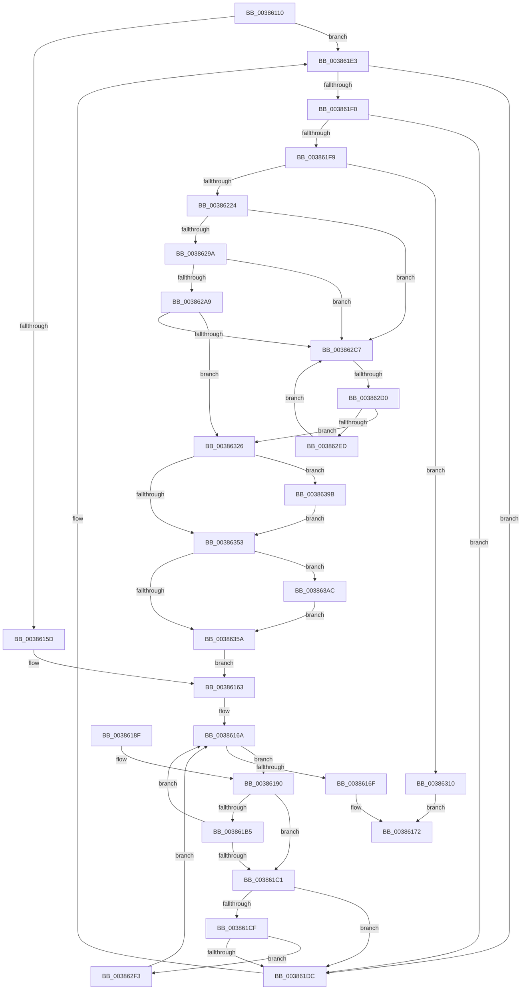

# MiInvalidateCollidedIos

- RVA: `0x00386110`–`0x003863B9` (길이 `681` bytes)
- VA: `0x0000000140386110`
- 실행 섹션: `.text`
- PDB 이름 있음: `예`; PDB Function 태그: `예`
- unwind 정보 RVA: `0x0007BD68`
- 디코드: `178`개 명령, `681/681` bytes 표시
- 미해석 바이트: `0` (있으면 어셈블리에 `.byte`로 보존)

> 이 문서는 커널 이미지의 기계어와 PDB 기호를 분석해 생성했습니다. 4번과 5번은 함수 원형과 자료형을 바이너리 사용 방식에서 추정한 C 해석이며 원본 소스 복구 결과는 아닙니다.

## 1. Dependencies

- 직접 호출 지점: **8**; 고유 호출 대상: **6**
- 직접 호출자로 확인된 함수: **2**
- RIP 상대 이미지 참조: **0**

### Outgoing calls
- `0x003861C1` → [MiReleaseInPageRefs](../2A/MiReleaseInPageRefs_function_002A4214.md) (function, `0x002A4214`)
- `0x00386313` → [MiReleaseInPageRefs](../2A/MiReleaseInPageRefs_function_002A4214.md) (function, `0x002A4214`)
- `0x0038632C` → [MI_READ_PTE_LOCK_FREE](../28/MI_READ_PTE_LOCK_FREE_function_002828A0.md) (function, `0x002828A0`)
- `0x00386337` → [MiUpdateTransitionPteFrame](MiUpdateTransitionPteFrame_function_00385EDC.md) (function, `0x00385EDC`)
- `0x0038634A` → [MiPteInShadowRange](../23/MiPteInShadowRange_function_0023FB00.md) (function, `0x0023FB00`)
- `0x0038637D` → [MiReleaseInPageRefs](../2A/MiReleaseInPageRefs_function_002A4214.md) (function, `0x002A4214`)
- `0x003863A0` → [MiSanitizeShadowPxe](../29/MiSanitizeShadowPxe_function_00294B68.md) (function, `0x00294B68`)
- `0x003863B2` → [MiWritePteShadow](../29/MiWritePteShadow_function_00294EAC.md) (function, `0x00294EAC`)

### Direct callers
- [MiFinishHardFault](../2B/MiFinishHardFault_function_002B6F10.md) at `0x002B7062`
- [sub_00371FEE](../37/Unknown_function_00371FEE.md) at `0x00371FEE`

### Static image references
- 디코드된 RIP-relative 메모리 참조가 없습니다.

## 2. Other-region calls and transfers

- 다른 실행 섹션으로 향하는 call: **0**
- call이 아닌 외부 분기/꼬리 이동: **1**
  - `0x003862CA` → [sub_006E4CA8](../6E/Unknown_function_006E4CA8.md) (`tail-transfer`)

## 3. Assembly (complete function range)

```asm
00386110  48 89 5C 24 10                  mov qword ptr [rsp + 0x10], rbx
00386115  48 89 6C 24 18                  mov qword ptr [rsp + 0x18], rbp
0038611A  48 89 74 24 20                  mov qword ptr [rsp + 0x20], rsi
0038611F  57                              push rdi
00386120  41 54                           push r12
00386122  41 55                           push r13
00386124  41 56                           push r14
00386126  41 57                           push r15
00386128  48 83 EC 20                     sub rsp, 0x20
0038612C  8B 81 C0 00 00 00               mov eax, dword ptr [rcx + 0xc0]
00386132  41 BB 01 00 00 00               mov r11d, 1
00386138  8B 51 50                        mov edx, dword ptr [rcx + 0x50]
0038613B  45 8B E3                        mov r12d, r11d
0038613E  49 B9 00 00 00 00 00 DE FF FF   movabs r9, 0xffffde0000000000
00386148  48 8B E9                        mov rbp, rcx
0038614B  49 BF 00 00 00 00 00 00 00 80   movabs r15, 0x8000000000000000
00386155  A8 40                           test al, 0x40
00386157  0F 85 86 00 00 00               jne 0x1403861e3
0038615D  45 33 F6                        xor r14d, r14d
00386160  4C 8B E9                        mov r13, rcx
00386163  49 8D 75 10                     lea rsi, [r13 + 0x10]
00386167  48 8B 3E                        mov rdi, qword ptr [rsi]
0038616A  48 3B FE                        cmp rdi, rsi
0038616D  75 21                           jne 0x140386190
0038616F  41 8B C4                        mov eax, r12d
00386172  48 8B 5C 24 58                  mov rbx, qword ptr [rsp + 0x58]
00386177  48 8B 6C 24 60                  mov rbp, qword ptr [rsp + 0x60]
0038617C  48 8B 74 24 68                  mov rsi, qword ptr [rsp + 0x68]
00386181  48 83 C4 20                     add rsp, 0x20
00386185  41 5F                           pop r15
00386187  41 5E                           pop r14
00386189  41 5D                           pop r13
0038618B  41 5C                           pop r12
0038618D  5F                              pop rdi
0038618E  C3                              ret
0038618F  CC                              int3
00386190  48 8B 87 30 01 00 00            mov rax, qword ptr [rdi + 0x130]
00386197  48 8B DF                        mov rbx, rdi
0038619A  48 8B 3F                        mov rdi, qword ptr [rdi]
0038619D  48 8D 0C 40                     lea rcx, [rax + rax*2]
003861A1  48 C1 E1 04                     shl rcx, 4
003861A5  49 8B C1                        mov rax, r9
003861A8  48 03 C8                        add rcx, rax
003861AB  8B 85 C0 00 00 00               mov eax, dword ptr [rbp + 0xc0]
003861B1  A8 40                           test al, 0x40
003861B3  74 0C                           je 0x1403861c1
003861B5  48 8B 41 08                     mov rax, qword ptr [rcx + 8]
003861B9  49 0B C7                        or rax, r15
003861BC  49 3B C6                        cmp rax, r14
003861BF  75 A9                           jne 0x14038616a
003861C1  E8 4E E0 F1 FF                  call 0x1402a4214
003861C6  48 8B 13                        mov rdx, qword ptr [rbx]
003861C9  48 39 5A 08                     cmp qword ptr [rdx + 8], rbx
003861CD  75 0D                           jne 0x1403861dc
003861CF  48 8B 4B 08                     mov rcx, qword ptr [rbx + 8]
003861D3  48 39 19                        cmp qword ptr [rcx], rbx
003861D6  0F 84 17 01 00 00               je 0x1403862f3
003861DC  B9 03 00 00 00                  mov ecx, 3
003861E1  CD 29                           int 0x29
003861E3  48 8D 59 10                     lea rbx, [rcx + 0x10]
003861E7  48 8B 03                        mov rax, qword ptr [rbx]
003861EA  48 39 58 08                     cmp qword ptr [rax + 8], rbx
003861EE  75 EC                           jne 0x1403861dc
003861F0  48 8B 4B 08                     mov rcx, qword ptr [rbx + 8]
003861F4  48 39 19                        cmp qword ptr [rcx], rbx
003861F7  75 E3                           jne 0x1403861dc
003861F9  48 89 01                        mov qword ptr [rcx], rax
003861FC  48 89 48 08                     mov qword ptr [rax + 8], rcx
00386200  48 8B BD 40 01 00 00            mov rdi, qword ptr [rbp + 0x140]
00386207  4C 8D 3C 7F                     lea r15, [rdi + rdi*2]
0038620B  49 C1 E7 04                     shl r15, 4
0038620F  49 8B C1                        mov rax, r9
00386212  4C 8B AD 48 01 00 00            mov r13, qword ptr [rbp + 0x148]
00386219  4C 03 F8                        add r15, rax
0038621C  85 D2                           test edx, edx
0038621E  0F 88 EC 00 00 00               js 0x140386310
00386224  4D 8B 77 08                     mov r14, qword ptr [r15 + 8]
00386228  49 8D 95 10 01 00 00            lea rdx, [r13 + 0x110]
0038622F  49 8B 85 00 01 00 00            mov rax, qword ptr [r13 + 0x100]
00386236  48 BB 00 00 00 00 00 00 00 80   movabs rbx, 0x8000000000000000
00386240  4C 0B F3                        or r14, rbx
00386243  45 33 E4                        xor r12d, r12d
00386246  48 85 C0                        test rax, rax
00386249  48 0F 45 D0                     cmovne rdx, rax
0038624D  8B 4A 2C                        mov ecx, dword ptr [rdx + 0x2c]
00386250  4C 8D 42 30                     lea r8, [rdx + 0x30]
00386254  03 4A 20                        add ecx, dword ptr [rdx + 0x20]
00386257  4D 8D 50 F8                     lea r10, [r8 - 8]
0038625B  8B 52 28                        mov edx, dword ptr [rdx + 0x28]
0038625E  81 E1 FF 0F 00 00               and ecx, 0xfff
00386264  49 8B 00                        mov rax, qword ptr [r8]
00386267  48 81 C2 FF 0F 00 00            add rdx, 0xfff
0038626E  48 03 D1                        add rdx, rcx
00386271  48 C1 EA 0C                     shr rdx, 0xc
00386275  48 8D 0C 40                     lea rcx, [rax + rax*2]
00386279  48 03 C9                        add rcx, rcx
0038627C  4D 8D 14 D2                     lea r10, [r10 + rdx*8]
00386280  49 8B C1                        mov rax, r9
00386283  4C 8B 4C C8 08                  mov r9, qword ptr [rax + rcx*8 + 8]
00386288  4C 0B CB                        or r9, rbx
0038628B  48 B9 00 00 00 00 00 DE FF FF   movabs rcx, 0xffffde0000000000
00386295  4D 3B F1                        cmp r14, r9
00386298  72 2D                           jb 0x1403862c7
0038629A  49 8B C6                        mov rax, r14
0038629D  49 2B C1                        sub rax, r9
003862A0  48 C1 F8 03                     sar rax, 3
003862A4  48 3B C2                        cmp rax, rdx
003862A7  73 1E                           jae 0x1403862c7
003862A9  49 8B 04 C0                     mov rax, qword ptr [r8 + rax*8]
003862AD  48 8D 34 40                     lea rsi, [rax + rax*2]
003862B1  48 C1 E6 04                     shl rsi, 4
003862B5  48 8B C1                        mov rax, rcx
003862B8  48 03 F0                        add rsi, rax
003862BB  48 8B 46 08                     mov rax, qword ptr [rsi + 8]
003862BF  48 0B C3                        or rax, rbx
003862C2  4C 3B F0                        cmp r14, rax
003862C5  74 5F                           je 0x140386326
003862C7  4D 3B C2                        cmp r8, r10
003862CA  0F 87 D8 E9 35 00               ja 0x1406e4ca8
003862D0  49 8B 00                        mov rax, qword ptr [r8]
003862D3  48 8D 34 40                     lea rsi, [rax + rax*2]
003862D7  48 C1 E6 04                     shl rsi, 4
003862DB  48 8B C1                        mov rax, rcx
003862DE  48 03 F0                        add rsi, rax
003862E1  48 8B 46 08                     mov rax, qword ptr [rsi + 8]
003862E5  48 0B C3                        or rax, rbx
003862E8  49 3B C6                        cmp rax, r14
003862EB  74 39                           je 0x140386326
003862ED  49 83 C0 08                     add r8, 8
003862F1  EB D4                           jmp 0x1403862c7
003862F3  48 89 11                        mov qword ptr [rcx], rdx
003862F6  48 89 4A 08                     mov qword ptr [rdx + 8], rcx
003862FA  48 89 5B 08                     mov qword ptr [rbx + 8], rbx
003862FE  48 89 1B                        mov qword ptr [rbx], rbx
00386301  49 B9 00 00 00 00 00 DE FF FF   movabs r9, 0xffffde0000000000
0038630B  E9 5A FE FF FF                  jmp 0x14038616a
00386310  49 8B CF                        mov rcx, r15
00386313  E8 FC DE F1 FF                  call 0x1402a4214
00386318  33 C0                           xor eax, eax
0038631A  48 89 5B 08                     mov qword ptr [rbx + 8], rbx
0038631E  48 89 1B                        mov qword ptr [rbx], rbx
00386321  E9 4C FE FF FF                  jmp 0x140386172
00386326  49 8B CE                        mov rcx, r14
00386329  45 8B E3                        mov r12d, r11d
0038632C  E8 6F C5 EF FF                  call 0x1402828a0
00386331  48 8B D7                        mov rdx, rdi
00386334  48 8B C8                        mov rcx, rax
00386337  E8 A0 FB FF FF                  call 0x140385edc
0038633C  49 8B CE                        mov rcx, r14
0038633F  48 89 44 24 50                  mov qword ptr [rsp + 0x50], rax
00386344  48 8B F8                        mov rdi, rax
00386347  48 8B D8                        mov rbx, rax
0038634A  E8 B1 97 EB FF                  call 0x14023fb00
0038634F  85 C0                           test eax, eax
00386351  75 48                           jne 0x14038639b
00386353  49 89 1E                        mov qword ptr [r14], rbx
00386356  85 C0                           test eax, eax
00386358  75 52                           jne 0x1403863ac
0038635A  48 89 BD A8 00 00 00            mov qword ptr [rbp + 0xa8], rdi
00386361  48 8B 46 10                     mov rax, qword ptr [rsi + 0x10]
00386365  48 8B C8                        mov rcx, rax
00386368  49 33 4F 10                     xor rcx, qword ptr [r15 + 0x10]
0038636C  48 81 E1 1F FC FF FF            and rcx, 0xfffffffffffffc1f
00386373  48 33 C8                        xor rcx, rax
00386376  49 89 4F 10                     mov qword ptr [r15 + 0x10], rcx
0038637A  48 8B CE                        mov rcx, rsi
0038637D  E8 92 DE F1 FF                  call 0x1402a4214
00386382  49 B9 00 00 00 00 00 DE FF FF   movabs r9, 0xffffde0000000000
0038638C  49 BF 00 00 00 00 00 00 00 80   movabs r15, 0x8000000000000000
00386396  E9 C8 FD FF FF                  jmp 0x140386163
0038639B  48 8D 54 24 50                  lea rdx, [rsp + 0x50]
003863A0  E8 C3 E7 F0 FF                  call 0x140294b68
003863A5  48 8B 5C 24 50                  mov rbx, qword ptr [rsp + 0x50]
003863AA  EB A7                           jmp 0x140386353
003863AC  48 8B D3                        mov rdx, rbx
003863AF  49 8B CE                        mov rcx, r14
003863B2  E8 F5 EA F0 FF                  call 0x140294eac
003863B7  EB A1                           jmp 0x14038635a
```

## 4. C-style interpretation (structured pseudocode)

```c
__int64 __fastcall MiInvalidateCollidedIos(__int64 a1)
{
    __int64 result;
    __int64 v_r12;
    __int64 v_r14;
    __int64 v_r15;
    __int64 v_rsi;
    __int64 v_rsp;
    unsigned __int64 v_stack_p10;
    unsigned __int64 v_stack_p18;
    unsigned __int64 v_stack_p20;
    unsigned __int64 v_stack_p50;

    v_stack_p10 = v_rbx;
    v_stack_p18 = v_rbp;
    v_stack_p20 = v_rsi;
    v_rsp = (v_rsp) - (32);
    if ((((unsigned __int8)((unsigned int)(*(unsigned int *)(a1 + 192)))) & (64)) != 0) goto loc_003861E3;
    v_r14 = 0;
loc_00386163:
loc_0038616A:
    if ((*(unsigned __int64 *)(a1 + 16)) != (a1 + 16)) goto loc_00386190;
loc_00386172:
    v_rsp = (v_rsp) + (32);
    return 1;
loc_00386190:
    a1 = (*(unsigned __int64 *)(*(unsigned __int64 *)(a1 + 16) + 304) + *(unsigned __int64 *)(*(unsigned __int64 *)(a1 + 16) + 304) * 2) << (4);
    a1 = (a1) + (a4);
    if ((((unsigned __int8)((unsigned int)(*(unsigned int *)(v_stack_p18 + 192)))) & (64)) == 0) goto loc_003861C1;
    result = (*(unsigned __int64 *)(a1 + 8)) | (v_r15);
    if (result != 0) goto loc_0038616A;
loc_003861C1:
    result = MiReleaseInPageRefs(a1, (unsigned int)(*(unsigned int *)(a1 + 80)), a3, a4);
    if ((*(unsigned __int64 *)(*(unsigned __int64 *)(*(unsigned __int64 *)(a1 + 16)) + 8)) != (*(unsigned __int64 *)(a1 + 16))) goto loc_003861DC;
    if ((*(unsigned __int64 *)(*(unsigned __int64 *)(*(unsigned __int64 *)(a1 + 16) + 8))) == (*(unsigned __int64 *)(a1 + 16))) goto loc_003862F3;
loc_003861DC:
loc_003861E3:
    if ((*(unsigned __int64 *)(*(unsigned __int64 *)(3 + 16) + 8)) != (3 + 16)) goto loc_003861DC;
    if ((*(unsigned __int64 *)(*(unsigned __int64 *)(3 + 16 + 8))) != (3 + 16)) goto loc_003861DC;
    *(unsigned __int64 *)(*(unsigned __int64 *)(3 + 16 + 8)) = *(unsigned __int64 *)(3 + 16);
    *(unsigned __int64 *)(*(unsigned __int64 *)(3 + 16) + 8) = *(unsigned __int64 *)(3 + 16 + 8);
    v_r15 = (*(unsigned __int64 *)(v_stack_p18 + 320) + *(unsigned __int64 *)(v_stack_p18 + 320) * 2) << (4);
    v_r15 = (v_r15) + (a4);
    if (sign_flag) goto loc_00386310;
    v_r14 = (*(unsigned __int64 *)(v_r15 + 8)) | (3 + 16);
    v_r12 = 0;
    a2 = *(unsigned __int64 *)(v_stack_p18 + 328) + 272;
    if (*(unsigned __int64 *)(*(unsigned __int64 *)(v_stack_p18 + 328) + 256) != 0) { a2 = *(unsigned __int64 *)(*(unsigned __int64 *)(v_stack_p18 + 328) + 256); }
    a1 = (unsigned int)(((unsigned int)(*(unsigned int *)(a2 + 44))) + (*(unsigned int *)(a2 + 32)));
    a1 = (unsigned int)((a1) & (0xFFFULL));
    a2 = ((unsigned int)(*(unsigned int *)(a2 + 40))) + (0xFFFULL);
    a2 = (a2) + (a1);
    a2 = (a2) >> (12);
    a1 = (*(unsigned __int64 *)(a2 + 48) + *(unsigned __int64 *)(a2 + 48) * 2) + (*(unsigned __int64 *)(a2 + 48) + *(unsigned __int64 *)(a2 + 48) * 2);
    a4 = (*(unsigned __int64 *)(a4 + a1 * 8 + 8)) | (3 + 16);
    if (v_r14 < a4) goto loc_003862C7;
    result = (v_r14) - (a4);
    result = (result) >> (3);
    if (result >= a2) goto loc_003862C7;
    v_rsi = (*(unsigned __int64 *)(a2 + 48 + result * 8) + *(unsigned __int64 *)(a2 + 48 + result * 8) * 2) << (4);
    v_rsi = (v_rsi) + (a1);
    result = (*(unsigned __int64 *)(v_rsi + 8)) | (3 + 16);
    if (v_r14 == result) goto loc_00386326;
loc_003862C7:
    v_rsi = (*(unsigned __int64 *)(a2 + 48) + *(unsigned __int64 *)(a2 + 48) * 2) << (4);
    v_rsi = (v_rsi) + (a1);
    result = (*(unsigned __int64 *)(v_rsi + 8)) | (3 + 16);
    if (result == v_r14) goto loc_00386326;
    a3 = (a2 + 48) + (8);
    goto loc_003862C7;
loc_003862F3:
    *(unsigned __int64 *)(a1) = a2;
    *(unsigned __int64 *)(a2 + 8) = a1;
    *(unsigned __int64 *)(3 + 16 + 8) = 3 + 16;
    *(unsigned __int64 *)(3 + 16) = 3 + 16;
    goto loc_0038616A;
loc_00386310:
    result = MiReleaseInPageRefs(v_r15, a2, a3, a4);
    result = 0;
    *(unsigned __int64 *)(3 + 16 + 8) = 3 + 16;
    *(unsigned __int64 *)(3 + 16) = 3 + 16;
    goto loc_00386172;
loc_00386326:
    result = MI_READ_PTE_LOCK_FREE(v_r14, a2, a3, a4);
    result = MiUpdateTransitionPteFrame(result, *(unsigned __int64 *)(v_stack_p18 + 320), a3, a4);
    v_stack_p50 = result;
    result = MiPteInShadowRange(v_r14, *(unsigned __int64 *)(v_stack_p18 + 320), a3, a4);
    if ((unsigned int)(result) != 0) goto loc_0038639B;
loc_00386353:
    *(unsigned __int64 *)(v_r14) = result;
    if ((unsigned int)(result) != 0) goto loc_003863AC;
loc_0038635A:
    *(unsigned __int64 *)(v_stack_p18 + 168) = result;
    a1 = (*(unsigned __int64 *)(v_rsi + 16)) ^ (*(unsigned __int64 *)(v_r15 + 16));
    a1 = (a1) & (-993);
    a1 = (a1) ^ (*(unsigned __int64 *)(v_rsi + 16));
    *(unsigned __int64 *)(v_r15 + 16) = a1;
    result = MiReleaseInPageRefs(v_rsi, *(unsigned __int64 *)(v_stack_p18 + 320), a3, a4);
    goto loc_00386163;
loc_0038639B:
    result = MiSanitizeShadowPxe(v_rsi, v_stack_p50, a3, a4);
    goto loc_00386353;
loc_003863AC:
    result = MiWritePteShadow(v_r14, v_stack_p50, a3, a4);
    goto loc_0038635A;
}
```

## 5. (Beta) C Style

```c
int64_t MiInvalidateCollidedIos(void *Arg1)
{
    uint8_t *arg1 = (uint8_t *)Arg1;

    int64_t result;
    int64_t local_r12;
    int64_t local_r14;
    int64_t local_r15;
    int64_t local_rsi;
    int64_t local_rsp;
    uint64_t v_stack_p10;
    uint64_t v_stack_p18;
    uint64_t v_stack_p20;
    uint64_t v_stack_p50;

    v_stack_p10 = local_rbx;
    v_stack_p18 = local_rbp;
    v_stack_p20 = local_rsi;
    local_rsp = (local_rsp) - (32);
    if ((((uint8_t)((uint32_t)(*(uint32_t *)(arg1 + 0xC0)))) & (64)) != 0) goto loc_003861E3;
    local_r14 = 0;
loc_00386163:
loc_0038616A:
    if ((*(uint64_t *)(arg1 + 0x10)) != (Arg1 + 16)) goto loc_00386190;
loc_00386172:
    local_rsp = (local_rsp) + (32);
    return 1;
loc_00386190:
    Arg1 = (*(uint64_t *)(*(uint64_t *)(arg1 + 0x10) + 0x130) + *(uint64_t *)(*(uint64_t *)(arg1 + 0x10) + 0x130) * 2) << (4);
    Arg1 = (Arg1) + (a4);
    if ((((uint8_t)((uint32_t)(*(uint32_t *)(v_stack_p18 + 0xC0)))) & (64)) == 0) goto loc_003861C1;
    result = (*(uint64_t *)(arg1 + 0x8)) | (local_r15);
    if (result != 0) goto loc_0038616A;
loc_003861C1:
    result = MiReleaseInPageRefs(Arg1, (uint32_t)(*(uint32_t *)(arg1 + 0x50)), a3, a4);
    if ((*(uint64_t *)(*(uint64_t *)(*(uint64_t *)(arg1 + 0x10)) + 0x8)) != (*(uint64_t *)(arg1 + 0x10))) goto loc_003861DC;
    if ((*(uint64_t *)(*(uint64_t *)(*(uint64_t *)(arg1 + 0x10) + 0x8))) == (*(uint64_t *)(arg1 + 0x10))) goto loc_003862F3;
loc_003861DC:
loc_003861E3:
    if ((*(uint64_t *)(*(uint64_t *)(3 + 0x10) + 0x8)) != (3 + 16)) goto loc_003861DC;
    if ((*(uint64_t *)(*(uint64_t *)(3 + 0x10 + 0x8))) != (3 + 16)) goto loc_003861DC;
    *(uint64_t *)(*(uint64_t *)(3 + 0x10 + 0x8)) = *(uint64_t *)(3 + 0x10);
    *(uint64_t *)(*(uint64_t *)(3 + 0x10) + 0x8) = *(uint64_t *)(3 + 0x10 + 0x8);
    local_r15 = (*(uint64_t *)(v_stack_p18 + 0x140) + *(uint64_t *)(v_stack_p18 + 0x140) * 2) << (4);
    local_r15 = (local_r15) + (a4);
    if (sign_flag) goto loc_00386310;
    local_r14 = (*(uint64_t *)(local_r15 + 0x8)) | (3 + 16);
    local_r12 = 0;
    a2 = *(uint64_t *)(v_stack_p18 + 0x148) + 272;
    if (*(uint64_t *)(*(uint64_t *)(v_stack_p18 + 0x148) + 0x100) != 0) { a2 = *(uint64_t *)(*(uint64_t *)(v_stack_p18 + 0x148) + 0x100); }
    Arg1 = (uint32_t)(((uint32_t)(*(uint32_t *)(a2 + 0x2C))) + (*(uint32_t *)(a2 + 0x20)));
    Arg1 = (uint32_t)((Arg1) & (0xFFFULL));
    a2 = ((uint32_t)(*(uint32_t *)(a2 + 0x28))) + (0xFFFULL);
    a2 = (a2) + (Arg1);
    a2 = (a2) >> (12);
    Arg1 = (*(uint64_t *)(a2 + 0x30) + *(uint64_t *)(a2 + 0x30) * 2) + (*(uint64_t *)(a2 + 0x30) + *(uint64_t *)(a2 + 0x30) * 2);
    a4 = (*(uint64_t *)(a4 + arg1 * 8 + 0x8)) | (3 + 16);
    if (local_r14 < a4) goto loc_003862C7;
    result = (local_r14) - (a4);
    result = (result) >> (3);
    if (result >= a2) goto loc_003862C7;
    local_rsi = (*(uint64_t *)(a2 + 0x30 + result * 8) + *(uint64_t *)(a2 + 0x30 + result * 8) * 2) << (4);
    local_rsi = (local_rsi) + (Arg1);
    result = (*(uint64_t *)(local_rsi + 0x8)) | (3 + 16);
    if (local_r14 == result) goto loc_00386326;
loc_003862C7:
    local_rsi = (*(uint64_t *)(a2 + 0x30) + *(uint64_t *)(a2 + 0x30) * 2) << (4);
    local_rsi = (local_rsi) + (Arg1);
    result = (*(uint64_t *)(local_rsi + 0x8)) | (3 + 16);
    if (result == local_r14) goto loc_00386326;
    a3 = (a2 + 48) + (8);
    goto loc_003862C7;
loc_003862F3:
    *(uint64_t *)(arg1) = a2;
    *(void **)(a2 + 0x8) = Arg1;
    *(uint64_t *)(3 + 0x10 + 0x8) = 3 + 16;
    *(uint64_t *)(3 + 0x10) = 3 + 16;
    goto loc_0038616A;
loc_00386310:
    result = MiReleaseInPageRefs(local_r15, a2, a3, a4);
    result = 0;
    *(uint64_t *)(3 + 0x10 + 0x8) = 3 + 16;
    *(uint64_t *)(3 + 0x10) = 3 + 16;
    goto loc_00386172;
loc_00386326:
    result = MI_READ_PTE_LOCK_FREE(local_r14, a2, a3, a4);
    result = MiUpdateTransitionPteFrame(result, *(uint64_t *)(v_stack_p18 + 0x140), a3, a4);
    v_stack_p50 = result;
    result = MiPteInShadowRange(local_r14, *(uint64_t *)(v_stack_p18 + 0x140), a3, a4);
    if ((uint32_t)(result) != 0) goto loc_0038639B;
loc_00386353:
    *(uint64_t *)(local_r14) = result;
    if ((uint32_t)(result) != 0) goto loc_003863AC;
loc_0038635A:
    *(uint64_t *)(v_stack_p18 + 0xA8) = result;
    Arg1 = (*(uint64_t *)(local_rsi + 0x10)) ^ (*(uint64_t *)(local_r15 + 0x10));
    Arg1 = (Arg1) & (-993);
    Arg1 = (Arg1) ^ (*(uint64_t *)(local_rsi + 0x10));
    *(void **)(local_r15 + 0x10) = Arg1;
    result = MiReleaseInPageRefs(local_rsi, *(uint64_t *)(v_stack_p18 + 0x140), a3, a4);
    goto loc_00386163;
loc_0038639B:
    result = MiSanitizeShadowPxe(local_rsi, v_stack_p50, a3, a4);
    goto loc_00386353;
loc_003863AC:
    result = MiWritePteShadow(local_r14, v_stack_p50, a3, a4);
    goto loc_0038635A;
}
```

### 관측된 메모리 오프셋

구조체 형식이 확인되지 않은 접근은 인자 기준의 오프셋으로만 기록했습니다.

| 기준 인자 | 오프셋 표현 | 폭 (bit) | 접근 |
|---|---:|---:|---|
| `Arg1` | `+ 0x50` | `32` | `R` |
| `Arg1` | `+ 0xA8` | `64` | `W` |
| `Arg1` | `+ 0xC0` | `32` | `R` |
| `Arg1` | `+ 0x140` | `64` | `R` |
| `Arg1` | `+ 0x148` | `64` | `R` |

## 6. Execution-region graph

[열기: 2D/3D 그래프와 함수 탐색 컨트롤 패널](../../../control-panel.html?section=text&rva=0x00386110&view=graph)

- 2D 그래프는 위에서 아래로 흐르고, 3D 그래프는 빈 공간을 드래그해 회전합니다. Shift+드래그는 이동, 휠은 확대·축소, 함수 노드 선택은 대상 보고서 이동입니다.

### Static fallback


