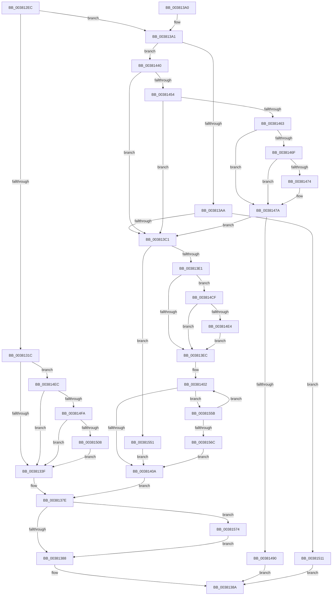

# MiIssueHardFaultIo

- RVA: `0x003812EC`–`0x0038158E` (길이 `674` bytes)
- VA: `0x00000001403812EC`
- 실행 섹션: `.text`
- PDB 이름 있음: `예`; PDB Function 태그: `아니요`
- unwind 정보 RVA: `0x0007B974`
- 디코드: `158`개 명령, `674/674` bytes 표시
- 미해석 바이트: `0` (있으면 어셈블리에 `.byte`로 보존)

> 이 문서는 커널 이미지의 기계어와 PDB 기호를 분석해 생성했습니다. 4번과 5번은 함수 원형과 자료형을 바이너리 사용 방식에서 추정한 C 해석이며 원본 소스 복구 결과는 아닙니다.

## 1. Dependencies

- 직접 호출 지점: **8**; 고유 호출 대상: **6**
- 직접 호출자로 확인된 함수: **5**
- RIP 상대 이미지 참조: **2**

### Outgoing calls
- `0x00381379` → [SmPageRead](../34/SmPageRead_function_0034C1A0.md) (function, `0x0034C1A0`)
- `0x00381436` → [IoPageReadEx](../29/IoPageReadEx_function_0029ABF0.md) (function, `0x0029ABF0`)
- `0x003814B5` → [MiTransferFileExtent](../4C/MiTransferFileExtent_function_004CAADC.md) (function, `0x004CAADC`)
- `0x003814C3` → [KeSetEvent](../33/KeSetEvent_function_0033F310.md) (function, `0x0033F310`)
- `0x003814D6` → [MiGetSystemRegionType](../28/MiGetSystemRegionType_function_0028EC80.md) (function, `0x0028EC80`)
- `0x0038152C` → [MiCopyImageExtentContents](../4D/MiCopyImageExtentContents_function_004D6558.md) (function, `0x004D6558`)
- `0x00381545` → [KeSetEvent](../33/KeSetEvent_function_0033F310.md) (function, `0x0033F310`)
- `0x00381584` → [KeSetEvent](../33/KeSetEvent_function_0033F310.md) (function, `0x0033F310`)

### Direct callers
- [MiPfIssueCoalesceCandidates](../36/MiPfIssueCoalesceCandidates_function_0036B4D4.md) at `0x0036B51F`
- [sub_0036CB1C](../36/Unknown_function_0036CB1C.md) at `0x0036CC63`
- [sub_0036CEB4](../36/Unknown_function_0036CEB4.md) at `0x0036CF5E`
- [MiPfCoalesceAndIssueIOs](../36/MiPfCoalesceAndIssueIOs_function_0036D158.md) at `0x0036D1E7`
- [MiPfCoalesceAndIssueIOs](../36/MiPfCoalesceAndIssueIOs_function_0036D158.md) at `0x0036D32E`
- [MiIssueHardFault](MiIssueHardFault_function_00380074.md) at `0x003802C0`

### Static image references
- `0x0038135E` → RVA `0x00E30088` (`.data`; read)
- `0x00381463` → RVA `0x00E2DC80` (`.data`; read)

## 2. Other-region calls and transfers

- 다른 실행 섹션으로 향하는 call: **0**
- 별도 외부 분기/꼬리 이동을 확인하지 못했습니다.

## 3. Assembly (complete function range)

```asm
003812EC  48 89 5C 24 08                  mov qword ptr [rsp + 8], rbx
003812F1  48 89 74 24 10                  mov qword ptr [rsp + 0x10], rsi
003812F6  48 89 7C 24 18                  mov qword ptr [rsp + 0x18], rdi
003812FB  41 56                           push r14
003812FD  48 83 EC 40                     sub rsp, 0x40
00381301  44 8B 89 C0 00 00 00            mov r9d, dword ptr [rcx + 0xc0]
00381308  4D 8B D0                        mov r10, r8
0038130B  41 0F BA E1 0A                  bt r9d, 0xa
00381310  44 8B C2                        mov r8d, edx
00381313  48 8B F9                        mov rdi, rcx
00381316  0F 83 85 00 00 00               jae 0x1403813a1
0038131C  48 8D 81 10 01 00 00            lea rax, [rcx + 0x110]
00381323  48 8B C8                        mov rcx, rax
00381326  48 83 C9 01                     or rcx, 1
0038132A  41 F6 C1 20                     test r9b, 0x20
0038132E  48 0F 44 C8                     cmove rcx, rax
00381332  4C 8B C1                        mov r8, rcx
00381335  41 F6 C2 01                     test r10b, 1
00381339  0F 85 AD 01 00 00               jne 0x1403814ec
0038133F  48 8B 87 F8 00 00 00            mov rax, qword ptr [rdi + 0xf8]
00381346  48 8D 77 20                     lea rsi, [rdi + 0x20]
0038134A  4C 8D 77 50                     lea r14, [rdi + 0x50]
0038134E  4C 8B CE                        mov r9, rsi
00381351  48 8D 57 60                     lea rdx, [rdi + 0x60]
00381355  4C 89 74 24 20                  mov qword ptr [rsp + 0x20], r14
0038135A  48 8B 40 28                     mov rax, qword ptr [rax + 0x28]
0038135E  48 8B 0D 23 ED AA 00            mov rcx, qword ptr [rip + 0xaaed23]
00381365  48 C1 E8 2B                     shr rax, 0x2b
00381369  25 FF 03 00 00                  and eax, 0x3ff
0038136E  48 8B 0C C1                     mov rcx, qword ptr [rcx + rax*8]
00381372  48 8B 89 B8 00 00 00            mov rcx, qword ptr [rcx + 0xb8]
00381379  E8 22 AE FC FF                  call 0x14034c1a0
0038137E  8B D8                           mov ebx, eax
00381380  85 C0                           test eax, eax
00381382  0F 88 EC 01 00 00               js 0x140381574
00381388  8B C3                           mov eax, ebx
0038138A  48 8B 5C 24 50                  mov rbx, qword ptr [rsp + 0x50]
0038138F  48 8B 74 24 58                  mov rsi, qword ptr [rsp + 0x58]
00381394  48 8B 7C 24 60                  mov rdi, qword ptr [rsp + 0x60]
00381399  48 83 C4 40                     add rsp, 0x40
0038139D  41 5E                           pop r14
0038139F  C3                              ret
003813A0  CC                              int3
003813A1  45 85 C0                        test r8d, r8d
003813A4  0F 84 96 00 00 00               je 0x140381440
003813AA  48 8B 81 D0 00 00 00            mov rax, qword ptr [rcx + 0xd0]
003813B1  48 8B 08                        mov rcx, qword ptr [rax]
003813B4  8A 41 3E                        mov al, byte ptr [rcx + 0x3e]
003813B7  24 0C                           and al, 0xc
003813B9  3C 08                           cmp al, 8
003813BB  0F 84 50 01 00 00               je 0x140381511
003813C1  41 8B C9                        mov ecx, r9d
003813C4  C1 E9 03                        shr ecx, 3
003813C7  83 E1 04                        and ecx, 4
003813CA  8B F1                           mov esi, ecx
003813CC  83 CE 01                        or esi, 1
003813CF  41 0F BA E1 13                  bt r9d, 0x13
003813D4  0F 43 F1                        cmovae esi, ecx
003813D7  41 F6 C1 20                     test r9b, 0x20
003813DB  0F 85 70 01 00 00               jne 0x140381551
003813E1  8B DE                           mov ebx, esi
003813E3  45 85 C0                        test r8d, r8d
003813E6  0F 84 E3 00 00 00               je 0x1403814cf
003813EC  65 48 8B 04 25 88 01 00 00      mov rax, qword ptr gs:[0x188]
003813F5  48 8B 90 20 02 00 00            mov rdx, qword ptr [rax + 0x220]
003813FC  8B 82 60 06 00 00               mov eax, dword ptr [rdx + 0x660]
00381402  85 C0                           test eax, eax
00381404  0F 85 51 01 00 00               jne 0x14038155b
0038140A  48 83 64 24 30 00               and qword ptr [rsp + 0x30], 0
00381410  48 8D 77 20                     lea rsi, [rdi + 0x20]
00381414  48 8B 8F C8 00 00 00            mov rcx, qword ptr [rdi + 0xc8]
0038141B  4C 8D 77 50                     lea r14, [rdi + 0x50]
0038141F  4C 8B CE                        mov r9, rsi
00381422  89 5C 24 28                     mov dword ptr [rsp + 0x28], ebx
00381426  4C 8D 47 60                     lea r8, [rdi + 0x60]
0038142A  4C 89 74 24 20                  mov qword ptr [rsp + 0x20], r14
0038142F  48 8D 97 10 01 00 00            lea rdx, [rdi + 0x110]
00381436  E8 B5 97 F1 FF                  call 0x14029abf0
0038143B  E9 3E FF FF FF                  jmp 0x14038137e
00381440  48 8B 91 F8 00 00 00            mov rdx, qword ptr [rcx + 0xf8]
00381447  48 8B 42 28                     mov rax, qword ptr [rdx + 0x28]
0038144B  48 85 C0                        test rax, rax
0038144E  0F 89 6D FF FF FF               jns 0x1403813c1
00381454  48 8B 52 10                     mov rdx, qword ptr [rdx + 0x10]
00381458  48 0F BA E2 0A                  bt rdx, 0xa
0038145D  0F 83 5E FF FF FF               jae 0x1403813c1
00381463  48 8B 05 16 C8 AA 00            mov rax, qword ptr [rip + 0xaac816]
0038146A  48 85 C0                        test rax, rax
0038146D  74 0B                           je 0x14038147a
0038146F  F6 C2 10                        test dl, 0x10
00381472  75 06                           jne 0x14038147a
00381474  48 F7 D0                        not rax
00381477  48 23 D0                        and rdx, rax
0038147A  48 C1 FA 10                     sar rdx, 0x10
0038147E  48 8B 02                        mov rax, qword ptr [rdx]
00381481  8A 48 3E                        mov cl, byte ptr [rax + 0x3e]
00381484  80 E1 0C                        and cl, 0xc
00381487  80 F9 08                        cmp cl, 8
0038148A  0F 85 31 FF FF FF               jne 0x1403813c1
00381490  48 8B 87 00 01 00 00            mov rax, qword ptr [rdi + 0x100]
00381497  48 8D 8F 10 01 00 00            lea rcx, [rdi + 0x110]
0038149E  4C 8B 47 60                     mov r8, qword ptr [rdi + 0x60]
003814A2  48 8D 5F 50                     lea rbx, [rdi + 0x50]
003814A6  48 85 C0                        test rax, rax
003814A9  48 89 5C 24 20                  mov qword ptr [rsp + 0x20], rbx
003814AE  48 0F 45 C8                     cmovne rcx, rax
003814B2  45 33 C9                        xor r9d, r9d
003814B5  E8 22 96 14 00                  call 0x1404caadc
003814BA  48 8D 4F 20                     lea rcx, [rdi + 0x20]
003814BE  45 33 C0                        xor r8d, r8d
003814C1  33 D2                           xor edx, edx
003814C3  E8 48 DE FB FF                  call 0x14033f310
003814C8  8B 03                           mov eax, dword ptr [rbx]
003814CA  E9 BB FE FF FF                  jmp 0x14038138a
003814CF  48 8B 8F E0 00 00 00            mov rcx, qword ptr [rdi + 0xe0]
003814D6  E8 A5 D7 F0 FF                  call 0x14028ec80
003814DB  83 F8 07                        cmp eax, 7
003814DE  0F 85 08 FF FF FF               jne 0x1403813ec
003814E4  83 CB 02                        or ebx, 2
003814E7  E9 00 FF FF FF                  jmp 0x1403813ec
003814EC  49 83 E2 FE                     and r10, 0xfffffffffffffffe
003814F0  41 80 3A 01                     cmp byte ptr [r10], 1
003814F4  0F 85 45 FE FF FF               jne 0x14038133f
003814FA  41 F7 42 50 00 08 00 00         test dword ptr [r10 + 0x50], 0x800
00381502  0F 84 37 FE FF FF               je 0x14038133f
00381508  49 83 C8 02                     or r8, 2
0038150C  E9 2E FE FF FF                  jmp 0x14038133f
00381511  48 8B 87 00 01 00 00            mov rax, qword ptr [rdi + 0x100]
00381518  48 8D 9F 10 01 00 00            lea rbx, [rdi + 0x110]
0038151F  48 85 C0                        test rax, rax
00381522  48 8B CF                        mov rcx, rdi
00381525  48 0F 45 D8                     cmovne rbx, rax
00381529  48 8B D3                        mov rdx, rbx
0038152C  E8 27 50 15 00                  call 0x1404d6558
00381531  8B 43 28                        mov eax, dword ptr [rbx + 0x28]
00381534  48 8D 4F 20                     lea rcx, [rdi + 0x20]
00381538  83 67 50 00                     and dword ptr [rdi + 0x50], 0
0038153C  45 33 C0                        xor r8d, r8d
0038153F  33 D2                           xor edx, edx
00381541  48 89 47 58                     mov qword ptr [rdi + 0x58], rax
00381545  E8 C6 DD FB FF                  call 0x14033f310
0038154A  33 C0                           xor eax, eax
0038154C  E9 39 FE FF FF                  jmp 0x14038138a
00381551  83 CE 02                        or esi, 2
00381554  8B DE                           mov ebx, esi
00381556  E9 AF FE FF FF                  jmp 0x14038140a
0038155B  8D 48 FF                        lea ecx, [rax - 1]
0038155E  F0 0F B1 8A 60 06 00 00         lock cmpxchg dword ptr [rdx + 0x660], ecx
00381566  0F 85 96 FE FF FF               jne 0x140381402
0038156C  83 CB 08                        or ebx, 8
0038156F  E9 96 FE FF FF                  jmp 0x14038140a
00381574  48 83 67 58 00                  and qword ptr [rdi + 0x58], 0
00381579  45 33 C0                        xor r8d, r8d
0038157C  33 D2                           xor edx, edx
0038157E  41 89 1E                        mov dword ptr [r14], ebx
00381581  48 8B CE                        mov rcx, rsi
00381584  E8 87 DD FB FF                  call 0x14033f310
00381589  E9 FA FD FF FF                  jmp 0x140381388
```

## 4. C-style interpretation (structured pseudocode)

```c
__int64 __fastcall MiIssueHardFaultIo(__int64 a1, int a2, __int64 a3)
{
    __int64 result;
    __int64 v_r10;
    __int64 v_rbx;
    __int64 v_rsi;
    __int64 v_rsp;
    unsigned __int64 v_stack_m28;
    unsigned __int64 v_stack_p10;
    unsigned __int64 v_stack_p18;
    unsigned __int64 v_stack_p20;
    unsigned int v_stack_p28;
    unsigned __int64 v_stack_p30;
    unsigned __int64 v_stack_p8;

    v_stack_p8 = v_rbx;
    v_stack_p10 = v_rsi;
    v_stack_p18 = v_rdi;
    v_rsp = (v_rsp) - (64);
    if (condition_is_above_or_equal) goto loc_003813A1;
    a1 = (a1 + 272) | (1);
    if ((((unsigned __int8)((unsigned int)(*(unsigned int *)(a1 + 192)))) & (32)) == 0) { a1 = a1 + 272; }
    if ((((unsigned __int8)(a3)) & (1)) != 0) goto loc_003814EC;
loc_0038133F:
    v_stack_m28 = a1 + 80;
    result = (*(unsigned __int64 *)(*(unsigned __int64 *)(a1 + 248) + 40)) >> (43);
    result = (unsigned int)((result) & (0x3FFULL));
    result = SmPageRead(*(unsigned __int64 *)(*(unsigned __int64 *)(*(unsigned __int64 *)(v_rip + 11201827) + result * 8) + 184), a1 + 96, a1, a1 + 32);
loc_0038137E:
    if (sign_flag) goto loc_00381574;
loc_00381388:
loc_0038138A:
    v_rsp = (v_rsp) + (64);
    return (unsigned int)((unsigned int)((unsigned int)((unsigned int)(result))));
loc_003813A1:
    if ((unsigned int)(a1) == 0) goto loc_00381440;
    result = (unsigned __int8)((*(unsigned __int8 *)(*(unsigned __int64 *)(*(unsigned __int64 *)(*(unsigned __int64 *)(*(unsigned __int64 *)(*(unsigned __int64 *)(v_rip + 11201827) + result * 8) + 184) + 208)) + 62)) & (12));
    if (((unsigned __int8)(result)) == 8) goto loc_00381511;
loc_003813C1:
    a1 = (unsigned int)(((unsigned int)((unsigned int)(a1 + 32))) >> (3));
    a1 = (unsigned int)((a1) & (4));
    v_rsi = (unsigned int)(((unsigned int)((unsigned int)(a1))) | (1));
    if (condition_is_above_or_equal) { v_rsi = (unsigned int)(a1); }
    if ((((unsigned __int8)(a1 + 32)) & (32)) != 0) goto loc_00381551;
    if ((unsigned int)(a1) == 0) goto loc_003814CF;
loc_003813EC:
loc_00381402:
    if ((unsigned int)((unsigned int)(*(unsigned int *)(*(unsigned __int64 *)(*(unsigned __int64 *)(gs_base + (0 + 392)) + 544) + 1632))) != 0) goto loc_0038155B;
loc_0038140A:
    v_stack_p28 = (unsigned int)((unsigned int)((unsigned int)(v_rsi)));
    v_stack_p20 = v_stack_p18 + 80;
    result = IoPageReadEx(*(unsigned __int64 *)(v_stack_p18 + 200), v_stack_p18 + 272, v_stack_p18 + 96, v_stack_p18 + 32);
    goto loc_0038137E;
loc_00381440:
    if (!sign_flag) goto loc_003813C1;
    if (condition_is_above_or_equal) goto loc_003813C1;
    if (*(unsigned __int64 *)(v_rip + 11192342) == 0) goto loc_0038147A;
    result = *(unsigned __int64 *)(v_rip + 11192342);
    if ((((unsigned __int8)(*(unsigned __int64 *)(*(unsigned __int64 *)(*(unsigned __int64 *)(v_stack_p18 + 200) + 248) + 16))) & (16)) == 0) {
        result = ~(*(unsigned __int64 *)(v_rip + 11192342));
        a2 = (*(unsigned __int64 *)(*(unsigned __int64 *)(*(unsigned __int64 *)(v_stack_p18 + 200) + 248) + 16)) & (result);
    }
    a2 = (a2) >> (16);
    a1 = (unsigned __int8)((*(unsigned __int8 *)(*(unsigned __int64 *)(a2) + 62)) & (12));
    if (((unsigned __int8)(a1)) != 8) goto loc_003813C1;
    v_stack_p20 = v_stack_p18 + 80;
    a1 = v_stack_p18 + 272;
    if (*(unsigned __int64 *)(v_stack_p18 + 256) != 0) { a1 = *(unsigned __int64 *)(v_stack_p18 + 256); }
    a4 = 0;
    result = MiTransferFileExtent(a1, a2, *(unsigned __int64 *)(v_stack_p18 + 96), a4);
    a3 = 0;
    a2 = 0;
    result = KeSetEvent(v_stack_p18 + 32, a2, a3, a4);
    goto loc_0038138A;
loc_003814CF:
    result = MiGetSystemRegionType(*(unsigned __int64 *)(v_stack_p18 + 224), a2, a3, a4);
    if (((unsigned int)(result)) != 7) goto loc_003813EC;
    v_rbx = (unsigned int)((v_stack_p18 + 80) | (2));
    goto loc_003813EC;
loc_003814EC:
    v_r10 = (a3) & (-2);
    if ((*(unsigned __int8 *)(v_r10)) != 1) goto loc_0038133F;
    if (((*(unsigned int *)(v_r10 + 80)) & (0x800ULL)) == 0) goto loc_0038133F;
    a3 = (a3) | (2);
    goto loc_0038133F;
loc_00381511:
    v_rbx = v_stack_p18 + 272;
    if (*(unsigned __int64 *)(v_stack_p18 + 256) != 0) { v_rbx = *(unsigned __int64 *)(v_stack_p18 + 256); }
    result = MiCopyImageExtentContents(v_stack_p18, v_rbx, a3, a4);
    a3 = 0;
    a2 = 0;
    *(unsigned __int64 *)(v_stack_p18 + 88) = (unsigned int)(*(unsigned int *)(v_rbx + 40));
    result = KeSetEvent(v_stack_p18 + 32, a2, a3, a4);
    result = 0;
    goto loc_0038138A;
loc_00381551:
    v_rsi = (unsigned int)((v_stack_p18 + 32) | (2));
    goto loc_0038140A;
loc_0038155B:
    if (condition_is_not_equal) goto loc_00381402;
    v_rbx = (unsigned int)(((unsigned int)((unsigned int)(v_rsi))) | (8));
    goto loc_0038140A;
loc_00381574:
    a3 = 0;
    a2 = 0;
    *(unsigned int *)(v_stack_p18 + 80) = (unsigned int)(v_rbx);
    result = KeSetEvent(v_rsi, a2, a3, a4);
    goto loc_00381388;
}
```

## 5. (Beta) C Style

```c
int64_t MiIssueHardFaultIo(void *Arg1, int32_t Arg2, int64_t Arg3)
{
    uint8_t *arg1 = (uint8_t *)Arg1;

    int64_t result;
    int64_t local_r10;
    int64_t local_rbx;
    int64_t local_rsi;
    int64_t local_rsp;
    uint64_t v_stack_m28;
    uint64_t v_stack_p10;
    uint64_t v_stack_p18;
    uint64_t v_stack_p20;
    uint32_t v_stack_p28;
    uint64_t v_stack_p30;
    uint64_t v_stack_p8;

    v_stack_p8 = local_rbx;
    v_stack_p10 = local_rsi;
    v_stack_p18 = local_rdi;
    local_rsp = (local_rsp) - (64);
    if (condition_is_above_or_equal) goto loc_003813A1;
    Arg1 = (Arg1 + 272) | (1);
    if ((((uint8_t)((uint32_t)(*(uint32_t *)(arg1 + 0xC0)))) & (32)) == 0) { Arg1 = Arg1 + 272; }
    if ((((uint8_t)(Arg3)) & (1)) != 0) goto loc_003814EC;
loc_0038133F:
    v_stack_m28 = Arg1 + 80;
    result = (*(uint64_t *)(*(uint64_t *)(arg1 + 0xF8) + 0x28)) >> (43);
    result = (uint32_t)((result) & (0x3FFULL));
    result = SmPageRead(*(uint64_t *)(*(uint64_t *)(*(uint64_t *)(v_rip + 0xAAED23) + result * 8) + 0xB8), Arg1 + 96, Arg1, Arg1 + 32);
loc_0038137E:
    if (sign_flag) goto loc_00381574;
loc_00381388:
loc_0038138A:
    local_rsp = (local_rsp) + (64);
    return (uint32_t)((uint32_t)((uint32_t)((uint32_t)(result))));
loc_003813A1:
    if ((uint32_t)(Arg1) == 0) goto loc_00381440;
    result = (uint8_t)((*(uint8_t *)(*(uint64_t *)(*(uint64_t *)(*(uint64_t *)(*(uint64_t *)(*(uint64_t *)(v_rip + 0xAAED23) + result * 8) + 0xB8) + 0xD0)) + 0x3E)) & (12));
    if (((uint8_t)(result)) == 8) goto loc_00381511;
loc_003813C1:
    Arg1 = (uint32_t)(((uint32_t)((uint32_t)(Arg1 + 32))) >> (3));
    Arg1 = (uint32_t)((Arg1) & (4));
    local_rsi = (uint32_t)(((uint32_t)((uint32_t)(Arg1))) | (1));
    if (condition_is_above_or_equal) { local_rsi = (uint32_t)(Arg1); }
    if ((((uint8_t)(Arg1 + 32)) & (32)) != 0) goto loc_00381551;
    if ((uint32_t)(Arg1) == 0) goto loc_003814CF;
loc_003813EC:
loc_00381402:
    if ((uint32_t)((uint32_t)(*(uint32_t *)(*(uint64_t *)(*(uint64_t *)(gs_base + (0 + 0x188)) + 0x220) + 0x660))) != 0) goto loc_0038155B;
loc_0038140A:
    v_stack_p28 = (uint32_t)((uint32_t)((uint32_t)(local_rsi)));
    v_stack_p20 = v_stack_p18 + 80;
    result = IoPageReadEx(*(uint64_t *)(v_stack_p18 + 0xC8), v_stack_p18 + 272, v_stack_p18 + 96, v_stack_p18 + 32);
    goto loc_0038137E;
loc_00381440:
    if (!sign_flag) goto loc_003813C1;
    if (condition_is_above_or_equal) goto loc_003813C1;
    if (*(uint64_t *)(v_rip + 0xAAC816) == 0) goto loc_0038147A;
    result = *(uint64_t *)(v_rip + 0xAAC816);
    if ((((uint8_t)(*(uint64_t *)(*(uint64_t *)(*(uint64_t *)(v_stack_p18 + 0xC8) + 0xF8) + 0x10))) & (16)) == 0) {
        result = ~(*(uint64_t *)(v_rip + 0xAAC816));
        Arg2 = (*(uint64_t *)(*(uint64_t *)(*(uint64_t *)(v_stack_p18 + 0xC8) + 0xF8) + 0x10)) & (result);
    }
    Arg2 = (Arg2) >> (16);
    Arg1 = (uint8_t)((*(uint8_t *)(*(uint64_t *)(Arg2) + 0x3E)) & (12));
    if (((uint8_t)(Arg1)) != 8) goto loc_003813C1;
    v_stack_p20 = v_stack_p18 + 80;
    Arg1 = v_stack_p18 + 272;
    if (*(uint64_t *)(v_stack_p18 + 0x100) != 0) { Arg1 = *(uint64_t *)(v_stack_p18 + 0x100); }
    a4 = 0;
    result = MiTransferFileExtent(Arg1, Arg2, *(uint64_t *)(v_stack_p18 + 0x60), a4);
    Arg3 = 0;
    Arg2 = 0;
    result = KeSetEvent(v_stack_p18 + 32, Arg2, Arg3, a4);
    goto loc_0038138A;
loc_003814CF:
    result = MiGetSystemRegionType(*(uint64_t *)(v_stack_p18 + 0xE0), Arg2, Arg3, a4);
    if (((uint32_t)(result)) != 7) goto loc_003813EC;
    local_rbx = (uint32_t)((v_stack_p18 + 80) | (2));
    goto loc_003813EC;
loc_003814EC:
    local_r10 = (Arg3) & (-2);
    if ((*(uint8_t *)(local_r10)) != 1) goto loc_0038133F;
    if (((*(uint32_t *)(local_r10 + 0x50)) & (0x800ULL)) == 0) goto loc_0038133F;
    Arg3 = (Arg3) | (2);
    goto loc_0038133F;
loc_00381511:
    local_rbx = v_stack_p18 + 272;
    if (*(uint64_t *)(v_stack_p18 + 0x100) != 0) { local_rbx = *(uint64_t *)(v_stack_p18 + 0x100); }
    result = MiCopyImageExtentContents(v_stack_p18, local_rbx, Arg3, a4);
    Arg3 = 0;
    Arg2 = 0;
    *(uint64_t *)(v_stack_p18 + 0x58) = (uint32_t)(*(uint32_t *)(local_rbx + 0x28));
    result = KeSetEvent(v_stack_p18 + 32, Arg2, Arg3, a4);
    result = 0;
    goto loc_0038138A;
loc_00381551:
    local_rsi = (uint32_t)((v_stack_p18 + 32) | (2));
    goto loc_0038140A;
loc_0038155B:
    if (condition_is_not_equal) goto loc_00381402;
    local_rbx = (uint32_t)(((uint32_t)((uint32_t)(local_rsi))) | (8));
    goto loc_0038140A;
loc_00381574:
    Arg3 = 0;
    Arg2 = 0;
    *(uint32_t *)(v_stack_p18 + 0x50) = (uint32_t)(local_rbx);
    result = KeSetEvent(local_rsi, Arg2, Arg3, a4);
    goto loc_00381388;
}
```

### 관측된 메모리 오프셋

구조체 형식이 확인되지 않은 접근은 인자 기준의 오프셋으로만 기록했습니다.

| 기준 인자 | 오프셋 표현 | 폭 (bit) | 접근 |
|---|---:|---:|---|
| `Arg1` | `+ 0x0` | `32` | `R` |
| `Arg1` | `+ 0x0` | `32` | `W` |
| `Arg1` | `+ 0x20` | `64` | `R` |
| `Arg1` | `+ 0x50` | `32` | `R/W` |
| `Arg1` | `+ 0x50` | `64` | `R` |
| `Arg1` | `+ 0x58` | `64` | `R/W` |
| `Arg1` | `+ 0x58` | `64` | `W` |
| `Arg1` | `+ 0x60` | `64` | `R` |
| `Arg1` | `+ 0xC0` | `32` | `R` |
| `Arg1` | `+ 0xC8` | `64` | `R` |
| `Arg1` | `+ 0xD0` | `64` | `R` |
| `Arg1` | `+ 0xE0` | `64` | `R` |
| `Arg1` | `+ 0xF8` | `64` | `R` |
| `Arg1` | `+ 0x100` | `64` | `R` |
| `Arg1` | `+ 0x110` | `64` | `R` |

## 6. Execution-region graph

[열기: 2D/3D 그래프와 함수 탐색 컨트롤 패널](../../../control-panel.html?section=text&rva=0x003812EC&view=graph)

- 2D 그래프는 위에서 아래로 흐르고, 3D 그래프는 빈 공간을 드래그해 회전합니다. Shift+드래그는 이동, 휠은 확대·축소, 함수 노드 선택은 대상 보고서 이동입니다.

### Static fallback


