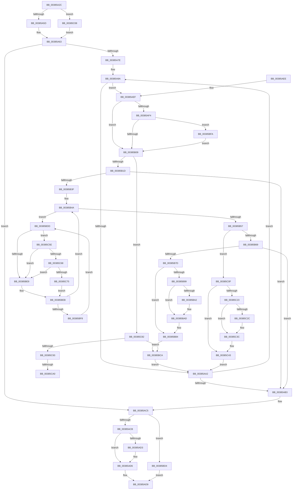

# MiLockLowestPrioritySecondaryStandbyPage

- RVA: `0x00385A2C`–`0x00385CB1` (길이 `645` bytes)
- VA: `0x0000000140385A2C`
- 실행 섹션: `.text`
- PDB 이름 있음: `예`; PDB Function 태그: `예`
- unwind 정보 RVA: `0x0007BCDC`
- 디코드: `162`개 명령, `645/645` bytes 표시
- 미해석 바이트: `0` (있으면 어셈블리에 `.byte`로 보존)

> 이 문서는 커널 이미지의 기계어와 PDB 기호를 분석해 생성했습니다. 4번과 5번은 함수 원형과 자료형을 바이너리 사용 방식에서 추정한 C 해석이며 원본 소스 복구 결과는 아닙니다.

## 1. Dependencies

- 직접 호출 지점: **11**; 고유 호출 대상: **6**
- 직접 호출자로 확인된 함수: **3**
- RIP 상대 이미지 참조: **3**

### Outgoing calls
- `0x00385B0C` → [ExAcquireSpinLockExclusiveAtDpcLevel](../24/ExAcquireSpinLockExclusiveAtDpcLevel_function_00248E80.md) (function, `0x00248E80`)
- `0x00385B42` → [ExReleaseSpinLockExclusiveFromDpcLevel](../24/ExReleaseSpinLockExclusiveFromDpcLevel_function_002497E0.md) (function, `0x002497E0`)
- `0x00385B6C` → [ExAcquireSpinLockExclusiveAtDpcLevel](../24/ExAcquireSpinLockExclusiveAtDpcLevel_function_00248E80.md) (function, `0x00248E80`)
- `0x00385B80` → [ExReleaseSpinLockExclusiveFromDpcLevel](../24/ExReleaseSpinLockExclusiveFromDpcLevel_function_002497E0.md) (function, `0x002497E0`)
- `0x00385BA8` → [KiLowerIrqlProcessIrqlFlags](../4F/KiLowerIrqlProcessIrqlFlags_function_004F5698.md) (function, `0x004F5698`)
- `0x00385BFE` → [KiRaiseIrqlProcessIrqlFlags](../4F/KiRaiseIrqlProcessIrqlFlags_function_004F56FC.md) (function, `0x004F56FC`)
- `0x00385C32` → [KiLowerIrqlProcessIrqlFlags](../4F/KiLowerIrqlProcessIrqlFlags_function_004F5698.md) (function, `0x004F5698`)
- `0x00385C68` → [KiCheckVpBackingLongSpinWaitHypercall](../30/KiCheckVpBackingLongSpinWaitHypercall_function_0030F490.md) (function, `0x0030F490`)
- `0x00385C78` → [HvlNotifyLongSpinWait](../30/HvlNotifyLongSpinWait_function_0030F460.md) (function, `0x0030F460`)
- `0x00385C85` → [ExReleaseSpinLockExclusiveFromDpcLevel](../24/ExReleaseSpinLockExclusiveFromDpcLevel_function_002497E0.md) (function, `0x002497E0`)
- `0x00385CA6` → [KiLowerIrqlProcessIrqlFlags](../4F/KiLowerIrqlProcessIrqlFlags_function_004F5698.md) (function, `0x004F5698`)

### Direct callers
- [MiSwapNumaStandbyPage](MiSwapNumaStandbyPage_function_00385144.md) at `0x00385222`
- [MiRepurposeStandbySlabPage](MiRepurposeStandbySlabPage_function_00385780.md) at `0x003858FB`
- [sub_006E4B4C](../6E/Unknown_function_006E4B4C.md) at `0x006E4BB7`

### Static image references
- `0x00385AFC` → RVA `0x00FC6D20` (`ALMOSTRO`; read)
- `0x00385BE0` → RVA `0x00FC52AC` (`ALMOSTRO`; reference)
- `0x00385C5E` → RVA `0x00FC6AB8` (`ALMOSTRO`; read)

## 2. Other-region calls and transfers

- 다른 실행 섹션으로 향하는 call: **0**
- call이 아닌 외부 분기/꼬리 이동: **2**
  - `0x00385C9A` → [sub_006E4C5C](../6E/Unknown_function_006E4C5C.md) (`tail-transfer`)
  - `0x00385CAC` → [sub_006E4C5C](../6E/Unknown_function_006E4C5C.md) (`tail-transfer`)

## 3. Assembly (complete function range)

```asm
00385A2C  48 89 5C 24 10                  mov qword ptr [rsp + 0x10], rbx
00385A31  4C 89 4C 24 20                  mov qword ptr [rsp + 0x20], r9
00385A36  4C 89 44 24 18                  mov qword ptr [rsp + 0x18], r8
00385A3B  55                              push rbp
00385A3C  56                              push rsi
00385A3D  57                              push rdi
00385A3E  41 54                           push r12
00385A40  41 55                           push r13
00385A42  41 56                           push r14
00385A44  41 57                           push r15
00385A46  48 83 EC 20                     sub rsp, 0x20
00385A4A  49 83 20 00                     and qword ptr [r8], 0
00385A4E  4D 8B F9                        mov r15, r9
00385A51  49 8B C0                        mov rax, r8
00385A54  4D 85 C9                        test r9, r9
00385A57  0F 84 AB 01 00 00               je 0x140385c08
00385A5D  41 C6 01 11                     mov byte ptr [r9], 0x11
00385A61  32 DB                           xor bl, bl
00385A63  48 8D B9 C0 0C 00 00            lea rdi, [rcx + 0xcc0]
00385A6A  45 33 E4                        xor r12d, r12d
00385A6D  48 81 C1 80 0F 00 00            add rcx, 0xf80
00385A74  48 89 4C 24 60                  mov qword ptr [rsp + 0x60], rcx
00385A79  48 3B F9                        cmp rdi, rcx
00385A7C  73 47                           jae 0x140385ac5
00385A7E  4C 8B 7C 24 60                  mov r15, qword ptr [rsp + 0x60]
00385A83  4C 8D 72 10                     lea r14, [rdx + 0x10]
00385A87  48 8D 77 20                     lea rsi, [rdi + 0x20]
00385A8B  48 BD FF FF FF FF 3F 00 00 00   movabs rbp, 0x3fffffffff
00385A95  41 8D 4C 24 02                  lea ecx, [r12 + 2]
00385A9A  49 8B 06                        mov rax, qword ptr [r14]
00385A9D  48 3B C5                        cmp rax, rbp
00385AA0  75 4D                           jne 0x140385aef
00385AA2  48 83 C7 58                     add rdi, 0x58
00385AA6  48 83 C6 58                     add rsi, 0x58
00385AAA  49 83 C6 58                     add r14, 0x58
00385AAE  49 3B FF                        cmp rdi, r15
00385AB1  72 E7                           jb 0x140385a9a
00385AB3  48 8B 4C 24 60                  mov rcx, qword ptr [rsp + 0x60]
00385AB8  4C 8B 7C 24 78                  mov r15, qword ptr [rsp + 0x78]
00385ABD  48 3B F9                        cmp rdi, rcx
00385AC0  48 8B 44 24 70                  mov rax, qword ptr [rsp + 0x70]
00385AC5  0F 84 09 01 00 00               je 0x140385bd4
00385ACB  48 89 38                        mov qword ptr [rax], rdi
00385ACE  4D 85 FF                        test r15, r15
00385AD1  74 03                           je 0x140385ad6
00385AD3  41 88 1F                        mov byte ptr [r15], bl
00385AD6  49 8B C4                        mov rax, r12
00385AD9  48 8B 5C 24 68                  mov rbx, qword ptr [rsp + 0x68]
00385ADE  48 83 C4 20                     add rsp, 0x20
00385AE2  41 5F                           pop r15
00385AE4  41 5E                           pop r14
00385AE6  41 5D                           pop r13
00385AE8  41 5C                           pop r12
00385AEA  5F                              pop rdi
00385AEB  5E                              pop rsi
00385AEC  5D                              pop rbp
00385AED  C3                              ret
00385AEE  CC                              int3
00385AEF  80 FB 11                        cmp bl, 0x11
00385AF2  74 15                           je 0x140385b09
00385AF4  44 0F 20 C3                     mov rbx, cr8
00385AF8  44 0F 22 C1                     mov cr8, rcx
00385AFC  83 3D 1D 12 C4 00 00            cmp dword ptr [rip + 0xc4121d], 0
00385B03  0F 85 F1 00 00 00               jne 0x140385bfa
00385B09  48 8B CE                        mov rcx, rsi
00385B0C  E8 6F 33 EC FF                  call 0x140248e80
00385B11  4D 8B 26                        mov r12, qword ptr [r14]
00385B14  4C 3B E5                        cmp r12, rbp
00385B17  0F 84 65 01 00 00               je 0x140385c82
00385B1D  4B 8D 2C 64                     lea rbp, [r12 + r12*2]
00385B21  48 C1 E5 04                     shl rbp, 4
00385B25  48 B8 00 00 00 00 00 DE FF FF   movabs rax, 0xffffde0000000000
00385B2F  48 03 E8                        add rbp, rax
00385B32  F0 48 0F BA 6D 18 3F            lock bts qword ptr [rbp + 0x18], 0x3f
00385B39  0F 83 74 FF FF FF               jae 0x140385ab3
00385B3F  48 8B CE                        mov rcx, rsi
00385B42  E8 99 3C EC FF                  call 0x1402497e0
00385B47  45 33 ED                        xor r13d, r13d
00385B4A  F0 48 0F BA 6D 18 3F            lock bts qword ptr [rbp + 0x18], 0x3f
00385B51  0F 82 86 00 00 00               jb 0x140385bdd
00385B57  8A 45 22                        mov al, byte ptr [rbp + 0x22]
00385B5A  B9 02 00 00 00                  mov ecx, 2
00385B5F  24 07                           and al, 7
00385B61  3A C1                           cmp al, cl
00385B63  0F 85 A6 00 00 00               jne 0x140385c0f
00385B69  48 8B CE                        mov rcx, rsi
00385B6C  E8 0F 33 EC FF                  call 0x140248e80
00385B71  49 8B 06                        mov rax, qword ptr [r14]
00385B74  4C 3B E0                        cmp r12, rax
00385B77  0F 84 36 FF FF FF               je 0x140385ab3
00385B7D  48 8B CE                        mov rcx, rsi
00385B80  E8 5B 3C EC FF                  call 0x1402497e0
00385B85  48 B8 FF FF FF FF FF FF FF 7F   movabs rax, 0x7fffffffffffffff
00385B8F  F0 48 21 45 18                  lock and qword ptr [rbp + 0x18], rax
00385B94  80 FB 11                        cmp bl, 0x11
00385B97  74 1B                           je 0x140385bb4
00385B99  83 3D 80 11 C4 00 00            cmp dword ptr [rip + 0xc41180], 0
00385BA0  74 0B                           je 0x140385bad
00385BA2  44 0F 20 C1                     mov rcx, cr8
00385BA6  8A D3                           mov dl, bl
00385BA8  E8 EB FA 16 00                  call 0x1404f5698
00385BAD  0F B6 C3                        movzx eax, bl
00385BB0  44 0F 22 C0                     mov cr8, rax
00385BB4  48 83 EF 58                     sub rdi, 0x58
00385BB8  48 83 EE 58                     sub rsi, 0x58
00385BBC  49 83 EE 58                     sub r14, 0x58
00385BC0  48 BD FF FF FF FF 3F 00 00 00   movabs rbp, 0x3fffffffff
00385BCA  B9 02 00 00 00                  mov ecx, 2
00385BCF  E9 CE FE FF FF                  jmp 0x140385aa2
00385BD4  48 83 C8 FF                     or rax, 0xffffffffffffffff
00385BD8  E9 FC FE FF FF                  jmp 0x140385ad9
00385BDD  41 FF C5                        inc r13d
00385BE0  44 85 2D C5 F6 C3 00            test dword ptr [rip + 0xc3f6c5], r13d
00385BE7  74 75                           je 0x140385c5e
00385BE9  F3 90                           pause
00385BEB  48 8B 45 18                     mov rax, qword ptr [rbp + 0x18]
00385BEF  48 85 C0                        test rax, rax
00385BF2  0F 89 52 FF FF FF               jns 0x140385b4a
00385BF8  EB E3                           jmp 0x140385bdd
00385BFA  8A D1                           mov dl, cl
00385BFC  8A CB                           mov cl, bl
00385BFE  E8 F9 FA 16 00                  call 0x1404f56fc
00385C03  E9 01 FF FF FF                  jmp 0x140385b09
00385C08  B3 11                           mov bl, 0x11
00385C0A  E9 54 FE FF FF                  jmp 0x140385a63
00385C0F  48 B8 FF FF FF FF FF FF FF 7F   movabs rax, 0x7fffffffffffffff
00385C19  F0 48 21 45 18                  lock and qword ptr [rbp + 0x18], rax
00385C1E  80 FB 11                        cmp bl, 0x11
00385C21  74 20                           je 0x140385c43
00385C23  83 3D F6 10 C4 00 00            cmp dword ptr [rip + 0xc410f6], 0
00385C2A  74 10                           je 0x140385c3c
00385C2C  44 0F 20 C1                     mov rcx, cr8
00385C30  8A D3                           mov dl, bl
00385C32  E8 61 FA 16 00                  call 0x1404f5698
00385C37  B9 02 00 00 00                  mov ecx, 2
00385C3C  0F B6 C3                        movzx eax, bl
00385C3F  44 0F 22 C0                     mov cr8, rax
00385C43  48 83 EF 58                     sub rdi, 0x58
00385C47  48 83 EE 58                     sub rsi, 0x58
00385C4B  49 83 EE 58                     sub r14, 0x58
00385C4F  48 BD FF FF FF FF 3F 00 00 00   movabs rbp, 0x3fffffffff
00385C59  E9 44 FE FF FF                  jmp 0x140385aa2
00385C5E  8B 05 54 0E C4 00               mov eax, dword ptr [rip + 0xc40e54]
00385C64  A8 40                           test al, 0x40
00385C66  74 81                           je 0x140385be9
00385C68  E8 23 98 F8 FF                  call 0x14030f490
00385C6D  84 C0                           test al, al
00385C6F  0F 84 74 FF FF FF               je 0x140385be9
00385C75  41 8B CD                        mov ecx, r13d
00385C78  E8 E3 97 F8 FF                  call 0x14030f460
00385C7D  E9 69 FF FF FF                  jmp 0x140385beb
00385C82  48 8B CE                        mov rcx, rsi
00385C85  E8 56 3B EC FF                  call 0x1402497e0
00385C8A  80 FB 11                        cmp bl, 0x11
00385C8D  0F 84 37 FF FF FF               je 0x140385bca
00385C93  83 3D 86 10 C4 00 00            cmp dword ptr [rip + 0xc41086], 0
00385C9A  0F 84 BC EF 35 00               je 0x1406e4c5c
00385CA0  44 0F 20 C1                     mov rcx, cr8
00385CA4  8A D3                           mov dl, bl
00385CA6  E8 ED F9 16 00                  call 0x1404f5698
00385CAB  90                              nop
00385CAC  E9 AB EF 35 00                  jmp 0x1406e4c5c
```

## 4. C-style interpretation (structured pseudocode)

```c
__int64 __fastcall MiLockLowestPrioritySecondaryStandbyPage(__int64 a1, __int64 a2, __int64 a3, __int64 a4)
{
    __int64 result;
    __int64 v_r12;
    __int64 v_r13;
    __int64 v_r14;
    __int64 v_rbp;
    __int64 v_rbx;
    __int64 v_rdi;
    __int64 v_rsi;
    __int64 v_rsp;
    unsigned __int64 v_stack_p10;
    unsigned __int64 v_stack_p18;
    unsigned __int64 v_stack_p20;
    unsigned __int64 v_stack_p8;

    v_stack_p10 = v_rbx;
    v_stack_p20 = a4;
    v_stack_p18 = a3;
    v_rsp = (v_rsp) - (32);
    if (a4 == 0) goto loc_00385C08;
    *(unsigned __int8 *)(a4) = 17;
    v_rbx = 0;
loc_00385A63:
    v_r12 = 0;
    a1 = (a1) + (0xF80ULL);
    v_stack_p8 = a1;
    if ((a1 + 3264) >= a1) goto loc_00385AC5;
loc_00385A9A:
    if ((*(unsigned __int64 *)(a2 + 16)) != v_rbp) goto loc_00385AEF;
loc_00385AA2:
    v_rdi = (a1 + 3264) + (88);
    v_rsi = (a1 + 3264 + 32) + (88);
    v_r14 = (a2 + 16) + (88);
    if (v_rdi < v_stack_p8) goto loc_00385A9A;
loc_00385AB3:
loc_00385AC5:
    if (v_rdi == v_stack_p8) goto loc_00385BD4;
    *(unsigned __int64 *)(v_stack_p18) = v_rdi;
    if (v_stack_p20 != 0) {
        *(unsigned __int8 *)(v_stack_p20) = 0;
    }
loc_00385AD9:
    v_rsp = (v_rsp) + (32);
    return 0;
loc_00385AEF:
    if (((unsigned __int8)(v_stack_p10)) == 17) goto loc_00385B09;
    if ((*(unsigned int *)(v_rip + 12849693)) != 0) goto loc_00385BFA;
loc_00385B09:
    result = ExAcquireSpinLockExclusiveAtDpcLevel(v_rsi, a2, a3, a4);
    if ((*(unsigned __int64 *)(v_r14)) == v_rbp) goto loc_00385C82;
    v_rbp = (*(unsigned __int64 *)(v_r14) + *(unsigned __int64 *)(v_r14) * 2) << (4);
    v_rbp = (v_rbp) + (result);
    if (condition_is_above_or_equal) goto loc_00385AB3;
    result = ExReleaseSpinLockExclusiveFromDpcLevel(v_rsi, a2, a3, a4);
    v_r13 = 0;
loc_00385B4A:
    if (condition_is_below) goto loc_00385BDD;
    result = (unsigned __int8)((*(unsigned __int8 *)(v_rbp + 34)) & (7));
    if (((unsigned __int8)(result)) != 2) goto loc_00385C0F;
    result = ExAcquireSpinLockExclusiveAtDpcLevel(v_rsi, a2, a3, a4);
    if ((*(unsigned __int64 *)(v_r14)) == (*(unsigned __int64 *)(v_r14))) goto loc_00385AB3;
    result = ExReleaseSpinLockExclusiveFromDpcLevel(v_rsi, a2, a3, a4);
    if (((unsigned __int8)(v_cr8)) == 17) goto loc_00385BB4;
    if ((*(unsigned int *)(v_rip + 12849536)) != 0) {
        a1 = v_stack_p8;
        a2 = (unsigned __int8)(v_cr8);
        result = KiLowerIrqlProcessIrqlFlags(a1, a2, a3, a4);
    }
loc_00385BB4:
    v_rdi = (v_rdi) - (88);
    v_rsi = (v_rsi) - (88);
    v_r14 = (v_r14) - (88);
loc_00385BCA:
    goto loc_00385AA2;
loc_00385BD4:
    result = ((unsigned __int8)(v_cr8)) | (-1);
    goto loc_00385AD9;
loc_00385BDD:
    v_r13 = (unsigned int)((v_r13) + 1);
    if (((*(unsigned int *)(v_rip + 12842693)) & ((unsigned int)(v_r13))) == 0) goto loc_00385C5E;
loc_00385BE9:
loc_00385BEB:
    if (!sign_flag) goto loc_00385B4A;
    goto loc_00385BDD;
loc_00385BFA:
    result = KiRaiseIrqlProcessIrqlFlags((unsigned __int8)(v_cr8), 2, a3, a4);
    goto loc_00385B09;
loc_00385C08:
    goto loc_00385A63;
loc_00385C0F:
    if (17 == 17) goto loc_00385C43;
    if ((*(unsigned int *)(v_rip + 12849398)) != 0) {
        a1 = (unsigned __int8)(v_cr8);
        a2 = 17;
        result = KiLowerIrqlProcessIrqlFlags(a1, a2, a3, a4);
        a1 = 2;
    }
loc_00385C43:
    v_rdi = (v_rdi) - (88);
    v_rsi = (v_rsi) - (88);
    v_r14 = (v_r14) - (88);
    goto loc_00385AA2;
loc_00385C5E:
    if ((((unsigned __int8)((unsigned int)(*(unsigned int *)(v_rip + 12848724)))) & (64)) == 0) goto loc_00385BE9;
    result = KiCheckVpBackingLongSpinWaitHypercall(a1, a2, a3, a4);
    if ((unsigned __int8)(result) == 0) goto loc_00385BE9;
    result = HvlNotifyLongSpinWait((unsigned int)((unsigned int)(v_r13)), a2, a3, a4);
    goto loc_00385BEB;
loc_00385C82:
    result = ExReleaseSpinLockExclusiveFromDpcLevel(v_rsi, a2, a3, a4);
    if (17 == 17) goto loc_00385BCA;
    result = KiLowerIrqlProcessIrqlFlags(17, 17, a3, a4);
}
```

## 5. (Beta) C Style

```c
int64_t MiLockLowestPrioritySecondaryStandbyPage(void *Arg1, void *Arg2, void *Arg3, int64_t Arg4)
{
    uint8_t *arg1 = (uint8_t *)Arg1;
    uint8_t *arg2 = (uint8_t *)Arg2;
    uint8_t *arg3 = (uint8_t *)Arg3;

    int64_t result;
    int64_t local_r12;
    int64_t local_r13;
    int64_t local_r14;
    int64_t local_rbp;
    int64_t local_rbx;
    int64_t local_rdi;
    int64_t local_rsi;
    int64_t local_rsp;
    uint64_t v_stack_p10;
    uint64_t v_stack_p18;
    uint64_t v_stack_p20;
    uint64_t v_stack_p8;

    v_stack_p10 = local_rbx;
    v_stack_p20 = Arg4;
    v_stack_p18 = Arg3;
    local_rsp = (local_rsp) - (32);
    if (Arg4 == 0) goto loc_00385C08;
    *(uint8_t *)(Arg4) = 17;
    local_rbx = 0;
loc_00385A63:
    local_r12 = 0;
    Arg1 = (Arg1) + (0xF80ULL);
    v_stack_p8 = Arg1;
    if ((Arg1 + 3264) >= Arg1) goto loc_00385AC5;
loc_00385A9A:
    if ((*(uint64_t *)(arg2 + 0x10)) != local_rbp) goto loc_00385AEF;
loc_00385AA2:
    local_rdi = (Arg1 + 3264) + (88);
    local_rsi = (Arg1 + 3264 + 32) + (88);
    local_r14 = (Arg2 + 16) + (88);
    if (local_rdi < v_stack_p8) goto loc_00385A9A;
loc_00385AB3:
loc_00385AC5:
    if (local_rdi == v_stack_p8) goto loc_00385BD4;
    *(uint64_t *)(v_stack_p18) = local_rdi;
    if (v_stack_p20 != 0) {
        *(uint8_t *)(v_stack_p20) = 0;
    }
loc_00385AD9:
    local_rsp = (local_rsp) + (32);
    return 0;
loc_00385AEF:
    if (((uint8_t)(v_stack_p10)) == 17) goto loc_00385B09;
    if ((*(uint32_t *)(v_rip + 0xC4121D)) != 0) goto loc_00385BFA;
loc_00385B09:
    result = ExAcquireSpinLockExclusiveAtDpcLevel(local_rsi, Arg2, Arg3, Arg4);
    if ((*(uint64_t *)(local_r14)) == local_rbp) goto loc_00385C82;
    local_rbp = (*(uint64_t *)(local_r14) + *(uint64_t *)(local_r14) * 2) << (4);
    local_rbp = (local_rbp) + (result);
    if (condition_is_above_or_equal) goto loc_00385AB3;
    result = ExReleaseSpinLockExclusiveFromDpcLevel(local_rsi, Arg2, Arg3, Arg4);
    local_r13 = 0;
loc_00385B4A:
    if (condition_is_below) goto loc_00385BDD;
    result = (uint8_t)((*(uint8_t *)(local_rbp + 0x22)) & (7));
    if (((uint8_t)(result)) != 2) goto loc_00385C0F;
    result = ExAcquireSpinLockExclusiveAtDpcLevel(local_rsi, Arg2, Arg3, Arg4);
    if ((*(uint64_t *)(local_r14)) == (*(uint64_t *)(local_r14))) goto loc_00385AB3;
    result = ExReleaseSpinLockExclusiveFromDpcLevel(local_rsi, Arg2, Arg3, Arg4);
    if (((uint8_t)(v_cr8)) == 17) goto loc_00385BB4;
    if ((*(uint32_t *)(v_rip + 0xC41180)) != 0) {
        Arg1 = v_stack_p8;
        Arg2 = (uint8_t)(v_cr8);
        result = KiLowerIrqlProcessIrqlFlags(Arg1, Arg2, Arg3, Arg4);
    }
loc_00385BB4:
    local_rdi = (local_rdi) - (88);
    local_rsi = (local_rsi) - (88);
    local_r14 = (local_r14) - (88);
loc_00385BCA:
    goto loc_00385AA2;
loc_00385BD4:
    result = ((uint8_t)(v_cr8)) | (-1);
    goto loc_00385AD9;
loc_00385BDD:
    local_r13 = (uint32_t)((local_r13) + 1);
    if (((*(uint32_t *)(v_rip + 0xC3F6C5)) & ((uint32_t)(local_r13))) == 0) goto loc_00385C5E;
loc_00385BE9:
loc_00385BEB:
    if (!sign_flag) goto loc_00385B4A;
    goto loc_00385BDD;
loc_00385BFA:
    result = KiRaiseIrqlProcessIrqlFlags((uint8_t)(v_cr8), 2, Arg3, Arg4);
    goto loc_00385B09;
loc_00385C08:
    goto loc_00385A63;
loc_00385C0F:
    if (17 == 17) goto loc_00385C43;
    if ((*(uint32_t *)(v_rip + 0xC410F6)) != 0) {
        Arg1 = (uint8_t)(v_cr8);
        Arg2 = 17;
        result = KiLowerIrqlProcessIrqlFlags(Arg1, Arg2, Arg3, Arg4);
        Arg1 = 2;
    }
loc_00385C43:
    local_rdi = (local_rdi) - (88);
    local_rsi = (local_rsi) - (88);
    local_r14 = (local_r14) - (88);
    goto loc_00385AA2;
loc_00385C5E:
    if ((((uint8_t)((uint32_t)(*(uint32_t *)(v_rip + 0xC40E54)))) & (64)) == 0) goto loc_00385BE9;
    result = KiCheckVpBackingLongSpinWaitHypercall(Arg1, Arg2, Arg3, Arg4);
    if ((uint8_t)(result) == 0) goto loc_00385BE9;
    result = HvlNotifyLongSpinWait((uint32_t)((uint32_t)(local_r13)), Arg2, Arg3, Arg4);
    goto loc_00385BEB;
loc_00385C82:
    result = ExReleaseSpinLockExclusiveFromDpcLevel(local_rsi, Arg2, Arg3, Arg4);
    if (17 == 17) goto loc_00385BCA;
    result = KiLowerIrqlProcessIrqlFlags(17, 17, Arg3, Arg4);
}
```

### 관측된 메모리 오프셋

구조체 형식이 확인되지 않은 접근은 인자 기준의 오프셋으로만 기록했습니다.

| 기준 인자 | 오프셋 표현 | 폭 (bit) | 접근 |
|---|---:|---:|---|
| `Arg1` | `+ 0xCC0` | `64` | `R` |
| `Arg2` | `+ 0x0` | `64` | `R` |
| `Arg2` | `+ 0x10` | `64` | `R` |
| `Arg3` | `+ 0x0` | `64` | `R/W` |

## 6. Execution-region graph

[열기: 2D/3D 그래프와 함수 탐색 컨트롤 패널](../../../control-panel.html?section=text&rva=0x00385A2C&view=graph)

- 2D 그래프는 위에서 아래로 흐르고, 3D 그래프는 빈 공간을 드래그해 회전합니다. Shift+드래그는 이동, 휠은 확대·축소, 함수 노드 선택은 대상 보고서 이동입니다.

### Static fallback


