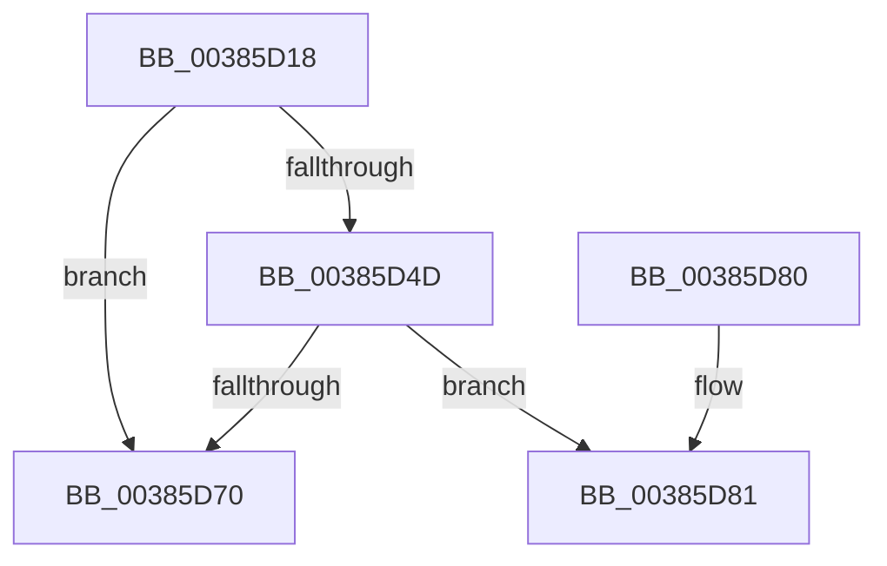

# MiMakeDriverPageStayResident

- RVA: `0x00385D18`–`0x00385DD2` (길이 `186` bytes)
- VA: `0x0000000140385D18`
- 실행 섹션: `.text`
- PDB 이름 있음: `예`; PDB Function 태그: `예`
- unwind 정보 RVA: `0x0007BD08`
- 디코드: `46`개 명령, `186/186` bytes 표시
- 미해석 바이트: `0` (있으면 어셈블리에 `.byte`로 보존)

> 이 문서는 커널 이미지의 기계어와 PDB 기호를 분석해 생성했습니다. 4번과 5번은 함수 원형과 자료형을 바이너리 사용 방식에서 추정한 C 해석이며 원본 소스 복구 결과는 아닙니다.

## 1. Dependencies

- 직접 호출 지점: **1**; 고유 호출 대상: **1**
- 직접 호출자로 확인된 함수: **2**
- RIP 상대 이미지 참조: **0**

### Outgoing calls
- `0x00385D65` → [MiGetWsleContents](../31/MiGetWsleContents_function_00316540.md) (function, `0x00316540`)

### Direct callers
- [MiMakeDriverPagesPrivate](MiMakeDriverPagesPrivate_function_00384C60.md) at `0x00385066`
- [MiProtectDriverSectionPte](../67/MiProtectDriverSectionPte_function_006706C0.md) at `0x0067086E`

### Static image references
- 디코드된 RIP-relative 메모리 참조가 없습니다.

## 2. Other-region calls and transfers

- 다른 실행 섹션으로 향하는 call: **0**
- call이 아닌 외부 분기/꼬리 이동: **1**
  - `0x00385DCD` → [sub_006E4C68](../6E/Unknown_function_006E4C68.md) (`tail-transfer`)

## 3. Assembly (complete function range)

```asm
00385D18  48 89 5C 24 10                  mov qword ptr [rsp + 0x10], rbx
00385D1D  48 89 74 24 18                  mov qword ptr [rsp + 0x18], rsi
00385D22  57                              push rdi
00385D23  48 83 EC 20                     sub rsp, 0x20
00385D27  4C 8B 91 38 01 00 00            mov r10, qword ptr [rcx + 0x138]
00385D2E  4D 8B C8                        mov r9, r8
00385D31  4C 2B 49 30                     sub r9, qword ptr [rcx + 0x30]
00385D35  49 8B F8                        mov rdi, r8
00385D38  49 C1 E9 0C                     shr r9, 0xc
00385D3C  48 8B F2                        mov rsi, rdx
00385D3F  45 8B C1                        mov r8d, r9d
00385D42  4D 0F A3 02                     bt qword ptr [r10], r8
00385D46  0F 92 C0                        setb al
00385D49  84 C0                           test al, al
00385D4B  75 23                           jne 0x140385d70
00385D4D  49 C1 E8 03                     shr r8, 3
00385D51  41 83 E1 07                     and r9d, 7
00385D55  48 8B D7                        mov rdx, rdi
00385D58  43 0F BE 04 10                  movsx eax, byte ptr [r8 + r10]
00385D5D  44 0F AB C8                     bts eax, r9d
00385D61  43 88 04 10                     mov byte ptr [r8 + r10], al
00385D65  E8 D6 07 F9 FF                  call 0x140316540
00385D6A  24 0F                           and al, 0xf
00385D6C  3C 09                           cmp al, 9
00385D6E  75 11                           jne 0x140385d81
00385D70  48 8B 5C 24 38                  mov rbx, qword ptr [rsp + 0x38]
00385D75  48 8B 74 24 40                  mov rsi, qword ptr [rsp + 0x40]
00385D7A  48 83 C4 20                     add rsp, 0x20
00385D7E  5F                              pop rdi
00385D7F  C3                              ret
00385D80  CC                              int3
00385D81  48 C1 EF 09                     shr rdi, 9
00385D85  48 B8 F8 FF FF FF 7F 00 00 00   movabs rax, 0x7ffffffff8
00385D8F  48 23 F8                        and rdi, rax
00385D92  48 B8 00 00 00 00 80 F6 FF FF   movabs rax, 0xfffff68000000000
00385D9C  48 03 F8                        add rdi, rax
00385D9F  48 B9 FF FF FF FF FF 00 00 00   movabs rcx, 0xffffffffff
00385DA9  48 8B 07                        mov rax, qword ptr [rdi]
00385DAC  48 C1 E8 0C                     shr rax, 0xc
00385DB0  48 23 C1                        and rax, rcx
00385DB3  48 8D 1C 40                     lea rbx, [rax + rax*2]
00385DB7  48 C1 E3 04                     shl rbx, 4
00385DBB  48 B8 00 00 00 00 00 DE FF FF   movabs rax, 0xffffde0000000000
00385DC5  48 03 D8                        add rbx, rax
00385DC8  83 64 24 30 00                  and dword ptr [rsp + 0x30], 0
00385DCD  E9 96 EE 35 00                  jmp 0x1406e4c68
```

## 4. C-style interpretation (structured pseudocode)

```c
__int64 __fastcall MiMakeDriverPageStayResident(__int64 a1, __int64 a2, __int64 a3)
{
    __int64 result;
    __int64 v_rbx;
    __int64 v_rdi;
    __int64 v_rsp;
    unsigned __int64 v_stack_p10;
    unsigned __int64 v_stack_p18;
    unsigned int v_stack_p30;

    v_stack_p10 = v_rbx;
    v_stack_p18 = v_rsi;
    v_rsp = (v_rsp) - (32);
    a4 = (a3) - (*(unsigned __int64 *)(a1 + 48));
    a4 = (a4) >> (12);
    result = (condition_is_below) ? 1 : 0;
    if ((unsigned __int8)(result) != 0) goto loc_00385D70;
    a3 = ((unsigned int)((unsigned int)(a4))) >> (3);
    a4 = (unsigned int)((a4) & (7));
    *(unsigned __int8 *)(a3 + *(unsigned __int64 *)(a1 + 312) * 1) = (unsigned __int8)((__int8)(*(unsigned __int8 *)(a3 + *(unsigned __int64 *)(a1 + 312) * 1)));
    result = MiGetWsleContents(a1, a3, a3, a4);
    result = (unsigned __int8)((result) & (15));
    if (((unsigned __int8)(result)) != 9) goto loc_00385D81;
loc_00385D70:
    v_rsp = (v_rsp) + (32);
    return result;
loc_00385D81:
    v_rdi = (a3) >> (9);
    v_rdi = (v_rdi) & (result);
    v_rdi = (v_rdi) + (result);
    result = (*(unsigned __int64 *)(v_rdi)) >> (12);
    result = (result) & (a1);
    v_rbx = (result + result * 2) << (4);
    v_rbx = (v_rbx) + (result);
}
```

## 5. (Beta) C Style

```c
int64_t MiMakeDriverPageStayResident(void *Arg1, int64_t Arg2, int64_t Arg3)
{
    uint8_t *arg1 = (uint8_t *)Arg1;

    int64_t result;
    int64_t local_rbx;
    int64_t local_rdi;
    int64_t local_rsp;
    uint64_t v_stack_p10;
    uint64_t v_stack_p18;
    uint32_t v_stack_p30;

    v_stack_p10 = local_rbx;
    v_stack_p18 = local_rsi;
    local_rsp = (local_rsp) - (32);
    a4 = (Arg3) - (*(uint64_t *)(arg1 + 0x30));
    a4 = (a4) >> (12);
    result = (condition_is_below) ? 1 : 0;
    if ((uint8_t)(result) != 0) goto loc_00385D70;
    Arg3 = ((uint32_t)((uint32_t)(a4))) >> (3);
    a4 = (uint32_t)((a4) & (7));
    *(uint8_t *)(Arg3 + *(uint64_t *)(arg1 + 0x138) * 1) = (uint8_t)((int8_t)(*(uint8_t *)(Arg3 + *(uint64_t *)(arg1 + 0x138) * 1)));
    result = MiGetWsleContents(Arg1, Arg3, Arg3, a4);
    result = (uint8_t)((result) & (15));
    if (((uint8_t)(result)) != 9) goto loc_00385D81;
loc_00385D70:
    local_rsp = (local_rsp) + (32);
    return result;
loc_00385D81:
    local_rdi = (Arg3) >> (9);
    local_rdi = (local_rdi) & (result);
    local_rdi = (local_rdi) + (result);
    result = (*(uint64_t *)(local_rdi)) >> (12);
    result = (result) & (Arg1);
    local_rbx = (result + result * 2) << (4);
    local_rbx = (local_rbx) + (result);
}
```

### 관측된 메모리 오프셋

구조체 형식이 확인되지 않은 접근은 인자 기준의 오프셋으로만 기록했습니다.

| 기준 인자 | 오프셋 표현 | 폭 (bit) | 접근 |
|---|---:|---:|---|
| `Arg1` | `+ 0x30` | `64` | `R` |
| `Arg1` | `+ 0x138` | `64` | `R` |

## 6. Execution-region graph

[열기: 2D/3D 그래프와 함수 탐색 컨트롤 패널](../../../control-panel.html?section=text&rva=0x00385D18&view=graph)

- 2D 그래프는 위에서 아래로 흐르고, 3D 그래프는 빈 공간을 드래그해 회전합니다. Shift+드래그는 이동, 휠은 확대·축소, 함수 노드 선택은 대상 보고서 이동입니다.

### Static fallback


