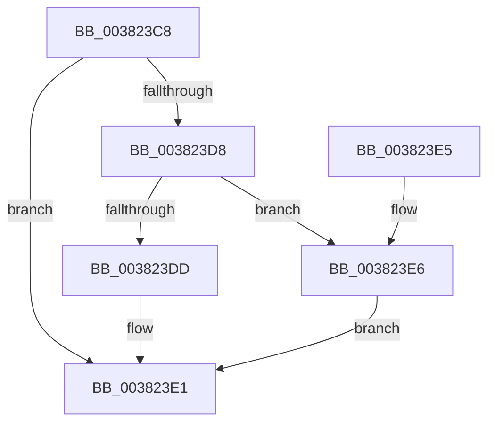

# MiMakePageFilePte

- RVA: `0x003823C8`–`0x003823EB` (길이 `35` bytes)
- VA: `0x00000001403823C8`
- 실행 섹션: `.text`
- PDB 이름 있음: `예`; PDB Function 태그: `아니요`
- unwind 정보 RVA: `0x000DB714`
- 디코드: `12`개 명령, `35/35` bytes 표시
- 미해석 바이트: `0` (있으면 어셈블리에 `.byte`로 보존)

> 이 문서는 커널 이미지의 기계어와 PDB 기호를 분석해 생성했습니다. 4번과 5번은 함수 원형과 자료형을 바이너리 사용 방식에서 추정한 C 해석이며 원본 소스 복구 결과는 아닙니다.

## 1. Dependencies

- 직접 호출 지점: **0**; 고유 호출 대상: **0**
- 직접 호출자로 확인된 함수: **12**
- RIP 상대 이미지 참조: **1**

### Outgoing calls
- 직접 디코드된 call 명령이 없습니다.

### Direct callers
- [MiActOnPte](../24/MiActOnPte_function_00244C90.md) at `0x0024551A`
- [MiTrimUnusedPageFileRegionsWorker](../2A/MiTrimUnusedPageFileRegionsWorker_function_002AA320.md) at `0x002AA392`
- [MiStoreWriteModifiedPages](../2B/MiStoreWriteModifiedPages_function_002B46C4.md) at `0x002B53FC`
- [MiDetermineModifiedPageListHead](../2B/MiDetermineModifiedPageListHead_function_002BAB00.md) at `0x002BAD43`
- [MiGatherPagefilePages](../37/MiGatherPagefilePages_function_00372B08.md) at `0x0037315C`
- [MiSetStoreVirtualPagefileValue](../37/MiSetStoreVirtualPagefileValue_function_00373B80.md) at `0x00373D27`
- [MiTransferSoftwarePte](MiTransferSoftwarePte_function_003821F0.md) at `0x003823B2`
- [MiGetKernelStackSwapSupport](../3E/MiGetKernelStackSwapSupport_function_003E2900.md) at `0x003E29BC`
- [MiFindPageFileWriteCluster](../3E/MiFindPageFileWriteCluster_function_003E2B00.md) at `0x003E2B4F`
- [MiUpdatePfnBackingStore](../44/MiUpdatePfnBackingStore_function_004442B4.md) at `0x004443CD`
- [MiTrimUnusedPageFileRegionsApc](../4D/MiTrimUnusedPageFileRegionsApc_function_004D3700.md) at `0x004D3734`
- [MiTrimUnusedPageFileRegionsApc](../4D/MiTrimUnusedPageFileRegionsApc_function_004D3700.md) at `0x004D379E`
- [MiReserveWorkingSetSwapSpaceRuns](../../page/A8/MiReserveWorkingSetSwapSpaceRuns_function_00A834A4.md) at `0x00A834FF`

### Static image references
- `0x003823C8` → RVA `0x00E2DC80` (`.data`; read)

## 2. Other-region calls and transfers

- 다른 실행 섹션으로 향하는 call: **0**
- 별도 외부 분기/꼬리 이동을 확인하지 못했습니다.

## 3. Assembly (complete function range)

```asm
003823C8  48 8B 05 B1 B8 AA 00            mov rax, qword ptr [rip + 0xaab8b1]
003823CF  48 C1 E1 20                     shl rcx, 0x20
003823D3  48 85 C0                        test rax, rax
003823D6  74 09                           je 0x1403823e1
003823D8  48 85 C1                        test rcx, rax
003823DB  74 09                           je 0x1403823e6
003823DD  48 83 C9 10                     or rcx, 0x10
003823E1  48 8B C1                        mov rax, rcx
003823E4  C3                              ret
003823E5  CC                              int3
003823E6  48 0B C8                        or rcx, rax
003823E9  EB F6                           jmp 0x1403823e1
```

## 4. C-style interpretation (structured pseudocode)

```c
__int64 __fastcall MiMakePageFilePte(__int64 a1)
{
    a1 = (a1) << (32);
    if (*(unsigned __int64 *)(v_rip + 11188401) == 0) goto loc_003823E1;
    if (((a1) & (*(unsigned __int64 *)(v_rip + 11188401))) == 0) goto loc_003823E6;
    a1 = (a1) | (16);
loc_003823E1:
    return a1;
loc_003823E6:
    a1 = (a1) | (a1);
    goto loc_003823E1;
}
```

## 5. (Beta) C Style

```c
int64_t MiMakePageFilePte(int64_t Arg1)
{
    Arg1 = (Arg1) << (32);
    if (*(uint64_t *)(v_rip + 0xAAB8B1) == 0) goto loc_003823E1;
    if (((Arg1) & (*(uint64_t *)(v_rip + 0xAAB8B1))) == 0) goto loc_003823E6;
    Arg1 = (Arg1) | (16);
loc_003823E1:
    return Arg1;
loc_003823E6:
    Arg1 = (Arg1) | (Arg1);
    goto loc_003823E1;
}
```

## 6. Execution-region graph

[열기: 2D/3D 그래프와 함수 탐색 컨트롤 패널](../../../control-panel.html?section=text&rva=0x003823C8&view=graph)

- 2D 그래프는 위에서 아래로 흐르고, 3D 그래프는 빈 공간을 드래그해 회전합니다. Shift+드래그는 이동, 휠은 확대·축소, 함수 노드 선택은 대상 보고서 이동입니다.

### Static fallback


