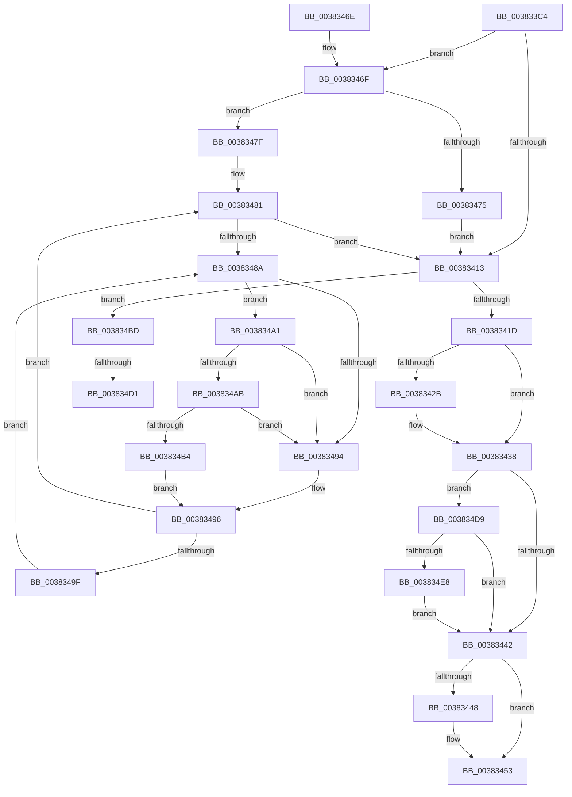

# MiMarkPfnVerified

- RVA: `0x003833C4`–`0x00383514` (길이 `336` bytes)
- VA: `0x00000001403833C4`
- 실행 섹션: `.text`
- PDB 이름 있음: `예`; PDB Function 태그: `예`
- unwind 정보 RVA: `0x0007BB88`
- 디코드: `89`개 명령, `336/336` bytes 표시
- 미해석 바이트: `0` (있으면 어셈블리에 `.byte`로 보존)

> 이 문서는 커널 이미지의 기계어와 PDB 기호를 분석해 생성했습니다. 4번과 5번은 함수 원형과 자료형을 바이너리 사용 방식에서 추정한 C 해석이며 원본 소스 복구 결과는 아닙니다.

## 1. Dependencies

- 직접 호출 지점: **7**; 고유 호출 대상: **7**
- 직접 호출자로 확인된 함수: **14**
- RIP 상대 이미지 참조: **3**

### Outgoing calls
- `0x00383433` → [MiSetPfnIdentity](../2A/MiSetPfnIdentity_function_002A2350.md) (function, `0x002A2350`)
- `0x0038344E` → [MiUnlockPage](../31/MiUnlockPage_function_0031A3E0.md) (function, `0x0031A3E0`)
- `0x00383475` → [MiLockPageInline](../31/MiLockPageInline_function_0031A340.md) (function, `0x0031A340`)
- `0x003834AB` → [KiCheckVpBackingLongSpinWaitHypercall](../30/KiCheckVpBackingLongSpinWaitHypercall_function_0030F490.md) (function, `0x0030F490`)
- `0x003834B6` → [HvlNotifyLongSpinWait](../30/HvlNotifyLongSpinWait_function_0030F460.md) (function, `0x0030F460`)
- `0x003834F5` → [MiGetPagePrivilege](../28/MiGetPagePrivilege_function_00285420.md) (function, `0x00285420`)
- `0x0038350A` → [KeSetPagePrivilege](../40/KeSetPagePrivilege_function_00407970.md) (function, `0x00407970`)

### Direct callers
- [sub_002B1D4E](../2B/Unknown_function_002B1D4E.md) at `0x002B1D80`
- [sub_002B1D4E](../2B/Unknown_function_002B1D4E.md) at `0x002B1FE4`
- [MiAllocateWsle](../33/MiAllocateWsle_function_003332C0.md) at `0x00333859`
- [MiValidateInPage](MiValidateInPage_function_00382E0C.md) at `0x0038316D`
- [MiSetSystemCodeProtection](MiSetSystemCodeProtection_function_00384420.md) at `0x00384545`
- [MiCompleteSecureProcessFault](../46/MiCompleteSecureProcessFault_function_0046710C.md) at `0x004671D8`
- [MiProtectDriverSectionPte](../67/MiProtectDriverSectionPte_function_006706C0.md) at `0x00670A3E`
- [MiInitializeBootLoadedDriverPfnRange](../69/MiInitializeBootLoadedDriverPfnRange_function_00696F60.md) at `0x00697060`
- [sub_006DB64E](../6D/Unknown_function_006DB64E.md) at `0x006DB683`
- [sub_006DC422](../6D/Unknown_function_006DC422.md) at `0x006DC47B`
- [MiValidateImagePfn](../../page/93/MiValidateImagePfn_function_0093EA08.md) at `0x0093EBBF`
- [MiCreateDescriptorPfns](../../init/C6/MiCreateDescriptorPfns_function_00C61D74.md) at `0x00C61F7E`
- [MiUpdateBootHpatPagesInUse](../../init/C6/MiUpdateBootHpatPagesInUse_function_00C67548.md) at `0x00C67650`
- [MiInitializeBootShadowStackPage](../../init/C6/MiInitializeBootShadowStackPage_function_00C67D8C.md) at `0x00C67E02`
- [MiValidateKernelHalLargePageRange](../../init/C6/MiValidateKernelHalLargePageRange_function_00C6C800.md) at `0x00C6C899`

### Static image references
- `0x0038348C` → RVA `0x00FC52AC` (`ALMOSTRO`; reference)
- `0x003834A1` → RVA `0x00FC6AB8` (`ALMOSTRO`; read)
- `0x003834D9` → RVA `0x00FC6A88` (`ALMOSTRO`; read)

## 2. Other-region calls and transfers

- 다른 실행 섹션으로 향하는 call: **0**
- call이 아닌 외부 분기/꼬리 이동: **2**
  - `0x003834CB` → [sub_006E48C2](../6E/Unknown_function_006E48C2.md) (`tail-transfer`)
  - `0x003834D4` → [sub_006E48C2](../6E/Unknown_function_006E48C2.md) (`tail-transfer`)

## 3. Assembly (complete function range)

```asm
003833C4  48 8B C4                        mov rax, rsp
003833C7  48 89 58 08                     mov qword ptr [rax + 8], rbx
003833CB  48 89 68 10                     mov qword ptr [rax + 0x10], rbp
003833CF  48 89 70 18                     mov qword ptr [rax + 0x18], rsi
003833D3  48 89 78 20                     mov qword ptr [rax + 0x20], rdi
003833D7  41 56                           push r14
003833D9  48 83 EC 40                     sub rsp, 0x40
003833DD  0F 57 C0                        xorps xmm0, xmm0
003833E0  8B FA                           mov edi, edx
003833E2  0F 11 40 E8                     movups xmmword ptr [rax - 0x18], xmm0
003833E6  48 8B D9                        mov rbx, rcx
003833E9  48 B8 00 00 00 00 00 DE FF FF   movabs rax, 0xffffde0000000000
003833F3  48 8B E9                        mov rbp, rcx
003833F6  41 B6 11                        mov r14b, 0x11
003833F9  48 2B E8                        sub rbp, rax
003833FC  48 B8 AB AA AA AA AA AA AA AA   movabs rax, 0xaaaaaaaaaaaaaaab
00383406  48 C1 FD 04                     sar rbp, 4
0038340A  48 0F AF E8                     imul rbp, rax
0038340E  F6 C2 04                        test dl, 4
00383411  74 5C                           je 0x14038346f
00383413  40 F6 C7 02                     test dil, 2
00383417  0F 85 A0 00 00 00               jne 0x1403834bd
0038341D  48 8B 43 28                     mov rax, qword ptr [rbx + 0x28]
00383421  48 C1 E8 3C                     shr rax, 0x3c
00383425  24 07                           and al, 7
00383427  3C 03                           cmp al, 3
00383429  74 0D                           je 0x140383438
0038342B  BA 03 00 00 00                  mov edx, 3
00383430  48 8B CB                        mov rcx, rbx
00383433  E8 18 EF F1 FF                  call 0x1402a2350
00383438  40 F6 C7 01                     test dil, 1
0038343C  0F 85 97 00 00 00               jne 0x1403834d9
00383442  40 F6 C7 04                     test dil, 4
00383446  75 0B                           jne 0x140383453
00383448  41 8A D6                        mov dl, r14b
0038344B  48 8B CB                        mov rcx, rbx
0038344E  E8 8D 6F F9 FF                  call 0x14031a3e0
00383453  48 8B 5C 24 50                  mov rbx, qword ptr [rsp + 0x50]
00383458  48 8B 6C 24 58                  mov rbp, qword ptr [rsp + 0x58]
0038345D  48 8B 74 24 60                  mov rsi, qword ptr [rsp + 0x60]
00383462  48 8B 7C 24 68                  mov rdi, qword ptr [rsp + 0x68]
00383467  48 83 C4 40                     add rsp, 0x40
0038346B  41 5E                           pop r14
0038346D  C3                              ret
0038346E  CC                              int3
0038346F  40 F6 C7 40                     test dil, 0x40
00383473  75 0A                           jne 0x14038347f
00383475  E8 C6 6E F9 FF                  call 0x14031a340
0038347A  44 8A F0                        mov r14b, al
0038347D  EB 94                           jmp 0x140383413
0038347F  33 F6                           xor esi, esi
00383481  F0 48 0F BA 6B 18 3F            lock bts qword ptr [rbx + 0x18], 0x3f
00383488  73 89                           jae 0x140383413
0038348A  FF C6                           inc esi
0038348C  85 35 1A 1E C4 00               test dword ptr [rip + 0xc41e1a], esi
00383492  74 0D                           je 0x1403834a1
00383494  F3 90                           pause
00383496  48 8B 43 18                     mov rax, qword ptr [rbx + 0x18]
0038349A  48 85 C0                        test rax, rax
0038349D  79 E2                           jns 0x140383481
0038349F  EB E9                           jmp 0x14038348a
003834A1  8B 05 11 36 C4 00               mov eax, dword ptr [rip + 0xc43611]
003834A7  A8 40                           test al, 0x40
003834A9  74 E9                           je 0x140383494
003834AB  E8 E0 BF F8 FF                  call 0x14030f490
003834B0  84 C0                           test al, al
003834B2  74 E0                           je 0x140383494
003834B4  8B CE                           mov ecx, esi
003834B6  E8 A5 BF F8 FF                  call 0x14030f460
003834BB  EB D9                           jmp 0x140383496
003834BD  48 8B 4B 28                     mov rcx, qword ptr [rbx + 0x28]
003834C1  48 C1 E9 3C                     shr rcx, 0x3c
003834C5  80 E1 07                        and cl, 7
003834C8  80 F9 03                        cmp cl, 3
003834CB  0F 85 F1 13 36 00               jne 0x1406e48c2
003834D1  83 E7 FD                        and edi, 0xfffffffd
003834D4  E9 E9 13 36 00                  jmp 0x1406e48c2
003834D9  48 0F BA 25 A6 35 C4 00 0F      bt qword ptr [rip + 0xc435a6], 0xf
003834E2  0F 83 5A FF FF FF               jae 0x140383442
003834E8  4C 8D 44 24 30                  lea r8, [rsp + 0x30]
003834ED  BA 01 00 00 00                  mov edx, 1
003834F2  48 8B CB                        mov rcx, rbx
003834F5  E8 26 1F F0 FF                  call 0x140285420
003834FA  41 B9 04 00 00 00               mov r9d, 4
00383500  4C 8D 44 24 30                  lea r8, [rsp + 0x30]
00383505  33 D2                           xor edx, edx
00383507  48 8B CD                        mov rcx, rbp
0038350A  E8 61 44 08 00                  call 0x140407970
0038350F  E9 2E FF FF FF                  jmp 0x140383442
```

## 4. C-style interpretation (structured pseudocode)

```c
__int64 __fastcall MiMarkPfnVerified(__int64 a1, int a2)
{
    __int64 result;
    __int64 v_rbp;
    __int64 v_rdi;
    __int64 v_rsi;
    __int64 v_rsp;
    unsigned __int64 v_stack_p10;
    unsigned __int64 v_stack_p18;
    unsigned __int64 v_stack_p20;
    unsigned __int64 v_stack_p30;
    unsigned __int64 v_stack_p8;

    *(unsigned __int64 *)(v_rsp + 8) = v_rbx;
    *(unsigned __int64 *)(v_rsp + 16) = v_rbp;
    *(unsigned __int64 *)(v_rsp + 24) = v_rsi;
    *(unsigned __int64 *)(v_rsp + 32) = v_rdi;
    v_rsp = (v_rsp) - (64);
    *(unsigned __int64 *)(v_rsp - 24) = v_xmm0;
    v_rbp = (a1) - (v_rsp);
    v_rbp = (v_rbp) >> (4);
    v_rbp = (v_rbp) * (v_rsp);
    if ((((unsigned __int8)(a2)) & (4)) == 0) goto loc_0038346F;
loc_00383413:
    if ((((unsigned __int8)((unsigned int)(a2))) & (2)) != 0) goto loc_003834BD;
    result = (*(unsigned __int64 *)(a1 + 40)) >> (60);
    result = (unsigned __int8)((result) & (7));
    if (((unsigned __int8)(result)) != 3) {
        a2 = 3;
        a1 = a1;
        result = MiSetPfnIdentity(a1, a2, a3, a4);
    }
    if ((((unsigned __int8)((unsigned int)(a2))) & (1)) != 0) goto loc_003834D9;
loc_00383442:
    if ((((unsigned __int8)((unsigned int)(a2))) & (4)) == 0) {
        a2 = 17;
        a1 = a1;
        result = MiUnlockPage(a1, a2, a3, a4);
    }
    v_rsp = (v_rsp) + (64);
    return result;
loc_0038346F:
    if ((((unsigned __int8)(v_stack_p20)) & (64)) != 0) goto loc_0038347F;
    result = MiLockPageInline(a1, a2, a3, a4);
    goto loc_00383413;
loc_0038347F:
    v_rsi = 0;
loc_00383481:
    if (condition_is_above_or_equal) goto loc_00383413;
loc_0038348A:
    v_rsi = (unsigned int)((v_rsi) + 1);
    if (((*(unsigned int *)(v_rip + 12852762)) & ((unsigned int)(v_rsi))) == 0) goto loc_003834A1;
loc_00383494:
loc_00383496:
    if (!sign_flag) goto loc_00383481;
    goto loc_0038348A;
loc_003834A1:
    if ((((unsigned __int8)((unsigned int)(*(unsigned int *)(v_rip + 12858897)))) & (64)) == 0) goto loc_00383494;
    result = KiCheckVpBackingLongSpinWaitHypercall(a1, a2, a3, a4);
    if ((unsigned __int8)(result) == 0) goto loc_00383494;
    result = HvlNotifyLongSpinWait((unsigned int)((unsigned int)(v_rsi)), a2, a3, a4);
    goto loc_00383496;
loc_003834BD:
    a1 = (*(unsigned __int64 *)(v_stack_p8 + 40)) >> (60);
    a1 = (unsigned __int8)((a1) & (7));
    v_rdi = (unsigned int)((v_stack_p20) & (0xFFFFFFFDULL));
loc_003834D9:
    if (condition_is_above_or_equal) goto loc_00383442;
    result = MiGetPagePrivilege(v_stack_p8, 1, v_stack_p30, a4);
    a2 = 0;
    result = KeSetPagePrivilege(v_stack_p10, a2, v_stack_p30, 4);
    goto loc_00383442;
}
```

## 5. (Beta) C Style

```c
int64_t MiMarkPfnVerified(void *Arg1, int32_t Arg2)
{
    uint8_t *arg1 = (uint8_t *)Arg1;

    int64_t result;
    int64_t local_rbp;
    int64_t local_rdi;
    int64_t local_rsi;
    int64_t local_rsp;
    uint64_t v_stack_p10;
    uint64_t v_stack_p18;
    uint64_t v_stack_p20;
    uint64_t v_stack_p30;
    uint64_t v_stack_p8;

    *(uint64_t *)(local_rsp + 0x8) = local_rbx;
    *(uint64_t *)(local_rsp + 0x10) = local_rbp;
    *(uint64_t *)(local_rsp + 0x18) = local_rsi;
    *(uint64_t *)(local_rsp + 0x20) = local_rdi;
    local_rsp = (local_rsp) - (64);
    *(uint64_t *)(local_rsp - 0x18) = v_xmm0;
    local_rbp = (Arg1) - (local_rsp);
    local_rbp = (local_rbp) >> (4);
    local_rbp = (local_rbp) * (local_rsp);
    if ((((uint8_t)(Arg2)) & (4)) == 0) goto loc_0038346F;
loc_00383413:
    if ((((uint8_t)((uint32_t)(Arg2))) & (2)) != 0) goto loc_003834BD;
    result = (*(uint64_t *)(arg1 + 0x28)) >> (60);
    result = (uint8_t)((result) & (7));
    if (((uint8_t)(result)) != 3) {
        Arg2 = 3;
        Arg1 = Arg1;
        result = MiSetPfnIdentity(Arg1, Arg2, a3, a4);
    }
    if ((((uint8_t)((uint32_t)(Arg2))) & (1)) != 0) goto loc_003834D9;
loc_00383442:
    if ((((uint8_t)((uint32_t)(Arg2))) & (4)) == 0) {
        Arg2 = 17;
        Arg1 = Arg1;
        result = MiUnlockPage(Arg1, Arg2, a3, a4);
    }
    local_rsp = (local_rsp) + (64);
    return result;
loc_0038346F:
    if ((((uint8_t)(v_stack_p20)) & (64)) != 0) goto loc_0038347F;
    result = MiLockPageInline(Arg1, Arg2, a3, a4);
    goto loc_00383413;
loc_0038347F:
    local_rsi = 0;
loc_00383481:
    if (condition_is_above_or_equal) goto loc_00383413;
loc_0038348A:
    local_rsi = (uint32_t)((local_rsi) + 1);
    if (((*(uint32_t *)(v_rip + 0xC41E1A)) & ((uint32_t)(local_rsi))) == 0) goto loc_003834A1;
loc_00383494:
loc_00383496:
    if (!sign_flag) goto loc_00383481;
    goto loc_0038348A;
loc_003834A1:
    if ((((uint8_t)((uint32_t)(*(uint32_t *)(v_rip + 0xC43611)))) & (64)) == 0) goto loc_00383494;
    result = KiCheckVpBackingLongSpinWaitHypercall(Arg1, Arg2, a3, a4);
    if ((uint8_t)(result) == 0) goto loc_00383494;
    result = HvlNotifyLongSpinWait((uint32_t)((uint32_t)(local_rsi)), Arg2, a3, a4);
    goto loc_00383496;
loc_003834BD:
    Arg1 = (*(uint64_t *)(v_stack_p8 + 0x28)) >> (60);
    Arg1 = (uint8_t)((Arg1) & (7));
    local_rdi = (uint32_t)((v_stack_p20) & (0xFFFFFFFDULL));
loc_003834D9:
    if (condition_is_above_or_equal) goto loc_00383442;
    result = MiGetPagePrivilege(v_stack_p8, 1, v_stack_p30, a4);
    Arg2 = 0;
    result = KeSetPagePrivilege(v_stack_p10, Arg2, v_stack_p30, 4);
    goto loc_00383442;
}
```

### 관측된 메모리 오프셋

구조체 형식이 확인되지 않은 접근은 인자 기준의 오프셋으로만 기록했습니다.

| 기준 인자 | 오프셋 표현 | 폭 (bit) | 접근 |
|---|---:|---:|---|
| `Arg1` | `+ 0x18` | `64` | `R` |
| `Arg1` | `+ 0x18` | `64` | `R/W` |
| `Arg1` | `+ 0x28` | `64` | `R` |

## 6. Execution-region graph

[열기: 2D/3D 그래프와 함수 탐색 컨트롤 패널](../../../control-panel.html?section=text&rva=0x003833C4&view=graph)

- 2D 그래프는 위에서 아래로 흐르고, 3D 그래프는 빈 공간을 드래그해 회전합니다. Shift+드래그는 이동, 휠은 확대·축소, 함수 노드 선택은 대상 보고서 이동입니다.

### Static fallback


