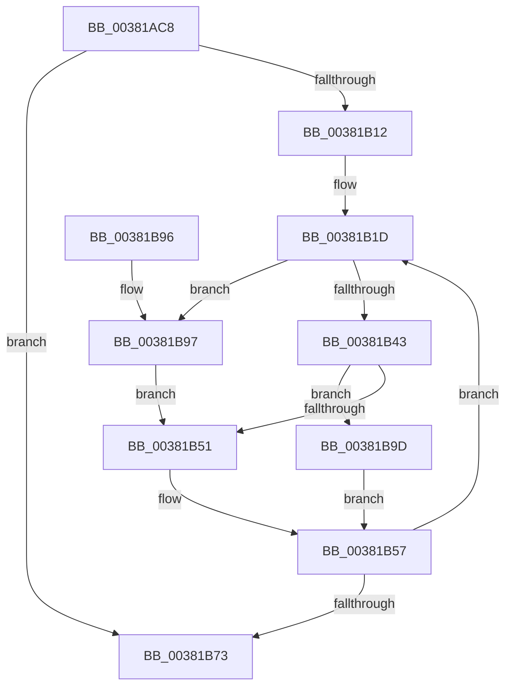

# MiObtainPagefileHashes

- RVA: `0x00381AC8`–`0x00381BA9` (길이 `225` bytes)
- VA: `0x0000000140381AC8`
- 실행 섹션: `.text`
- PDB 이름 있음: `예`; PDB Function 태그: `아니요`
- unwind 정보 RVA: `0x0007BA50`
- 디코드: `61`개 명령, `225/225` bytes 표시
- 미해석 바이트: `0` (있으면 어셈블리에 `.byte`로 보존)

> 이 문서는 커널 이미지의 기계어와 PDB 기호를 분석해 생성했습니다. 4번과 5번은 함수 원형과 자료형을 바이너리 사용 방식에서 추정한 C 해석이며 원본 소스 복구 결과는 아닙니다.

## 1. Dependencies

- 직접 호출 지점: **2**; 고유 호출 대상: **2**
- 직접 호출자로 확인된 함수: **2**
- RIP 상대 이미지 참조: **2**

### Outgoing calls
- `0x00381AF6` → [ExAcquireSpinLockSharedAtDpcLevel](../24/ExAcquireSpinLockSharedAtDpcLevel_function_00248E30.md) (function, `0x00248E30`)
- `0x00381B76` → [ExReleaseSpinLockSharedFromDpcLevel](../24/ExReleaseSpinLockSharedFromDpcLevel_function_0024A590.md) (function, `0x0024A590`)

### Direct callers
- [sub_00381821](Unknown_function_00381821.md) at `0x00381843`
- [MiArePagefileContentsCorrupted](MiArePagefileContentsCorrupted_function_003818C8.md) at `0x00381A76`

### Static image references
- `0x00381AFB` → RVA `0x00E3738C` (`.data`; read)
- `0x00381B48` → RVA `0x00E37390` (`.data`; read)

## 2. Other-region calls and transfers

- 다른 실행 섹션으로 향하는 call: **0**
- 별도 외부 분기/꼬리 이동을 확인하지 못했습니다.

## 3. Assembly (complete function range)

```asm
00381AC8  48 8B C4                        mov rax, rsp
00381ACB  48 89 58 08                     mov qword ptr [rax + 8], rbx
00381ACF  48 89 68 10                     mov qword ptr [rax + 0x10], rbp
00381AD3  48 89 70 18                     mov qword ptr [rax + 0x18], rsi
00381AD7  48 89 78 20                     mov qword ptr [rax + 0x20], rdi
00381ADB  41 56                           push r14
00381ADD  48 83 EC 20                     sub rsp, 0x20
00381AE1  48 8D A9 C8 00 00 00            lea rbp, [rcx + 0xc8]
00381AE8  41 8B F0                        mov esi, r8d
00381AEB  48 8B F9                        mov rdi, rcx
00381AEE  4D 8B F1                        mov r14, r9
00381AF1  48 8B CD                        mov rcx, rbp
00381AF4  8B DA                           mov ebx, edx
00381AF6  E8 35 73 EC FF                  call 0x140248e30
00381AFB  0F AF 1D 8A 58 AB 00            imul ebx, dword ptr [rip + 0xab588a]
00381B02  45 33 DB                        xor r11d, r11d
00381B05  8B D3                           mov edx, ebx
00381B07  48 03 97 B8 00 00 00            add rdx, qword ptr [rdi + 0xb8]
00381B0E  85 F6                           test esi, esi
00381B10  74 61                           je 0x140381b73
00381B12  49 8D 4E 08                     lea rcx, [r14 + 8]
00381B16  44 8B D6                        mov r10d, esi
00381B19  49 8D 5B FC                     lea rbx, [r11 - 4]
00381B1D  48 8B C2                        mov rax, rdx
00381B20  49 B8 F8 FF FF FF 7F 00 00 00   movabs r8, 0x7ffffffff8
00381B2A  48 C1 E8 09                     shr rax, 9
00381B2E  49 23 C0                        and rax, r8
00381B31  49 B8 00 00 00 00 80 F6 FF FF   movabs r8, 0xfffff68000000000
00381B3B  4A 8B 04 00                     mov rax, qword ptr [rax + r8]
00381B3F  A8 01                           test al, 1
00381B41  74 54                           je 0x140381b97
00381B43  8B 02                           mov eax, dword ptr [rdx]
00381B45  89 41 F8                        mov dword ptr [rcx - 8], eax
00381B48  44 39 1D 41 58 AB 00            cmp dword ptr [rip + 0xab5841], r11d
00381B4F  75 4C                           jne 0x140381b9d
00381B51  41 8B C3                        mov eax, r11d
00381B54  4C 89 19                        mov qword ptr [rcx], r11
00381B57  89 04 0B                        mov dword ptr [rbx + rcx], eax
00381B5A  4C 8B C1                        mov r8, rcx
00381B5D  8B 05 29 58 AB 00               mov eax, dword ptr [rip + 0xab5829]
00381B63  48 83 C1 10                     add rcx, 0x10
00381B67  48 03 D0                        add rdx, rax
00381B6A  4C 8B CB                        mov r9, rbx
00381B6D  49 83 EA 01                     sub r10, 1
00381B71  75 AA                           jne 0x140381b1d
00381B73  48 8B CD                        mov rcx, rbp
00381B76  E8 15 8A EC FF                  call 0x14024a590
00381B7B  48 8B 5C 24 30                  mov rbx, qword ptr [rsp + 0x30]
00381B80  48 8B 6C 24 38                  mov rbp, qword ptr [rsp + 0x38]
00381B85  48 8B 74 24 40                  mov rsi, qword ptr [rsp + 0x40]
00381B8A  48 8B 7C 24 48                  mov rdi, qword ptr [rsp + 0x48]
00381B8F  48 83 C4 20                     add rsp, 0x20
00381B93  41 5E                           pop r14
00381B95  C3                              ret
00381B96  CC                              int3
00381B97  44 89 59 F8                     mov dword ptr [rcx - 8], r11d
00381B9B  EB B4                           jmp 0x140381b51
00381B9D  48 8B 42 08                     mov rax, qword ptr [rdx + 8]
00381BA1  48 89 01                        mov qword ptr [rcx], rax
00381BA4  8B 42 04                        mov eax, dword ptr [rdx + 4]
00381BA7  EB AE                           jmp 0x140381b57
```

## 4. C-style interpretation (structured pseudocode)

```c
__int64 __fastcall MiObtainPagefileHashes(__int64 a1, int a2, int a3, __int64 a4)
{
    __int64 result;
    __int64 v_r10;
    __int64 v_r11;
    __int64 v_rbx;
    __int64 v_rsp;
    unsigned __int64 v_stack_p10;
    unsigned __int64 v_stack_p18;
    unsigned __int64 v_stack_p20;
    unsigned __int64 v_stack_p8;

    *(unsigned __int64 *)(v_rsp + 8) = v_rbx;
    *(unsigned __int64 *)(v_rsp + 16) = v_rbp;
    *(unsigned __int64 *)(v_rsp + 24) = v_rsi;
    *(unsigned __int64 *)(v_rsp + 32) = v_rdi;
    v_rsp = (v_rsp) - (32);
    result = ExAcquireSpinLockSharedAtDpcLevel(a1 + 200, a2, a3, a4);
    v_rbx = (unsigned int)(((unsigned int)(a2)) * (*(unsigned int *)(v_rip + 11229322)));
    v_r11 = 0;
    a2 = ((unsigned int)((unsigned int)(v_rbx))) + (*(unsigned __int64 *)(a1 + 184));
    if ((unsigned int)((unsigned int)(a3)) == 0) goto loc_00381B73;
loc_00381B1D:
    result = (a2) >> (9);
    result = (result) & (a3);
    if ((((unsigned __int8)(*(unsigned __int64 *)(result + a3 * 1))) & (1)) == 0) goto loc_00381B97;
    *(unsigned int *)(a4 + 8 - 8) = (unsigned int)((unsigned int)(*(unsigned int *)(a2)));
    if ((*(unsigned int *)(v_rip + 11229249)) != 0) goto loc_00381B9D;
loc_00381B51:
    *(unsigned __int64 *)(a4 + 8) = 0;
loc_00381B57:
    *(unsigned int *)(v_r11 - 4 + a4 + 8 * 1) = 0;
    a1 = (a4 + 8) + (16);
    a2 = (a2) + ((unsigned int)(*(unsigned int *)(v_rip + 11229225)));
    v_r10 = ((unsigned int)((unsigned int)((unsigned int)(a3)))) - (1);
    if (condition_is_not_equal) goto loc_00381B1D;
loc_00381B73:
    result = ExReleaseSpinLockSharedFromDpcLevel(a1 + 200, a2, a4 + 8, v_r11 - 4);
    v_rsp = (v_rsp) + (32);
    return result;
loc_00381B97:
    *(unsigned int *)(a1 + 200 - 8) = 0;
    goto loc_00381B51;
loc_00381B9D:
    *(unsigned __int64 *)(a1 + 200) = *(unsigned __int64 *)(a2 + 8);
    goto loc_00381B57;
}
```

## 5. (Beta) C Style

```c
int64_t MiObtainPagefileHashes(void *Arg1, void *Arg2, int32_t Arg3, void *Arg4)
{
    uint8_t *arg1 = (uint8_t *)Arg1;
    uint8_t *arg2 = (uint8_t *)Arg2;
    uint8_t *arg4 = (uint8_t *)Arg4;

    int64_t result;
    int64_t local_r10;
    int64_t local_r11;
    int64_t local_rbx;
    int64_t local_rsp;
    uint64_t v_stack_p10;
    uint64_t v_stack_p18;
    uint64_t v_stack_p20;
    uint64_t v_stack_p8;

    *(uint64_t *)(local_rsp + 0x8) = local_rbx;
    *(uint64_t *)(local_rsp + 0x10) = local_rbp;
    *(uint64_t *)(local_rsp + 0x18) = local_rsi;
    *(uint64_t *)(local_rsp + 0x20) = local_rdi;
    local_rsp = (local_rsp) - (32);
    result = ExAcquireSpinLockSharedAtDpcLevel(Arg1 + 200, Arg2, Arg3, Arg4);
    local_rbx = (uint32_t)(((uint32_t)(Arg2)) * (*(uint32_t *)(v_rip + 0xAB588A)));
    local_r11 = 0;
    Arg2 = ((uint32_t)((uint32_t)(local_rbx))) + (*(uint64_t *)(arg1 + 0xB8));
    if ((uint32_t)((uint32_t)(Arg3)) == 0) goto loc_00381B73;
loc_00381B1D:
    result = (Arg2) >> (9);
    result = (result) & (Arg3);
    if ((((uint8_t)(*(uint64_t *)(result + Arg3 * 1))) & (1)) == 0) goto loc_00381B97;
    *(uint32_t *)(arg4 + 0x8 - 0x8) = (uint32_t)((uint32_t)(*(uint32_t *)(arg2)));
    if ((*(uint32_t *)(v_rip + 0xAB5841)) != 0) goto loc_00381B9D;
loc_00381B51:
    *(uint64_t *)(arg4 + 0x8) = 0;
loc_00381B57:
    *(uint32_t *)(local_r11 - 0x4 + arg4 + 0x8 * 1) = 0;
    Arg1 = (Arg4 + 8) + (16);
    Arg2 = (Arg2) + ((uint32_t)(*(uint32_t *)(v_rip + 0xAB5829)));
    local_r10 = ((uint32_t)((uint32_t)((uint32_t)(Arg3)))) - (1);
    if (condition_is_not_equal) goto loc_00381B1D;
loc_00381B73:
    result = ExReleaseSpinLockSharedFromDpcLevel(Arg1 + 200, Arg2, Arg4 + 8, local_r11 - 4);
    local_rsp = (local_rsp) + (32);
    return result;
loc_00381B97:
    *(uint32_t *)(arg1 + 0xC8 - 0x8) = 0;
    goto loc_00381B51;
loc_00381B9D:
    *(uint64_t *)(arg1 + 0xC8) = *(uint64_t *)(arg2 + 0x8);
    goto loc_00381B57;
}
```

### 관측된 메모리 오프셋

구조체 형식이 확인되지 않은 접근은 인자 기준의 오프셋으로만 기록했습니다.

| 기준 인자 | 오프셋 표현 | 폭 (bit) | 접근 |
|---|---:|---:|---|
| `Arg1` | `+ 0xB8` | `64` | `R` |
| `Arg1` | `+ 0xC8` | `64` | `R` |
| `Arg2` | `+ 0x0` | `32` | `R` |
| `Arg2` | `+ 0x4` | `32` | `R` |
| `Arg2` | `+ 0x8` | `64` | `R` |
| `Arg4` | `- 0x8` | `32` | `W` |
| `Arg4` | `+ 0x0` | `64` | `W` |
| `Arg4` | `+ 0x8` | `64` | `R` |

## 6. Execution-region graph

[열기: 2D/3D 그래프와 함수 탐색 컨트롤 패널](../../../control-panel.html?section=text&rva=0x00381AC8&view=graph)

- 2D 그래프는 위에서 아래로 흐르고, 3D 그래프는 빈 공간을 드래그해 회전합니다. Shift+드래그는 이동, 휠은 확대·축소, 함수 노드 선택은 대상 보고서 이동입니다.

### Static fallback


