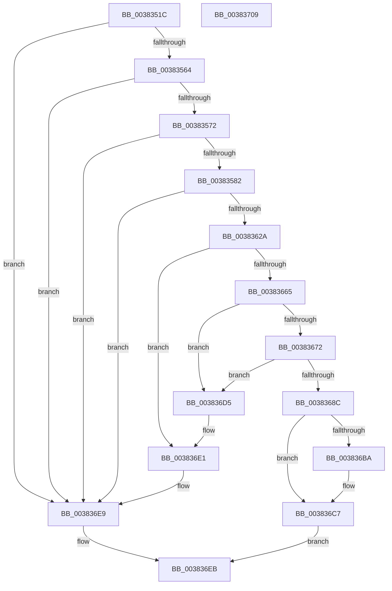

# MiReplaceLockedPage

- RVA: `0x0038351C`–`0x0038370A` (길이 `494` bytes)
- VA: `0x000000014038351C`
- 실행 섹션: `.text`
- PDB 이름 있음: `예`; PDB Function 태그: `아니요`
- unwind 정보 RVA: `0x0007BBB4`
- 디코드: `130`개 명령, `494/494` bytes 표시
- 미해석 바이트: `0` (있으면 어셈블리에 `.byte`로 보존)

> 이 문서는 커널 이미지의 기계어와 PDB 기호를 분석해 생성했습니다. 4번과 5번은 함수 원형과 자료형을 바이너리 사용 방식에서 추정한 C 해석이며 원본 소스 복구 결과는 아닙니다.

## 1. Dependencies

- 직접 호출 지점: **13**; 고유 호출 대상: **12**
- 직접 호출자로 확인된 함수: **1**
- RIP 상대 이미지 참조: **4**

### Outgoing calls
- `0x00383575` → [MiCanPageMove](MiCanPageMove_function_00383710.md) (function, `0x00383710`)
- `0x003835C9` → [MiGetPfnChannel](../33/MiGetPfnChannel_function_0033BA90.md) (function, `0x0033BA90`)
- `0x003835D4` → [MiPageToNode](../33/MiPageToNode_function_00338CD0.md) (function, `0x00338CD0`)
- `0x0038361B` → [MiGetPage](../28/MiGetPage_function_002884C0.md) (function, `0x002884C0`)
- `0x00383658` → [MiLockProtoPoolPage](../2B/MiLockProtoPoolPage_function_002B8B80.md) (function, `0x002B8B80`)
- `0x00383668` → [MiGetPfnSlabType](../28/MiGetPfnSlabType_function_0028E2D0.md) (function, `0x0028E2D0`)
- `0x00383683` → [MiTradeActivePage](../37/MiTradeActivePage_function_00374424.md) (function, `0x00374424`)
- `0x00383691` → [MiUnlockProtoPoolPage](../24/MiUnlockProtoPoolPage_function_00246090.md) (function, `0x00246090`)
- `0x003836A4` → [MiSetOriginalPtePfnFromFreeList](../28/MiSetOriginalPtePfnFromFreeList_function_0028A99C.md) (function, `0x0028A99C`)
- `0x003836AC` → [MiReleaseFreshPageAtDpc](../33/MiReleaseFreshPageAtDpc_function_00334B50.md) (function, `0x00334B50`)
- `0x003836C2` → [KiLowerIrqlProcessIrqlFlags](../4F/KiLowerIrqlProcessIrqlFlags_function_004F5698.md) (function, `0x004F5698`)
- `0x003836DC` → [MiUnlockProtoPoolPage](../24/MiUnlockProtoPoolPage_function_00246090.md) (function, `0x00246090`)
- `0x003836E4` → [MiReleaseFreshPage](../33/MiReleaseFreshPage_function_00334AE0.md) (function, `0x00334AE0`)

### Direct callers
- [MiTrimSharedPageFromViews](../2E/MiTrimSharedPageFromViews_function_002E16F8.md) at `0x002E20B0`

### Static image references
- `0x003835B5` → RVA `0x00E2DCCC` (`.data`; read)
- `0x00383607` → RVA `0x00E30088` (`.data`; read)
- `0x00383696` → RVA `0x00010880` (`.rdata`; read)
- `0x003836B1` → RVA `0x00FC6D20` (`ALMOSTRO`; read)

## 2. Other-region calls and transfers

- 다른 실행 섹션으로 향하는 call: **0**
- 별도 외부 분기/꼬리 이동을 확인하지 못했습니다.

## 3. Assembly (complete function range)

```asm
0038351C  48 89 5C 24 10                  mov qword ptr [rsp + 0x10], rbx
00383521  48 89 6C 24 18                  mov qword ptr [rsp + 0x18], rbp
00383526  48 89 74 24 20                  mov qword ptr [rsp + 0x20], rsi
0038352B  57                              push rdi
0038352C  41 54                           push r12
0038352E  41 55                           push r13
00383530  41 56                           push r14
00383532  41 57                           push r15
00383534  48 83 EC 40                     sub rsp, 0x40
00383538  48 8B 41 18                     mov rax, qword ptr [rcx + 0x18]
0038353C  4C 8B F1                        mov r14, rcx
0038353F  48 B9 FF FF FF FF FF FF FF 3F   movabs rcx, 0x3fffffffffffffff
00383549  41 BD 01 00 00 00               mov r13d, 1
0038354F  48 23 C1                        and rax, rcx
00383552  45 8B F9                        mov r15d, r9d
00383555  41 8B D8                        mov ebx, r8d
00383558  4C 8B E2                        mov r12, rdx
0038355B  49 3B C5                        cmp rax, r13
0038355E  0F 85 85 01 00 00               jne 0x1403836e9
00383564  41 8B 46 20                     mov eax, dword ptr [r14 + 0x20]
00383568  66 41 3B C5                     cmp ax, r13w
0038356C  0F 85 77 01 00 00               jne 0x1403836e9
00383572  49 8B CE                        mov rcx, r14
00383575  E8 96 01 00 00                  call 0x140383710
0038357A  85 C0                           test eax, eax
0038357C  0F 84 67 01 00 00               je 0x1403836e9
00383582  C6 44 24 70 11                  mov byte ptr [rsp + 0x70], 0x11
00383587  48 B8 00 00 00 00 00 DE FF FF   movabs rax, 0xffffde0000000000
00383591  48 8B C0                        mov rax, rax
00383594  33 D2                           xor edx, edx
00383596  49 8B F6                        mov rsi, r14
00383599  48 2B F0                        sub rsi, rax
0038359C  49 8B CE                        mov rcx, r14
0038359F  48 B8 AB AA AA AA AA AA AA AA   movabs rax, 0xaaaaaaaaaaaaaaab
003835A9  48 C1 FE 04                     sar rsi, 4
003835AD  48 0F AF F0                     imul rsi, rax
003835B1  41 8B 46 20                     mov eax, dword ptr [r14 + 0x20]
003835B5  44 8B 05 10 A7 AA 00            mov r8d, dword ptr [rip + 0xaaa710]
003835BC  89 44 24 30                     mov dword ptr [rsp + 0x30], eax
003835C0  48 8B C6                        mov rax, rsi
003835C3  49 F7 F0                        div r8
003835C6  48 8B EA                        mov rbp, rdx
003835C9  E8 C2 84 FB FF                  call 0x14033ba90
003835CE  48 8B CE                        mov rcx, rsi
003835D1  0F B6 F8                        movzx edi, al
003835D4  E8 F7 56 FB FF                  call 0x140338cd0
003835D9  0F B6 4C 24 32                  movzx ecx, byte ptr [rsp + 0x32]
003835DE  8B D0                           mov edx, eax
003835E0  83 E2 3F                        and edx, 0x3f
003835E3  83 E1 F0                        and ecx, 0xfffffff0
003835E6  83 C9 30                        or ecx, 0x30
003835E9  8B C7                           mov eax, edi
003835EB  41 23 C5                        and eax, r13d
003835EE  C1 E1 03                        shl ecx, 3
003835F1  0B D1                           or edx, ecx
003835F3  44 8B C3                        mov r8d, ebx
003835F6  03 D2                           add edx, edx
003835F8  0B D0                           or edx, eax
003835FA  40 0F B6 C5                     movzx eax, bpl
003835FE  C1 E2 08                        shl edx, 8
00383601  0B D0                           or edx, eax
00383603  49 8B 46 28                     mov rax, qword ptr [r14 + 0x28]
00383607  48 8B 0D 7A CA AA 00            mov rcx, qword ptr [rip + 0xaaca7a]
0038360E  48 C1 E8 2B                     shr rax, 0x2b
00383612  25 FF 03 00 00                  and eax, 0x3ff
00383617  48 8B 0C C1                     mov rcx, qword ptr [rcx + rax*8]
0038361B  E8 A0 4E F0 FF                  call 0x1402884c0
00383620  48 83 F8 FF                     cmp rax, -1
00383624  0F 84 BF 00 00 00               je 0x1403836e9
0038362A  48 8D 1C 40                     lea rbx, [rax + rax*2]
0038362E  48 B8 00 00 00 00 00 DE FF FF   movabs rax, 0xffffde0000000000
00383638  48 C1 E3 04                     shl rbx, 4
0038363C  48 8B C0                        mov rax, rax
0038363F  49 8B 4E 08                     mov rcx, qword ptr [r14 + 8]
00383643  48 8D 54 24 70                  lea rdx, [rsp + 0x70]
00383648  48 03 D8                        add rbx, rax
0038364B  48 B8 00 00 00 00 00 00 00 80   movabs rax, 0x8000000000000000
00383655  48 0B C8                        or rcx, rax
00383658  E8 23 55 F3 FF                  call 0x1402b8b80
0038365D  48 8B F8                        mov rdi, rax
00383660  48 85 C0                        test rax, rax
00383663  74 7C                           je 0x1403836e1
00383665  49 8B CE                        mov rcx, r14
00383668  E8 63 AC F0 FF                  call 0x14028e2d0
0038366D  83 F8 09                        cmp eax, 9
00383670  75 63                           jne 0x1403836d5
00383672  83 64 24 20 00                  and dword ptr [rsp + 0x20], 0
00383677  45 8B CF                        mov r9d, r15d
0038367A  4D 8B C4                        mov r8, r12
0038367D  48 8B D3                        mov rdx, rbx
00383680  49 8B CE                        mov rcx, r14
00383683  E8 9C 0D FF FF                  call 0x140374424
00383688  85 C0                           test eax, eax
0038368A  74 49                           je 0x1403836d5
0038368C  B2 11                           mov dl, 0x11
0038368E  48 8B CF                        mov rcx, rdi
00383691  E8 FA 29 EC FF                  call 0x140246090
00383696  48 8B 05 E3 D1 C8 FF            mov rax, qword ptr [rip - 0x372e1d]
0038369D  49 8D 4E 10                     lea rcx, [r14 + 0x10]
003836A1  48 89 01                        mov qword ptr [rcx], rax
003836A4  E8 F3 72 F0 FF                  call 0x14028a99c
003836A9  49 8B CE                        mov rcx, r14
003836AC  E8 9F 14 FB FF                  call 0x140334b50
003836B1  83 3D 68 36 C4 00 00            cmp dword ptr [rip + 0xc43668], 0
003836B8  74 0D                           je 0x1403836c7
003836BA  44 0F 20 C1                     mov rcx, cr8
003836BE  8A 54 24 70                     mov dl, byte ptr [rsp + 0x70]
003836C2  E8 D1 1F 17 00                  call 0x1404f5698
003836C7  0F B6 4C 24 70                  movzx ecx, byte ptr [rsp + 0x70]
003836CC  44 0F 22 C1                     mov cr8, rcx
003836D0  41 8B C5                        mov eax, r13d
003836D3  EB 16                           jmp 0x1403836eb
003836D5  8A 54 24 70                     mov dl, byte ptr [rsp + 0x70]
003836D9  48 8B CF                        mov rcx, rdi
003836DC  E8 AF 29 EC FF                  call 0x140246090
003836E1  48 8B CB                        mov rcx, rbx
003836E4  E8 F7 13 FB FF                  call 0x140334ae0
003836E9  33 C0                           xor eax, eax
003836EB  4C 8D 5C 24 40                  lea r11, [rsp + 0x40]
003836F0  49 8B 5B 38                     mov rbx, qword ptr [r11 + 0x38]
003836F4  49 8B 6B 40                     mov rbp, qword ptr [r11 + 0x40]
003836F8  49 8B 73 48                     mov rsi, qword ptr [r11 + 0x48]
003836FC  49 8B E3                        mov rsp, r11
003836FF  41 5F                           pop r15
00383701  41 5E                           pop r14
00383703  41 5D                           pop r13
00383705  41 5C                           pop r12
00383707  5F                              pop rdi
00383708  C3                              ret
00383709  CC                              int3
```

## 4. C-style interpretation (structured pseudocode)

```c
__int64 __fastcall MiReplaceLockedPage(__int64 a1, __int64 a2, int a3, int a4)
{
    __int64 result;
    __int64 v_rbx;
    __int64 v_rsi;
    __int64 v_rsp;
    unsigned __int64 v_stack_m28;
    unsigned __int8 v_stack_m36;
    unsigned int v_stack_m38;
    unsigned int v_stack_m48;
    unsigned __int64 v_stack_p10;
    unsigned __int64 v_stack_p18;
    unsigned __int64 v_stack_p20;
    unsigned __int8 v_stack_p8;

    v_stack_p10 = v_rbx;
    v_stack_p18 = v_rbp;
    v_stack_p20 = v_rsi;
    v_rsp = (v_rsp) - (64);
    result = (*(unsigned __int64 *)(a1 + 24)) & (a1);
    if (result != 1) goto loc_003836E9;
    if (((unsigned __int16)((unsigned int)(*(unsigned int *)(a1 + 32)))) != 1) goto loc_003836E9;
    result = MiCanPageMove(a1, a2, a3, a4);
    if ((unsigned int)(result) == 0) goto loc_003836E9;
    v_stack_p8 = 17;
    a2 = 0;
    v_rsi = (a1) - (result);
    v_rsi = (v_rsi) >> (4);
    v_rsi = (v_rsi) * (result);
    v_stack_m38 = (unsigned int)((unsigned int)(*(unsigned int *)(a1 + 32)));
    result = MiGetPfnChannel(a1, a2, (unsigned int)(*(unsigned int *)(v_rip + 11183888)), a4);
    result = MiPageToNode(v_rsi, a2, (unsigned int)(*(unsigned int *)(v_rip + 11183888)), a4);
    a2 = (unsigned int)(((unsigned int)((unsigned int)(result))) & (63));
    a1 = (unsigned int)((v_stack_m36) & (0xFFFFFFF0ULL));
    a1 = (unsigned int)((a1) | (48));
    result = (unsigned int)(((unsigned int)((unsigned int)((unsigned __int8)(result)))) & (1));
    a1 = (unsigned int)((a1) << (3));
    a2 = (unsigned int)((a2) | ((unsigned int)(a1)));
    a2 = (unsigned int)((a2) + ((unsigned int)(a2)));
    a2 = (unsigned int)((a2) | ((unsigned int)(result)));
    a2 = (unsigned int)((a2) << (8));
    a2 = (unsigned int)((a2) | (0));
    result = (*(unsigned __int64 *)(a1 + 40)) >> (43);
    result = (unsigned int)((result) & (0x3FFULL));
    result = MiGetPage(*(unsigned __int64 *)(*(unsigned __int64 *)(v_rip + 11192954) + result * 8), a2, (unsigned int)((unsigned int)((unsigned int)(a3))), a4);
    if (result == -1) goto loc_003836E9;
    v_rbx = (result + result * 2) << (4);
    v_rbx = (v_rbx) + (result);
    a1 = (*(unsigned __int64 *)(a1 + 8)) | (result);
    result = MiLockProtoPoolPage(a1, v_stack_p8, (unsigned int)((unsigned int)((unsigned int)(a3))), a4);
    if (result == 0) goto loc_003836E1;
    result = MiGetPfnSlabType(a1, v_stack_p8, (unsigned int)((unsigned int)((unsigned int)(a3))), a4);
    if (((unsigned int)(result)) != 9) goto loc_003836D5;
    result = MiTradeActivePage(a1, v_rbx, a2, (unsigned int)((unsigned int)((unsigned int)(a4))));
    if ((unsigned int)(result) == 0) goto loc_003836D5;
    result = MiUnlockProtoPoolPage(result, 17, a2, (unsigned int)((unsigned int)((unsigned int)(a4))));
    *(unsigned __int64 *)(a1 + 16) = *(unsigned __int64 *)(v_rip - 3616285);
    result = MiSetOriginalPtePfnFromFreeList(a1 + 16, 17, a2, (unsigned int)((unsigned int)((unsigned int)(a4))));
    result = MiReleaseFreshPageAtDpc(a1, 17, a2, (unsigned int)((unsigned int)((unsigned int)(a4))));
    if ((*(unsigned int *)(v_rip + 12858984)) != 0) {
        a1 = v_cr8;
        a2 = v_stack_p8;
        result = KiLowerIrqlProcessIrqlFlags(a1, a2, a2, (unsigned int)((unsigned int)((unsigned int)(a4))));
    }
    goto loc_003836EB;
loc_003836D5:
    result = MiUnlockProtoPoolPage(result, v_stack_p8, a2, (unsigned int)((unsigned int)((unsigned int)(a4))));
loc_003836E1:
    result = MiReleaseFreshPage(v_rbx, v_stack_p8, a2, (unsigned int)((unsigned int)((unsigned int)(a4))));
loc_003836E9:
    result = 0;
loc_003836EB:
    return result;
}
```

## 5. (Beta) C Style

```c
int64_t MiReplaceLockedPage(void *Arg1, int64_t Arg2, int32_t Arg3, int32_t Arg4)
{
    uint8_t *arg1 = (uint8_t *)Arg1;

    int64_t result;
    int64_t local_rbx;
    int64_t local_rsi;
    int64_t local_rsp;
    uint64_t v_stack_m28;
    uint8_t v_stack_m36;
    uint32_t v_stack_m38;
    uint32_t v_stack_m48;
    uint64_t v_stack_p10;
    uint64_t v_stack_p18;
    uint64_t v_stack_p20;
    uint8_t v_stack_p8;

    v_stack_p10 = local_rbx;
    v_stack_p18 = local_rbp;
    v_stack_p20 = local_rsi;
    local_rsp = (local_rsp) - (64);
    result = (*(uint64_t *)(arg1 + 0x18)) & (Arg1);
    if (result != 1) goto loc_003836E9;
    if (((uint16_t)((uint32_t)(*(uint32_t *)(arg1 + 0x20)))) != 1) goto loc_003836E9;
    result = MiCanPageMove(Arg1, Arg2, Arg3, Arg4);
    if ((uint32_t)(result) == 0) goto loc_003836E9;
    v_stack_p8 = 17;
    Arg2 = 0;
    local_rsi = (Arg1) - (result);
    local_rsi = (local_rsi) >> (4);
    local_rsi = (local_rsi) * (result);
    v_stack_m38 = (uint32_t)((uint32_t)(*(uint32_t *)(arg1 + 0x20)));
    result = MiGetPfnChannel(Arg1, Arg2, (uint32_t)(*(uint32_t *)(v_rip + 0xAAA710)), Arg4);
    result = MiPageToNode(local_rsi, Arg2, (uint32_t)(*(uint32_t *)(v_rip + 0xAAA710)), Arg4);
    Arg2 = (uint32_t)(((uint32_t)((uint32_t)(result))) & (63));
    Arg1 = (uint32_t)((v_stack_m36) & (0xFFFFFFF0ULL));
    Arg1 = (uint32_t)((Arg1) | (48));
    result = (uint32_t)(((uint32_t)((uint32_t)((uint8_t)(result)))) & (1));
    Arg1 = (uint32_t)((Arg1) << (3));
    Arg2 = (uint32_t)((Arg2) | ((uint32_t)(Arg1)));
    Arg2 = (uint32_t)((Arg2) + ((uint32_t)(Arg2)));
    Arg2 = (uint32_t)((Arg2) | ((uint32_t)(result)));
    Arg2 = (uint32_t)((Arg2) << (8));
    Arg2 = (uint32_t)((Arg2) | (0));
    result = (*(uint64_t *)(arg1 + 0x28)) >> (43);
    result = (uint32_t)((result) & (0x3FFULL));
    result = MiGetPage(*(uint64_t *)(*(uint64_t *)(v_rip + 0xAACA7A) + result * 8), Arg2, (uint32_t)((uint32_t)((uint32_t)(Arg3))), Arg4);
    if (result == -1) goto loc_003836E9;
    local_rbx = (result + result * 2) << (4);
    local_rbx = (local_rbx) + (result);
    Arg1 = (*(uint64_t *)(arg1 + 0x8)) | (result);
    result = MiLockProtoPoolPage(Arg1, v_stack_p8, (uint32_t)((uint32_t)((uint32_t)(Arg3))), Arg4);
    if (result == 0) goto loc_003836E1;
    result = MiGetPfnSlabType(Arg1, v_stack_p8, (uint32_t)((uint32_t)((uint32_t)(Arg3))), Arg4);
    if (((uint32_t)(result)) != 9) goto loc_003836D5;
    result = MiTradeActivePage(Arg1, local_rbx, Arg2, (uint32_t)((uint32_t)((uint32_t)(Arg4))));
    if ((uint32_t)(result) == 0) goto loc_003836D5;
    result = MiUnlockProtoPoolPage(result, 17, Arg2, (uint32_t)((uint32_t)((uint32_t)(Arg4))));
    *(uint64_t *)(arg1 + 0x10) = *(uint64_t *)(v_rip - 0x372E1D);
    result = MiSetOriginalPtePfnFromFreeList(Arg1 + 16, 17, Arg2, (uint32_t)((uint32_t)((uint32_t)(Arg4))));
    result = MiReleaseFreshPageAtDpc(Arg1, 17, Arg2, (uint32_t)((uint32_t)((uint32_t)(Arg4))));
    if ((*(uint32_t *)(v_rip + 0xC43668)) != 0) {
        Arg1 = v_cr8;
        Arg2 = v_stack_p8;
        result = KiLowerIrqlProcessIrqlFlags(Arg1, Arg2, Arg2, (uint32_t)((uint32_t)((uint32_t)(Arg4))));
    }
    goto loc_003836EB;
loc_003836D5:
    result = MiUnlockProtoPoolPage(result, v_stack_p8, Arg2, (uint32_t)((uint32_t)((uint32_t)(Arg4))));
loc_003836E1:
    result = MiReleaseFreshPage(local_rbx, v_stack_p8, Arg2, (uint32_t)((uint32_t)((uint32_t)(Arg4))));
loc_003836E9:
    result = 0;
loc_003836EB:
    return result;
}
```

### 관측된 메모리 오프셋

구조체 형식이 확인되지 않은 접근은 인자 기준의 오프셋으로만 기록했습니다.

| 기준 인자 | 오프셋 표현 | 폭 (bit) | 접근 |
|---|---:|---:|---|
| `Arg1` | `+ 0x0` | `64` | `W` |
| `Arg1` | `+ 0x8` | `64` | `R` |
| `Arg1` | `+ 0x10` | `64` | `R` |
| `Arg1` | `+ 0x18` | `64` | `R` |
| `Arg1` | `+ 0x20` | `32` | `R` |
| `Arg1` | `+ 0x28` | `64` | `R` |

## 6. Execution-region graph

[열기: 2D/3D 그래프와 함수 탐색 컨트롤 패널](../../../control-panel.html?section=text&rva=0x0038351C&view=graph)

- 2D 그래프는 위에서 아래로 흐르고, 3D 그래프는 빈 공간을 드래그해 회전합니다. Shift+드래그는 이동, 휠은 확대·축소, 함수 노드 선택은 대상 보고서 이동입니다.

### Static fallback


