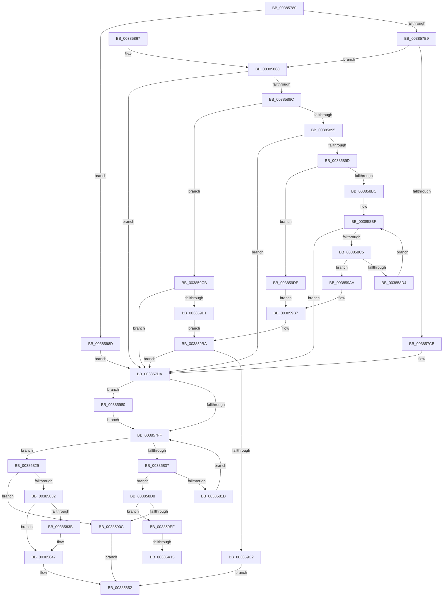

# MiRepurposeStandbySlabPage

- RVA: `0x00385780`–`0x00385A26` (길이 `678` bytes)
- VA: `0x0000000140385780`
- 실행 섹션: `.text`
- PDB 이름 있음: `예`; PDB Function 태그: `예`
- unwind 정보 RVA: `0x0007BCB0`
- 디코드: `180`개 명령, `678/678` bytes 표시
- 미해석 바이트: `0` (있으면 어셈블리에 `.byte`로 보존)

> 이 문서는 커널 이미지의 기계어와 PDB 기호를 분석해 생성했습니다. 4번과 5번은 함수 원형과 자료형을 바이너리 사용 방식에서 추정한 C 해석이며 원본 소스 복구 결과는 아닙니다.

## 1. Dependencies

- 직접 호출 지점: **8**; 고유 호출 대상: **8**
- 직접 호출자로 확인된 함수: **2**
- RIP 상대 이미지 참조: **1**

### Outgoing calls
- `0x00385842` → [KiLowerIrqlProcessIrqlFlags](../4F/KiLowerIrqlProcessIrqlFlags_function_004F5698.md) (function, `0x004F5698`)
- `0x003858FB` → [MiLockLowestPrioritySecondaryStandbyPage](MiLockLowestPrioritySecondaryStandbyPage_function_00385A2C.md) (function, `0x00385A2C`)
- `0x00385929` → [MiUnlinkPageFromListEx](../28/MiUnlinkPageFromListEx_function_00287590.md) (function, `0x00287590`)
- `0x00385937` → [ExReleaseSpinLockExclusiveFromDpcLevel](../24/ExReleaseSpinLockExclusiveFromDpcLevel_function_002497E0.md) (function, `0x002497E0`)
- `0x00385944` → [MiDiscardTransitionPteEx](../37/MiDiscardTransitionPteEx_function_00375954.md) (function, `0x00375954`)
- `0x00385968` → [MiReInitializeFreeSlabPfn](../37/MiReInitializeFreeSlabPfn_function_003758D8.md) (function, `0x003758D8`)
- `0x00385973` → [MiUnlockPage](../31/MiUnlockPage_function_0031A3E0.md) (function, `0x0031A3E0`)
- `0x00385983` → [KiRaiseIrqlProcessIrqlFlags](../4F/KiRaiseIrqlProcessIrqlFlags_function_004F56FC.md) (function, `0x004F56FC`)

### Direct callers
- [MiGetPageFromSlabAllocator](../37/MiGetPageFromSlabAllocator_function_00377294.md) at `0x003774E2`
- [MiGetPageFromSlabAllocator](../37/MiGetPageFromSlabAllocator_function_00377294.md) at `0x0037750A`
- [sub_006E3F8C](../6E/Unknown_function_006E3F8C.md) at `0x006E3FD4`

### Static image references
- `0x003857F2` → RVA `0x00FC6D20` (`ALMOSTRO`; read)

## 2. Other-region calls and transfers

- 다른 실행 섹션으로 향하는 call: **0**
- call이 아닌 외부 분기/꼬리 이동: **2**
  - `0x00385A0F` → [sub_006E4B4C](../6E/Unknown_function_006E4B4C.md) (`tail-transfer`)
  - `0x00385A21` → [sub_006E4B4C + 0x56](../6E/Unknown_function_006E4B4C.md) (`tail-transfer`)

## 3. Assembly (complete function range)

```asm
00385780  48 89 5C 24 20                  mov qword ptr [rsp + 0x20], rbx
00385785  55                              push rbp
00385786  56                              push rsi
00385787  57                              push rdi
00385788  41 54                           push r12
0038578A  41 55                           push r13
0038578C  41 56                           push r14
0038578E  41 57                           push r15
00385790  48 83 EC 20                     sub rsp, 0x20
00385794  8B 81 84 00 00 00               mov eax, dword ptr [rcx + 0x84]
0038579A  4C 8B E9                        mov r13, rcx
0038579D  48 69 D8 80 DF 00 00            imul rbx, rax, 0xdf80
003857A4  48 8B 41 18                     mov rax, qword ptr [rcx + 0x18]
003857A8  0F B6 EA                        movzx ebp, dl
003857AB  48 03 58 10                     add rbx, qword ptr [rax + 0x10]
003857AF  40 80 FD FF                     cmp bpl, 0xff
003857B3  0F 85 D4 01 00 00               jne 0x14038598d
003857B9  8B B1 80 00 00 00               mov esi, dword ptr [rcx + 0x80]
003857BF  40 32 ED                        xor bpl, bpl
003857C2  83 FE 08                        cmp esi, 8
003857C5  0F 84 9D 00 00 00               je 0x140385868
003857CB  45 32 FF                        xor r15b, r15b
003857CE  44 88 7C 24 68                  mov byte ptr [rsp + 0x68], r15b
003857D3  48 81 C3 98 DE 00 00            add rbx, 0xde98
003857DA  48 83 CF FF                     or rdi, 0xffffffffffffffff
003857DE  48 83 64 24 60 00               and qword ptr [rsp + 0x60], 0
003857E4  4C 8B F7                        mov r14, rdi
003857E7  45 0F 20 C4                     mov r12, cr8
003857EB  8D 57 03                        lea edx, [rdi + 3]
003857EE  44 0F 22 C2                     mov cr8, rdx
003857F2  83 3D 27 15 C4 00 00            cmp dword ptr [rip + 0xc41527], 0
003857F9  0F 85 81 01 00 00               jne 0x140385980
003857FF  49 8B C6                        mov rax, r14
00385802  41 3A EF                        cmp bpl, r15b
00385805  77 22                           ja 0x140385829
00385807  48 8B 43 08                     mov rax, qword ptr [rbx + 8]
0038580B  44 8B FE                        mov r15d, esi
0038580E  4C 0F A3 38                     bt qword ptr [rax], r15
00385812  0F 92 C0                        setb al
00385815  84 C0                           test al, al
00385817  0F 85 BB 00 00 00               jne 0x1403858d8
0038581D  44 8A 7C 24 68                  mov r15b, byte ptr [rsp + 0x68]
00385822  40 FE C5                        inc bpl
00385825  FF C6                           inc esi
00385827  EB D6                           jmp 0x1403857ff
00385829  48 3B C7                        cmp rax, rdi
0038582C  0F 85 DA 00 00 00               jne 0x14038590c
00385832  83 3D E7 14 C4 00 00            cmp dword ptr [rip + 0xc414e7], 0
00385839  74 0C                           je 0x140385847
0038583B  44 0F 20 C1                     mov rcx, cr8
0038583F  41 8A D4                        mov dl, r12b
00385842  E8 51 FE 16 00                  call 0x1404f5698
00385847  41 0F B6 C4                     movzx eax, r12b
0038584B  44 0F 22 C0                     mov cr8, rax
0038584F  48 8B C7                        mov rax, rdi
00385852  48 8B 5C 24 78                  mov rbx, qword ptr [rsp + 0x78]
00385857  48 83 C4 20                     add rsp, 0x20
0038585B  41 5F                           pop r15
0038585D  41 5E                           pop r14
0038585F  41 5D                           pop r13
00385861  41 5C                           pop r12
00385863  5F                              pop rdi
00385864  5E                              pop rsi
00385865  5D                              pop rbp
00385866  C3                              ret
00385867  CC                              int3
00385868  48 8B 9B B0 DE 00 00            mov rbx, qword ptr [rbx + 0xdeb0]
0038586F  33 F6                           xor esi, esi
00385871  48 81 C3 F0 CA 04 00            add rbx, 0x4caf0
00385878  41 B7 40                        mov r15b, 0x40
0038587B  44 88 7C 24 68                  mov byte ptr [rsp + 0x68], r15b
00385880  8B 03                           mov eax, dword ptr [rbx]
00385882  8B 13                           mov edx, dword ptr [rbx]
00385884  85 C0                           test eax, eax
00385886  0F 84 4E FF FF FF               je 0x1403857da
0038588C  83 FA 01                        cmp edx, 1
0038588F  0F 86 36 01 00 00               jbe 0x1403859cb
00385895  3B C2                           cmp eax, edx
00385897  0F 82 3D FF FF FF               jb 0x1403857da
0038589D  48 8B 4B 08                     mov rcx, qword ptr [rbx + 8]
003858A1  44 8D 42 FF                     lea r8d, [rdx - 1]
003858A5  41 8B C0                        mov eax, r8d
003858A8  48 C1 E8 05                     shr rax, 5
003858AC  44 8B 09                        mov r9d, dword ptr [rcx]
003858AF  4C 8D 14 81                     lea r10, [rcx + rax*4]
003858B3  49 3B CA                        cmp rcx, r10
003858B6  0F 84 22 01 00 00               je 0x1403859de
003858BC  45 85 C9                        test r9d, r9d
003858BF  0F 85 15 FF FF FF               jne 0x1403857da
003858C5  48 83 C1 04                     add rcx, 4
003858C9  8B 11                           mov edx, dword ptr [rcx]
003858CB  49 3B CA                        cmp rcx, r10
003858CE  0F 84 D6 00 00 00               je 0x1403859aa
003858D4  85 D2                           test edx, edx
003858D6  EB E7                           jmp 0x1403858bf
003858D8  49 8B 4D 18                     mov rcx, qword ptr [r13 + 0x18]
003858DC  4C 8D 44 24 60                  lea r8, [rsp + 0x60]
003858E1  40 0F B6 C5                     movzx eax, bpl
003858E5  45 33 C9                        xor r9d, r9d
003858E8  48 69 C0 C0 02 00 00            imul rax, rax, 0x2c0
003858EF  49 03 45 48                     add rax, qword ptr [r13 + 0x48]
003858F3  48 8B D0                        mov rdx, rax
003858F6  48 89 44 24 70                  mov qword ptr [rsp + 0x70], rax
003858FB  E8 2C 01 00 00                  call 0x140385a2c
00385900  4C 8B F0                        mov r14, rax
00385903  48 3B C7                        cmp rax, rdi
00385906  0F 84 E3 00 00 00               je 0x1403859ef
0038590C  4B 8D 1C 76                     lea rbx, [r14 + r14*2]
00385910  48 C1 E3 04                     shl rbx, 4
00385914  48 B8 00 00 00 00 00 DE FF FF   movabs rax, 0xffffde0000000000
0038591E  48 03 D8                        add rbx, rax
00385921  BA 01 00 00 00                  mov edx, 1
00385926  48 8B CB                        mov rcx, rbx
00385929  E8 62 1C F0 FF                  call 0x140287590
0038592E  48 8B 4C 24 60                  mov rcx, qword ptr [rsp + 0x60]
00385933  48 83 C1 20                     add rcx, 0x20
00385937  E8 A4 3E EC FF                  call 0x1402497e0
0038593C  BA 00 08 00 00                  mov edx, 0x800
00385941  48 8B CB                        mov rcx, rbx
00385944  E8 0B 00 FF FF                  call 0x140375954
00385949  8B 43 20                        mov eax, dword ptr [rbx + 0x20]
0038594C  49 8B D5                        mov rdx, r13
0038594F  89 44 24 68                     mov dword ptr [rsp + 0x68], eax
00385953  48 8B CB                        mov rcx, rbx
00385956  C1 E8 10                        shr eax, 0x10
00385959  24 F9                           and al, 0xf9
0038595B  0C 01                           or al, 1
0038595D  88 44 24 6A                     mov byte ptr [rsp + 0x6a], al
00385961  8B 44 24 68                     mov eax, dword ptr [rsp + 0x68]
00385965  89 43 20                        mov dword ptr [rbx + 0x20], eax
00385968  E8 6B FF FE FF                  call 0x1403758d8
0038596D  41 8A D4                        mov dl, r12b
00385970  48 8B CB                        mov rcx, rbx
00385973  E8 68 4A F9 FF                  call 0x14031a3e0
00385978  49 8B C6                        mov rax, r14
0038597B  E9 D2 FE FF FF                  jmp 0x140385852
00385980  41 8A CC                        mov cl, r12b
00385983  E8 74 FD 16 00                  call 0x1404f56fc
00385988  E9 72 FE FF FF                  jmp 0x1403857ff
0038598D  48 8B 9B B0 DE 00 00            mov rbx, qword ptr [rbx + 0xdeb0]
00385994  44 8A FD                        mov r15b, bpl
00385997  48 81 C3 F0 CA 04 00            add rbx, 0x4caf0
0038599E  40 88 6C 24 68                  mov byte ptr [rsp + 0x68], bpl
003859A3  8B F5                           mov esi, ebp
003859A5  E9 30 FE FF FF                  jmp 0x1403857da
003859AA  83 C8 FF                        or eax, 0xffffffff
003859AD  41 F7 D0                        not r8d
003859B0  41 8A C8                        mov cl, r8b
003859B3  D3 E8                           shr eax, cl
003859B5  85 D0                           test eax, edx
003859B7  0F 94 C0                        sete al
003859BA  84 C0                           test al, al
003859BC  0F 84 18 FE FF FF               je 0x1403857da
003859C2  48 83 C8 FF                     or rax, 0xffffffffffffffff
003859C6  E9 87 FE FF FF                  jmp 0x140385852
003859CB  0F 85 09 FE FF FF               jne 0x1403857da
003859D1  48 8B 43 08                     mov rax, qword ptr [rbx + 8]
003859D5  0F BA 20 00                     bt dword ptr [rax], 0
003859D9  0F 93 C0                        setae al
003859DC  EB DC                           jmp 0x1403859ba
003859DE  83 C8 FF                        or eax, 0xffffffff
003859E1  B9 20 00 00 00                  mov ecx, 0x20
003859E6  2B CA                           sub ecx, edx
003859E8  D3 E8                           shr eax, cl
003859EA  44 85 C8                        test eax, r9d
003859ED  EB C8                           jmp 0x1403859b7
003859EF  48 8B 43 08                     mov rax, qword ptr [rbx + 8]
003859F3  49 8B D7                        mov rdx, r15
003859F6  48 C1 EA 05                     shr rdx, 5
003859FA  41 83 E7 1F                     and r15d, 0x1f
003859FE  B9 01 00 00 00                  mov ecx, 1
00385A03  4C 8D 04 90                     lea r8, [rax + rdx*4]
00385A07  49 8D 47 01                     lea rax, [r15 + 1]
00385A0B  48 83 F8 20                     cmp rax, 0x20
00385A0F  0F 87 37 F1 35 00               ja 0x1406e4b4c
00385A15  41 8B CF                        mov ecx, r15d
00385A18  B8 01 00 00 00                  mov eax, 1
00385A1D  D3 E0                           shl eax, cl
00385A1F  F7 D0                           not eax
00385A21  E9 7C F1 35 00                  jmp 0x1406e4ba2
```

## 4. C-style interpretation (structured pseudocode)

```c
__int64 __fastcall MiRepurposeStandbySlabPage(__int64 a1, unsigned __int8 a2)
{
    __int64 result;
    __int64 v_r15;
    __int64 v_rbp;
    __int64 v_rbx;
    __int64 v_rdi;
    __int64 v_rsi;
    __int64 v_rsp;
    unsigned __int8 v_stack_p10;
    unsigned __int64 v_stack_p20;
    unsigned __int64 v_stack_p60;
    unsigned __int8 v_stack_p68;
    unsigned __int8 v_stack_p6A;
    unsigned __int64 v_stack_p70;
    unsigned __int64 v_stack_p8;

    v_stack_p20 = v_rbx;
    v_rsp = (v_rsp) - (32);
    v_rbx = (v_rbx) * ((unsigned int)(*(unsigned int *)(a1 + 132)));
    v_rbx = (v_rbx) + (*(unsigned __int64 *)(*(unsigned __int64 *)(a1 + 24) + 16));
    if (a2 != 255) goto loc_0038598D;
    v_rbp = 0;
    if (((unsigned int)((unsigned int)(*(unsigned int *)(a1 + 128)))) == 8) goto loc_00385868;
    v_r15 = 0;
    v_stack_p10 = 0;
    v_rbx = (v_rbx) + (0xDE98ULL);
loc_003857DA:
    v_rdi = (v_rdi) | (-1);
    if ((*(unsigned int *)(v_rip + 12850471)) != 0) goto loc_00385980;
loc_003857FF:
    if (0 > 0) goto loc_00385829;
    result = (0 < 0) ? 1 : 0;
    if ((unsigned __int8)(result) != 0) goto loc_003858D8;
    v_rbp = (unsigned __int8)((v_rbp) + 1);
    v_rsi = (unsigned int)(((unsigned int)(*(unsigned int *)(a1 + 128))) + 1);
    goto loc_003857FF;
loc_00385829:
    if (result != v_rdi) goto loc_0038590C;
    if ((*(unsigned int *)(v_rip + 12850407)) != 0) {
        a1 = v_rdi + 3;
        a2 = (unsigned __int8)(v_cr8);
        result = KiLowerIrqlProcessIrqlFlags(a1, a2, a3, a4);
    }
loc_00385852:
    v_rsp = (v_rsp) + (32);
    return v_rdi;
loc_00385868:
    v_rsi = 0;
    v_rbx = (*(unsigned __int64 *)(v_stack_p20 + 57008)) + (0x4CAF0ULL);
    v_stack_p68 = 64;
    if ((unsigned int)((unsigned int)(*(unsigned int *)(v_rbx))) == 0) goto loc_003857DA;
    if (((unsigned int)((unsigned int)(*(unsigned int *)(v_rbx)))) <= 1) goto loc_003859CB;
    if (((unsigned int)((unsigned int)(*(unsigned int *)(v_rbx)))) < ((unsigned int)((unsigned int)(*(unsigned int *)(v_rbx))))) goto loc_003857DA;
    result = ((unsigned int)((unsigned int)((unsigned int)(*(unsigned int *)(v_rbx)) - 1))) >> (5);
    if ((*(unsigned __int64 *)(v_rbx + 8)) == (*(unsigned __int64 *)(v_rbx + 8) + result * 4)) goto loc_003859DE;
loc_003858BF:
    if ((unsigned int)((unsigned int)(*(unsigned int *)(*(unsigned __int64 *)(v_rbx + 8)))) != 0) goto loc_003857DA;
    a1 = (*(unsigned __int64 *)(v_rbx + 8)) + (4);
    if (a1 == (*(unsigned __int64 *)(v_rbx + 8) + result * 4)) goto loc_003859AA;
    goto loc_003858BF;
loc_003858D8:
    a4 = 0;
    result = ((unsigned __int8)(v_rbp)) * ((unsigned __int8)(v_rbp));
    result = (result) + (*(unsigned __int64 *)(a1 + 72));
    v_stack_p70 = result;
    result = MiLockLowestPrioritySecondaryStandbyPage(*(unsigned __int64 *)(a1 + 24), result, v_stack_p60, a4);
    if (result == v_rdi) goto loc_003859EF;
loc_0038590C:
    v_rbx = (result + result * 2) << (4);
    v_rbx = (v_rbx) + (result);
    result = MiUnlinkPageFromListEx(v_rbx, 1, v_stack_p60, a4);
    a1 = (v_stack_p60) + (32);
    result = ExReleaseSpinLockExclusiveFromDpcLevel(a1, 1, v_stack_p60, a4);
    result = MiDiscardTransitionPteEx(v_rbx, (unsigned int)(0x800ULL), v_stack_p60, a4);
    v_stack_p68 = (unsigned int)((unsigned int)(*(unsigned int *)(v_rbx + 32)));
    result = (unsigned int)(((unsigned int)(*(unsigned int *)(v_rbx + 32))) >> (16));
    result = (unsigned __int8)((result) & (249));
    result = (unsigned __int8)((result) | (1));
    v_stack_p6A = (unsigned __int8)(result);
    *(unsigned int *)(v_rbx + 32) = (unsigned int)((unsigned int)(v_stack_p68));
    result = MiReInitializeFreeSlabPfn(v_rbx, a1, v_stack_p60, a4);
    result = MiUnlockPage(v_rbx, (unsigned __int8)(v_cr8), v_stack_p60, a4);
    goto loc_00385852;
loc_00385980:
    result = KiRaiseIrqlProcessIrqlFlags((unsigned __int8)(v_cr8), (unsigned __int8)(v_cr8), v_stack_p60, a4);
    goto loc_003857FF;
loc_0038598D:
    v_rbx = (*(unsigned __int64 *)(v_rbx + 57008)) + (0x4CAF0ULL);
    v_stack_p68 = (unsigned __int8)(v_rbp);
    goto loc_003857DA;
loc_003859AA:
    result = (unsigned int)((result) | (0xFFFFFFFFULL));
    a3 = (unsigned int)(~(v_stack_p60));
    result = (unsigned int)((result) >> ((unsigned __int8)((unsigned __int8)(a3))));
loc_003859B7:
    result = ((((unsigned int)(result)) & ((unsigned int)((unsigned __int8)(v_cr8)))) == 0) ? 1 : 0;
loc_003859BA:
    if ((unsigned __int8)(result) == 0) goto loc_003857DA;
    result = (result) | (-1);
    goto loc_00385852;
loc_003859CB:
    if (condition_is_not_equal) goto loc_003857DA;
    result = (condition_is_above_or_equal) ? 1 : 0;
    goto loc_003859BA;
loc_003859DE:
    result = (unsigned int)((result) | (0xFFFFFFFFULL));
    a1 = (unsigned int)((32) - ((unsigned int)((unsigned __int8)(v_cr8))));
    result = (unsigned int)((result) >> ((unsigned __int8)(a1)));
    goto loc_003859B7;
loc_003859EF:
    a2 = ((unsigned __int8)(v_rbp)) >> (5);
    v_r15 = (unsigned int)(((unsigned __int8)(v_rbp)) & (31));
    result = (unsigned int)((1) << ((unsigned __int8)((unsigned int)((unsigned int)(v_r15)))));
    result = (unsigned int)(~(result));
}
```

## 5. (Beta) C Style

```c
int64_t MiRepurposeStandbySlabPage(void *Arg1, uint8_t Arg2)
{
    uint8_t *arg1 = (uint8_t *)Arg1;

    int64_t result;
    int64_t local_r15;
    int64_t local_rbp;
    int64_t local_rbx;
    int64_t local_rdi;
    int64_t local_rsi;
    int64_t local_rsp;
    uint8_t v_stack_p10;
    uint64_t v_stack_p20;
    uint64_t v_stack_p60;
    uint8_t v_stack_p68;
    uint8_t v_stack_p6A;
    uint64_t v_stack_p70;
    uint64_t v_stack_p8;

    v_stack_p20 = local_rbx;
    local_rsp = (local_rsp) - (32);
    local_rbx = (local_rbx) * ((uint32_t)(*(uint32_t *)(arg1 + 0x84)));
    local_rbx = (local_rbx) + (*(uint64_t *)(*(uint64_t *)(arg1 + 0x18) + 0x10));
    if (Arg2 != 255) goto loc_0038598D;
    local_rbp = 0;
    if (((uint32_t)((uint32_t)(*(uint32_t *)(arg1 + 0x80)))) == 8) goto loc_00385868;
    local_r15 = 0;
    v_stack_p10 = 0;
    local_rbx = (local_rbx) + (0xDE98ULL);
loc_003857DA:
    local_rdi = (local_rdi) | (-1);
    if ((*(uint32_t *)(v_rip + 0xC41527)) != 0) goto loc_00385980;
loc_003857FF:
    if (0 > 0) goto loc_00385829;
    result = (0 < 0) ? 1 : 0;
    if ((uint8_t)(result) != 0) goto loc_003858D8;
    local_rbp = (uint8_t)((local_rbp) + 1);
    local_rsi = (uint32_t)(((uint32_t)(*(uint32_t *)(arg1 + 0x80))) + 1);
    goto loc_003857FF;
loc_00385829:
    if (result != local_rdi) goto loc_0038590C;
    if ((*(uint32_t *)(v_rip + 0xC414E7)) != 0) {
        Arg1 = local_rdi + 3;
        Arg2 = (uint8_t)(v_cr8);
        result = KiLowerIrqlProcessIrqlFlags(Arg1, Arg2, a3, a4);
    }
loc_00385852:
    local_rsp = (local_rsp) + (32);
    return local_rdi;
loc_00385868:
    local_rsi = 0;
    local_rbx = (*(uint64_t *)(v_stack_p20 + 0xDEB0)) + (0x4CAF0ULL);
    v_stack_p68 = 64;
    if ((uint32_t)((uint32_t)(*(uint32_t *)(local_rbx))) == 0) goto loc_003857DA;
    if (((uint32_t)((uint32_t)(*(uint32_t *)(local_rbx)))) <= 1) goto loc_003859CB;
    if (((uint32_t)((uint32_t)(*(uint32_t *)(local_rbx)))) < ((uint32_t)((uint32_t)(*(uint32_t *)(local_rbx))))) goto loc_003857DA;
    result = ((uint32_t)((uint32_t)((uint32_t)(*(uint32_t *)(local_rbx)) - 1))) >> (5);
    if ((*(uint64_t *)(local_rbx + 0x8)) == (*(uint64_t *)(local_rbx + 0x8) + result * 4)) goto loc_003859DE;
loc_003858BF:
    if ((uint32_t)((uint32_t)(*(uint32_t *)(*(uint64_t *)(local_rbx + 0x8)))) != 0) goto loc_003857DA;
    Arg1 = (*(uint64_t *)(local_rbx + 0x8)) + (4);
    if (Arg1 == (*(uint64_t *)(local_rbx + 0x8) + result * 4)) goto loc_003859AA;
    goto loc_003858BF;
loc_003858D8:
    a4 = 0;
    result = ((uint8_t)(local_rbp)) * ((uint8_t)(local_rbp));
    result = (result) + (*(uint64_t *)(arg1 + 0x48));
    v_stack_p70 = result;
    result = MiLockLowestPrioritySecondaryStandbyPage(*(uint64_t *)(arg1 + 0x18), result, v_stack_p60, a4);
    if (result == local_rdi) goto loc_003859EF;
loc_0038590C:
    local_rbx = (result + result * 2) << (4);
    local_rbx = (local_rbx) + (result);
    result = MiUnlinkPageFromListEx(local_rbx, 1, v_stack_p60, a4);
    Arg1 = (v_stack_p60) + (32);
    result = ExReleaseSpinLockExclusiveFromDpcLevel(Arg1, 1, v_stack_p60, a4);
    result = MiDiscardTransitionPteEx(local_rbx, (uint32_t)(0x800ULL), v_stack_p60, a4);
    v_stack_p68 = (uint32_t)((uint32_t)(*(uint32_t *)(local_rbx + 0x20)));
    result = (uint32_t)(((uint32_t)(*(uint32_t *)(local_rbx + 0x20))) >> (16));
    result = (uint8_t)((result) & (249));
    result = (uint8_t)((result) | (1));
    v_stack_p6A = (uint8_t)(result);
    *(uint32_t *)(local_rbx + 0x20) = (uint32_t)((uint32_t)(v_stack_p68));
    result = MiReInitializeFreeSlabPfn(local_rbx, Arg1, v_stack_p60, a4);
    result = MiUnlockPage(local_rbx, (uint8_t)(v_cr8), v_stack_p60, a4);
    goto loc_00385852;
loc_00385980:
    result = KiRaiseIrqlProcessIrqlFlags((uint8_t)(v_cr8), (uint8_t)(v_cr8), v_stack_p60, a4);
    goto loc_003857FF;
loc_0038598D:
    local_rbx = (*(uint64_t *)(local_rbx + 0xDEB0)) + (0x4CAF0ULL);
    v_stack_p68 = (uint8_t)(local_rbp);
    goto loc_003857DA;
loc_003859AA:
    result = (uint32_t)((result) | (0xFFFFFFFFULL));
    a3 = (uint32_t)(~(v_stack_p60));
    result = (uint32_t)((result) >> ((uint8_t)((uint8_t)(a3))));
loc_003859B7:
    result = ((((uint32_t)(result)) & ((uint32_t)((uint8_t)(v_cr8)))) == 0) ? 1 : 0;
loc_003859BA:
    if ((uint8_t)(result) == 0) goto loc_003857DA;
    result = (result) | (-1);
    goto loc_00385852;
loc_003859CB:
    if (condition_is_not_equal) goto loc_003857DA;
    result = (condition_is_above_or_equal) ? 1 : 0;
    goto loc_003859BA;
loc_003859DE:
    result = (uint32_t)((result) | (0xFFFFFFFFULL));
    Arg1 = (uint32_t)((32) - ((uint32_t)((uint8_t)(v_cr8))));
    result = (uint32_t)((result) >> ((uint8_t)(Arg1)));
    goto loc_003859B7;
loc_003859EF:
    Arg2 = ((uint8_t)(local_rbp)) >> (5);
    local_r15 = (uint32_t)(((uint8_t)(local_rbp)) & (31));
    result = (uint32_t)((1) << ((uint8_t)((uint32_t)((uint32_t)(local_r15)))));
    result = (uint32_t)(~(result));
}
```

### 관측된 메모리 오프셋

구조체 형식이 확인되지 않은 접근은 인자 기준의 오프셋으로만 기록했습니다.

| 기준 인자 | 오프셋 표현 | 폭 (bit) | 접근 |
|---|---:|---:|---|
| `Arg1` | `+ 0x18` | `64` | `R` |
| `Arg1` | `+ 0x48` | `64` | `R` |
| `Arg1` | `+ 0x80` | `32` | `R` |
| `Arg1` | `+ 0x84` | `32` | `R` |

## 6. Execution-region graph

[열기: 2D/3D 그래프와 함수 탐색 컨트롤 패널](../../../control-panel.html?section=text&rva=0x00385780&view=graph)

- 2D 그래프는 위에서 아래로 흐르고, 3D 그래프는 빈 공간을 드래그해 회전합니다. Shift+드래그는 이동, 휠은 확대·축소, 함수 노드 선택은 대상 보고서 이동입니다.

### Static fallback


