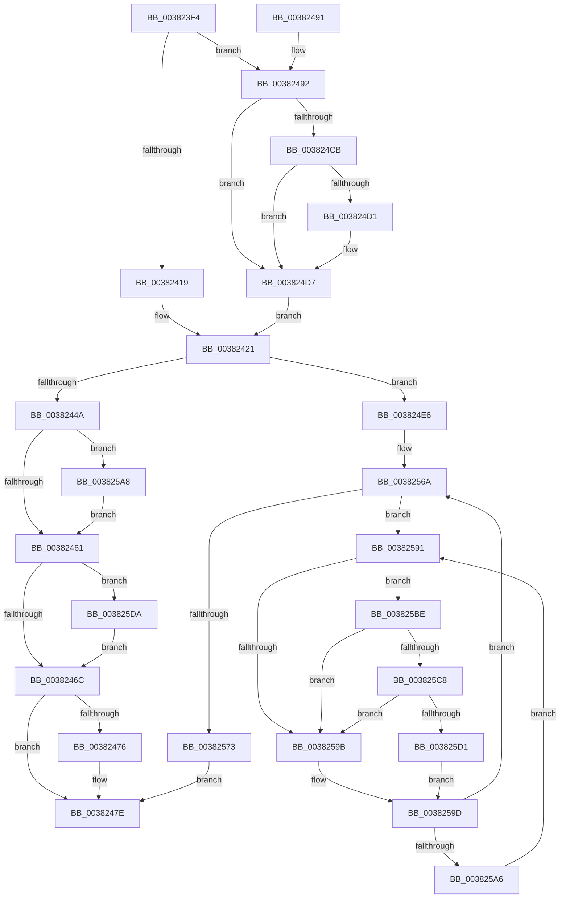

# MiRewriteTrimPteAsDemandZero

- RVA: `0x003823F4`–`0x003825EA` (길이 `502` bytes)
- VA: `0x00000001403823F4`
- 실행 섹션: `.text`
- PDB 이름 있음: `예`; PDB Function 태그: `아니요`
- unwind 정보 RVA: `0x0007BAD4`
- 디코드: `126`개 명령, `502/502` bytes 표시
- 미해석 바이트: `0` (있으면 어셈블리에 `.byte`로 보존)

> 이 문서는 커널 이미지의 기계어와 PDB 기호를 분석해 생성했습니다. 4번과 5번은 함수 원형과 자료형을 바이너리 사용 방식에서 추정한 C 해석이며 원본 소스 복구 결과는 아닙니다.

## 1. Dependencies

- 직접 호출 지점: **8**; 고유 호출 대상: **8**
- 직접 호출자로 확인된 함수: **1**
- RIP 상대 이미지 참조: **5**

### Outgoing calls
- `0x00382425` → [MiTransferSoftwarePte](MiTransferSoftwarePte_function_003821F0.md) (function, `0x003821F0`)
- `0x00382454` → [MiPteInShadowRange](../23/MiPteInShadowRange_function_0023FB00.md) (function, `0x0023FB00`)
- `0x00382513` → [MiMapPageInHyperSpaceWorker](../33/MiMapPageInHyperSpaceWorker_function_00332B10.md) (function, `0x00332B10`)
- `0x00382578` → [MiDecrementShareCountEx](../33/MiDecrementShareCountEx_function_00333F70.md) (function, `0x00333F70`)
- `0x003825AD` → [MiSanitizeShadowPxe](../29/MiSanitizeShadowPxe_function_00294B68.md) (function, `0x00294B68`)
- `0x003825C8` → [KiCheckVpBackingLongSpinWaitHypercall](../30/KiCheckVpBackingLongSpinWaitHypercall_function_0030F490.md) (function, `0x0030F490`)
- `0x003825D3` → [HvlNotifyLongSpinWait](../30/HvlNotifyLongSpinWait_function_0030F460.md) (function, `0x0030F460`)
- `0x003825E0` → [MiWritePteShadow](../29/MiWritePteShadow_function_00294EAC.md) (function, `0x00294EAC`)

### Direct callers
- [MiWsleFree](../28/MiWsleFree_function_00284600.md) at `0x00284D69`

### Static image references
- `0x00382495` → RVA `0x00E30088` (`.data`; read)
- `0x003824BF` → RVA `0x00E2DC80` (`.data`; read)
- `0x0038255A` → RVA `0x00010880` (`.rdata`; read)
- `0x00382593` → RVA `0x00FC52AC` (`ALMOSTRO`; reference)
- `0x003825BE` → RVA `0x00FC6AB8` (`ALMOSTRO`; read)

## 2. Other-region calls and transfers

- 다른 실행 섹션으로 향하는 call: **0**
- 별도 외부 분기/꼬리 이동을 확인하지 못했습니다.

## 3. Assembly (complete function range)

```asm
003823F4  48 89 5C 24 08                  mov qword ptr [rsp + 8], rbx
003823F9  48 89 6C 24 20                  mov qword ptr [rsp + 0x20], rbp
003823FE  56                              push rsi
003823FF  57                              push rdi
00382400  41 56                           push r14
00382402  48 83 EC 20                     sub rsp, 0x20
00382406  8B 42 10                        mov eax, dword ptr [rdx + 0x10]
00382409  4C 8D 72 28                     lea r14, [rdx + 0x28]
0038240D  D0 E8                           shr al, 1
0038240F  48 8B F2                        mov rsi, rdx
00382412  48 8B F9                        mov rdi, rcx
00382415  A8 01                           test al, 1
00382417  75 79                           jne 0x140382492
00382419  45 33 C9                        xor r9d, r9d
0038241C  45 33 C0                        xor r8d, r8d
0038241F  33 D2                           xor edx, edx
00382421  48 8B 4E 10                     mov rcx, qword ptr [rsi + 0x10]
00382425  E8 C6 FD FF FF                  call 0x1403821f0
0038242A  48 8B 76 08                     mov rsi, qword ptr [rsi + 8]
0038242E  48 8B D8                        mov rbx, rax
00382431  48 B8 00 00 00 00 00 00 00 80   movabs rax, 0x8000000000000000
0038243B  48 0B F0                        or rsi, rax
0038243E  49 8B 06                        mov rax, qword ptr [r14]
00382441  48 85 C0                        test rax, rax
00382444  0F 88 9C 00 00 00               js 0x1403824e6
0038244A  48 8B CE                        mov rcx, rsi
0038244D  48 89 5C 24 48                  mov qword ptr [rsp + 0x48], rbx
00382452  33 ED                           xor ebp, ebp
00382454  E8 A7 D6 EB FF                  call 0x14023fb00
00382459  85 C0                           test eax, eax
0038245B  0F 85 47 01 00 00               jne 0x1403825a8
00382461  48 89 1E                        mov qword ptr [rsi], rbx
00382464  85 ED                           test ebp, ebp
00382466  0F 85 6E 01 00 00               jne 0x1403825da
0038246C  8B 87 B8 00 00 00               mov eax, dword ptr [rdi + 0xb8]
00382472  A8 0F                           test al, 0xf
00382474  75 08                           jne 0x14038247e
00382476  F0 48 FF 8F 88 FE FF FF         lock dec qword ptr [rdi - 0x178]
0038247E  48 8B 5C 24 40                  mov rbx, qword ptr [rsp + 0x40]
00382483  48 8B 6C 24 58                  mov rbp, qword ptr [rsp + 0x58]
00382488  48 83 C4 20                     add rsp, 0x20
0038248C  41 5E                           pop r14
0038248E  5F                              pop rdi
0038248F  5E                              pop rsi
00382490  C3                              ret
00382491  CC                              int3
00382492  49 8B 06                        mov rax, qword ptr [r14]
00382495  48 8B 0D EC DB AA 00            mov rcx, qword ptr [rip + 0xaadbec]
0038249C  4C 8B 46 10                     mov r8, qword ptr [rsi + 0x10]
003824A0  48 C1 E8 2B                     shr rax, 0x2b
003824A4  25 FF 03 00 00                  and eax, 0x3ff
003824A9  48 8B 14 C1                     mov rdx, qword ptr [rcx + rax*8]
003824AD  49 8B C0                        mov rax, r8
003824B0  48 C1 E8 0C                     shr rax, 0xc
003824B4  83 E0 0F                        and eax, 0xf
003824B7  48 8B 94 C2 60 48 00 00         mov rdx, qword ptr [rdx + rax*8 + 0x4860]
003824BF  48 8B 05 BA B7 AA 00            mov rax, qword ptr [rip + 0xaab7ba]
003824C6  48 85 C0                        test rax, rax
003824C9  74 0C                           je 0x1403824d7
003824CB  41 F6 C0 10                     test r8b, 0x10
003824CF  75 06                           jne 0x1403824d7
003824D1  48 F7 D0                        not rax
003824D4  4C 23 C0                        and r8, rax
003824D7  49 C1 E8 20                     shr r8, 0x20
003824DB  41 B9 02 00 00 00               mov r9d, 2
003824E1  E9 3B FF FF FF                  jmp 0x140382421
003824E6  49 8B 0E                        mov rcx, qword ptr [r14]
003824E9  48 B8 FF FF FF FF FF 00 00 00   movabs rax, 0xffffffffff
003824F3  48 23 C8                        and rcx, rax
003824F6  48 8D 3C 49                     lea rdi, [rcx + rcx*2]
003824FA  48 C1 E7 04                     shl rdi, 4
003824FE  48 B8 00 00 00 00 00 DE FF FF   movabs rax, 0xffffde0000000000
00382508  33 D2                           xor edx, edx
0038250A  41 B8 00 00 00 80               mov r8d, 0x80000000
00382510  48 03 F8                        add rdi, rax
00382513  E8 F8 05 FB FF                  call 0x140332b10
00382518  48 C1 EE 03                     shr rsi, 3
0038251C  81 E6 FF 01 00 00               and esi, 0x1ff
00382522  48 8D 14 F0                     lea rdx, [rax + rsi*8]
00382526  48 8B 02                        mov rax, qword ptr [rdx]
00382529  48 89 1A                        mov qword ptr [rdx], rbx
0038252C  48 B8 F8 FF FF FF 7F 00 00 00   movabs rax, 0x7ffffffff8
00382536  48 C1 EA 09                     shr rdx, 9
0038253A  48 23 D0                        and rdx, rax
0038253D  48 B8 00 00 00 00 80 F6 FF FF   movabs rax, 0xfffff68000000000
00382547  48 03 D0                        add rdx, rax
0038254A  65 48 8B 04 25 20 00 00 00      mov rax, qword ptr gs:[0x20]
00382553  48 8B 88 38 88 00 00            mov rcx, qword ptr [rax + 0x8838]
0038255A  48 8B 05 1F E3 C8 FF            mov rax, qword ptr [rip - 0x371ce1]
00382561  48 83 21 00                     and qword ptr [rcx], 0
00382565  33 DB                           xor ebx, ebx
00382567  48 89 02                        mov qword ptr [rdx], rax
0038256A  F0 48 0F BA 6F 18 3F            lock bts qword ptr [rdi + 0x18], 0x3f
00382571  72 1E                           jb 0x140382591
00382573  33 D2                           xor edx, edx
00382575  48 8B CF                        mov rcx, rdi
00382578  E8 F3 19 FB FF                  call 0x140333f70
0038257D  48 B8 FF FF FF FF FF FF FF 7F   movabs rax, 0x7fffffffffffffff
00382587  F0 48 21 47 18                  lock and qword ptr [rdi + 0x18], rax
0038258C  E9 ED FE FF FF                  jmp 0x14038247e
00382591  FF C3                           inc ebx
00382593  85 1D 13 2D C4 00               test dword ptr [rip + 0xc42d13], ebx
00382599  74 23                           je 0x1403825be
0038259B  F3 90                           pause
0038259D  48 8B 47 18                     mov rax, qword ptr [rdi + 0x18]
003825A1  48 85 C0                        test rax, rax
003825A4  79 C4                           jns 0x14038256a
003825A6  EB E9                           jmp 0x140382591
003825A8  48 8D 54 24 48                  lea rdx, [rsp + 0x48]
003825AD  E8 B6 25 F1 FF                  call 0x140294b68
003825B2  48 8B 5C 24 48                  mov rbx, qword ptr [rsp + 0x48]
003825B7  8B E8                           mov ebp, eax
003825B9  E9 A3 FE FF FF                  jmp 0x140382461
003825BE  8B 05 F4 44 C4 00               mov eax, dword ptr [rip + 0xc444f4]
003825C4  A8 40                           test al, 0x40
003825C6  74 D3                           je 0x14038259b
003825C8  E8 C3 CE F8 FF                  call 0x14030f490
003825CD  84 C0                           test al, al
003825CF  74 CA                           je 0x14038259b
003825D1  8B CB                           mov ecx, ebx
003825D3  E8 88 CE F8 FF                  call 0x14030f460
003825D8  EB C3                           jmp 0x14038259d
003825DA  48 8B D3                        mov rdx, rbx
003825DD  48 8B CE                        mov rcx, rsi
003825E0  E8 C7 28 F1 FF                  call 0x140294eac
003825E5  E9 82 FE FF FF                  jmp 0x14038246c
```

## 4. C-style interpretation (structured pseudocode)

```c
__int64 __fastcall MiRewriteTrimPteAsDemandZero(__int64 a1, __int64 a2, int a3, int a4)
{
    __int64 result;
    __int64 v_rbp;
    __int64 v_rbx;
    __int64 v_rdi;
    __int64 v_rsi;
    __int64 v_rsp;
    unsigned __int64 v_stack_p10;
    unsigned __int64 v_stack_p20;
    unsigned __int64 v_stack_p48;
    unsigned __int64 v_stack_p8;

    v_stack_p8 = v_rbx;
    v_stack_p20 = v_rbp;
    v_rsp = (v_rsp) - (32);
    result = (unsigned __int8)(((unsigned int)(*(unsigned int *)(a2 + 16))) >> (1));
    if ((((unsigned __int8)(result)) & (1)) != 0) goto loc_00382492;
    a4 = 0;
    a3 = 0;
    a2 = 0;
loc_00382421:
    result = MiTransferSoftwarePte(*(unsigned __int64 *)(a2 + 16), a2, a3, a4);
    v_rsi = (*(unsigned __int64 *)(a2 + 8)) | (result);
    if (sign_flag) goto loc_003824E6;
    v_stack_p10 = result;
    v_rbp = 0;
    result = MiPteInShadowRange(v_rsi, a2, a3, a4);
    if ((unsigned int)(result) != 0) goto loc_003825A8;
loc_00382461:
    *(unsigned __int64 *)(v_rsi) = result;
    if (0 != 0) goto loc_003825DA;
loc_0038246C:
    if ((((unsigned __int8)((unsigned int)(*(unsigned int *)(a1 + 184)))) & (15)) == 0) {
    }
    v_rsp = (v_rsp) + (32);
    return (unsigned int)(*(unsigned int *)(a1 + 184));
loc_00382492:
    result = (*(unsigned __int64 *)(a2 + 40)) >> (43);
    result = (unsigned int)((result) & (0x3FFULL));
    result = (*(unsigned __int64 *)(v_rsi + 16)) >> (12);
    result = (unsigned int)((result) & (15));
    if (*(unsigned __int64 *)(v_rip + 11188154) == 0) goto loc_003824D7;
    result = *(unsigned __int64 *)(v_rip + 11188154);
    if ((((unsigned __int8)(*(unsigned __int64 *)(v_rsi + 16))) & (16)) == 0) {
        result = ~(*(unsigned __int64 *)(v_rip + 11188154));
        a3 = (*(unsigned __int64 *)(v_rsi + 16)) & (result);
    }
    a3 = (a3) >> (32);
    goto loc_00382421;
loc_003824E6:
    a1 = (*(unsigned __int64 *)(a2 + 40)) & (result);
    v_rdi = (a1 + a1 * 2) << (4);
    a2 = 0;
    v_rdi = (v_rdi) + (result);
    result = MiMapPageInHyperSpaceWorker(a1, a2, (unsigned int)(0x80000000ULL), 2);
    v_rsi = (v_rsi) >> (3);
    v_rsi = (unsigned int)((v_rsi) & (511));
    *(unsigned __int64 *)(result + v_rsi * 8) = v_stack_p8;
    a2 = (result + v_rsi * 8) >> (9);
    a2 = (a2) & (*(unsigned __int64 *)(result + v_rsi * 8));
    a2 = (a2) + (*(unsigned __int64 *)(result + v_rsi * 8));
    v_rbx = 0;
    *(unsigned __int64 *)(a2) = *(unsigned __int64 *)(v_rip - 3611873);
loc_0038256A:
    if (condition_is_below) goto loc_00382591;
    a2 = 0;
    result = MiDecrementShareCountEx(v_rdi, a2, (unsigned int)(0x80000000ULL), 2);
    goto loc_0038247E;
loc_00382591:
    v_rbx = (unsigned int)((v_rbx) + 1);
    if (((*(unsigned int *)(v_rip + 12856595)) & ((unsigned int)(v_rbx))) == 0) goto loc_003825BE;
loc_0038259B:
loc_0038259D:
    if (!sign_flag) goto loc_0038256A;
    goto loc_00382591;
loc_003825A8:
    result = MiSanitizeShadowPxe(v_rdi, v_stack_p48, (unsigned int)(0x80000000ULL), 2);
    goto loc_00382461;
loc_003825BE:
    if ((((unsigned __int8)((unsigned int)(*(unsigned int *)(v_rip + 12862708)))) & (64)) == 0) goto loc_0038259B;
    result = KiCheckVpBackingLongSpinWaitHypercall(v_rdi, v_stack_p48, (unsigned int)(0x80000000ULL), 2);
    if ((unsigned __int8)(result) == 0) goto loc_0038259B;
    result = HvlNotifyLongSpinWait((unsigned int)((unsigned int)(v_stack_p48)), v_stack_p48, (unsigned int)(0x80000000ULL), 2);
    goto loc_0038259D;
loc_003825DA:
    result = MiWritePteShadow(v_rsi, v_stack_p48, (unsigned int)(0x80000000ULL), 2);
    goto loc_0038246C;
}
```

## 5. (Beta) C Style

```c
int64_t MiRewriteTrimPteAsDemandZero(void *Arg1, void *Arg2, int32_t Arg3, int32_t Arg4)
{
    uint8_t *arg1 = (uint8_t *)Arg1;
    uint8_t *arg2 = (uint8_t *)Arg2;

    int64_t result;
    int64_t local_rbp;
    int64_t local_rbx;
    int64_t local_rdi;
    int64_t local_rsi;
    int64_t local_rsp;
    uint64_t v_stack_p10;
    uint64_t v_stack_p20;
    uint64_t v_stack_p48;
    uint64_t v_stack_p8;

    v_stack_p8 = local_rbx;
    v_stack_p20 = local_rbp;
    local_rsp = (local_rsp) - (32);
    result = (uint8_t)(((uint32_t)(*(uint32_t *)(arg2 + 0x10))) >> (1));
    if ((((uint8_t)(result)) & (1)) != 0) goto loc_00382492;
    Arg4 = 0;
    Arg3 = 0;
    Arg2 = 0;
loc_00382421:
    result = MiTransferSoftwarePte(*(uint64_t *)(arg2 + 0x10), Arg2, Arg3, Arg4);
    local_rsi = (*(uint64_t *)(arg2 + 0x8)) | (result);
    if (sign_flag) goto loc_003824E6;
    v_stack_p10 = result;
    local_rbp = 0;
    result = MiPteInShadowRange(local_rsi, Arg2, Arg3, Arg4);
    if ((uint32_t)(result) != 0) goto loc_003825A8;
loc_00382461:
    *(uint64_t *)(local_rsi) = result;
    if (0 != 0) goto loc_003825DA;
loc_0038246C:
    if ((((uint8_t)((uint32_t)(*(uint32_t *)(arg1 + 0xB8)))) & (15)) == 0) {
    }
    local_rsp = (local_rsp) + (32);
    return (uint32_t)(*(uint32_t *)(arg1 + 0xB8));
loc_00382492:
    result = (*(uint64_t *)(arg2 + 0x28)) >> (43);
    result = (uint32_t)((result) & (0x3FFULL));
    result = (*(uint64_t *)(local_rsi + 0x10)) >> (12);
    result = (uint32_t)((result) & (15));
    if (*(uint64_t *)(v_rip + 0xAAB7BA) == 0) goto loc_003824D7;
    result = *(uint64_t *)(v_rip + 0xAAB7BA);
    if ((((uint8_t)(*(uint64_t *)(local_rsi + 0x10))) & (16)) == 0) {
        result = ~(*(uint64_t *)(v_rip + 0xAAB7BA));
        Arg3 = (*(uint64_t *)(local_rsi + 0x10)) & (result);
    }
    Arg3 = (Arg3) >> (32);
    goto loc_00382421;
loc_003824E6:
    Arg1 = (*(uint64_t *)(arg2 + 0x28)) & (result);
    local_rdi = (Arg1 + Arg1 * 2) << (4);
    Arg2 = 0;
    local_rdi = (local_rdi) + (result);
    result = MiMapPageInHyperSpaceWorker(Arg1, Arg2, (uint32_t)(0x80000000ULL), 2);
    local_rsi = (local_rsi) >> (3);
    local_rsi = (uint32_t)((local_rsi) & (511));
    *(uint64_t *)(result + local_rsi * 8) = v_stack_p8;
    Arg2 = (result + local_rsi * 8) >> (9);
    Arg2 = (Arg2) & (*(uint64_t *)(result + local_rsi * 8));
    Arg2 = (Arg2) + (*(uint64_t *)(result + local_rsi * 8));
    local_rbx = 0;
    *(uint64_t *)(arg2) = *(uint64_t *)(v_rip - 0x371CE1);
loc_0038256A:
    if (condition_is_below) goto loc_00382591;
    Arg2 = 0;
    result = MiDecrementShareCountEx(local_rdi, Arg2, (uint32_t)(0x80000000ULL), 2);
    goto loc_0038247E;
loc_00382591:
    local_rbx = (uint32_t)((local_rbx) + 1);
    if (((*(uint32_t *)(v_rip + 0xC42D13)) & ((uint32_t)(local_rbx))) == 0) goto loc_003825BE;
loc_0038259B:
loc_0038259D:
    if (!sign_flag) goto loc_0038256A;
    goto loc_00382591;
loc_003825A8:
    result = MiSanitizeShadowPxe(local_rdi, v_stack_p48, (uint32_t)(0x80000000ULL), 2);
    goto loc_00382461;
loc_003825BE:
    if ((((uint8_t)((uint32_t)(*(uint32_t *)(v_rip + 0xC444F4)))) & (64)) == 0) goto loc_0038259B;
    result = KiCheckVpBackingLongSpinWaitHypercall(local_rdi, v_stack_p48, (uint32_t)(0x80000000ULL), 2);
    if ((uint8_t)(result) == 0) goto loc_0038259B;
    result = HvlNotifyLongSpinWait((uint32_t)((uint32_t)(v_stack_p48)), v_stack_p48, (uint32_t)(0x80000000ULL), 2);
    goto loc_0038259D;
loc_003825DA:
    result = MiWritePteShadow(local_rsi, v_stack_p48, (uint32_t)(0x80000000ULL), 2);
    goto loc_0038246C;
}
```

### 관측된 메모리 오프셋

구조체 형식이 확인되지 않은 접근은 인자 기준의 오프셋으로만 기록했습니다.

| 기준 인자 | 오프셋 표현 | 폭 (bit) | 접근 |
|---|---:|---:|---|
| `Arg1` | `- 0x178` | `64` | `R/W` |
| `Arg1` | `+ 0xB8` | `32` | `R` |
| `Arg2` | `+ 0x0` | `64` | `R` |
| `Arg2` | `+ 0x8` | `64` | `R` |
| `Arg2` | `+ 0x10` | `32` | `R` |
| `Arg2` | `+ 0x10` | `64` | `R` |
| `Arg2` | `+ 0x28` | `64` | `R` |

## 6. Execution-region graph

[열기: 2D/3D 그래프와 함수 탐색 컨트롤 패널](../../../control-panel.html?section=text&rva=0x003823F4&view=graph)

- 2D 그래프는 위에서 아래로 흐르고, 3D 그래프는 빈 공간을 드래그해 회전합니다. Shift+드래그는 이동, 휠은 확대·축소, 함수 노드 선택은 대상 보고서 이동입니다.

### Static fallback


