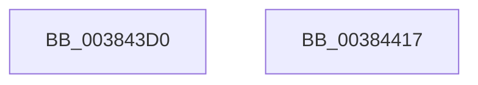

# MiSetImageProtection

- RVA: `0x003843D0`–`0x00384418` (길이 `72` bytes)
- VA: `0x00000001403843D0`
- 실행 섹션: `.text`
- PDB 이름 있음: `예`; PDB Function 태그: `아니요`
- unwind 정보 RVA: `0x0005D2F4`
- 디코드: `18`개 명령, `72/72` bytes 표시
- 미해석 바이트: `0` (있으면 어셈블리에 `.byte`로 보존)

> 이 문서는 커널 이미지의 기계어와 PDB 기호를 분석해 생성했습니다. 4번과 5번은 함수 원형과 자료형을 바이너리 사용 방식에서 추정한 C 해석이며 원본 소스 복구 결과는 아닙니다.

## 1. Dependencies

- 직접 호출 지점: **1**; 고유 호출 대상: **1**
- 직접 호출자로 확인된 함수: **8**
- RIP 상대 이미지 참조: **0**

### Outgoing calls
- `0x0038440D` → [MiSetSystemCodeProtection](MiSetSystemCodeProtection_function_00384420.md) (function, `0x00384420`)

### Direct callers
- [MiRestoreImportTableProtection](../../page/7F/MiRestoreImportTableProtection_function_007F81FC.md) at `0x007F8239`
- [MiRestoreImportTableProtection](../../page/7F/MiRestoreImportTableProtection_function_007F81FC.md) at `0x007F827E`
- [MiApplyHotPatchToDriverDataPages](../../page/80/MiApplyHotPatchToDriverDataPages_function_00801F18.md) at `0x00802018`
- [MiPatchDataPagesCallback](../../page/80/MiPatchDataPagesCallback_function_00806610.md) at `0x008066A0`
- [MiCompactServiceTable](../../page/80/MiCompactServiceTable_function_0080C63C.md) at `0x0080C719`
- [MiCompactServiceTable](../../page/80/MiCompactServiceTable_function_0080C63C.md) at `0x0080C736`
- [MiCompactServiceTable](../../page/80/MiCompactServiceTable_function_0080C63C.md) at `0x0080C7A1`
- [MiCompactServiceTable](../../page/80/MiCompactServiceTable_function_0080C63C.md) at `0x0080C7B4`
- [MmLoadSystemImageEx](../../page/99/MmLoadSystemImageEx_function_00999B8C.md) at `0x0099A00E`
- [MmLoadSystemImageEx](../../page/99/MmLoadSystemImageEx_function_00999B8C.md) at `0x0099A041`
- [MmChangeImageProtection](../../page/A5/MmChangeImageProtection_function_00A565F0.md) at `0x00A56691`
- [MmChangeImageProtection](../../page/A5/MmChangeImageProtection_function_00A565F0.md) at `0x00A566D4`
- [MiProcessKernelCfgImageLoadConfig](../../page/A7/MiProcessKernelCfgImageLoadConfig_function_00A7FE40.md) at `0x00A7FECB`
- [MiProcessKernelCfgImageLoadConfig](../../page/A7/MiProcessKernelCfgImageLoadConfig_function_00A7FE40.md) at `0x00A7FF1A`
- [MiProcessKernelCfgImageLoadConfig](../../page/A7/MiProcessKernelCfgImageLoadConfig_function_00A7FE40.md) at `0x00A7FF59`
- [MiProcessKernelCfgImageLoadConfig](../../page/A7/MiProcessKernelCfgImageLoadConfig_function_00A7FE40.md) at `0x00A7FFCA`
- [MiSetImportTableProtection](../../page/AC/MiSetImportTableProtection_function_00AC2D2C.md) at `0x00AC2D8F`
- [MiSetImportTableProtection](../../page/AC/MiSetImportTableProtection_function_00AC2D2C.md) at `0x00AC2E33`

### Static image references
- 디코드된 RIP-relative 메모리 참조가 없습니다.

## 2. Other-region calls and transfers

- 다른 실행 섹션으로 향하는 call: **0**
- 별도 외부 분기/꼬리 이동을 확인하지 못했습니다.

## 3. Assembly (complete function range)

```asm
003843D0  48 83 EC 38                     sub rsp, 0x38
003843D4  41 FF C8                        dec r8d
003843D7  49 BA 00 00 00 00 80 F6 FF FF   movabs r10, 0xfffff68000000000
003843E1  4C 03 C2                        add r8, rdx
003843E4  49 BB F8 FF FF FF 7F 00 00 00   movabs r11, 0x7ffffffff8
003843EE  49 C1 E8 09                     shr r8, 9
003843F2  4D 23 C3                        and r8, r11
003843F5  49 8B C2                        mov rax, r10
003843F8  48 C1 EA 09                     shr rdx, 9
003843FC  4C 03 C0                        add r8, rax
003843FF  49 23 D3                        and rdx, r11
00384402  49 8B C2                        mov rax, r10
00384405  83 64 24 20 00                  and dword ptr [rsp + 0x20], 0
0038440A  48 03 D0                        add rdx, rax
0038440D  E8 0E 00 00 00                  call 0x140384420
00384412  48 83 C4 38                     add rsp, 0x38
00384416  C3                              ret
00384417  CC                              int3
```

## 4. C-style interpretation (structured pseudocode)

```c
__int64 __fastcall MiSetImageProtection(__int64 a1, __int64 a2, int a3)
{
    __int64 result;
    __int64 v_rsp;
    unsigned int v_stack_m18;

    v_rsp = (v_rsp) - (56);
    a3 = (unsigned int)((a3) - 1);
    a3 = (a3) + (a2);
    a3 = (a3) >> (9);
    a3 = (a3) & (v_r11);
    a2 = (a2) >> (9);
    a3 = (a3) + (v_r10);
    a2 = (a2) & (v_r11);
    a2 = (a2) + (v_r10);
    result = MiSetSystemCodeProtection(a1, a2, a3, a4);
    v_rsp = (v_rsp) + (56);
    return result;
}
```

## 5. (Beta) C Style

```c
int64_t MiSetImageProtection(int64_t Arg1, int64_t Arg2, int32_t Arg3)
{
    int64_t result;
    int64_t local_rsp;
    uint32_t v_stack_m18;

    local_rsp = (local_rsp) - (56);
    Arg3 = (uint32_t)((Arg3) - 1);
    Arg3 = (Arg3) + (Arg2);
    Arg3 = (Arg3) >> (9);
    Arg3 = (Arg3) & (local_r11);
    Arg2 = (Arg2) >> (9);
    Arg3 = (Arg3) + (local_r10);
    Arg2 = (Arg2) & (local_r11);
    Arg2 = (Arg2) + (local_r10);
    result = MiSetSystemCodeProtection(Arg1, Arg2, Arg3, a4);
    local_rsp = (local_rsp) + (56);
    return result;
}
```

## 6. Execution-region graph

[열기: 2D/3D 그래프와 함수 탐색 컨트롤 패널](../../../control-panel.html?section=text&rva=0x003843D0&view=graph)

- 2D 그래프는 위에서 아래로 흐르고, 3D 그래프는 빈 공간을 드래그해 회전합니다. Shift+드래그는 이동, 휠은 확대·축소, 함수 노드 선택은 대상 보고서 이동입니다.

### Static fallback


