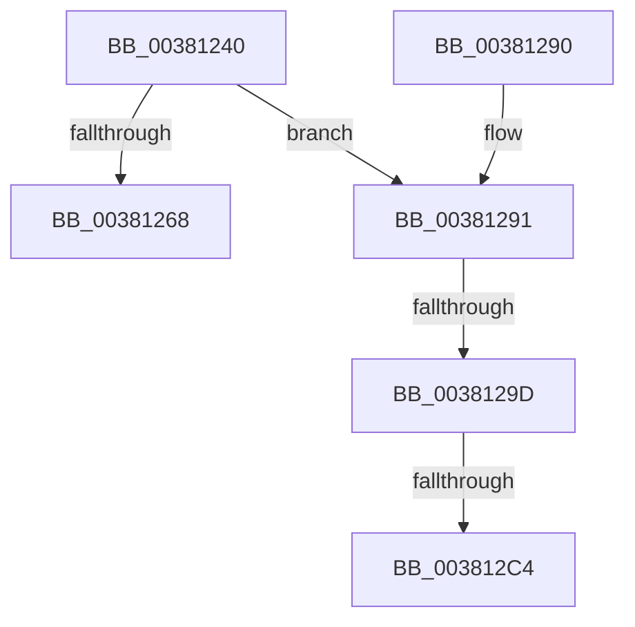

# MiStoreFaultComplete

- RVA: `0x00381240`–`0x003812E6` (길이 `166` bytes)
- VA: `0x0000000140381240`
- 실행 섹션: `.text`
- PDB 이름 있음: `예`; PDB Function 태그: `예`
- unwind 정보 RVA: `0x0007B94C`
- 디코드: `40`개 명령, `166/166` bytes 표시
- 미해석 바이트: `0` (있으면 어셈블리에 `.byte`로 보존)

> 이 문서는 커널 이미지의 기계어와 PDB 기호를 분석해 생성했습니다. 4번과 5번은 함수 원형과 자료형을 바이너리 사용 방식에서 추정한 C 해석이며 원본 소스 복구 결과는 아닙니다.

## 1. Dependencies

- 직접 호출 지점: **1**; 고유 호출 대상: **1**
- 직접 호출자로 확인된 함수: **2**
- RIP 상대 이미지 참조: **0**

### Outgoing calls
- `0x003812E0` → [KeBugCheckEx](../4F/KeBugCheckEx_function_004FD660.md) (function, `0x004FD660`)

### Direct callers
- [MiWaitForInPageComplete](MiWaitForInPageComplete_function_00380AB8.md) at `0x00380C14`
- [MiReadPagefilePage](../66/MiReadPagefilePage_function_0066F78C.md) at `0x0066F9D0`

### Static image references
- 디코드된 RIP-relative 메모리 참조가 없습니다.

## 2. Other-region calls and transfers

- 다른 실행 섹션으로 향하는 call: **0**
- call이 아닌 외부 분기/꼬리 이동: **2**
  - `0x00381297` → [sub_006E46EA + 0xC](../6E/Unknown_function_006E46EA.md) (`tail-transfer`)
  - `0x003812BE` → [sub_006E46EA](../6E/Unknown_function_006E46EA.md) (`tail-transfer`)

## 3. Assembly (complete function range)

```asm
00381240  48 89 5C 24 08                  mov qword ptr [rsp + 8], rbx
00381245  48 89 74 24 10                  mov qword ptr [rsp + 0x10], rsi
0038124A  48 89 7C 24 18                  mov qword ptr [rsp + 0x18], rdi
0038124F  41 56                           push r14
00381251  48 83 EC 30                     sub rsp, 0x30
00381255  48 63 71 50                     movsxd rsi, dword ptr [rcx + 0x50]
00381259  4C 8B F2                        mov r14, rdx
0038125C  48 8B F9                        mov rdi, rcx
0038125F  BB 01 00 00 00                  mov ebx, 1
00381264  85 F6                           test esi, esi
00381266  78 29                           js 0x140381291
00381268  8B 41 58                        mov eax, dword ptr [rcx + 0x58]
0038126B  44 0F B7 C0                     movzx r8d, ax
0038126F  49 C1 E0 0C                     shl r8, 0xc
00381273  4C 89 41 58                     mov qword ptr [rcx + 0x58], r8
00381277  48 8B 74 24 48                  mov rsi, qword ptr [rsp + 0x48]
0038127C  48 8B 7C 24 50                  mov rdi, qword ptr [rsp + 0x50]
00381281  41 89 1E                        mov dword ptr [r14], ebx
00381284  48 8B 5C 24 40                  mov rbx, qword ptr [rsp + 0x40]
00381289  48 83 C4 30                     add rsp, 0x30
0038128D  41 5E                           pop r14
0038128F  C3                              ret
00381290  CC                              int3
00381291  81 FE 25 02 00 C0               cmp esi, 0xc0000225
00381297  0F 85 59 34 36 00               jne 0x1406e46f6
0038129D  48 8B 81 40 01 00 00            mov rax, qword ptr [rcx + 0x140]
003812A4  48 8D 04 40                     lea rax, [rax + rax*2]
003812A8  48 03 C0                        add rax, rax
003812AB  48 B9 18 00 00 00 00 DE FF FF   movabs rcx, 0xffffde0000000018
003812B5  48 8B 04 C1                     mov rax, qword ptr [rcx + rax*8]
003812B9  48 0F BA E0 3E                  bt rax, 0x3e
003812BE  0F 82 26 34 36 00               jb 0x1406e46ea
003812C4  8B 87 B8 00 00 00               mov eax, dword ptr [rdi + 0xb8]
003812CA  4C 8B C7                        mov r8, rdi
003812CD  4C 63 4F 50                     movsxd r9, dword ptr [rdi + 0x50]
003812D1  BA 00 60 00 00                  mov edx, 0x6000
003812D6  B9 1A 00 00 00                  mov ecx, 0x1a
003812DB  48 89 44 24 20                  mov qword ptr [rsp + 0x20], rax
003812E0  E8 7B C3 17 00                  call 0x1404fd660
003812E5  CC                              int3
```

## 4. C-style interpretation (structured pseudocode)

```c
__int64 __fastcall MiStoreFaultComplete(__int64 a1, __int64 a2)
{
    __int64 result;
    __int64 v_rsp;
    unsigned __int64 v_stack_p10;
    unsigned __int64 v_stack_p18;
    unsigned __int64 v_stack_p20;
    unsigned __int64 v_stack_p8;

    v_stack_p8 = v_rbx;
    v_stack_p10 = v_rsi;
    v_stack_p18 = v_rdi;
    v_rsp = (v_rsp) - (48);
    if (sign_flag) goto loc_00381291;
    a3 = ((unsigned __int16)((unsigned int)(*(unsigned int *)(a1 + 88)))) << (12);
    *(unsigned __int64 *)(a1 + 88) = a3;
    *(unsigned int *)(a2) = 1;
    v_rsp = (v_rsp) + (48);
    return (unsigned int)(*(unsigned int *)(a1 + 88));
loc_00381291:
    result = (*(unsigned __int64 *)(a1 + 320) + *(unsigned __int64 *)(a1 + 320) * 2) + (*(unsigned __int64 *)(a1 + 320) + *(unsigned __int64 *)(a1 + 320) * 2);
    v_stack_p20 = (unsigned int)(*(unsigned int *)(v_stack_p18 + 184));
    result = KeBugCheckEx(26, (unsigned int)(0x6000ULL), v_stack_p18, (int)(*(unsigned int *)(v_stack_p18 + 80)));
    return result;
}
```

## 5. (Beta) C Style

```c
int64_t MiStoreFaultComplete(void *Arg1, void *Arg2)
{
    uint8_t *arg1 = (uint8_t *)Arg1;
    uint8_t *arg2 = (uint8_t *)Arg2;

    int64_t result;
    int64_t local_rsp;
    uint64_t v_stack_p10;
    uint64_t v_stack_p18;
    uint64_t v_stack_p20;
    uint64_t v_stack_p8;

    v_stack_p8 = local_rbx;
    v_stack_p10 = local_rsi;
    v_stack_p18 = local_rdi;
    local_rsp = (local_rsp) - (48);
    if (sign_flag) goto loc_00381291;
    a3 = ((uint16_t)((uint32_t)(*(uint32_t *)(arg1 + 0x58)))) << (12);
    *(uint64_t *)(arg1 + 0x58) = a3;
    *(uint32_t *)(arg2) = 1;
    local_rsp = (local_rsp) + (48);
    return (uint32_t)(*(uint32_t *)(arg1 + 0x58));
loc_00381291:
    result = (*(uint64_t *)(arg1 + 0x140) + *(uint64_t *)(arg1 + 0x140) * 2) + (*(uint64_t *)(arg1 + 0x140) + *(uint64_t *)(arg1 + 0x140) * 2);
    v_stack_p20 = (uint32_t)(*(uint32_t *)(v_stack_p18 + 0xB8));
    result = KeBugCheckEx(26, (uint32_t)(0x6000ULL), v_stack_p18, (int32_t)(*(uint32_t *)(v_stack_p18 + 0x50)));
    return result;
}
```

### 관측된 메모리 오프셋

구조체 형식이 확인되지 않은 접근은 인자 기준의 오프셋으로만 기록했습니다.

| 기준 인자 | 오프셋 표현 | 폭 (bit) | 접근 |
|---|---:|---:|---|
| `Arg1` | `+ 0x50` | `32` | `R` |
| `Arg1` | `+ 0x58` | `32` | `R` |
| `Arg1` | `+ 0x58` | `64` | `W` |
| `Arg1` | `+ 0xB8` | `32` | `R` |
| `Arg1` | `+ 0x140` | `64` | `R` |
| `Arg2` | `+ 0x0` | `32` | `W` |

## 6. Execution-region graph

[열기: 2D/3D 그래프와 함수 탐색 컨트롤 패널](../../../control-panel.html?section=text&rva=0x00381240&view=graph)

- 2D 그래프는 위에서 아래로 흐르고, 3D 그래프는 빈 공간을 드래그해 회전합니다. Shift+드래그는 이동, 휠은 확대·축소, 함수 노드 선택은 대상 보고서 이동입니다.

### Static fallback


