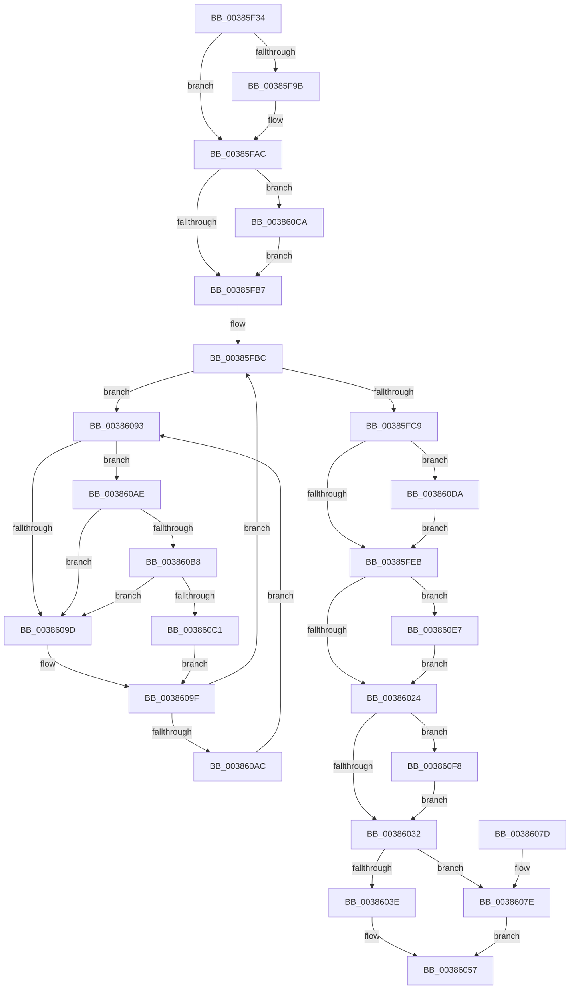

# MiSwapHardFaultPage

- RVA: `0x00385F34`–`0x00386109` (길이 `469` bytes)
- VA: `0x0000000140385F34`
- 실행 섹션: `.text`
- PDB 이름 있음: `예`; PDB Function 태그: `아니요`
- unwind 정보 RVA: `0x0007BD4C`
- 디코드: `125`개 명령, `469/469` bytes 표시
- 미해석 바이트: `0` (있으면 어셈블리에 `.byte`로 보존)

> 이 문서는 커널 이미지의 기계어와 PDB 기호를 분석해 생성했습니다. 4번과 5번은 함수 원형과 자료형을 바이너리 사용 방식에서 추정한 C 해석이며 원본 소스 복구 결과는 아닙니다.

## 1. Dependencies

- 직접 호출 지점: **11**; 고유 호출 대상: **11**
- 직접 호출자로 확인된 함수: **2**
- RIP 상대 이미지 참조: **2**

### Outgoing calls
- `0x00385F53` → [MI_READ_PTE_LOCK_FREE](../28/MI_READ_PTE_LOCK_FREE_function_002828A0.md) (function, `0x002828A0`)
- `0x00385F80` → [MiUpdateTransitionPteFrame](MiUpdateTransitionPteFrame_function_00385EDC.md) (function, `0x00385EDC`)
- `0x00385F92` → [MiPteInShadowRange](../23/MiPteInShadowRange_function_0023FB00.md) (function, `0x0023FB00`)
- `0x00385FA0` → [MiSanitizeShadowPxe](../29/MiSanitizeShadowPxe_function_00294B68.md) (function, `0x00294B68`)
- `0x00385FCF` → [MiCopyPfnEntryEx](../2B/MiCopyPfnEntryEx_function_002B2670.md) (function, `0x002B2670`)
- `0x00386035` → [MiRemoveLockedPageCharge](../24/MiRemoveLockedPageCharge_function_00246950.md) (function, `0x00246950`)
- `0x00386052` → [MiPfnReferenceCountIsZero](../2B/MiPfnReferenceCountIsZero_function_002B9E40.md) (function, `0x002B9E40`)
- `0x003860B8` → [KiCheckVpBackingLongSpinWaitHypercall](../30/KiCheckVpBackingLongSpinWaitHypercall_function_0030F490.md) (function, `0x0030F490`)
- `0x003860C3` → [HvlNotifyLongSpinWait](../30/HvlNotifyLongSpinWait_function_0030F460.md) (function, `0x0030F460`)
- `0x003860D0` → [MiWritePteShadow](../29/MiWritePteShadow_function_00294EAC.md) (function, `0x00294EAC`)
- `0x003860DD` → [MiSetPfnIdentity](../2A/MiSetPfnIdentity_function_002A2350.md) (function, `0x002A2350`)

### Direct callers
- [MiHardFaultPageRelease](../2B/MiHardFaultPageRelease_function_002B5728.md) at `0x002B58DB`
- [MiIdealClusterPage](../4D/MiIdealClusterPage_function_004DB964.md) at `0x004DC11F`

### Static image references
- `0x00386095` → RVA `0x00FC52AC` (`ALMOSTRO`; reference)
- `0x003860AE` → RVA `0x00FC6AB8` (`ALMOSTRO`; read)

## 2. Other-region calls and transfers

- 다른 실행 섹션으로 향하는 call: **0**
- 별도 외부 분기/꼬리 이동을 확인하지 못했습니다.

## 3. Assembly (complete function range)

```asm
00385F34  48 89 5C 24 18                  mov qword ptr [rsp + 0x18], rbx
00385F39  48 89 6C 24 20                  mov qword ptr [rsp + 0x20], rbp
00385F3E  56                              push rsi
00385F3F  57                              push rdi
00385F40  41 54                           push r12
00385F42  41 56                           push r14
00385F44  41 57                           push r15
00385F46  48 83 EC 20                     sub rsp, 0x20
00385F4A  49 8B F0                        mov rsi, r8
00385F4D  48 8B FA                        mov rdi, rdx
00385F50  4C 8B F1                        mov r14, rcx
00385F53  E8 48 C9 EF FF                  call 0x1402828a0
00385F58  49 BF 00 00 00 00 00 DE FF FF   movabs r15, 0xffffde0000000000
00385F62  4D 8B CF                        mov r9, r15
00385F65  48 8B D6                        mov rdx, rsi
00385F68  49 BC AB AA AA AA AA AA AA AA   movabs r12, 0xaaaaaaaaaaaaaaab
00385F72  49 2B D1                        sub rdx, r9
00385F75  48 8B C8                        mov rcx, rax
00385F78  48 C1 FA 04                     sar rdx, 4
00385F7C  49 0F AF D4                     imul rdx, r12
00385F80  E8 57 FF FF FF                  call 0x140385edc
00385F85  49 8B CE                        mov rcx, r14
00385F88  48 89 44 24 58                  mov qword ptr [rsp + 0x58], rax
00385F8D  48 8B D8                        mov rbx, rax
00385F90  33 ED                           xor ebp, ebp
00385F92  E8 69 9B EB FF                  call 0x14023fb00
00385F97  85 C0                           test eax, eax
00385F99  74 11                           je 0x140385fac
00385F9B  48 8D 54 24 58                  lea rdx, [rsp + 0x58]
00385FA0  E8 C3 EB F0 FF                  call 0x140294b68
00385FA5  48 8B 5C 24 58                  mov rbx, qword ptr [rsp + 0x58]
00385FAA  8B E8                           mov ebp, eax
00385FAC  49 89 1E                        mov qword ptr [r14], rbx
00385FAF  85 ED                           test ebp, ebp
00385FB1  0F 85 13 01 00 00               jne 0x1403860ca
00385FB7  33 DB                           xor ebx, ebx
00385FB9  8D 6B 01                        lea ebp, [rbx + 1]
00385FBC  F0 48 0F BA 6E 18 3F            lock bts qword ptr [rsi + 0x18], 0x3f
00385FC3  0F 82 CA 00 00 00               jb 0x140386093
00385FC9  48 8B D7                        mov rdx, rdi
00385FCC  48 8B CE                        mov rcx, rsi
00385FCF  E8 9C C6 F2 FF                  call 0x1402b2670
00385FD4  48 8B 47 28                     mov rax, qword ptr [rdi + 0x28]
00385FD8  BA 03 00 00 00                  mov edx, 3
00385FDD  48 C1 E8 3C                     shr rax, 0x3c
00385FE1  24 07                           and al, 7
00385FE3  3A C2                           cmp al, dl
00385FE5  0F 84 EF 00 00 00               je 0x1403860da
00385FEB  48 8B 46 18                     mov rax, qword ptr [rsi + 0x18]
00385FEF  48 B9 00 00 00 00 00 00 00 C0   movabs rcx, 0xc000000000000000
00385FF9  48 23 C1                        and rax, rcx
00385FFC  48 B9 00 00 00 00 00 00 00 40   movabs rcx, 0x4000000000000000
00386006  48 89 46 18                     mov qword ptr [rsi + 0x18], rax
0038600A  48 8B 47 18                     mov rax, qword ptr [rdi + 0x18]
0038600E  48 0B C1                        or rax, rcx
00386011  48 89 47 18                     mov qword ptr [rdi + 0x18], rax
00386015  8B 47 10                        mov eax, dword ptr [rdi + 0x10]
00386018  C0 E8 02                        shr al, 2
0038601B  40 84 C5                        test bpl, al
0038601E  0F 85 C3 00 00 00               jne 0x1403860e7
00386024  8B 47 10                        mov eax, dword ptr [rdi + 0x10]
00386027  D0 E8                           shr al, 1
00386029  40 84 C5                        test bpl, al
0038602C  0F 85 C6 00 00 00               jne 0x1403860f8
00386032  48 8B CF                        mov rcx, rdi
00386035  E8 16 09 EC FF                  call 0x140246950
0038603A  85 C0                           test eax, eax
0038603C  74 40                           je 0x14038607e
0038603E  49 8B C7                        mov rax, r15
00386041  48 8B D7                        mov rdx, rdi
00386044  48 8B CF                        mov rcx, rdi
00386047  48 2B D0                        sub rdx, rax
0038604A  48 C1 FA 04                     sar rdx, 4
0038604E  49 0F AF D4                     imul rdx, r12
00386052  E8 E9 3D F3 FF                  call 0x1402b9e40
00386057  48 B8 FF FF FF FF FF FF FF 7F   movabs rax, 0x7fffffffffffffff
00386061  F0 48 21 47 18                  lock and qword ptr [rdi + 0x18], rax
00386066  48 8B 5C 24 60                  mov rbx, qword ptr [rsp + 0x60]
0038606B  48 8B 6C 24 68                  mov rbp, qword ptr [rsp + 0x68]
00386070  48 83 C4 20                     add rsp, 0x20
00386074  41 5F                           pop r15
00386076  41 5E                           pop r14
00386078  41 5C                           pop r12
0038607A  5F                              pop rdi
0038607B  5E                              pop rsi
0038607C  C3                              ret
0038607D  CC                              int3
0038607E  8B 46 20                        mov eax, dword ptr [rsi + 0x20]
00386081  89 44 24 50                     mov dword ptr [rsp + 0x50], eax
00386085  66 89 6C 24 50                  mov word ptr [rsp + 0x50], bp
0038608A  8B 44 24 50                     mov eax, dword ptr [rsp + 0x50]
0038608E  89 46 20                        mov dword ptr [rsi + 0x20], eax
00386091  EB C4                           jmp 0x140386057
00386093  03 DD                           add ebx, ebp
00386095  85 1D 11 F2 C3 00               test dword ptr [rip + 0xc3f211], ebx
0038609B  74 11                           je 0x1403860ae
0038609D  F3 90                           pause
0038609F  48 8B 46 18                     mov rax, qword ptr [rsi + 0x18]
003860A3  48 85 C0                        test rax, rax
003860A6  0F 89 10 FF FF FF               jns 0x140385fbc
003860AC  EB E5                           jmp 0x140386093
003860AE  8B 05 04 0A C4 00               mov eax, dword ptr [rip + 0xc40a04]
003860B4  A8 40                           test al, 0x40
003860B6  74 E5                           je 0x14038609d
003860B8  E8 D3 93 F8 FF                  call 0x14030f490
003860BD  84 C0                           test al, al
003860BF  74 DC                           je 0x14038609d
003860C1  8B CB                           mov ecx, ebx
003860C3  E8 98 93 F8 FF                  call 0x14030f460
003860C8  EB D5                           jmp 0x14038609f
003860CA  48 8B D3                        mov rdx, rbx
003860CD  49 8B CE                        mov rcx, r14
003860D0  E8 D7 ED F0 FF                  call 0x140294eac
003860D5  E9 DD FE FF FF                  jmp 0x140385fb7
003860DA  48 8B CE                        mov rcx, rsi
003860DD  E8 6E C2 F1 FF                  call 0x1402a2350
003860E2  E9 04 FF FF FF                  jmp 0x140385feb
003860E7  48 8B 47 10                     mov rax, qword ptr [rdi + 0x10]
003860EB  48 83 E0 FB                     and rax, 0xfffffffffffffffb
003860EF  48 89 47 10                     mov qword ptr [rdi + 0x10], rax
003860F3  E9 2C FF FF FF                  jmp 0x140386024
003860F8  48 8B 47 10                     mov rax, qword ptr [rdi + 0x10]
003860FC  48 83 E0 FD                     and rax, 0xfffffffffffffffd
00386100  48 89 47 10                     mov qword ptr [rdi + 0x10], rax
00386104  E9 29 FF FF FF                  jmp 0x140386032
```

## 4. C-style interpretation (structured pseudocode)

```c
__int64 __fastcall MiSwapHardFaultPage(__int64 a1, __int64 a2, __int64 a3)
{
    __int64 result;
    __int64 v_rbp;
    __int64 v_rbx;
    __int64 v_rsp;
    unsigned __int64 v_stack_p10;
    unsigned __int64 v_stack_p18;
    unsigned __int64 v_stack_p20;
    unsigned int v_stack_p50;

    v_stack_p18 = v_rbx;
    v_stack_p20 = v_rbp;
    v_rsp = (v_rsp) - (32);
    result = MI_READ_PTE_LOCK_FREE(a1, a2, a3, a4);
    a2 = (a3) - (v_r15);
    a2 = (a2) >> (4);
    a2 = (a2) * (v_r12);
    result = MiUpdateTransitionPteFrame(result, a2, a3, v_r15);
    v_stack_p10 = result;
    v_rbp = 0;
    result = MiPteInShadowRange(a1, a2, a3, v_r15);
    v_rbx = result;
    if ((unsigned int)(result) != 0) {
        a2 = v_stack_p10;
        result = MiSanitizeShadowPxe(a1, a2, a3, v_r15);
        v_rbx = v_stack_p10;
        v_rbp = (unsigned int)(result);
    }
    *(unsigned __int64 *)(a1) = v_rbx;
    if ((unsigned int)(v_rbp) != 0) goto loc_003860CA;
loc_00385FB7:
    v_rbx = 0;
loc_00385FBC:
    if (condition_is_below) goto loc_00386093;
    result = MiCopyPfnEntryEx(a3, a2, a3, v_r15);
    result = (*(unsigned __int64 *)(a2 + 40)) >> (60);
    result = (unsigned __int8)((result) & (7));
    if (((unsigned __int8)(result)) == 3) goto loc_003860DA;
loc_00385FEB:
    result = (*(unsigned __int64 *)(a3 + 24)) & (a3);
    *(unsigned __int64 *)(a3 + 24) = result;
    result = (*(unsigned __int64 *)(a2 + 24)) | (a3);
    *(unsigned __int64 *)(a2 + 24) = result;
    result = (unsigned __int8)(((unsigned int)(*(unsigned int *)(a2 + 16))) >> (2));
    if ((((unsigned __int8)(v_rbx + 1)) & ((unsigned __int8)(result))) != 0) goto loc_003860E7;
loc_00386024:
    result = (unsigned __int8)(((unsigned int)(*(unsigned int *)(a2 + 16))) >> (1));
    if ((((unsigned __int8)(v_rbx + 1)) & ((unsigned __int8)(result))) != 0) goto loc_003860F8;
loc_00386032:
    result = MiRemoveLockedPageCharge(a2, 3, a3, v_r15);
    if ((unsigned int)(result) == 0) goto loc_0038607E;
    a2 = (a2) - (v_r15);
    a2 = (a2) >> (4);
    a2 = (a2) * (v_r12);
    result = MiPfnReferenceCountIsZero(a2, a2, a3, v_r15);
loc_00386057:
    v_rsp = (v_rsp) + (32);
    return result;
loc_0038607E:
    v_stack_p50 = (unsigned int)((unsigned int)(*(unsigned int *)(a3 + 32)));
    v_stack_p50 = (unsigned __int16)(v_stack_p20);
    *(unsigned int *)(a3 + 32) = (unsigned int)((unsigned int)(v_stack_p50));
    goto loc_00386057;
loc_00386093:
    v_rbx = (unsigned int)((v_stack_p18) + ((unsigned int)(v_stack_p20)));
    if (((*(unsigned int *)(v_rip + 12841489)) & ((unsigned int)(v_rbx))) == 0) goto loc_003860AE;
loc_0038609D:
loc_0038609F:
    if (!sign_flag) goto loc_00385FBC;
    goto loc_00386093;
loc_003860AE:
    if ((((unsigned __int8)((unsigned int)(*(unsigned int *)(v_rip + 12847620)))) & (64)) == 0) goto loc_0038609D;
    result = KiCheckVpBackingLongSpinWaitHypercall(a2, a2, a3, v_r15);
    if ((unsigned __int8)(result) == 0) goto loc_0038609D;
    result = HvlNotifyLongSpinWait((unsigned int)((unsigned int)(v_rbx)), a2, a3, v_r15);
    goto loc_0038609F;
loc_003860CA:
    result = MiWritePteShadow(a1, v_rbx, a3, v_r15);
    goto loc_00385FB7;
loc_003860DA:
    result = MiSetPfnIdentity(a3, v_rbx, a3, v_r15);
    goto loc_00385FEB;
loc_003860E7:
    result = (*(unsigned __int64 *)(a2 + 16)) & (-5);
    *(unsigned __int64 *)(a2 + 16) = result;
    goto loc_00386024;
loc_003860F8:
    result = (*(unsigned __int64 *)(a2 + 16)) & (-3);
    *(unsigned __int64 *)(a2 + 16) = result;
    goto loc_00386032;
}
```

## 5. (Beta) C Style

```c
int64_t MiSwapHardFaultPage(void *Arg1, void *Arg2, void *Arg3)
{
    uint8_t *arg1 = (uint8_t *)Arg1;
    uint8_t *arg2 = (uint8_t *)Arg2;
    uint8_t *arg3 = (uint8_t *)Arg3;

    int64_t result;
    int64_t local_rbp;
    int64_t local_rbx;
    int64_t local_rsp;
    uint64_t v_stack_p10;
    uint64_t v_stack_p18;
    uint64_t v_stack_p20;
    uint32_t v_stack_p50;

    v_stack_p18 = local_rbx;
    v_stack_p20 = local_rbp;
    local_rsp = (local_rsp) - (32);
    result = MI_READ_PTE_LOCK_FREE(Arg1, Arg2, Arg3, a4);
    Arg2 = (Arg3) - (local_r15);
    Arg2 = (Arg2) >> (4);
    Arg2 = (Arg2) * (local_r12);
    result = MiUpdateTransitionPteFrame(result, Arg2, Arg3, local_r15);
    v_stack_p10 = result;
    local_rbp = 0;
    result = MiPteInShadowRange(Arg1, Arg2, Arg3, local_r15);
    local_rbx = result;
    if ((uint32_t)(result) != 0) {
        Arg2 = v_stack_p10;
        result = MiSanitizeShadowPxe(Arg1, Arg2, Arg3, local_r15);
        local_rbx = v_stack_p10;
        local_rbp = (uint32_t)(result);
    }
    *(uint64_t *)(arg1) = local_rbx;
    if ((uint32_t)(local_rbp) != 0) goto loc_003860CA;
loc_00385FB7:
    local_rbx = 0;
loc_00385FBC:
    if (condition_is_below) goto loc_00386093;
    result = MiCopyPfnEntryEx(Arg3, Arg2, Arg3, local_r15);
    result = (*(uint64_t *)(arg2 + 0x28)) >> (60);
    result = (uint8_t)((result) & (7));
    if (((uint8_t)(result)) == 3) goto loc_003860DA;
loc_00385FEB:
    result = (*(uint64_t *)(arg3 + 0x18)) & (Arg3);
    *(uint64_t *)(arg3 + 0x18) = result;
    result = (*(uint64_t *)(arg2 + 0x18)) | (Arg3);
    *(uint64_t *)(arg2 + 0x18) = result;
    result = (uint8_t)(((uint32_t)(*(uint32_t *)(arg2 + 0x10))) >> (2));
    if ((((uint8_t)(local_rbx + 1)) & ((uint8_t)(result))) != 0) goto loc_003860E7;
loc_00386024:
    result = (uint8_t)(((uint32_t)(*(uint32_t *)(arg2 + 0x10))) >> (1));
    if ((((uint8_t)(local_rbx + 1)) & ((uint8_t)(result))) != 0) goto loc_003860F8;
loc_00386032:
    result = MiRemoveLockedPageCharge(Arg2, 3, Arg3, local_r15);
    if ((uint32_t)(result) == 0) goto loc_0038607E;
    Arg2 = (Arg2) - (local_r15);
    Arg2 = (Arg2) >> (4);
    Arg2 = (Arg2) * (local_r12);
    result = MiPfnReferenceCountIsZero(Arg2, Arg2, Arg3, local_r15);
loc_00386057:
    local_rsp = (local_rsp) + (32);
    return result;
loc_0038607E:
    v_stack_p50 = (uint32_t)((uint32_t)(*(uint32_t *)(arg3 + 0x20)));
    v_stack_p50 = (uint16_t)(v_stack_p20);
    *(uint32_t *)(arg3 + 0x20) = (uint32_t)((uint32_t)(v_stack_p50));
    goto loc_00386057;
loc_00386093:
    local_rbx = (uint32_t)((v_stack_p18) + ((uint32_t)(v_stack_p20)));
    if (((*(uint32_t *)(v_rip + 0xC3F211)) & ((uint32_t)(local_rbx))) == 0) goto loc_003860AE;
loc_0038609D:
loc_0038609F:
    if (!sign_flag) goto loc_00385FBC;
    goto loc_00386093;
loc_003860AE:
    if ((((uint8_t)((uint32_t)(*(uint32_t *)(v_rip + 0xC40A04)))) & (64)) == 0) goto loc_0038609D;
    result = KiCheckVpBackingLongSpinWaitHypercall(Arg2, Arg2, Arg3, local_r15);
    if ((uint8_t)(result) == 0) goto loc_0038609D;
    result = HvlNotifyLongSpinWait((uint32_t)((uint32_t)(local_rbx)), Arg2, Arg3, local_r15);
    goto loc_0038609F;
loc_003860CA:
    result = MiWritePteShadow(Arg1, local_rbx, Arg3, local_r15);
    goto loc_00385FB7;
loc_003860DA:
    result = MiSetPfnIdentity(Arg3, local_rbx, Arg3, local_r15);
    goto loc_00385FEB;
loc_003860E7:
    result = (*(uint64_t *)(arg2 + 0x10)) & (-5);
    *(uint64_t *)(arg2 + 0x10) = result;
    goto loc_00386024;
loc_003860F8:
    result = (*(uint64_t *)(arg2 + 0x10)) & (-3);
    *(uint64_t *)(arg2 + 0x10) = result;
    goto loc_00386032;
}
```

### 관측된 메모리 오프셋

구조체 형식이 확인되지 않은 접근은 인자 기준의 오프셋으로만 기록했습니다.

| 기준 인자 | 오프셋 표현 | 폭 (bit) | 접근 |
|---|---:|---:|---|
| `Arg1` | `+ 0x0` | `64` | `W` |
| `Arg2` | `+ 0x10` | `32` | `R` |
| `Arg2` | `+ 0x10` | `64` | `R` |
| `Arg2` | `+ 0x10` | `64` | `W` |
| `Arg2` | `+ 0x18` | `64` | `R` |
| `Arg2` | `+ 0x18` | `64` | `R/W` |
| `Arg2` | `+ 0x18` | `64` | `W` |
| `Arg2` | `+ 0x28` | `64` | `R` |
| `Arg3` | `+ 0x18` | `64` | `R` |
| `Arg3` | `+ 0x18` | `64` | `R/W` |
| `Arg3` | `+ 0x18` | `64` | `W` |
| `Arg3` | `+ 0x20` | `32` | `R` |
| `Arg3` | `+ 0x20` | `32` | `W` |

## 6. Execution-region graph

[열기: 2D/3D 그래프와 함수 탐색 컨트롤 패널](../../../control-panel.html?section=text&rva=0x00385F34&view=graph)

- 2D 그래프는 위에서 아래로 흐르고, 3D 그래프는 빈 공간을 드래그해 회전합니다. Shift+드래그는 이동, 휠은 확대·축소, 함수 노드 선택은 대상 보고서 이동입니다.

### Static fallback


