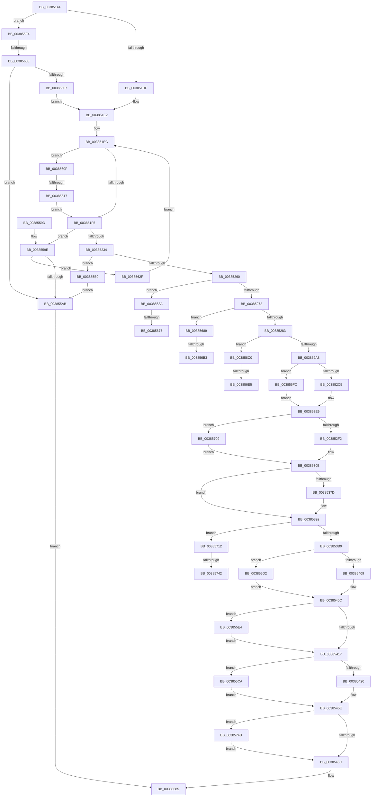

# MiSwapNumaStandbyPage

- RVA: `0x00385144`–`0x00385777` (길이 `1,587` bytes)
- VA: `0x0000000140385144`
- 실행 섹션: `.text`
- PDB 이름 있음: `예`; PDB Function 태그: `예`
- unwind 정보 RVA: `0x0007BC84`
- 디코드: `393`개 명령, `1,587/1,587` bytes 표시
- 미해석 바이트: `0` (있으면 어셈블리에 `.byte`로 보존)

> 이 문서는 커널 이미지의 기계어와 PDB 기호를 분석해 생성했습니다. 4번과 5번은 함수 원형과 자료형을 바이너리 사용 방식에서 추정한 C 해석이며 원본 소스 복구 결과는 아닙니다.

## 1. Dependencies

- 직접 호출 지점: **34**; 고유 호출 대상: **29**
- 직접 호출자로 확인된 함수: **4**
- RIP 상대 이미지 참조: **8**

### Outgoing calls
- `0x00385183` → [MiPageToNode](../33/MiPageToNode_function_00338CD0.md) (function, `0x00338CD0`)
- `0x00385222` → [MiLockLowestPrioritySecondaryStandbyPage](MiLockLowestPrioritySecondaryStandbyPage_function_00385A2C.md) (function, `0x00385A2C`)
- `0x00385263` → [MiCanPageMove](MiCanPageMove_function_00383710.md) (function, `0x00383710`)
- `0x00385306` → [MiSetPfnBlink](../3B/MiSetPfnBlink_function_003BC790.md) (function, `0x003BC790`)
- `0x00385315` → [MiUnlinkSecondaryListStandbyPage](../33/MiUnlinkSecondaryListStandbyPage_function_0033B080.md) (function, `0x0033B080`)
- `0x0038532C` → [MiFinalizePageAttribute](../33/MiFinalizePageAttribute_function_00332E30.md) (function, `0x00332E30`)
- `0x0038533E` → [MiReplaceStandbyLookaside](../33/MiReplaceStandbyLookaside_function_003397D0.md) (function, `0x003397D0`)
- `0x00385349` → [MiCopyPfnEntryEx](../2B/MiCopyPfnEntryEx_function_002B2670.md) (function, `0x002B2670`)
- `0x00385356` → [MiInsertSecondaryListStandbyPage](../33/MiInsertSecondaryListStandbyPage_function_0033BEE0.md) (function, `0x0033BEE0`)
- `0x0038539A` → [ExReleaseSpinLockExclusiveFromDpcLevel](../24/ExReleaseSpinLockExclusiveFromDpcLevel_function_002497E0.md) (function, `0x002497E0`)
- `0x003853C4` → [MiMapPageInHyperSpaceWorker](../33/MiMapPageInHyperSpaceWorker_function_00332B10.md) (function, `0x00332B10`)
- `0x003853DE` → [MI_READ_PTE_LOCK_FREE](../28/MI_READ_PTE_LOCK_FREE_function_002828A0.md) (function, `0x002828A0`)
- `0x003853E9` → [MiUpdateTransitionPteFrame](MiUpdateTransitionPteFrame_function_00385EDC.md) (function, `0x00385EDC`)
- `0x003853FC` → [MiPteInShadowRange](../23/MiPteInShadowRange_function_0023FB00.md) (function, `0x0023FB00`)
- `0x0038546A` → [MiCopyPage](../2B/MiCopyPage_function_002B1B30.md) (function, `0x002B1B30`)
- `0x003854A4` → [MiUpdateLargePageCandidateValue](../33/MiUpdateLargePageCandidateValue_function_0033EF80.md) (function, `0x0033EF80`)
- `0x003854BB` → [MiUpdateLargePageCandidateValue](../33/MiUpdateLargePageCandidateValue_function_0033EF80.md) (function, `0x0033EF80`)
- `0x003854D2` → [MiClearPfnReuseFields](../37/MiClearPfnReuseFields_function_003759F0.md) (function, `0x003759F0`)
- `0x00385540` → [MiSetOriginalPtePfnFromFreeList](../28/MiSetOriginalPtePfnFromFreeList_function_0028A99C.md) (function, `0x0028A99C`)
- `0x0038555E` → [MiSetPfnIdentity](../2A/MiSetPfnIdentity_function_002A2350.md) (function, `0x002A2350`)
- `0x0038557D` → [MiUnlockPage](../31/MiUnlockPage_function_0031A3E0.md) (function, `0x0031A3E0`)
- `0x003855B8` → [ExReleaseSpinLockExclusiveFromDpcLevel](../24/ExReleaseSpinLockExclusiveFromDpcLevel_function_002497E0.md) (function, `0x002497E0`)
- `0x003855C3` → [MiUnlockPage](../31/MiUnlockPage_function_0031A3E0.md) (function, `0x0031A3E0`)
- `0x003855D6` → [MiSanitizeShadowPxe](../29/MiSanitizeShadowPxe_function_00294B68.md) (function, `0x00294B68`)
- `0x003855EA` → [MiWritePteShadow](../29/MiWritePteShadow_function_00294EAC.md) (function, `0x00294EAC`)
- `0x00385651` → [ExReleaseSpinLockExclusiveFromDpcLevel](../24/ExReleaseSpinLockExclusiveFromDpcLevel_function_002497E0.md) (function, `0x002497E0`)
- `0x00385659` → [MiReuseStandbyPage](../44/MiReuseStandbyPage_function_0044CA90.md) (function, `0x0044CA90`)
- `0x00385666` → [MiReleaseFreshPageAtDpc](../33/MiReleaseFreshPageAtDpc_function_00334B50.md) (function, `0x00334B50`)
- `0x0038567E` → [KiLowerIrqlProcessIrqlFlags](../4F/KiLowerIrqlProcessIrqlFlags_function_004F5698.md) (function, `0x004F5698`)
- `0x003856CE` → [MiIsDecayPfn](../2B/MiIsDecayPfn_function_002B9240.md) (function, `0x002B9240`)
- `0x00385729` → [MiSetPfnContainingFrame](../36/MiSetPfnContainingFrame_function_00363FC0.md) (function, `0x00363FC0`)
- `0x00385753` → [ExAcquireSpinLockExclusiveAtDpcLevel](../24/ExAcquireSpinLockExclusiveAtDpcLevel_function_00248E80.md) (function, `0x00248E80`)
- `0x00385764` → [MiSetPfnTbFlushStamp](../2B/MiSetPfnTbFlushStamp_function_002B7A70.md) (function, `0x002B7A70`)
- `0x0038576D` → [ExReleaseSpinLockExclusiveFromDpcLevel](../24/ExReleaseSpinLockExclusiveFromDpcLevel_function_002497E0.md) (function, `0x002497E0`)

### Direct callers
- [MiGetPage](../28/MiGetPage_function_002884C0.md) at `0x00289631`
- [MiGetPageChain](../33/MiGetPageChain_function_00330130.md) at `0x0033081D`
- [MiPruneStandbyPages](../3B/MiPruneStandbyPages_function_003BC0E4.md) at `0x003BC350`
- [sub_006E7C12](../6E/Unknown_function_006E7C12.md) at `0x006E7C4A`

### Static image references
- `0x0038518E` → RVA `0x00E30088` (`.data`; read)
- `0x003851BD` → RVA `0x00FC5002` (`ALMOSTRO`; read)
- `0x00385276` → RVA `0x00E3014C` (`.data`; read)
- `0x0038535F` → RVA `0x00FCF080` (`CACHEALI`; read)
- `0x00385451` → RVA `0x00010880` (`.rdata`; read)
- `0x0038566B` → RVA `0x00FC6D20` (`ALMOSTRO`; read)
- `0x00385689` → RVA `0x00E301A8` (`.data`; read)
- `0x00385735` → RVA `0x00FC6A87` (`ALMOSTRO`; read)

## 2. Other-region calls and transfers

- 다른 실행 섹션으로 향하는 call: **0**
- call이 아닌 외부 분기/꼬리 이동: **10**
  - `0x003855FD` → [sub_006E4A1A](../6E/Unknown_function_006E4A1A.md) (`tail-transfer`)
  - `0x00385611` → [sub_006E4A1A + 0x30](../6E/Unknown_function_006E4A1A.md) (`tail-transfer`)
  - `0x00385671` → [sub_006E4A1A + 0x56](../6E/Unknown_function_006E4A1A.md) (`tail-transfer`)
  - `0x00385684` → [sub_006E4A1A + 0x56](../6E/Unknown_function_006E4A1A.md) (`tail-transfer`)
  - `0x003856AD` → [sub_006E4A1A + 0x63](../6E/Unknown_function_006E4A1A.md) (`tail-transfer`)
  - `0x003856BB` → [sub_006E4A1A + 0xCC](../6E/Unknown_function_006E4A1A.md) (`tail-transfer`)
  - `0x003856DF` → [sub_006E4A1A + 0xD5](../6E/Unknown_function_006E4A1A.md) (`tail-transfer`)
  - `0x003856F7` → [sub_006E4A1A + 0xE5](../6E/Unknown_function_006E4A1A.md) (`tail-transfer`)
  - `0x0038573C` → [sub_006E4A1A + 0x114](../6E/Unknown_function_006E4A1A.md) (`tail-transfer`)
  - `0x00385746` → [sub_006E4A1A + 0x114](../6E/Unknown_function_006E4A1A.md) (`tail-transfer`)

## 3. Assembly (complete function range)

```asm
00385144  48 89 5C 24 18                  mov qword ptr [rsp + 0x18], rbx
00385149  55                              push rbp
0038514A  56                              push rsi
0038514B  57                              push rdi
0038514C  41 54                           push r12
0038514E  41 55                           push r13
00385150  41 56                           push r14
00385152  41 57                           push r15
00385154  48 8B EC                        mov rbp, rsp
00385157  48 83 EC 70                     sub rsp, 0x70
0038515B  48 83 65 C8 00                  and qword ptr [rbp - 0x38], 0
00385160  4C 8D 3C 49                     lea r15, [rcx + rcx*2]
00385164  49 C1 E7 04                     shl r15, 4
00385168  41 8B F9                        mov edi, r9d
0038516B  45 8A E8                        mov r13b, r8b
0038516E  8B DA                           mov ebx, edx
00385170  4C 8B F1                        mov r14, rcx
00385173  48 B8 00 00 00 00 00 DE FF FF   movabs rax, 0xffffde0000000000
0038517D  48 8B C0                        mov rax, rax
00385180  4C 03 F8                        add r15, rax
00385183  E8 48 3B FB FF                  call 0x140338cd0
00385188  49 8B 4F 28                     mov rcx, qword ptr [r15 + 0x28]
0038518C  8B F0                           mov esi, eax
0038518E  48 8B 05 F3 AE AA 00            mov rax, qword ptr [rip + 0xaaaef3]
00385195  45 33 E4                        xor r12d, r12d
00385198  48 C1 E9 2B                     shr rcx, 0x2b
0038519C  81 E1 FF 03 00 00               and ecx, 0x3ff
003851A2  C6 45 48 00                     mov byte ptr [rbp + 0x48], 0
003851A6  44 88 65 40                     mov byte ptr [rbp + 0x40], r12b
003851AA  48 8B 0C C8                     mov rcx, qword ptr [rax + rcx*8]
003851AE  48 69 C3 80 DF 00 00            imul rax, rbx, 0xdf80
003851B5  48 89 4D D8                     mov qword ptr [rbp - 0x28], rcx
003851B9  48 03 41 10                     add rax, qword ptr [rcx + 0x10]
003851BD  8A 0D 3F FE C3 00               mov cl, byte ptr [rip + 0xc3fe3f]
003851C3  48 89 45 E0                     mov qword ptr [rbp - 0x20], rax
003851C7  88 4D C0                        mov byte ptr [rbp - 0x40], cl
003851CA  8B 90 50 3B 00 00               mov edx, dword ptr [rax + 0x3b50]
003851D0  83 E2 01                        and edx, 1
003851D3  89 55 C4                        mov dword ptr [rbp - 0x3c], edx
003851D6  80 F9 01                        cmp cl, 1
003851D9  0F 87 15 04 00 00               ja 0x1403855f4
003851DF  41 8A FC                        mov dil, r12b
003851E2  0F B6 C1                        movzx eax, cl
003851E5  49 03 C4                        add rax, r12
003851E8  48 89 45 E8                     mov qword ptr [rbp - 0x18], rax
003851EC  4D 85 E4                        test r12, r12
003851EF  0F 85 1A 04 00 00               jne 0x14038560f
003851F5  44 8A 6D 48                     mov r13b, byte ptr [rbp + 0x48]
003851F9  48 8B 55 E0                     mov rdx, qword ptr [rbp - 0x20]
003851FD  4C 8D 4D 40                     lea r9, [rbp + 0x40]
00385201  41 0F B6 C5                     movzx eax, r13b
00385205  4C 8D 45 C8                     lea r8, [rbp - 0x38]
00385209  48 69 C8 C0 02 00 00            imul rcx, rax, 0x2c0
00385210  48 81 C2 48 14 00 00            add rdx, 0x1448
00385217  C6 45 40 11                     mov byte ptr [rbp + 0x40], 0x11
0038521B  48 03 D1                        add rdx, rcx
0038521E  48 8B 4D D8                     mov rcx, qword ptr [rbp - 0x28]
00385222  E8 05 08 00 00                  call 0x140385a2c
00385227  4C 8B E8                        mov r13, rax
0038522A  48 83 F8 FF                     cmp rax, -1
0038522E  0F 84 6A 03 00 00               je 0x14038559e
00385234  48 8D 3C 45 00 00 00 00         lea rdi, [rax*2]
0038523C  49 BB 00 00 00 00 00 DE FF FF   movabs r11, 0xffffde0000000000
00385246  48 03 F8                        add rdi, rax
00385249  48 C1 E7 04                     shl rdi, 4
0038524D  49 8B C3                        mov rax, r11
00385250  48 03 F8                        add rdi, rax
00385253  F0 49 0F BA 6F 18 3F            lock bts qword ptr [r15 + 0x18], 0x3f
0038525A  0F 82 50 03 00 00               jb 0x1403855b0
00385260  48 8B CF                        mov rcx, rdi
00385263  E8 A8 E4 FF FF                  call 0x140383710
00385268  33 F6                           xor esi, esi
0038526A  85 C0                           test eax, eax
0038526C  0F 84 C8 03 00 00               je 0x14038563a
00385272  44 8D 66 01                     lea r12d, [rsi + 1]
00385276  44 39 25 CF AE AA 00            cmp dword ptr [rip + 0xaaaecf], r12d
0038527D  0F 84 06 04 00 00               je 0x140385689
00385283  48 8B 4F 18                     mov rcx, qword ptr [rdi + 0x18]
00385287  48 B8 FF FF FF FF FF 00 00 00   movabs rax, 0xffffffffff
00385291  4C 8B 17                        mov r10, qword ptr [rdi]
00385294  48 23 C8                        and rcx, rax
00385297  4C 23 D0                        and r10, rax
0038529A  8B 47 20                        mov eax, dword ptr [rdi + 0x20]
0038529D  C1 E8 18                        shr eax, 0x18
003852A0  A8 08                           test al, 8
003852A2  0F 85 18 04 00 00               jne 0x1403856c0
003852A8  49 B8 FF FF FF FF 3F 00 00 00   movabs r8, 0x3fffffffff
003852B2  48 BB 00 00 00 00 00 FF FF FF   movabs rbx, 0xffffff0000000000
003852BC  49 3B C8                        cmp rcx, r8
003852BF  0F 84 37 04 00 00               je 0x1403856fc
003852C5  48 8D 14 49                     lea rdx, [rcx + rcx*2]
003852C9  48 C1 E2 04                     shl rdx, 4
003852CD  49 8B C3                        mov rax, r11
003852D0  48 03 D0                        add rdx, rax
003852D3  49 8B CE                        mov rcx, r14
003852D6  48 8B 02                        mov rax, qword ptr [rdx]
003852D9  48 33 C8                        xor rcx, rax
003852DC  48 8B 45 C8                     mov rax, qword ptr [rbp - 0x38]
003852E0  48 23 CB                        and rcx, rbx
003852E3  49 33 CE                        xor rcx, r14
003852E6  48 89 0A                        mov qword ptr [rdx], rcx
003852E9  4D 3B D0                        cmp r10, r8
003852EC  0F 84 17 04 00 00               je 0x140385709
003852F2  4B 8D 0C 52                     lea rcx, [r10 + r10*2]
003852F6  48 C1 E1 04                     shl rcx, 4
003852FA  49 8B C3                        mov rax, r11
003852FD  48 03 C8                        add rcx, rax
00385300  49 8B D6                        mov rdx, r14
00385303  45 33 C0                        xor r8d, r8d
00385306  E8 85 74 03 00                  call 0x1403bc790
0038530B  BB 09 00 00 00                  mov ebx, 9
00385310  48 8B CF                        mov rcx, rdi
00385313  8B D3                           mov edx, ebx
00385315  E8 66 5D FB FF                  call 0x14033b080
0038531A  8B 47 20                        mov eax, dword ptr [rdi + 0x20]
0038531D  45 8B C4                        mov r8d, r12d
00385320  C1 E8 10                        shr eax, 0x10
00385323  49 8B CF                        mov rcx, r15
00385326  0F B6 D0                        movzx edx, al
00385329  C1 EA 06                        shr edx, 6
0038532C  E8 FF DA FA FF                  call 0x140332e30
00385331  45 33 C9                        xor r9d, r9d
00385334  44 8B C3                        mov r8d, ebx
00385337  48 83 CA FF                     or rdx, 0xffffffffffffffff
0038533B  49 8B CD                        mov rcx, r13
0038533E  E8 8D 44 FB FF                  call 0x1403397d0
00385343  48 8B D7                        mov rdx, rdi
00385346  49 8B CF                        mov rcx, r15
00385349  E8 22 D3 F2 FF                  call 0x1402b2670
0038534E  45 33 C0                        xor r8d, r8d
00385351  8B D3                           mov edx, ebx
00385353  49 8B CF                        mov rcx, r15
00385356  E8 85 6B FB FF                  call 0x14033bee0
0038535B  F0 09 34 24                     lock or dword ptr [rsp], esi
0038535F  8B 0D 1B 9D C4 00               mov ecx, dword ptr [rip + 0xc49d1b]
00385365  48 BA FF FF FF FF FF FF FF C7   movabs rdx, 0xc7ffffffffffffff
0038536F  49 8B 47 18                     mov rax, qword ptr [r15 + 0x18]
00385373  48 C1 E8 3B                     shr rax, 0x3b
00385377  33 C1                           xor eax, ecx
00385379  A8 07                           test al, 7
0038537B  74 15                           je 0x140385392
0038537D  49 8B 47 18                     mov rax, qword ptr [r15 + 0x18]
00385381  48 C1 E1 3B                     shl rcx, 0x3b
00385385  48 33 C1                        xor rax, rcx
00385388  48 23 C2                        and rax, rdx
0038538B  48 33 C1                        xor rax, rcx
0038538E  49 89 47 18                     mov qword ptr [r15 + 0x18], rax
00385392  48 8B 4D C8                     mov rcx, qword ptr [rbp - 0x38]
00385396  48 83 C1 20                     add rcx, 0x20
0038539A  E8 41 44 EC FF                  call 0x1402497e0
0038539F  4C 8B 67 28                     mov r12, qword ptr [rdi + 0x28]
003853A3  48 B8 FF FF FF FF FF 00 00 00   movabs rax, 0xffffffffff
003853AD  4C 23 E0                        and r12, rax
003853B0  4D 3B E5                        cmp r12, r13
003853B3  0F 84 59 03 00 00               je 0x140385712
003853B9  33 D2                           xor edx, edx
003853BB  41 B8 00 00 00 80               mov r8d, 0x80000000
003853C1  49 8B CC                        mov rcx, r12
003853C4  E8 47 D7 FA FF                  call 0x140332b10
003853C9  48 8B 4F 08                     mov rcx, qword ptr [rdi + 8]
003853CD  48 C1 E9 03                     shr rcx, 3
003853D1  81 E1 FF 01 00 00               and ecx, 0x1ff
003853D7  48 8D 34 C8                     lea rsi, [rax + rcx*8]
003853DB  48 8B CE                        mov rcx, rsi
003853DE  E8 BD D4 EF FF                  call 0x1402828a0
003853E3  49 8B D6                        mov rdx, r14
003853E6  48 8B C8                        mov rcx, rax
003853E9  E8 EE 0A 00 00                  call 0x140385edc
003853EE  83 65 48 00                     and dword ptr [rbp + 0x48], 0
003853F2  48 8B CE                        mov rcx, rsi
003853F5  48 8B D8                        mov rbx, rax
003853F8  48 89 45 D0                     mov qword ptr [rbp - 0x30], rax
003853FC  E8 FF A6 EB FF                  call 0x14023fb00
00385401  85 C0                           test eax, eax
00385403  0F 85 C9 01 00 00               jne 0x1403855d2
00385409  8B 45 48                        mov eax, dword ptr [rbp + 0x48]
0038540C  48 89 1E                        mov qword ptr [rsi], rbx
0038540F  85 C0                           test eax, eax
00385411  0F 85 CD 01 00 00               jne 0x1403855e4
00385417  4D 3B E5                        cmp r12, r13
0038541A  0F 84 AA 01 00 00               je 0x1403855ca
00385420  48 C1 EE 09                     shr rsi, 9
00385424  48 B8 F8 FF FF FF 7F 00 00 00   movabs rax, 0x7ffffffff8
0038542E  48 23 F0                        and rsi, rax
00385431  48 B8 00 00 00 00 80 F6 FF FF   movabs rax, 0xfffff68000000000
0038543B  48 03 F0                        add rsi, rax
0038543E  65 48 8B 04 25 20 00 00 00      mov rax, qword ptr gs:[0x20]
00385447  45 33 E4                        xor r12d, r12d
0038544A  48 8B 88 38 88 00 00            mov rcx, qword ptr [rax + 0x8838]
00385451  48 8B 05 28 B4 C8 FF            mov rax, qword ptr [rip - 0x374bd8]
00385458  4C 89 21                        mov qword ptr [rcx], r12
0038545B  48 89 06                        mov qword ptr [rsi], rax
0038545E  41 B8 06 00 00 00               mov r8d, 6
00385464  49 8B D5                        mov rdx, r13
00385467  49 8B CE                        mov rcx, r14
0038546A  E8 C1 C6 F2 FF                  call 0x1402b1b30
0038546F  F0 44 09 24 24                  lock or dword ptr [rsp], r12d
00385474  8B 35 06 9C C4 00               mov esi, dword ptr [rip + 0xc49c06]
0038547A  49 8B 47 18                     mov rax, qword ptr [r15 + 0x18]
0038547E  48 C1 E8 3B                     shr rax, 0x3b
00385482  33 C6                           xor eax, esi
00385484  A8 07                           test al, 7
00385486  0F 85 BF 02 00 00               jne 0x14038574b
0038548C  48 8B 4D D8                     mov rcx, qword ptr [rbp - 0x28]
00385490  BE 03 00 00 00                  mov esi, 3
00385495  44 8B C6                        mov r8d, esi
00385498  4C 89 64 24 20                  mov qword ptr [rsp + 0x20], r12
0038549D  49 8B D5                        mov rdx, r13
003854A0  44 8D 4E FF                     lea r9d, [rsi - 1]
003854A4  E8 D7 9A FB FF                  call 0x14033ef80
003854A9  48 8B 4D D8                     mov rcx, qword ptr [rbp - 0x28]
003854AD  44 8B CE                        mov r9d, esi
003854B0  44 8B C6                        mov r8d, esi
003854B3  4C 89 64 24 20                  mov qword ptr [rsp + 0x20], r12
003854B8  49 8B D6                        mov rdx, r14
003854BB  E8 C0 9A FB FF                  call 0x14033ef80
003854C0  48 BB FF FF FF FF FF FF FF 7F   movabs rbx, 0x7fffffffffffffff
003854CA  F0 49 21 5F 18                  lock and qword ptr [r15 + 0x18], rbx
003854CF  48 8B CF                        mov rcx, rdi
003854D2  E8 19 05 FF FF                  call 0x1403759f0
003854D7  F0 44 09 24 24                  lock or dword ptr [rsp], r12d
003854DC  8B 15 9E 9B C4 00               mov edx, dword ptr [rip + 0xc49b9e]
003854E2  48 8B 47 18                     mov rax, qword ptr [rdi + 0x18]
003854E6  48 C1 E2 3B                     shl rdx, 0x3b
003854EA  48 8B CA                        mov rcx, rdx
003854ED  48 33 C8                        xor rcx, rax
003854F0  48 B8 FF FF FF FF FF FF FF C7   movabs rax, 0xc7ffffffffffffff
003854FA  48 23 C8                        and rcx, rax
003854FD  48 33 CA                        xor rcx, rdx
00385500  48 89 4F 18                     mov qword ptr [rdi + 0x18], rcx
00385504  48 B9 00 00 00 00 00 FF FF FF   movabs rcx, 0xffffff0000000000
0038550E  4C 89 27                        mov qword ptr [rdi], r12
00385511  48 8B 47 18                     mov rax, qword ptr [rdi + 0x18]
00385515  48 23 C1                        and rax, rcx
00385518  48 8D 4F 10                     lea rcx, [rdi + 0x10]
0038551C  48 89 47 18                     mov qword ptr [rdi + 0x18], rax
00385520  8B 47 20                        mov eax, dword ptr [rdi + 0x20]
00385523  89 45 48                        mov dword ptr [rbp + 0x48], eax
00385526  C1 E8 10                        shr eax, 0x10
00385529  24 FD                           and al, 0xfd
0038552B  0C 05                           or al, 5
0038552D  88 45 4A                        mov byte ptr [rbp + 0x4a], al
00385530  8B 45 48                        mov eax, dword ptr [rbp + 0x48]
00385533  89 47 20                        mov dword ptr [rdi + 0x20], eax
00385536  48 8B 05 43 B3 C8 FF            mov rax, qword ptr [rip - 0x374cbd]
0038553D  48 89 01                        mov qword ptr [rcx], rax
00385540  E8 57 54 F0 FF                  call 0x14028a99c
00385545  8B 47 20                        mov eax, dword ptr [rdi + 0x20]
00385548  33 D2                           xor edx, edx
0038554A  89 45 48                        mov dword ptr [rbp + 0x48], eax
0038554D  48 8B CF                        mov rcx, rdi
00385550  C1 E8 18                        shr eax, 0x18
00385553  24 F7                           and al, 0xf7
00385555  88 45 4B                        mov byte ptr [rbp + 0x4b], al
00385558  8B 45 48                        mov eax, dword ptr [rbp + 0x48]
0038555B  89 47 20                        mov dword ptr [rdi + 0x20], eax
0038555E  E8 ED CD F1 FF                  call 0x1402a2350
00385563  8B 47 20                        mov eax, dword ptr [rdi + 0x20]
00385566  48 8B CF                        mov rcx, rdi
00385569  8A 55 40                        mov dl, byte ptr [rbp + 0x40]
0038556C  89 45 48                        mov dword ptr [rbp + 0x48], eax
0038556F  C1 E8 18                        shr eax, 0x18
00385572  24 F8                           and al, 0xf8
00385574  88 45 4B                        mov byte ptr [rbp + 0x4b], al
00385577  8B 45 48                        mov eax, dword ptr [rbp + 0x48]
0038557A  89 47 20                        mov dword ptr [rdi + 0x20], eax
0038557D  E8 5E 4E F9 FF                  call 0x14031a3e0
00385582  49 8B C5                        mov rax, r13
00385585  48 8B 9C 24 C0 00 00 00         mov rbx, qword ptr [rsp + 0xc0]
0038558D  48 83 C4 70                     add rsp, 0x70
00385591  41 5F                           pop r15
00385593  41 5E                           pop r14
00385595  41 5D                           pop r13
00385597  41 5C                           pop r12
00385599  5F                              pop rdi
0038559A  5E                              pop rsi
0038559B  5D                              pop rbp
0038559C  C3                              ret
0038559D  CC                              int3
0038559E  49 FF C4                        inc r12
003855A1  4C 3B 65 E8                     cmp r12, qword ptr [rbp - 0x18]
003855A5  0F 82 84 00 00 00               jb 0x14038562f
003855AB  49 8B C6                        mov rax, r14
003855AE  EB D5                           jmp 0x140385585
003855B0  48 8B 4D C8                     mov rcx, qword ptr [rbp - 0x38]
003855B4  48 83 C1 20                     add rcx, 0x20
003855B8  E8 23 42 EC FF                  call 0x1402497e0
003855BD  8A 55 40                        mov dl, byte ptr [rbp + 0x40]
003855C0  48 8B CF                        mov rcx, rdi
003855C3  E8 18 4E F9 FF                  call 0x14031a3e0
003855C8  EB E1                           jmp 0x1403855ab
003855CA  45 33 E4                        xor r12d, r12d
003855CD  E9 8C FE FF FF                  jmp 0x14038545e
003855D2  48 8D 55 D0                     lea rdx, [rbp - 0x30]
003855D6  E8 8D F5 F0 FF                  call 0x140294b68
003855DB  48 8B 5D D0                     mov rbx, qword ptr [rbp - 0x30]
003855DF  E9 28 FE FF FF                  jmp 0x14038540c
003855E4  48 8B D3                        mov rdx, rbx
003855E7  48 8B CE                        mov rcx, rsi
003855EA  E8 BD F8 F0 FF                  call 0x140294eac
003855EF  E9 23 FE FF FF                  jmp 0x140385417
003855F4  4C 8D A0 81 3B 00 00            lea r12, [rax + 0x3b81]
003855FB  85 D2                           test edx, edx
003855FD  0F 85 17 F4 35 00               jne 0x1406e4a1a
00385603  3B F3                           cmp esi, ebx
00385605  74 A4                           je 0x1403855ab
00385607  41 8A FD                        mov dil, r13b
0038560A  E9 D3 FB FF FF                  jmp 0x1403851e2
0038560F  85 D2                           test edx, edx
00385611  0F 85 33 F4 35 00               jne 0x1406e4a4a
00385617  40 88 7D 48                     mov byte ptr [rbp + 0x48], dil
0038561B  40 FE C7                        inc dil
0038561E  40 3A F9                        cmp dil, cl
00385621  40 8A C7                        mov al, dil
00385624  40 1A FF                        sbb dil, dil
00385627  40 22 F8                        and dil, al
0038562A  E9 C6 FB FF FF                  jmp 0x1403851f5
0038562F  8A 4D C0                        mov cl, byte ptr [rbp - 0x40]
00385632  8B 55 C4                        mov edx, dword ptr [rbp - 0x3c]
00385635  E9 B2 FB FF FF                  jmp 0x1403851ec
0038563A  48 BB FF FF FF FF FF FF FF 7F   movabs rbx, 0x7fffffffffffffff
00385644  F0 49 21 5F 18                  lock and qword ptr [r15 + 0x18], rbx
00385649  48 8B 4D C8                     mov rcx, qword ptr [rbp - 0x38]
0038564D  48 83 C1 20                     add rcx, 0x20
00385651  E8 8A 41 EC FF                  call 0x1402497e0
00385656  48 8B CF                        mov rcx, rdi
00385659  E8 32 74 0C 00                  call 0x14044ca90
0038565E  F0 48 21 5F 18                  lock and qword ptr [rdi + 0x18], rbx
00385663  49 8B CF                        mov rcx, r15
00385666  E8 E5 F4 FA FF                  call 0x140334b50
0038566B  39 35 AF 16 C4 00               cmp dword ptr [rip + 0xc416af], esi
00385671  0F 84 F9 F3 35 00               je 0x1406e4a70
00385677  44 0F 20 C1                     mov rcx, cr8
0038567B  8A 55 40                        mov dl, byte ptr [rbp + 0x40]
0038567E  E8 15 00 17 00                  call 0x1404f5698
00385683  90                              nop
00385684  E9 E7 F3 35 00                  jmp 0x1406e4a70
00385689  48 8B 05 18 AB AA 00            mov rax, qword ptr [rip + 0xaaab18]
00385690  4D 8B CD                        mov r9, r13
00385693  41 83 E1 1F                     and r9d, 0x1f
00385697  49 8B CD                        mov rcx, r13
0038569A  48 C1 E9 05                     shr rcx, 5
0038569E  49 8B D4                        mov rdx, r12
003856A1  4C 8D 04 88                     lea r8, [rax + rcx*4]
003856A5  49 8D 41 01                     lea rax, [r9 + 1]
003856A9  48 83 F8 20                     cmp rax, 0x20
003856AD  0F 87 CA F3 35 00               ja 0x1406e4a7d
003856B3  41 8B C9                        mov ecx, r9d
003856B6  41 8B C4                        mov eax, r12d
003856B9  D3 E0                           shl eax, cl
003856BB  E9 26 F4 35 00                  jmp 0x1406e4ae6
003856C0  4C 8D 0C 49                     lea r9, [rcx + rcx*2]
003856C4  49 C1 E1 04                     shl r9, 4
003856C8  49 8B C3                        mov rax, r11
003856CB  4C 03 C8                        add r9, rax
003856CE  E8 6D 3B F3 FF                  call 0x1402b9240
003856D3  48 BB 00 00 00 00 00 FF FF FF   movabs rbx, 0xffffff0000000000
003856DD  85 C0                           test eax, eax
003856DF  0F 85 0A F4 35 00               jne 0x1406e4aef
003856E5  49 8B 01                        mov rax, qword ptr [r9]
003856E8  49 8B CE                        mov rcx, r14
003856EB  48 33 C8                        xor rcx, rax
003856EE  48 23 CB                        and rcx, rbx
003856F1  49 33 CE                        xor rcx, r14
003856F4  49 89 09                        mov qword ptr [r9], rcx
003856F7  E9 03 F4 35 00                  jmp 0x1406e4aff
003856FC  48 8B 45 C8                     mov rax, qword ptr [rbp - 0x38]
00385700  4C 89 70 10                     mov qword ptr [rax + 0x10], r14
00385704  E9 E0 FB FF FF                  jmp 0x1403852e9
00385709  4C 89 70 18                     mov qword ptr [rax + 0x18], r14
0038570D  E9 F9 FB FF FF                  jmp 0x14038530b
00385712  48 8B 5F 08                     mov rbx, qword ptr [rdi + 8]
00385716  48 B8 00 00 00 00 00 00 00 80   movabs rax, 0x8000000000000000
00385720  49 8B D6                        mov rdx, r14
00385723  49 8B CF                        mov rcx, r15
00385726  48 0B D8                        or rbx, rax
00385729  E8 92 E8 FD FF                  call 0x140363fc0
0038572E  49 8B C6                        mov rax, r14
00385731  48 C1 E0 0C                     shl rax, 0xc
00385735  40 38 35 4B 13 C4 00            cmp byte ptr [rip + 0xc4134b], sil
0038573C  0F 84 EC F3 35 00               je 0x1406e4b2e
00385742  48 83 C8 02                     or rax, 2
00385746  E9 E3 F3 35 00                  jmp 0x1406e4b2e
0038574B  48 8B 5D C8                     mov rbx, qword ptr [rbp - 0x38]
0038574F  48 8D 4B 20                     lea rcx, [rbx + 0x20]
00385753  E8 28 37 EC FF                  call 0x140248e80
00385758  48 8B D6                        mov rdx, rsi
0038575B  41 B8 01 00 00 00               mov r8d, 1
00385761  49 8B CF                        mov rcx, r15
00385764  E8 07 23 F3 FF                  call 0x1402b7a70
00385769  48 8D 4B 20                     lea rcx, [rbx + 0x20]
0038576D  E8 6E 40 EC FF                  call 0x1402497e0
00385772  E9 15 FD FF FF                  jmp 0x14038548c
```

## 4. C-style interpretation (structured pseudocode)

```c
__int64 __fastcall MiSwapNumaStandbyPage(__int64 a1, int a2, unsigned __int8 a3, int a4)
{
    __int64 result;
    __int64 v_r10;
    __int64 v_r12;
    __int64 v_r15;
    __int64 v_rbx;
    __int64 v_rdi;
    __int64 v_rsi;
    __int64 v_rsp;
    unsigned __int64 v_stack_m50;
    unsigned __int64 v_stack_m58;
    unsigned __int64 v_stack_m60;
    unsigned __int64 v_stack_m68;
    unsigned __int64 v_stack_m70;
    unsigned int v_stack_m74;
    unsigned __int8 v_stack_m78;
    unsigned __int64 v_stack_m88;
    unsigned int v_stack_mA8;
    unsigned __int8 v_stack_p10;
    unsigned __int8 v_stack_p12;
    unsigned __int8 v_stack_p13;
    unsigned __int64 v_stack_p18;
    unsigned __int8 v_stack_p8;

    v_stack_p18 = v_rbx;
    v_rsp = (v_rsp) - (112);
    v_r15 = (a1 + a1 * 2) << (4);
    v_r15 = (v_r15) + (result);
    result = MiPageToNode(a1, a2, a3, a4);
    v_r12 = 0;
    a1 = (*(unsigned __int64 *)(v_r15 + 40)) >> (43);
    a1 = (unsigned int)((a1) & (0x3FFULL));
    v_stack_p10 = 0;
    v_stack_p8 = 0;
    result = (*(unsigned __int64 *)(v_rip + 11185907)) * ((unsigned int)(a2));
    v_stack_m60 = *(unsigned __int64 *)(*(unsigned __int64 *)(v_rip + 11185907) + a1 * 8);
    result = (result) + (*(unsigned __int64 *)(*(unsigned __int64 *)(*(unsigned __int64 *)(v_rip + 11185907) + a1 * 8) + 16));
    v_stack_m58 = result;
    v_stack_m78 = (unsigned __int8)(*(unsigned __int8 *)(v_rip + 12844607));
    a2 = (unsigned int)(((unsigned int)(*(unsigned int *)(result + 15184))) & (1));
    v_stack_m74 = a2;
    if (((unsigned __int8)(*(unsigned __int8 *)(v_rip + 12844607))) > 1) goto loc_003855F4;
loc_003851E2:
    result = ((unsigned __int8)(*(unsigned __int8 *)(v_rip + 12844607))) + (0);
    v_stack_m50 = result;
loc_003851EC:
    if (0 != 0) goto loc_0038560F;
loc_003851F5:
    a1 = (*(unsigned __int8 *)(v_rip + 12844607)) * ((unsigned __int8)(v_stack_p10));
    a2 = (v_stack_m58) + (0x1448ULL);
    v_stack_p8 = 17;
    a2 = (a2) + (a1);
    result = MiLockLowestPrioritySecondaryStandbyPage(v_stack_m60, a2, v_stack_m70, v_stack_p8);
    if (result == -1) goto loc_0038559E;
    v_rdi = (result * 2) + (result);
    v_rdi = (v_rdi) << (4);
    v_rdi = (v_rdi) + (v_r11);
    if (condition_is_below) goto loc_003855B0;
    result = MiCanPageMove(v_rdi, a2, v_stack_m70, v_stack_p8);
    v_rsi = 0;
    if ((unsigned int)(result) == 0) goto loc_0038563A;
    if ((*(unsigned int *)(v_rip + 11185871)) == ((unsigned int)(v_rsi + 1))) goto loc_00385689;
    a1 = (*(unsigned __int64 *)(v_rdi + 24)) & (result);
    v_r10 = (*(unsigned __int64 *)(v_rdi)) & (result);
    result = (unsigned int)(((unsigned int)(*(unsigned int *)(v_rdi + 32))) >> (24));
    if ((((unsigned __int8)(result)) & (8)) != 0) goto loc_003856C0;
    if (a1 == v_stack_m70) goto loc_003856FC;
    a2 = (a1 + a1 * 2) << (4);
    a2 = (a2) + (v_r11);
    a1 = (a1) ^ (*(unsigned __int64 *)(a2));
    a1 = (a1) & ((unsigned int)(a2));
    a1 = (a1) ^ (a1);
    *(unsigned __int64 *)(a2) = a1;
loc_003852E9:
    if (v_r10 == v_stack_m70) goto loc_00385709;
    a1 = (v_r10 + v_r10 * 2) << (4);
    a1 = (a1) + (v_r11);
    a3 = 0;
    result = MiSetPfnBlink(a1, a1, a3, v_stack_p8);
loc_0038530B:
    result = MiUnlinkSecondaryListStandbyPage(v_rdi, 9, a3, v_stack_p8);
    result = (unsigned int)(((unsigned int)(*(unsigned int *)(v_rdi + 32))) >> (16));
    a2 = (unsigned int)(((unsigned __int8)(result)) >> (6));
    result = MiFinalizePageAttribute(v_r15, a2, (unsigned int)((unsigned int)(v_rsi + 1)), v_stack_p8);
    a4 = 0;
    a2 = (a2) | (-1);
    result = MiReplaceStandbyLookaside(result, a2, 9, a4);
    result = MiCopyPfnEntryEx(v_r15, v_rdi, 9, a4);
    a3 = 0;
    result = MiInsertSecondaryListStandbyPage(v_r15, 9, a3, a4);
    result = (*(unsigned __int64 *)(v_r15 + 24)) >> (59);
    result = (unsigned int)((result) ^ ((unsigned int)((unsigned int)(*(unsigned int *)(v_rip + 12885275)))));
    if ((((unsigned __int8)(result)) & (7)) != 0) {
        result = *(unsigned __int64 *)(v_r15 + 24);
        a1 = ((unsigned int)(*(unsigned int *)(v_rip + 12885275))) << (59);
        result = (result) ^ (a1);
        result = (result) & (9);
        result = (result) ^ (a1);
        *(unsigned __int64 *)(v_r15 + 24) = result;
    }
    a1 = (v_stack_m70) + (32);
    result = ExReleaseSpinLockExclusiveFromDpcLevel(a1, 9, a3, a4);
    v_r12 = (*(unsigned __int64 *)(v_rdi + 40)) & (result);
    if (v_r12 == result) goto loc_00385712;
    a2 = 0;
    result = MiMapPageInHyperSpaceWorker(v_r12, a2, (unsigned int)(0x80000000ULL), a4);
    a1 = (*(unsigned __int64 *)(v_rdi + 8)) >> (3);
    a1 = (unsigned int)((a1) & (511));
    result = MI_READ_PTE_LOCK_FREE(result + a1 * 8, a2, (unsigned int)(0x80000000ULL), a4);
    result = MiUpdateTransitionPteFrame(result, a1, (unsigned int)(0x80000000ULL), a4);
    v_stack_m68 = result;
    result = MiPteInShadowRange(result + a1 * 8, a1, (unsigned int)(0x80000000ULL), a4);
    if ((unsigned int)(result) != 0) goto loc_003855D2;
loc_0038540C:
    *(unsigned __int64 *)(result + a1 * 8) = result;
    if ((unsigned int)((unsigned int)(v_stack_p10)) != 0) goto loc_003855E4;
loc_00385417:
    if (v_r12 == result) goto loc_003855CA;
    v_rsi = (result + a1 * 8) >> (9);
    v_rsi = (v_rsi) & ((unsigned int)(v_stack_p10));
    v_rsi = (v_rsi) + ((unsigned int)(v_stack_p10));
    v_r12 = 0;
    *(unsigned __int64 *)(*(unsigned __int64 *)(*(unsigned __int64 *)(gs_base + (0 + 32)) + 34872)) = 0;
    *(unsigned __int64 *)(v_rsi) = *(unsigned __int64 *)(v_rip - 3623896);
loc_0038545E:
    result = MiCopyPage(a1, result, 6, a4);
    result = (*(unsigned __int64 *)(v_r15 + 24)) >> (59);
    result = (unsigned int)((result) ^ ((unsigned int)((unsigned int)(*(unsigned int *)(v_rip + 12884998)))));
    if ((((unsigned __int8)(result)) & (7)) != 0) goto loc_0038574B;
loc_0038548C:
    v_stack_m88 = 0;
    result = MiUpdateLargePageCandidateValue(v_stack_m60, result, 3, 3 - 1);
    v_stack_m88 = 0;
    result = MiUpdateLargePageCandidateValue(v_stack_m60, a1, 3, 3);
    result = MiClearPfnReuseFields(v_rdi, a1, 3, 3);
    a2 = ((unsigned int)(*(unsigned int *)(v_rip + 12884894))) << (59);
    a1 = (a2) ^ (*(unsigned __int64 *)(v_rdi + 24));
    a1 = (a1) & (*(unsigned __int64 *)(v_rdi + 24));
    a1 = (a1) ^ (a2);
    *(unsigned __int64 *)(v_rdi + 24) = a1;
    *(unsigned __int64 *)(v_rdi) = 0;
    result = (*(unsigned __int64 *)(v_rdi + 24)) & (a1);
    *(unsigned __int64 *)(v_rdi + 24) = result;
    v_stack_p10 = (unsigned int)((unsigned int)(*(unsigned int *)(v_rdi + 32)));
    result = (unsigned int)(((unsigned int)(*(unsigned int *)(v_rdi + 32))) >> (16));
    result = (unsigned __int8)((result) & (253));
    result = (unsigned __int8)((result) | (5));
    v_stack_p12 = (unsigned __int8)(result);
    *(unsigned int *)(v_rdi + 32) = (unsigned int)((unsigned int)(v_stack_p10));
    *(unsigned __int64 *)(v_rdi + 16) = *(unsigned __int64 *)(v_rip - 3624125);
    result = MiSetOriginalPtePfnFromFreeList(v_rdi + 16, a2, 3, 3);
    a2 = 0;
    v_stack_p10 = (unsigned int)((unsigned int)(*(unsigned int *)(v_rdi + 32)));
    result = (unsigned int)(((unsigned int)(*(unsigned int *)(v_rdi + 32))) >> (24));
    result = (unsigned __int8)((result) & (247));
    v_stack_p13 = (unsigned __int8)(result);
    *(unsigned int *)(v_rdi + 32) = (unsigned int)((unsigned int)(v_stack_p10));
    result = MiSetPfnIdentity(v_rdi, a2, 3, 3);
    v_stack_p10 = (unsigned int)((unsigned int)(*(unsigned int *)(v_rdi + 32)));
    result = (unsigned int)(((unsigned int)(*(unsigned int *)(v_rdi + 32))) >> (24));
    result = (unsigned __int8)((result) & (248));
    v_stack_p13 = (unsigned __int8)(result);
    *(unsigned int *)(v_rdi + 32) = (unsigned int)((unsigned int)(v_stack_p10));
    result = MiUnlockPage(v_rdi, v_stack_p8, 3, 3);
loc_00385585:
    v_rsp = (v_rsp) + (112);
    return result;
loc_0038559E:
    v_r12 = (v_r12) + 1;
    if (v_r12 < v_stack_m50) goto loc_0038562F;
loc_003855AB:
    goto loc_00385585;
loc_003855B0:
    a1 = (v_stack_m70) + (32);
    result = ExReleaseSpinLockExclusiveFromDpcLevel(a1, v_stack_p8, 3, 3);
    result = MiUnlockPage(v_rdi, v_stack_p8, 3, 3);
    goto loc_003855AB;
loc_003855CA:
    v_r12 = 0;
    goto loc_0038545E;
loc_003855D2:
    result = MiSanitizeShadowPxe(v_rdi, v_stack_m68, 3, 3);
    goto loc_0038540C;
loc_003855E4:
    result = MiWritePteShadow(3, v_stack_m68, 3, 3);
    goto loc_00385417;
loc_003855F4:
    if (3 == ((unsigned int)(v_stack_m68))) goto loc_003855AB;
    goto loc_003851E2;
loc_0038560F:
    v_stack_p10 = (unsigned __int8)((unsigned __int8)(result));
    v_rdi = (unsigned __int8)(((unsigned __int8)(result)) + 1);
    v_rdi = (unsigned __int8)((v_rdi) & ((unsigned __int8)((unsigned __int8)(v_rdi))));
    goto loc_003851F5;
loc_0038562F:
    goto loc_003851EC;
loc_0038563A:
    a1 = (v_stack_m70) + (32);
    result = ExReleaseSpinLockExclusiveFromDpcLevel(a1, (unsigned int)(v_stack_m74), 3, 3);
    result = MiReuseStandbyPage(v_rdi, (unsigned int)(v_stack_m74), 3, 3);
    result = MiReleaseFreshPageAtDpc(v_r15, (unsigned int)(v_stack_m74), 3, 3);
    result = KiLowerIrqlProcessIrqlFlags(v_cr8, v_stack_p8, 3, 3);
loc_00385689:
    a4 = (unsigned int)((result) & (31));
    a1 = (result) >> (5);
    result = (unsigned int)(((unsigned int)((unsigned int)(result + 15233))) << ((unsigned __int8)((unsigned int)(a4))));
loc_003856C0:
    a4 = ((unsigned int)(a4) + (unsigned int)(a4) * 2) << (4);
    a4 = (a4) + (v_r11);
    result = MiIsDecayPfn((unsigned int)(a4), result + 15233, *(unsigned __int64 *)(v_rip + 11184920) + a1 * 4, a4);
    a1 = (a1) ^ (*(unsigned __int64 *)(a4));
    a1 = (a1) & (v_stack_m68);
    a1 = (a1) ^ (a1);
    *(unsigned __int64 *)(a4) = a1;
loc_003856FC:
    *(unsigned __int64 *)(v_stack_m70 + 16) = a1;
    goto loc_003852E9;
loc_00385709:
    *(unsigned __int64 *)(v_stack_m70 + 24) = a1;
    goto loc_0038530B;
loc_00385712:
    v_rbx = (*(unsigned __int64 *)(v_rdi + 8)) | (v_stack_m70);
    result = MiSetPfnContainingFrame(v_r15, a1, *(unsigned __int64 *)(v_rip + 11184920) + a1 * 4, a4);
    result = (a1) << (12);
    result = (result) | (2);
loc_0038574B:
    result = ExAcquireSpinLockExclusiveAtDpcLevel(v_stack_m70 + 32, a1, *(unsigned __int64 *)(v_rip + 11184920) + a1 * 4, a4);
    result = MiSetPfnTbFlushStamp(v_r15, 3, 1, a4);
    result = ExReleaseSpinLockExclusiveFromDpcLevel(v_stack_m70 + 32, 3, 1, a4);
    goto loc_0038548C;
}
```

## 5. (Beta) C Style

```c
int64_t MiSwapNumaStandbyPage(void *Arg1, int32_t Arg2, uint8_t Arg3, int32_t Arg4)
{
    uint8_t *arg1 = (uint8_t *)Arg1;

    int64_t result;
    int64_t local_r10;
    int64_t local_r12;
    int64_t local_r15;
    int64_t local_rbx;
    int64_t local_rdi;
    int64_t local_rsi;
    int64_t local_rsp;
    uint64_t v_stack_m50;
    uint64_t v_stack_m58;
    uint64_t v_stack_m60;
    uint64_t v_stack_m68;
    uint64_t v_stack_m70;
    uint32_t v_stack_m74;
    uint8_t v_stack_m78;
    uint64_t v_stack_m88;
    uint32_t v_stack_mA8;
    uint8_t v_stack_p10;
    uint8_t v_stack_p12;
    uint8_t v_stack_p13;
    uint64_t v_stack_p18;
    uint8_t v_stack_p8;

    v_stack_p18 = local_rbx;
    local_rsp = (local_rsp) - (112);
    local_r15 = (Arg1 + Arg1 * 2) << (4);
    local_r15 = (local_r15) + (result);
    result = MiPageToNode(Arg1, Arg2, Arg3, Arg4);
    local_r12 = 0;
    Arg1 = (*(uint64_t *)(local_r15 + 0x28)) >> (43);
    Arg1 = (uint32_t)((Arg1) & (0x3FFULL));
    v_stack_p10 = 0;
    v_stack_p8 = 0;
    result = (*(uint64_t *)(v_rip + 0xAAAEF3)) * ((uint32_t)(Arg2));
    v_stack_m60 = *(uint64_t *)(*(uint64_t *)(v_rip + 0xAAAEF3) + arg1 * 8);
    result = (result) + (*(uint64_t *)(*(uint64_t *)(*(uint64_t *)(v_rip + 0xAAAEF3) + arg1 * 8) + 0x10));
    v_stack_m58 = result;
    v_stack_m78 = (uint8_t)(*(uint8_t *)(v_rip + 0xC3FE3F));
    Arg2 = (uint32_t)(((uint32_t)(*(uint32_t *)(result + 0x3B50))) & (1));
    v_stack_m74 = Arg2;
    if (((uint8_t)(*(uint8_t *)(v_rip + 0xC3FE3F))) > 1) goto loc_003855F4;
loc_003851E2:
    result = ((uint8_t)(*(uint8_t *)(v_rip + 0xC3FE3F))) + (0);
    v_stack_m50 = result;
loc_003851EC:
    if (0 != 0) goto loc_0038560F;
loc_003851F5:
    Arg1 = (*(uint8_t *)(v_rip + 0xC3FE3F)) * ((uint8_t)(v_stack_p10));
    Arg2 = (v_stack_m58) + (0x1448ULL);
    v_stack_p8 = 17;
    Arg2 = (Arg2) + (Arg1);
    result = MiLockLowestPrioritySecondaryStandbyPage(v_stack_m60, Arg2, v_stack_m70, v_stack_p8);
    if (result == -1) goto loc_0038559E;
    local_rdi = (result * 2) + (result);
    local_rdi = (local_rdi) << (4);
    local_rdi = (local_rdi) + (local_r11);
    if (condition_is_below) goto loc_003855B0;
    result = MiCanPageMove(local_rdi, Arg2, v_stack_m70, v_stack_p8);
    local_rsi = 0;
    if ((uint32_t)(result) == 0) goto loc_0038563A;
    if ((*(uint32_t *)(v_rip + 0xAAAECF)) == ((uint32_t)(local_rsi + 1))) goto loc_00385689;
    Arg1 = (*(uint64_t *)(local_rdi + 0x18)) & (result);
    local_r10 = (*(uint64_t *)(local_rdi)) & (result);
    result = (uint32_t)(((uint32_t)(*(uint32_t *)(local_rdi + 0x20))) >> (24));
    if ((((uint8_t)(result)) & (8)) != 0) goto loc_003856C0;
    if (Arg1 == v_stack_m70) goto loc_003856FC;
    Arg2 = (Arg1 + Arg1 * 2) << (4);
    Arg2 = (Arg2) + (local_r11);
    Arg1 = (Arg1) ^ (*(uint64_t *)(Arg2));
    Arg1 = (Arg1) & ((uint32_t)(Arg2));
    Arg1 = (Arg1) ^ (Arg1);
    *(void **)(Arg2) = Arg1;
loc_003852E9:
    if (local_r10 == v_stack_m70) goto loc_00385709;
    Arg1 = (local_r10 + local_r10 * 2) << (4);
    Arg1 = (Arg1) + (local_r11);
    Arg3 = 0;
    result = MiSetPfnBlink(Arg1, Arg1, Arg3, v_stack_p8);
loc_0038530B:
    result = MiUnlinkSecondaryListStandbyPage(local_rdi, 9, Arg3, v_stack_p8);
    result = (uint32_t)(((uint32_t)(*(uint32_t *)(local_rdi + 0x20))) >> (16));
    Arg2 = (uint32_t)(((uint8_t)(result)) >> (6));
    result = MiFinalizePageAttribute(local_r15, Arg2, (uint32_t)((uint32_t)(local_rsi + 1)), v_stack_p8);
    Arg4 = 0;
    Arg2 = (Arg2) | (-1);
    result = MiReplaceStandbyLookaside(result, Arg2, 9, Arg4);
    result = MiCopyPfnEntryEx(local_r15, local_rdi, 9, Arg4);
    Arg3 = 0;
    result = MiInsertSecondaryListStandbyPage(local_r15, 9, Arg3, Arg4);
    result = (*(uint64_t *)(local_r15 + 0x18)) >> (59);
    result = (uint32_t)((result) ^ ((uint32_t)((uint32_t)(*(uint32_t *)(v_rip + 0xC49D1B)))));
    if ((((uint8_t)(result)) & (7)) != 0) {
        result = *(uint64_t *)(local_r15 + 0x18);
        Arg1 = ((uint32_t)(*(uint32_t *)(v_rip + 0xC49D1B))) << (59);
        result = (result) ^ (Arg1);
        result = (result) & (9);
        result = (result) ^ (Arg1);
        *(uint64_t *)(local_r15 + 0x18) = result;
    }
    Arg1 = (v_stack_m70) + (32);
    result = ExReleaseSpinLockExclusiveFromDpcLevel(Arg1, 9, Arg3, Arg4);
    local_r12 = (*(uint64_t *)(local_rdi + 0x28)) & (result);
    if (local_r12 == result) goto loc_00385712;
    Arg2 = 0;
    result = MiMapPageInHyperSpaceWorker(local_r12, Arg2, (uint32_t)(0x80000000ULL), Arg4);
    Arg1 = (*(uint64_t *)(local_rdi + 0x8)) >> (3);
    Arg1 = (uint32_t)((Arg1) & (511));
    result = MI_READ_PTE_LOCK_FREE(result + Arg1 * 8, Arg2, (uint32_t)(0x80000000ULL), Arg4);
    result = MiUpdateTransitionPteFrame(result, Arg1, (uint32_t)(0x80000000ULL), Arg4);
    v_stack_m68 = result;
    result = MiPteInShadowRange(result + Arg1 * 8, Arg1, (uint32_t)(0x80000000ULL), Arg4);
    if ((uint32_t)(result) != 0) goto loc_003855D2;
loc_0038540C:
    *(uint64_t *)(result + arg1 * 8) = result;
    if ((uint32_t)((uint32_t)(v_stack_p10)) != 0) goto loc_003855E4;
loc_00385417:
    if (local_r12 == result) goto loc_003855CA;
    local_rsi = (result + Arg1 * 8) >> (9);
    local_rsi = (local_rsi) & ((uint32_t)(v_stack_p10));
    local_rsi = (local_rsi) + ((uint32_t)(v_stack_p10));
    local_r12 = 0;
    *(uint64_t *)(*(uint64_t *)(*(uint64_t *)(gs_base + (0 + 0x20)) + 0x8838)) = 0;
    *(uint64_t *)(local_rsi) = *(uint64_t *)(v_rip - 0x374BD8);
loc_0038545E:
    result = MiCopyPage(Arg1, result, 6, Arg4);
    result = (*(uint64_t *)(local_r15 + 0x18)) >> (59);
    result = (uint32_t)((result) ^ ((uint32_t)((uint32_t)(*(uint32_t *)(v_rip + 0xC49C06)))));
    if ((((uint8_t)(result)) & (7)) != 0) goto loc_0038574B;
loc_0038548C:
    v_stack_m88 = 0;
    result = MiUpdateLargePageCandidateValue(v_stack_m60, result, 3, 3 - 1);
    v_stack_m88 = 0;
    result = MiUpdateLargePageCandidateValue(v_stack_m60, Arg1, 3, 3);
    result = MiClearPfnReuseFields(local_rdi, Arg1, 3, 3);
    Arg2 = ((uint32_t)(*(uint32_t *)(v_rip + 0xC49B9E))) << (59);
    Arg1 = (Arg2) ^ (*(uint64_t *)(local_rdi + 0x18));
    Arg1 = (Arg1) & (*(uint64_t *)(local_rdi + 0x18));
    Arg1 = (Arg1) ^ (Arg2);
    *(void **)(local_rdi + 0x18) = Arg1;
    *(uint64_t *)(local_rdi) = 0;
    result = (*(uint64_t *)(local_rdi + 0x18)) & (Arg1);
    *(uint64_t *)(local_rdi + 0x18) = result;
    v_stack_p10 = (uint32_t)((uint32_t)(*(uint32_t *)(local_rdi + 0x20)));
    result = (uint32_t)(((uint32_t)(*(uint32_t *)(local_rdi + 0x20))) >> (16));
    result = (uint8_t)((result) & (253));
    result = (uint8_t)((result) | (5));
    v_stack_p12 = (uint8_t)(result);
    *(uint32_t *)(local_rdi + 0x20) = (uint32_t)((uint32_t)(v_stack_p10));
    *(uint64_t *)(local_rdi + 0x10) = *(uint64_t *)(v_rip - 0x374CBD);
    result = MiSetOriginalPtePfnFromFreeList(local_rdi + 16, Arg2, 3, 3);
    Arg2 = 0;
    v_stack_p10 = (uint32_t)((uint32_t)(*(uint32_t *)(local_rdi + 0x20)));
    result = (uint32_t)(((uint32_t)(*(uint32_t *)(local_rdi + 0x20))) >> (24));
    result = (uint8_t)((result) & (247));
    v_stack_p13 = (uint8_t)(result);
    *(uint32_t *)(local_rdi + 0x20) = (uint32_t)((uint32_t)(v_stack_p10));
    result = MiSetPfnIdentity(local_rdi, Arg2, 3, 3);
    v_stack_p10 = (uint32_t)((uint32_t)(*(uint32_t *)(local_rdi + 0x20)));
    result = (uint32_t)(((uint32_t)(*(uint32_t *)(local_rdi + 0x20))) >> (24));
    result = (uint8_t)((result) & (248));
    v_stack_p13 = (uint8_t)(result);
    *(uint32_t *)(local_rdi + 0x20) = (uint32_t)((uint32_t)(v_stack_p10));
    result = MiUnlockPage(local_rdi, v_stack_p8, 3, 3);
loc_00385585:
    local_rsp = (local_rsp) + (112);
    return result;
loc_0038559E:
    local_r12 = (local_r12) + 1;
    if (local_r12 < v_stack_m50) goto loc_0038562F;
loc_003855AB:
    goto loc_00385585;
loc_003855B0:
    Arg1 = (v_stack_m70) + (32);
    result = ExReleaseSpinLockExclusiveFromDpcLevel(Arg1, v_stack_p8, 3, 3);
    result = MiUnlockPage(local_rdi, v_stack_p8, 3, 3);
    goto loc_003855AB;
loc_003855CA:
    local_r12 = 0;
    goto loc_0038545E;
loc_003855D2:
    result = MiSanitizeShadowPxe(local_rdi, v_stack_m68, 3, 3);
    goto loc_0038540C;
loc_003855E4:
    result = MiWritePteShadow(3, v_stack_m68, 3, 3);
    goto loc_00385417;
loc_003855F4:
    if (3 == ((uint32_t)(v_stack_m68))) goto loc_003855AB;
    goto loc_003851E2;
loc_0038560F:
    v_stack_p10 = (uint8_t)((uint8_t)(result));
    local_rdi = (uint8_t)(((uint8_t)(result)) + 1);
    local_rdi = (uint8_t)((local_rdi) & ((uint8_t)((uint8_t)(local_rdi))));
    goto loc_003851F5;
loc_0038562F:
    goto loc_003851EC;
loc_0038563A:
    Arg1 = (v_stack_m70) + (32);
    result = ExReleaseSpinLockExclusiveFromDpcLevel(Arg1, (uint32_t)(v_stack_m74), 3, 3);
    result = MiReuseStandbyPage(local_rdi, (uint32_t)(v_stack_m74), 3, 3);
    result = MiReleaseFreshPageAtDpc(local_r15, (uint32_t)(v_stack_m74), 3, 3);
    result = KiLowerIrqlProcessIrqlFlags(v_cr8, v_stack_p8, 3, 3);
loc_00385689:
    Arg4 = (uint32_t)((result) & (31));
    Arg1 = (result) >> (5);
    result = (uint32_t)(((uint32_t)((uint32_t)(result + 15233))) << ((uint8_t)((uint32_t)(Arg4))));
loc_003856C0:
    Arg4 = ((uint32_t)(Arg4) + (uint32_t)(Arg4) * 2) << (4);
    Arg4 = (Arg4) + (local_r11);
    result = MiIsDecayPfn((uint32_t)(Arg4), result + 15233, *(uint64_t *)(v_rip + 0xAAAB18) + Arg1 * 4, Arg4);
    Arg1 = (Arg1) ^ (*(uint64_t *)(Arg4));
    Arg1 = (Arg1) & (v_stack_m68);
    Arg1 = (Arg1) ^ (Arg1);
    *(void **)(Arg4) = Arg1;
loc_003856FC:
    *(void **)(v_stack_m70 + 0x10) = Arg1;
    goto loc_003852E9;
loc_00385709:
    *(void **)(v_stack_m70 + 0x18) = Arg1;
    goto loc_0038530B;
loc_00385712:
    local_rbx = (*(uint64_t *)(local_rdi + 0x8)) | (v_stack_m70);
    result = MiSetPfnContainingFrame(local_r15, Arg1, *(uint64_t *)(v_rip + 0xAAAB18) + Arg1 * 4, Arg4);
    result = (Arg1) << (12);
    result = (result) | (2);
loc_0038574B:
    result = ExAcquireSpinLockExclusiveAtDpcLevel(v_stack_m70 + 32, Arg1, *(uint64_t *)(v_rip + 0xAAAB18) + Arg1 * 4, Arg4);
    result = MiSetPfnTbFlushStamp(local_r15, 3, 1, Arg4);
    result = ExReleaseSpinLockExclusiveFromDpcLevel(v_stack_m70 + 32, 3, 1, Arg4);
    goto loc_0038548C;
}
```

### 관측된 메모리 오프셋

구조체 형식이 확인되지 않은 접근은 인자 기준의 오프셋으로만 기록했습니다.

| 기준 인자 | 오프셋 표현 | 폭 (bit) | 접근 |
|---|---:|---:|---|
| `Arg1` | `+ 0x0 + rcx*2` | `64` | `R` |

## 6. Execution-region graph

[열기: 2D/3D 그래프와 함수 탐색 컨트롤 패널](../../../control-panel.html?section=text&rva=0x00385144&view=graph)

- 2D 그래프는 위에서 아래로 흐르고, 3D 그래프는 빈 공간을 드래그해 회전합니다. Shift+드래그는 이동, 휠은 확대·축소, 함수 노드 선택은 대상 보고서 이동입니다.

### Static fallback


