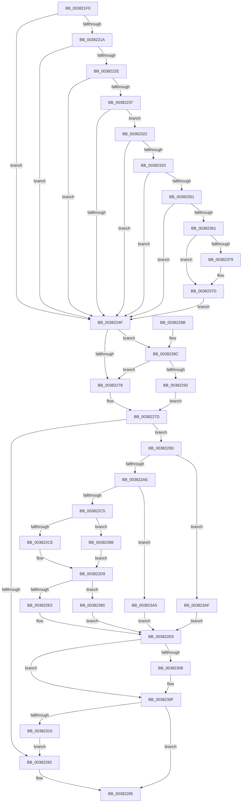

# MiTransferSoftwarePte

- RVA: `0x003821F0`–`0x003823BF` (길이 `463` bytes)
- VA: `0x00000001403821F0`
- 실행 섹션: `.text`
- PDB 이름 있음: `예`; PDB Function 태그: `아니요`
- unwind 정보 RVA: `0x0007BAC8`
- 디코드: `111`개 명령, `463/463` bytes 표시
- 미해석 바이트: `0` (있으면 어셈블리에 `.byte`로 보존)

> 이 문서는 커널 이미지의 기계어와 PDB 기호를 분석해 생성했습니다. 4번과 5번은 함수 원형과 자료형을 바이너리 사용 방식에서 추정한 C 해석이며 원본 소스 복구 결과는 아닙니다.

## 1. Dependencies

- 직접 호출 지점: **1**; 고유 호출 대상: **1**
- 직접 호출자로 확인된 함수: **13**
- RIP 상대 이미지 참조: **2**

### Outgoing calls
- `0x003823B2` → [MiMakePageFilePte](MiMakePageFilePte_function_003823C8.md) (function, `0x003823C8`)

### Direct callers
- [MiTrimUnusedPageFileRegionsWorker](../2A/MiTrimUnusedPageFileRegionsWorker_function_002AA320.md) at `0x002AA616`
- [MiStoreWriteModifiedPages](../2B/MiStoreWriteModifiedPages_function_002B46C4.md) at `0x002B4D79`
- [MiStoreWriteModifiedPages](../2B/MiStoreWriteModifiedPages_function_002B46C4.md) at `0x002B4E62`
- [MiStoreWriteModifiedPages](../2B/MiStoreWriteModifiedPages_function_002B46C4.md) at `0x002B51C1`
- [MiStoreWriteModifiedPages](../2B/MiStoreWriteModifiedPages_function_002B46C4.md) at `0x002B5444`
- [MiZeroCfgSystemWideBitmapWorker](../36/MiZeroCfgSystemWideBitmapWorker_function_00367060.md) at `0x00367263`
- [MiZeroCfgSystemWideBitmapWorker](../36/MiZeroCfgSystemWideBitmapWorker_function_00367060.md) at `0x0036733F`
- [MiDeleteSectionCluster](../37/MiDeleteSectionCluster_function_00373DF0.md) at `0x00373FB6`
- [MiWritePageFileHash](MiWritePageFileHash_function_00381DC8.md) at `0x00381F20`
- [MiRewriteTrimPteAsDemandZero](MiRewriteTrimPteAsDemandZero_function_003823F4.md) at `0x00382425`
- [MiReservePageFileSpaceForPage](MiReservePageFileSpaceForPage_function_0038377C.md) at `0x00383B2C`
- [MiFindFreePageFileSpace](../3E/MiFindFreePageFileSpace_function_003E2CAC.md) at `0x003E2FFA`
- [MiWriteComplete](../40/MiWriteComplete_function_004069B0.md) at `0x00406D9D`
- [sub_006D7206](../6D/Unknown_function_006D7206.md) at `0x006D720E`
- [sub_006D7C08](../6D/Unknown_function_006D7C08.md) at `0x006D7C2C`
- [sub_006D7C5C](../6D/Unknown_function_006D7C5C.md) at `0x006D7D32`
- [sub_006D7D40](../6D/Unknown_function_006D7D40.md) at `0x006D7D51`

### Static image references
- `0x003822AE` → RVA `0x00E2DC80` (`.data`; read)
- `0x00382322` → RVA `0x00FC6A88` (`ALMOSTRO`; read)

## 2. Other-region calls and transfers

- 다른 실행 섹션으로 향하는 call: **0**
- 별도 외부 분기/꼬리 이동을 확인하지 못했습니다.

## 3. Assembly (complete function range)

```asm
003821F0  40 53                           push rbx
003821F2  48 83 EC 30                     sub rsp, 0x30
003821F6  48 89 4C 24 20                  mov qword ptr [rsp + 0x20], rcx
003821FB  4C 8B DA                        mov r11, rdx
003821FE  4C 8B 54 24 20                  mov r10, qword ptr [rsp + 0x20]
00382203  41 8B D8                        mov ebx, r8d
00382206  48 BA 00 D0 BE 7D FB F6 FF FF   movabs rdx, 0xfffff6fb7dbed000
00382210  48 8D 44 24 20                  lea rax, [rsp + 0x20]
00382215  48 3B C2                        cmp rax, rdx
00382218  72 35                           jb 0x14038224f
0038221A  48 BA F8 D7 BE 7D FB F6 FF FF   movabs rdx, 0xfffff6fb7dbed7f8
00382224  48 8D 44 24 20                  lea rax, [rsp + 0x20]
00382229  48 3B C2                        cmp rax, rdx
0038222C  77 21                           ja 0x14038224f
0038222E  49 8B C2                        mov rax, r10
00382231  41 F6 C2 01                     test r10b, 1
00382235  74 18                           je 0x14038224f
00382237  41 F6 C2 42                     test r10b, 0x42
0038223B  41 0F 95 C0                     setne r8b
0038223F  41 F6 C2 20                     test r10b, 0x20
00382243  0F 95 C2                        setne dl
00382246  44 84 C2                        test dl, r8b
00382249  0F 84 D3 00 00 00               je 0x140382322
0038224F  49 0F BA E2 0A                  bt r10, 0xa
00382254  48 C7 C2 FF F7 FF FF            mov rdx, 0xfffffffffffff7ff
0038225B  48 C7 C0 F7 FF FF FF            mov rax, 0xfffffffffffffff7
00382262  48 0F 42 C2                     cmovb rax, rdx
00382266  48 8D 54 24 20                  lea rdx, [rsp + 0x20]
0038226B  49 23 C2                        and rax, r10
0038226E  48 89 02                        mov qword ptr [rdx], rax
00382271  48 0F BA E1 0A                  bt rcx, 0xa
00382276  73 14                           jae 0x14038228c
00382278  48 8B 4C 24 20                  mov rcx, qword ptr [rsp + 0x20]
0038227D  4D 85 DB                        test r11, r11
00382280  75 1B                           jne 0x14038229d
00382282  48 8B C1                        mov rax, rcx
00382285  48 83 C4 30                     add rsp, 0x30
00382289  5B                              pop rbx
0038228A  C3                              ret
0038228B  CC                              int3
0038228C  41 F6 C1 04                     test r9b, 4
00382290  75 E6                           jne 0x140382278
00382292  48 8B 4C 24 20                  mov rcx, qword ptr [rsp + 0x20]
00382297  48 83 E1 F9                     and rcx, 0xfffffffffffffff9
0038229B  EB E0                           jmp 0x14038227d
0038229D  45 0F B7 93 AC 00 00 00         movzx r10d, word ptr [r11 + 0xac]
003822A5  48 85 C9                        test rcx, rcx
003822A8  0F 84 01 01 00 00               je 0x1403823af
003822AE  4C 8B 05 CB B9 AA 00            mov r8, qword ptr [rip + 0xaab9cb]
003822B5  48 8B D3                        mov rdx, rbx
003822B8  48 C1 E2 20                     shl rdx, 0x20
003822BC  4D 85 C0                        test r8, r8
003822BF  0F 84 E0 00 00 00               je 0x1403823a5
003822C5  F6 C1 10                        test cl, 0x10
003822C8  0F 85 CA 00 00 00               jne 0x140382398
003822CE  49 8B C0                        mov rax, r8
003822D1  48 F7 D0                        not rax
003822D4  48 23 C8                        and rcx, rax
003822D7  8B C9                           mov ecx, ecx
003822D9  48 0B D1                        or rdx, rcx
003822DC  49 85 D0                        test r8, rdx
003822DF  0F 84 AB 00 00 00               je 0x140382390
003822E5  48 83 CA 10                     or rdx, 0x10
003822E9  49 8B CA                        mov rcx, r10
003822EC  48 C1 E1 0C                     shl rcx, 0xc
003822F0  48 8B C1                        mov rax, rcx
003822F3  48 33 C2                        xor rax, rdx
003822F6  48 25 FF 0F FF FF               and rax, 0xffffffffffff0fff
003822FC  48 33 C1                        xor rax, rcx
003822FF  48 8B C8                        mov rcx, rax
00382302  41 F6 C1 01                     test r9b, 1
00382306  74 07                           je 0x14038230f
00382308  48 83 C8 04                     or rax, 4
0038230C  48 8B C8                        mov rcx, rax
0038230F  41 F6 C1 02                     test r9b, 2
00382313  0F 84 6C FF FF FF               je 0x140382285
00382319  48 83 C9 02                     or rcx, 2
0038231D  E9 60 FF FF FF                  jmp 0x140382282
00382322  48 F7 05 5B 47 C4 00 00 00 60 00  test qword ptr [rip + 0xc4475b], 0x600000
0038232D  0F 84 1C FF FF FF               je 0x14038224f
00382333  65 48 8B 14 25 88 01 00 00      mov rdx, qword ptr gs:[0x188]
0038233C  4C 8B 82 B8 00 00 00            mov r8, qword ptr [rdx + 0xb8]
00382343  41 80 B8 60 01 00 00 01         cmp byte ptr [r8 + 0x160], 1
0038234B  0F 84 FE FE FF FF               je 0x14038224f
00382351  4D 8B 80 08 05 00 00            mov r8, qword ptr [r8 + 0x508]
00382358  4D 85 C0                        test r8, r8
0038235B  0F 84 EE FE FF FF               je 0x14038224f
00382361  48 8D 54 24 20                  lea rdx, [rsp + 0x20]
00382366  48 C1 EA 03                     shr rdx, 3
0038236A  81 E2 FF 01 00 00               and edx, 0x1ff
00382370  49 8B 14 D0                     mov rdx, qword ptr [r8 + rdx*8]
00382374  F6 C2 20                        test dl, 0x20
00382377  74 04                           je 0x14038237d
00382379  48 83 C8 20                     or rax, 0x20
0038237D  4C 8B D0                        mov r10, rax
00382380  49 83 CA 42                     or r10, 0x42
00382384  F6 C2 42                        test dl, 0x42
00382387  4C 0F 44 D0                     cmove r10, rax
0038238B  E9 BF FE FF FF                  jmp 0x14038224f
00382390  49 0B D0                        or rdx, r8
00382393  E9 51 FF FF FF                  jmp 0x1403822e9
00382398  B8 EF FF FF FF                  mov eax, 0xffffffef
0038239D  48 23 C8                        and rcx, rax
003823A0  E9 34 FF FF FF                  jmp 0x1403822d9
003823A5  8B C1                           mov eax, ecx
003823A7  48 0B D0                        or rdx, rax
003823AA  E9 3A FF FF FF                  jmp 0x1403822e9
003823AF  48 8B CB                        mov rcx, rbx
003823B2  E8 11 00 00 00                  call 0x1403823c8
003823B7  48 8B D0                        mov rdx, rax
003823BA  E9 2A FF FF FF                  jmp 0x1403822e9
```

## 4. C-style interpretation (structured pseudocode)

```c
__int64 __fastcall MiTransferSoftwarePte(__int64 a1, __int64 a2, int a3, unsigned __int8 a4)
{
    __int64 result;
    __int64 v_r10;
    __int64 v_rsp;
    unsigned __int64 v_stack_m18;
    unsigned __int64 v_stack_p20;

    v_rsp = (v_rsp) - (48);
    v_stack_m18 = a1;
    if (v_stack_m18 < a2) goto loc_0038224F;
    if (v_stack_m18 > a2) goto loc_0038224F;
    if ((((unsigned __int8)(v_stack_m18)) & (1)) == 0) goto loc_0038224F;
    a3 = ((((unsigned __int8)(v_stack_m18)) & (66)) != 0) ? 1 : 0;
    a2 = ((((unsigned __int8)(v_stack_m18)) & (32)) != 0) ? 1 : 0;
    if ((((unsigned __int8)(a2)) & ((unsigned __int8)(a3))) == 0) goto loc_00382322;
loc_0038224F:
    result = -9;
    if (condition_is_below) { result = 0xFFFFFFFFFFFFF7FFULL; }
    result = (result) & (v_stack_m18);
    *(unsigned __int64 *)(v_stack_m18) = result;
    if (condition_is_above_or_equal) goto loc_0038228C;
loc_00382278:
loc_0038227D:
    if (a2 != 0) goto loc_0038229D;
loc_00382282:
loc_00382285:
    v_rsp = (v_rsp) + (48);
    return v_stack_m18;
loc_0038228C:
    if (((a4) & (4)) != 0) goto loc_00382278;
    a1 = (v_stack_p20) & (-7);
    goto loc_0038227D;
loc_0038229D:
    if (a1 == 0) goto loc_003823AF;
    a2 = ((unsigned int)(a3)) << (32);
    if (*(unsigned __int64 *)(v_rip + 11188683) == 0) goto loc_003823A5;
    if ((((unsigned __int8)(a1)) & (16)) != 0) goto loc_00382398;
    result = ~(*(unsigned __int64 *)(v_rip + 11188683));
    a1 = (a1) & (result);
loc_003822D9:
    a2 = (a2) | ((unsigned int)((unsigned int)(a1)));
    if (((*(unsigned __int64 *)(v_rip + 11188683)) & (a2)) == 0) goto loc_00382390;
    a2 = (a2) | (16);
loc_003822E9:
    a1 = (*(unsigned __int16 *)(a2 + 172)) << (12);
    result = (a1) ^ (a2);
    result = (result) & (0xFFFFFFFFFFFF0FFFULL);
    result = (result) ^ (a1);
    if (((a4) & (1)) != 0) {
        result = (result) | (4);
        a1 = result;
    }
    if (((a4) & (2)) == 0) goto loc_00382285;
    a1 = (a1) | (2);
    goto loc_00382282;
loc_00382322:
    if (((*(unsigned __int64 *)(v_rip + 12863323)) & (0x600000ULL)) == 0) goto loc_0038224F;
    if ((*(unsigned __int8 *)(*(unsigned __int64 *)(*(unsigned __int64 *)(gs_base + (0 + 392)) + 184) + 352)) == 1) goto loc_0038224F;
    if (*(unsigned __int64 *)(*(unsigned __int64 *)(*(unsigned __int64 *)(gs_base + (0 + 392)) + 184) + 1288) == 0) goto loc_0038224F;
    a2 = (v_stack_p20) >> (3);
    a2 = (unsigned int)((a2) & (511));
    if ((((unsigned __int8)(*(unsigned __int64 *)(*(unsigned __int64 *)(*(unsigned __int64 *)(*(unsigned __int64 *)(gs_base + (0 + 392)) + 184) + 1288) + a2 * 8))) & (32)) != 0) {
        result = (result) | (32);
    }
    v_r10 = (result) | (66);
    if ((((unsigned __int8)(*(unsigned __int64 *)(*(unsigned __int64 *)(*(unsigned __int64 *)(*(unsigned __int64 *)(gs_base + (0 + 392)) + 184) + 1288) + a2 * 8))) & (66)) == 0) { v_r10 = result; }
    goto loc_0038224F;
loc_00382390:
    a2 = (*(unsigned __int64 *)(*(unsigned __int64 *)(*(unsigned __int64 *)(*(unsigned __int64 *)(gs_base + (0 + 392)) + 184) + 1288) + a2 * 8)) | (*(unsigned __int64 *)(*(unsigned __int64 *)(*(unsigned __int64 *)(gs_base + (0 + 392)) + 184) + 1288));
    goto loc_003822E9;
loc_00382398:
    a1 = (a1) & ((unsigned int)(0xFFFFFFEFULL));
    goto loc_003822D9;
loc_003823A5:
    a2 = (a2) | ((unsigned int)((unsigned int)(a1)));
    goto loc_003822E9;
loc_003823AF:
    result = MiMakePageFilePte((unsigned int)(a3), a2, *(unsigned __int64 *)(*(unsigned __int64 *)(*(unsigned __int64 *)(gs_base + (0 + 392)) + 184) + 1288), a4);
    goto loc_003822E9;
}
```

## 5. (Beta) C Style

```c
int64_t MiTransferSoftwarePte(int64_t Arg1, int64_t Arg2, int32_t Arg3, uint8_t Arg4)
{
    int64_t result;
    int64_t local_r10;
    int64_t local_rsp;
    uint64_t v_stack_m18;
    uint64_t v_stack_p20;

    local_rsp = (local_rsp) - (48);
    v_stack_m18 = Arg1;
    if (v_stack_m18 < Arg2) goto loc_0038224F;
    if (v_stack_m18 > Arg2) goto loc_0038224F;
    if ((((uint8_t)(v_stack_m18)) & (1)) == 0) goto loc_0038224F;
    Arg3 = ((((uint8_t)(v_stack_m18)) & (66)) != 0) ? 1 : 0;
    Arg2 = ((((uint8_t)(v_stack_m18)) & (32)) != 0) ? 1 : 0;
    if ((((uint8_t)(Arg2)) & ((uint8_t)(Arg3))) == 0) goto loc_00382322;
loc_0038224F:
    result = -9;
    if (condition_is_below) { result = 0xFFFFFFFFFFFFF7FFULL; }
    result = (result) & (v_stack_m18);
    *(uint64_t *)(v_stack_m18) = result;
    if (condition_is_above_or_equal) goto loc_0038228C;
loc_00382278:
loc_0038227D:
    if (Arg2 != 0) goto loc_0038229D;
loc_00382282:
loc_00382285:
    local_rsp = (local_rsp) + (48);
    return v_stack_m18;
loc_0038228C:
    if (((Arg4) & (4)) != 0) goto loc_00382278;
    Arg1 = (v_stack_p20) & (-7);
    goto loc_0038227D;
loc_0038229D:
    if (Arg1 == 0) goto loc_003823AF;
    Arg2 = ((uint32_t)(Arg3)) << (32);
    if (*(uint64_t *)(v_rip + 0xAAB9CB) == 0) goto loc_003823A5;
    if ((((uint8_t)(Arg1)) & (16)) != 0) goto loc_00382398;
    result = ~(*(uint64_t *)(v_rip + 0xAAB9CB));
    Arg1 = (Arg1) & (result);
loc_003822D9:
    Arg2 = (Arg2) | ((uint32_t)((uint32_t)(Arg1)));
    if (((*(uint64_t *)(v_rip + 0xAAB9CB)) & (Arg2)) == 0) goto loc_00382390;
    Arg2 = (Arg2) | (16);
loc_003822E9:
    Arg1 = (*(uint16_t *)(Arg2 + 0xAC)) << (12);
    result = (Arg1) ^ (Arg2);
    result = (result) & (0xFFFFFFFFFFFF0FFFULL);
    result = (result) ^ (Arg1);
    if (((Arg4) & (1)) != 0) {
        result = (result) | (4);
        Arg1 = result;
    }
    if (((Arg4) & (2)) == 0) goto loc_00382285;
    Arg1 = (Arg1) | (2);
    goto loc_00382282;
loc_00382322:
    if (((*(uint64_t *)(v_rip + 0xC4475B)) & (0x600000ULL)) == 0) goto loc_0038224F;
    if ((*(uint8_t *)(*(uint64_t *)(*(uint64_t *)(gs_base + (0 + 0x188)) + 0xB8) + 0x160)) == 1) goto loc_0038224F;
    if (*(uint64_t *)(*(uint64_t *)(*(uint64_t *)(gs_base + (0 + 0x188)) + 0xB8) + 0x508) == 0) goto loc_0038224F;
    Arg2 = (v_stack_p20) >> (3);
    Arg2 = (uint32_t)((Arg2) & (511));
    if ((((uint8_t)(*(uint64_t *)(*(uint64_t *)(*(uint64_t *)(*(uint64_t *)(gs_base + (0 + 0x188)) + 0xB8) + 0x508) + Arg2 * 8))) & (32)) != 0) {
        result = (result) | (32);
    }
    local_r10 = (result) | (66);
    if ((((uint8_t)(*(uint64_t *)(*(uint64_t *)(*(uint64_t *)(*(uint64_t *)(gs_base + (0 + 0x188)) + 0xB8) + 0x508) + Arg2 * 8))) & (66)) == 0) { local_r10 = result; }
    goto loc_0038224F;
loc_00382390:
    Arg2 = (*(uint64_t *)(*(uint64_t *)(*(uint64_t *)(*(uint64_t *)(gs_base + (0 + 0x188)) + 0xB8) + 0x508) + Arg2 * 8)) | (*(uint64_t *)(*(uint64_t *)(*(uint64_t *)(gs_base + (0 + 0x188)) + 0xB8) + 0x508));
    goto loc_003822E9;
loc_00382398:
    Arg1 = (Arg1) & ((uint32_t)(0xFFFFFFEFULL));
    goto loc_003822D9;
loc_003823A5:
    Arg2 = (Arg2) | ((uint32_t)((uint32_t)(Arg1)));
    goto loc_003822E9;
loc_003823AF:
    result = MiMakePageFilePte((uint32_t)(Arg3), Arg2, *(uint64_t *)(*(uint64_t *)(*(uint64_t *)(gs_base + (0 + 0x188)) + 0xB8) + 0x508), Arg4);
    goto loc_003822E9;
}
```

## 6. Execution-region graph

[열기: 2D/3D 그래프와 함수 탐색 컨트롤 패널](../../../control-panel.html?section=text&rva=0x003821F0&view=graph)

- 2D 그래프는 위에서 아래로 흐르고, 3D 그래프는 빈 공간을 드래그해 회전합니다. Shift+드래그는 이동, 휠은 확대·축소, 함수 노드 선택은 대상 보고서 이동입니다.

### Static fallback


