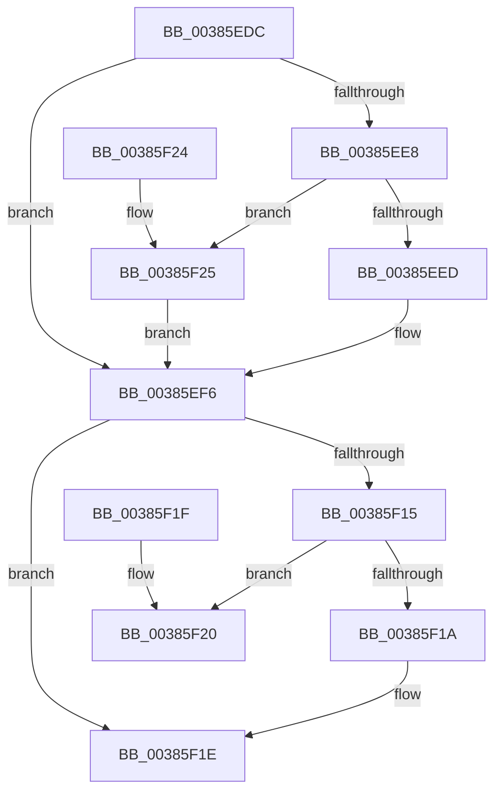

# MiUpdateTransitionPteFrame

- RVA: `0x00385EDC`–`0x00385F2B` (길이 `79` bytes)
- VA: `0x0000000140385EDC`
- 실행 섹션: `.text`
- PDB 이름 있음: `예`; PDB Function 태그: `아니요`
- unwind 정보 RVA: `0x000DB714`
- 디코드: `26`개 명령, `79/79` bytes 표시
- 미해석 바이트: `0` (있으면 어셈블리에 `.byte`로 보존)

> 이 문서는 커널 이미지의 기계어와 PDB 기호를 분석해 생성했습니다. 4번과 5번은 함수 원형과 자료형을 바이너리 사용 방식에서 추정한 C 해석이며 원본 소스 복구 결과는 아닙니다.

## 1. Dependencies

- 직접 호출 지점: **0**; 고유 호출 대상: **0**
- 직접 호출자로 확인된 함수: **8**
- RIP 상대 이미지 참조: **1**

### Outgoing calls
- 직접 디코드된 call 명령이 없습니다.

### Direct callers
- [MiMigratePfn](../28/MiMigratePfn_function_0028DBB0.md) at `0x0028DE9E`
- [MiReplaceTransitionPage](../2B/MiReplaceTransitionPage_function_002B1120.md) at `0x002B17DD`
- [MiDuplicateCloneLeaf](MiDuplicateCloneLeaf_function_003825F0.md) at `0x00382905`
- [MiSwapNumaStandbyPage](MiSwapNumaStandbyPage_function_00385144.md) at `0x003853E9`
- [MiSwapHardFaultPage](MiSwapHardFaultPage_function_00385F34.md) at `0x00385F80`
- [MiInvalidateCollidedIos](MiInvalidateCollidedIos_function_00386110.md) at `0x00386337`
- [MiSplitDirectMapPage](../4D/MiSplitDirectMapPage_function_004DAAA0.md) at `0x004DACAA`
- [sub_006E4A1A](../6E/Unknown_function_006E4A1A.md) at `0x006E4AF6`

### Static image references
- `0x00385EDC` → RVA `0x00E2DC80` (`.data`; read)

## 2. Other-region calls and transfers

- 다른 실행 섹션으로 향하는 call: **0**
- 별도 외부 분기/꼬리 이동을 확인하지 못했습니다.

## 3. Assembly (complete function range)

```asm
00385EDC  4C 8B 05 9D 7D AA 00            mov r8, qword ptr [rip + 0xaa7d9d]
00385EE3  4D 85 C0                        test r8, r8
00385EE6  74 0E                           je 0x140385ef6
00385EE8  F6 C1 10                        test cl, 0x10
00385EEB  75 38                           jne 0x140385f25
00385EED  49 8B C0                        mov rax, r8
00385EF0  48 F7 D0                        not rax
00385EF3  48 23 C8                        and rcx, rax
00385EF6  48 C1 E2 0C                     shl rdx, 0xc
00385EFA  48 8B C2                        mov rax, rdx
00385EFD  48 33 C1                        xor rax, rcx
00385F00  48 B9 FF 0F 00 00 00 00 F0 FF   movabs rcx, 0xfff0000000000fff
00385F0A  48 23 C1                        and rax, rcx
00385F0D  48 33 C2                        xor rax, rdx
00385F10  4D 85 C0                        test r8, r8
00385F13  74 09                           je 0x140385f1e
00385F15  4C 85 C0                        test rax, r8
00385F18  74 06                           je 0x140385f20
00385F1A  48 83 C8 10                     or rax, 0x10
00385F1E  C3                              ret
00385F1F  CC                              int3
00385F20  49 0B C0                        or rax, r8
00385F23  C3                              ret
00385F24  CC                              int3
00385F25  48 83 E1 EF                     and rcx, 0xffffffffffffffef
00385F29  EB CB                           jmp 0x140385ef6
```

## 4. C-style interpretation (structured pseudocode)

```c
__int64 __fastcall MiUpdateTransitionPteFrame(__int64 a1, __int64 a2)
{
    __int64 result;

    if (*(unsigned __int64 *)(v_rip + 11173277) == 0) goto loc_00385EF6;
    if ((((unsigned __int8)(a1)) & (16)) != 0) goto loc_00385F25;
    result = ~(*(unsigned __int64 *)(v_rip + 11173277));
    a1 = (a1) & (result);
loc_00385EF6:
    a2 = (a2) << (12);
    result = (a2) ^ (a1);
    result = (result) & (a1);
    result = (result) ^ (a2);
    if (*(unsigned __int64 *)(v_rip + 11173277) == 0) goto loc_00385F1E;
    if (((result) & (*(unsigned __int64 *)(v_rip + 11173277))) == 0) goto loc_00385F20;
    result = (result) | (16);
loc_00385F1E:
    return result;
loc_00385F20:
    result = (result) | (*(unsigned __int64 *)(v_rip + 11173277));
    return result;
loc_00385F25:
    a1 = (a1) & (-17);
    goto loc_00385EF6;
}
```

## 5. (Beta) C Style

```c
int64_t MiUpdateTransitionPteFrame(int64_t Arg1, int64_t Arg2)
{
    int64_t result;

    if (*(uint64_t *)(v_rip + 0xAA7D9D) == 0) goto loc_00385EF6;
    if ((((uint8_t)(Arg1)) & (16)) != 0) goto loc_00385F25;
    result = ~(*(uint64_t *)(v_rip + 0xAA7D9D));
    Arg1 = (Arg1) & (result);
loc_00385EF6:
    Arg2 = (Arg2) << (12);
    result = (Arg2) ^ (Arg1);
    result = (result) & (Arg1);
    result = (result) ^ (Arg2);
    if (*(uint64_t *)(v_rip + 0xAA7D9D) == 0) goto loc_00385F1E;
    if (((result) & (*(uint64_t *)(v_rip + 0xAA7D9D))) == 0) goto loc_00385F20;
    result = (result) | (16);
loc_00385F1E:
    return result;
loc_00385F20:
    result = (result) | (*(uint64_t *)(v_rip + 0xAA7D9D));
    return result;
loc_00385F25:
    Arg1 = (Arg1) & (-17);
    goto loc_00385EF6;
}
```

## 6. Execution-region graph

[열기: 2D/3D 그래프와 함수 탐색 컨트롤 패널](../../../control-panel.html?section=text&rva=0x00385EDC&view=graph)

- 2D 그래프는 위에서 아래로 흐르고, 3D 그래프는 빈 공간을 드래그해 회전합니다. Shift+드래그는 이동, 휠은 확대·축소, 함수 노드 선택은 대상 보고서 이동입니다.

### Static fallback


