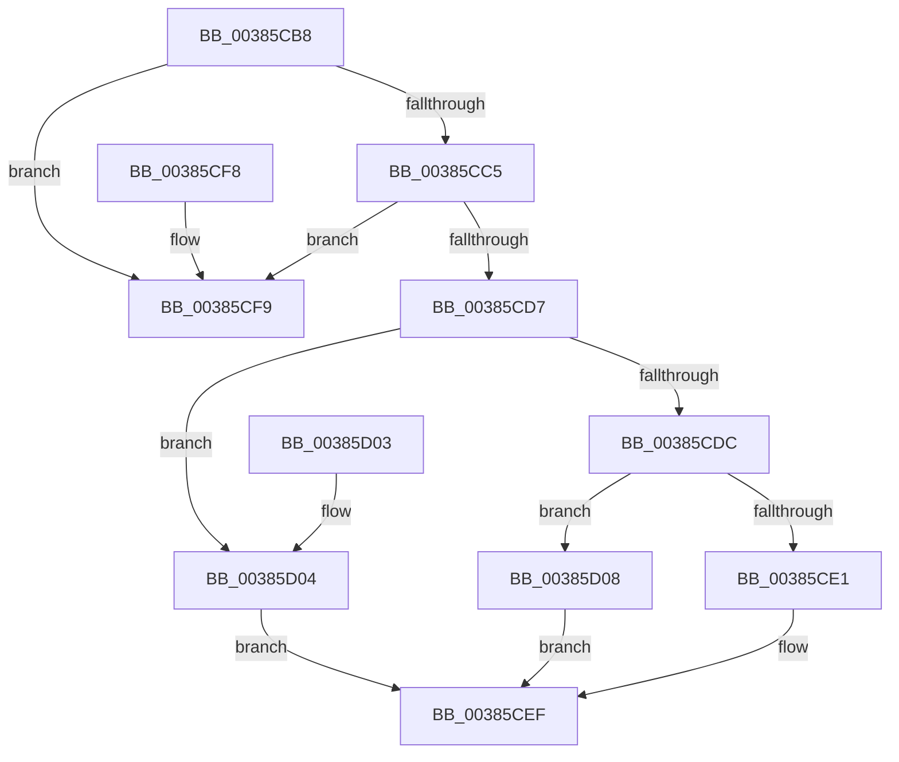

# MiUseProtectedSlabAllocatorForDriverPage

- RVA: `0x00385CB8`–`0x00385D0F` (길이 `87` bytes)
- VA: `0x0000000140385CB8`
- 실행 섹션: `.text`
- PDB 이름 있음: `예`; PDB Function 태그: `아니요`
- unwind 정보 RVA: `0x000DB714`
- 디코드: `28`개 명령, `87/87` bytes 표시
- 미해석 바이트: `0` (있으면 어셈블리에 `.byte`로 보존)

> 이 문서는 커널 이미지의 기계어와 PDB 기호를 분석해 생성했습니다. 4번과 5번은 함수 원형과 자료형을 바이너리 사용 방식에서 추정한 C 해석이며 원본 소스 복구 결과는 아닙니다.

## 1. Dependencies

- 직접 호출 지점: **0**; 고유 호출 대상: **0**
- 직접 호출자로 확인된 함수: **2**
- RIP 상대 이미지 참조: **1**

### Outgoing calls
- 직접 디코드된 call 명령이 없습니다.

### Direct callers
- [MiMakeDriverPagesPrivate](MiMakeDriverPagesPrivate_function_00384C60.md) at `0x00384EBF`
- [MiAllocateDriverPage](../../page/A8/MiAllocateDriverPage_function_00A80128.md) at `0x00A8017B`

### Static image references
- `0x00385CB8` → RVA `0x00FC6A88` (`ALMOSTRO`; read)

## 2. Other-region calls and transfers

- 다른 실행 섹션으로 향하는 call: **0**
- 별도 외부 분기/꼬리 이동을 확인하지 못했습니다.

## 3. Assembly (complete function range)

```asm
00385CB8  48 F7 05 C5 0D C4 00 00 80 00 00  test qword ptr [rip + 0xc40dc5], 0x8000
00385CC3  74 34                           je 0x140385cf9
00385CC5  8B 41 04                        mov eax, dword ptr [rcx + 4]
00385CC8  A8 08                           test al, 8
00385CCA  0F 95 C1                        setne cl
00385CCD  F6 C2 02                        test dl, 2
00385CD0  0F 95 C0                        setne al
00385CD3  84 C8                           test al, cl
00385CD5  74 22                           je 0x140385cf9
00385CD7  F6 C2 02                        test dl, 2
00385CDA  75 28                           jne 0x140385d04
00385CDC  F6 C2 01                        test dl, 1
00385CDF  74 27                           je 0x140385d08
00385CE1  48 8B 05 A0 0D C4 00            mov rax, qword ptr [rip + 0xc40da0]
00385CE8  48 C1 E8 0F                     shr rax, 0xf
00385CEC  83 E0 01                        and eax, 1
00385CEF  41 89 00                        mov dword ptr [r8], eax
00385CF2  B8 01 00 00 00                  mov eax, 1
00385CF7  C3                              ret
00385CF8  CC                              int3
00385CF9  41 C7 00 09 00 00 00            mov dword ptr [r8], 9
00385D00  33 C0                           xor eax, eax
00385D02  C3                              ret
00385D03  CC                              int3
00385D04  33 C0                           xor eax, eax
00385D06  EB E7                           jmp 0x140385cef
00385D08  B8 02 00 00 00                  mov eax, 2
00385D0D  EB E0                           jmp 0x140385cef
```

## 4. C-style interpretation (structured pseudocode)

```c
__int64 __fastcall MiUseProtectedSlabAllocatorForDriverPage(__int64 a1, unsigned __int8 a2, __int64 a3)
{
    __int64 result;

    if (((*(unsigned __int64 *)(v_rip + 12848581)) & (0x8000ULL)) == 0) goto loc_00385CF9;
    a1 = ((((unsigned __int8)((unsigned int)(*(unsigned int *)(a1 + 4)))) & (8)) != 0) ? 1 : 0;
    result = (((a2) & (2)) != 0) ? 1 : 0;
    if ((((unsigned __int8)(result)) & ((unsigned __int8)(a1))) == 0) goto loc_00385CF9;
    if (((a2) & (2)) != 0) goto loc_00385D04;
    if (((a2) & (1)) == 0) goto loc_00385D08;
    result = (*(unsigned __int64 *)(v_rip + 12848544)) >> (15);
    result = (unsigned int)((result) & (1));
loc_00385CEF:
    *(unsigned int *)(a3) = (unsigned int)(result);
    return 1;
loc_00385CF9:
    *(unsigned int *)(a3) = 9;
    result = 0;
    return result;
loc_00385D04:
    result = 0;
    goto loc_00385CEF;
loc_00385D08:
    goto loc_00385CEF;
}
```

## 5. (Beta) C Style

```c
int64_t MiUseProtectedSlabAllocatorForDriverPage(void *Arg1, uint8_t Arg2, void *Arg3)
{
    uint8_t *arg1 = (uint8_t *)Arg1;
    uint8_t *arg3 = (uint8_t *)Arg3;

    int64_t result;

    if (((*(uint64_t *)(v_rip + 0xC40DC5)) & (0x8000ULL)) == 0) goto loc_00385CF9;
    Arg1 = ((((uint8_t)((uint32_t)(*(uint32_t *)(arg1 + 0x4)))) & (8)) != 0) ? 1 : 0;
    result = (((Arg2) & (2)) != 0) ? 1 : 0;
    if ((((uint8_t)(result)) & ((uint8_t)(Arg1))) == 0) goto loc_00385CF9;
    if (((Arg2) & (2)) != 0) goto loc_00385D04;
    if (((Arg2) & (1)) == 0) goto loc_00385D08;
    result = (*(uint64_t *)(v_rip + 0xC40DA0)) >> (15);
    result = (uint32_t)((result) & (1));
loc_00385CEF:
    *(uint32_t *)(arg3) = (uint32_t)(result);
    return 1;
loc_00385CF9:
    *(uint32_t *)(arg3) = 9;
    result = 0;
    return result;
loc_00385D04:
    result = 0;
    goto loc_00385CEF;
loc_00385D08:
    goto loc_00385CEF;
}
```

### 관측된 메모리 오프셋

구조체 형식이 확인되지 않은 접근은 인자 기준의 오프셋으로만 기록했습니다.

| 기준 인자 | 오프셋 표현 | 폭 (bit) | 접근 |
|---|---:|---:|---|
| `Arg1` | `+ 0x4` | `32` | `R` |
| `Arg3` | `+ 0x0` | `32` | `W` |

## 6. Execution-region graph

[열기: 2D/3D 그래프와 함수 탐색 컨트롤 패널](../../../control-panel.html?section=text&rva=0x00385CB8&view=graph)

- 2D 그래프는 위에서 아래로 흐르고, 3D 그래프는 빈 공간을 드래그해 회전합니다. Shift+드래그는 이동, 휠은 확대·축소, 함수 노드 선택은 대상 보고서 이동입니다.

### Static fallback


