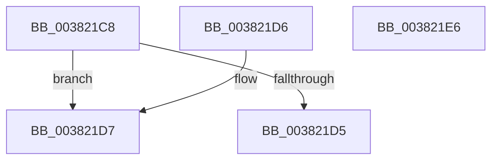

# MiWriteEntirePageHashEntry

- RVA: `0x003821C8`–`0x003821E7` (길이 `31` bytes)
- VA: `0x00000001403821C8`
- 실행 섹션: `.text`
- PDB 이름 있음: `예`; PDB Function 태그: `아니요`
- unwind 정보 RVA: `0x000DB714`
- 디코드: `12`개 명령, `31/31` bytes 표시
- 미해석 바이트: `0` (있으면 어셈블리에 `.byte`로 보존)

> 이 문서는 커널 이미지의 기계어와 PDB 기호를 분석해 생성했습니다. 4번과 5번은 함수 원형과 자료형을 바이너리 사용 방식에서 추정한 C 해석이며 원본 소스 복구 결과는 아닙니다.

## 1. Dependencies

- 직접 호출 지점: **0**; 고유 호출 대상: **0**
- 직접 호출자로 확인된 함수: **3**
- RIP 상대 이미지 참조: **1**

### Outgoing calls
- 직접 디코드된 call 명령이 없습니다.

### Direct callers
- [MiWritePageFileHash](MiWritePageFileHash_function_00381DC8.md) at `0x00382055`
- [MiLateWritePageHash](../4D/MiLateWritePageHash_function_004D4148.md) at `0x004D41DE`
- [MiLateWritePageHash](../4D/MiLateWritePageHash_function_004D4148.md) at `0x004D4237`
- [sub_006D7254](../6D/Unknown_function_006D7254.md) at `0x006D7305`
- [sub_006D7254](../6D/Unknown_function_006D7254.md) at `0x006D7352`

### Static image references
- `0x003821CC` → RVA `0x00E37390` (`.data`; read)

## 2. Other-region calls and transfers

- 다른 실행 섹션으로 향하는 call: **0**
- 별도 외부 분기/꼬리 이동을 확인하지 못했습니다.

## 3. Assembly (complete function range)

```asm
003821C8  8B 02                           mov eax, dword ptr [rdx]
003821CA  89 01                           mov dword ptr [rcx], eax
003821CC  83 3D BD 51 AB 00 00            cmp dword ptr [rip + 0xab51bd], 0
003821D3  75 02                           jne 0x1403821d7
003821D5  C3                              ret
003821D6  CC                              int3
003821D7  48 8B 42 08                     mov rax, qword ptr [rdx + 8]
003821DB  48 89 41 08                     mov qword ptr [rcx + 8], rax
003821DF  8B 42 04                        mov eax, dword ptr [rdx + 4]
003821E2  89 41 04                        mov dword ptr [rcx + 4], eax
003821E5  C3                              ret
003821E6  CC                              int3
```

## 4. C-style interpretation (structured pseudocode)

```c
__int64 __fastcall MiWriteEntirePageHashEntry(__int64 a1, __int64 a2)
{
    *(unsigned int *)(a1) = (unsigned int)((unsigned int)(*(unsigned int *)(a2)));
    if ((*(unsigned int *)(v_rip + 11227581)) != 0) goto loc_003821D7;
    return (unsigned int)(*(unsigned int *)(a2));
loc_003821D7:
    *(unsigned __int64 *)(a1 + 8) = *(unsigned __int64 *)(a2 + 8);
    *(unsigned int *)(a1 + 4) = (unsigned int)((unsigned int)(*(unsigned int *)(a2 + 4)));
    return (unsigned int)(*(unsigned int *)(a2 + 4));
}
```

## 5. (Beta) C Style

```c
int64_t MiWriteEntirePageHashEntry(void *Arg1, void *Arg2)
{
    uint8_t *arg1 = (uint8_t *)Arg1;
    uint8_t *arg2 = (uint8_t *)Arg2;

    *(uint32_t *)(arg1) = (uint32_t)((uint32_t)(*(uint32_t *)(arg2)));
    if ((*(uint32_t *)(v_rip + 0xAB51BD)) != 0) goto loc_003821D7;
    return (uint32_t)(*(uint32_t *)(arg2));
loc_003821D7:
    *(uint64_t *)(arg1 + 0x8) = *(uint64_t *)(arg2 + 0x8);
    *(uint32_t *)(arg1 + 0x4) = (uint32_t)((uint32_t)(*(uint32_t *)(arg2 + 0x4)));
    return (uint32_t)(*(uint32_t *)(arg2 + 0x4));
}
```

### 관측된 메모리 오프셋

구조체 형식이 확인되지 않은 접근은 인자 기준의 오프셋으로만 기록했습니다.

| 기준 인자 | 오프셋 표현 | 폭 (bit) | 접근 |
|---|---:|---:|---|
| `Arg1` | `+ 0x0` | `32` | `W` |
| `Arg1` | `+ 0x4` | `32` | `W` |
| `Arg1` | `+ 0x8` | `64` | `W` |
| `Arg2` | `+ 0x0` | `32` | `R` |
| `Arg2` | `+ 0x4` | `32` | `R` |
| `Arg2` | `+ 0x8` | `64` | `R` |

## 6. Execution-region graph

[열기: 2D/3D 그래프와 함수 탐색 컨트롤 패널](../../../control-panel.html?section=text&rva=0x003821C8&view=graph)

- 2D 그래프는 위에서 아래로 흐르고, 3D 그래프는 빈 공간을 드래그해 회전합니다. Shift+드래그는 이동, 휠은 확대·축소, 함수 노드 선택은 대상 보고서 이동입니다.

### Static fallback


