# MiWritePageFileHash

- RVA: `0x00381DC8`–`0x003821C1` (길이 `1,017` bytes)
- VA: `0x0000000140381DC8`
- 실행 섹션: `.text`
- PDB 이름 있음: `예`; PDB Function 태그: `아니요`
- unwind 정보 RVA: `0x0007BAA0`
- 디코드: `252`개 명령, `1,017/1,017` bytes 표시
- 미해석 바이트: `0` (있으면 어셈블리에 `.byte`로 보존)

> 이 문서는 커널 이미지의 기계어와 PDB 기호를 분석해 생성했습니다. 4번과 5번은 함수 원형과 자료형을 바이너리 사용 방식에서 추정한 C 해석이며 원본 소스 복구 결과는 아닙니다.

## 1. Dependencies

- 직접 호출 지점: **14**; 고유 호출 대상: **13**
- 직접 호출자로 확인된 함수: **1**
- RIP 상대 이미지 참조: **7**

### Outgoing calls
- `0x00381F20` → [MiTransferSoftwarePte](MiTransferSoftwarePte_function_003821F0.md) (function, `0x003821F0`)
- `0x00381F2B` → [MiIsPfnOriginalPteLost](../37/MiIsPfnOriginalPteLost_function_00373B5C.md) (function, `0x00373B5C`)
- `0x00381F9B` → [MiGetPagingFileOffset](../36/MiGetPagingFileOffset_function_0036F530.md) (function, `0x0036F530`)
- `0x00381FAE` → [MiGetPagingFileOffset](../36/MiGetPagingFileOffset_function_0036F530.md) (function, `0x0036F530`)
- `0x00381FC1` → [MiComputePageHash](MiComputePageHash_function_00381C20.md) (function, `0x00381C20`)
- `0x00381FC8` → [KeShouldYieldProcessor](../27/KeShouldYieldProcessor_function_002773E0.md) (function, `0x002773E0`)
- `0x00382007` → [ExAcquireSpinLockExclusiveAtDpcLevel](../24/ExAcquireSpinLockExclusiveAtDpcLevel_function_00248E80.md) (function, `0x00248E80`)
- `0x00382055` → [MiWriteEntirePageHashEntry](MiWriteEntirePageHashEntry_function_003821C8.md) (function, `0x003821C8`)
- `0x0038206E` → [MiReleaseSpinLockExclusive](../24/MiReleaseSpinLockExclusive_function_002482C0.md) (function, `0x002482C0`)
- `0x003820F1` → [MiLockPageInline](../31/MiLockPageInline_function_0031A340.md) (function, `0x0031A340`)
- `0x00382107` → [MiUnlockPage](../31/MiUnlockPage_function_0031A3E0.md) (function, `0x0031A3E0`)
- `0x0038212E` → [_security_check_cookie](../6A/_security_check_cookie_function_006AC640.md) (function, `0x006AC640`)
- `0x0038214F` → [ExAcquireSpinLockExclusive](../24/ExAcquireSpinLockExclusive_function_00248690.md) (function, `0x00248690`)
- `0x003821BB` → [MiPageHashBugCheck](../69/MiPageHashBugCheck_function_00697AC8.md) (function, `0x00697AC8`)

### Direct callers
- [MiMapPageFileHash](../49/MiMapPageFileHash_function_004921E0.md) at `0x00492360`

### Static image references
- `0x00381DDF` → RVA `0x00E0A740` (`.data`; read)
- `0x00381E14` → RVA `0x00E37390` (`.data`; read)
- `0x00381E6A` → RVA `0x00E37478` (`.data`; read)
- `0x00381F16` → RVA `0x00010880` (`.rdata`; read)
- `0x00381F53` → RVA `0x00FC5200` (`ALMOSTRO`; read)
- `0x00382014` → RVA `0x00E3738C` (`.data`; read)
- `0x00382193` → RVA `0x00E30254` (`.data`; read)

## 2. Other-region calls and transfers

- 다른 실행 섹션으로 향하는 call: **0**
- 별도 외부 분기/꼬리 이동을 확인하지 못했습니다.

## 3. Assembly (complete function range)

```asm
00381DC8  48 89 5C 24 20                  mov qword ptr [rsp + 0x20], rbx
00381DCD  55                              push rbp
00381DCE  56                              push rsi
00381DCF  57                              push rdi
00381DD0  41 54                           push r12
00381DD2  41 55                           push r13
00381DD4  41 56                           push r14
00381DD6  41 57                           push r15
00381DD8  48 81 EC 70 01 00 00            sub rsp, 0x170
00381DDF  48 8B 05 5A 89 A8 00            mov rax, qword ptr [rip + 0xa8895a]
00381DE6  48 33 C4                        xor rax, rsp
00381DE9  48 89 84 24 60 01 00 00         mov qword ptr [rsp + 0x160], rax
00381DF1  33 DB                           xor ebx, ebx
00381DF3  48 89 4C 24 40                  mov qword ptr [rsp + 0x40], rcx
00381DF8  45 33 E4                        xor r12d, r12d
00381DFB  44 89 44 24 34                  mov dword ptr [rsp + 0x34], r8d
00381E00  48 8B F9                        mov rdi, rcx
00381E03  4C 89 64 24 38                  mov qword ptr [rsp + 0x38], r12
00381E08  33 C9                           xor ecx, ecx
00381E0A  C6 44 24 30 11                  mov byte ptr [rsp + 0x30], 0x11
00381E0F  33 ED                           xor ebp, ebp
00381E11  41 8B C1                        mov eax, r9d
00381E14  39 0D 76 55 AB 00               cmp dword ptr [rip + 0xab5576], ecx
00381E1A  4C 8B F2                        mov r14, rdx
00381E1D  89 44 24 50                     mov dword ptr [rsp + 0x50], eax
00381E21  8D 53 01                        lea edx, [rbx + 1]
00381E24  0F 95 C1                        setne cl
00381E27  45 8B F8                        mov r15d, r8d
00381E2A  89 4C 24 4C                     mov dword ptr [rsp + 0x4c], ecx
00381E2E  45 33 ED                        xor r13d, r13d
00381E31  49 B8 00 00 00 00 00 DE FF FF   movabs r8, 0xffffde0000000000
00381E3B  44 89 6C 24 48                  mov dword ptr [rsp + 0x48], r13d
00381E40  44 3B E8                        cmp r13d, eax
00381E43  0F 83 9A 01 00 00               jae 0x140381fe3
00381E49  8B F3                           mov esi, ebx
00381E4B  48 8D 44 24 60                  lea rax, [rsp + 0x60]
00381E50  48 C1 E6 04                     shl rsi, 4
00381E54  48 03 C6                        add rax, rsi
00381E57  48 89 44 24 58                  mov qword ptr [rsp + 0x58], rax
00381E5C  83 20 00                        and dword ptr [rax], 0
00381E5F  85 C9                           test ecx, ecx
00381E61  0F 85 F5 02 00 00               jne 0x14038215c
00381E67  4D 8B 3E                        mov r15, qword ptr [r14]
00381E6A  4C 3B 3D 07 56 AB 00            cmp r15, qword ptr [rip + 0xab5607]
00381E71  0F 84 65 01 00 00               je 0x140381fdc
00381E77  4B 8D 3C 7F                     lea rdi, [r15 + r15*2]
00381E7B  44 8B E2                        mov r12d, edx
00381E7E  48 C1 E7 04                     shl rdi, 4
00381E82  49 8B C0                        mov rax, r8
00381E85  48 03 F8                        add rdi, rax
00381E88  48 83 7C 24 38 00               cmp qword ptr [rsp + 0x38], 0
00381E8E  0F 84 55 02 00 00               je 0x1403820e9
00381E94  F0 48 0F BA 6F 18 3F            lock bts qword ptr [rdi + 0x18], 0x3f
00381E9B  0F 82 CB 02 00 00               jb 0x14038216c
00381EA1  85 ED                           test ebp, ebp
00381EA3  74 3E                           je 0x140381ee3
00381EA5  4C 8B 64 24 38                  mov r12, qword ptr [rsp + 0x38]
00381EAA  48 8B 7C 24 40                  mov rdi, qword ptr [rsp + 0x40]
00381EAF  44 8B 7C 24 34                  mov r15d, dword ptr [rsp + 0x34]
00381EB4  83 FB 10                        cmp ebx, 0x10
00381EB7  0F 84 32 01 00 00               je 0x140381fef
00381EBD  85 ED                           test ebp, ebp
00381EBF  0F 85 2A 01 00 00               jne 0x140381fef
00381EC5  8B 4C 24 4C                     mov ecx, dword ptr [rsp + 0x4c]
00381EC9  49 83 C6 08                     add r14, 8
00381ECD  48 8B 7C 24 40                  mov rdi, qword ptr [rsp + 0x40]
00381ED2  BA 01 00 00 00                  mov edx, 1
00381ED7  8B 44 24 50                     mov eax, dword ptr [rsp + 0x50]
00381EDB  44 03 EA                        add r13d, edx
00381EDE  E9 4E FF FF FF                  jmp 0x140381e31
00381EE3  4C 8B 6F 08                     mov r13, qword ptr [rdi + 8]
00381EE7  48 B9 FF FF FF FF FF 00 00 00   movabs rcx, 0xffffffffff
00381EF1  48 8B 47 28                     mov rax, qword ptr [rdi + 0x28]
00381EF5  48 23 C1                        and rax, rcx
00381EF8  48 B9 68 DF BE 7D FB F6 FF FF   movabs rcx, 0xfffff6fb7dbedf68
00381F02  44 8B 44 24 34                  mov r8d, dword ptr [rsp + 0x34]
00381F07  49 3B C7                        cmp rax, r15
00381F0A  44 8B CA                        mov r9d, edx
00381F0D  48 8B 54 24 40                  mov rdx, qword ptr [rsp + 0x40]
00381F12  4C 0F 44 E9                     cmove r13, rcx
00381F16  48 8B 0D 63 E9 C8 FF            mov rcx, qword ptr [rip - 0x37169d]
00381F1D  44 03 C3                        add r8d, ebx
00381F20  E8 CB 02 00 00                  call 0x1403821f0
00381F25  48 8B CF                        mov rcx, rdi
00381F28  4C 8B D8                        mov r11, rax
00381F2B  E8 2C 1C FF FF                  call 0x140373b5c
00381F30  85 C0                           test eax, eax
00381F32  0F 85 E3 01 00 00               jne 0x14038211b
00381F38  48 8B 4F 10                     mov rcx, qword ptr [rdi + 0x10]
00381F3C  48 C1 E9 05                     shr rcx, 5
00381F40  8B C9                           mov ecx, ecx
00381F42  48 C1 E1 05                     shl rcx, 5
00381F46  4C 33 D9                        xor r11, rcx
00381F49  49 81 E3 1F FC FF FF            and r11, 0xfffffffffffffc1f
00381F50  4C 33 D9                        xor r11, rcx
00381F53  8B 05 A7 32 C4 00               mov eax, dword ptr [rip + 0xc432a7]
00381F59  49 8B CB                        mov rcx, r11
00381F5C  48 C1 E9 05                     shr rcx, 5
00381F60  BF 01 00 00 00                  mov edi, 1
00381F65  83 E1 1F                        and ecx, 0x1f
00381F68  40 84 C7                        test dil, al
00381F6B  75 39                           jne 0x140381fa6
00381F6D  83 F9 1F                        cmp ecx, 0x1f
00381F70  74 34                           je 0x140381fa6
00381F72  8B C1                           mov eax, ecx
00381F74  C1 E8 03                        shr eax, 3
00381F77  83 F8 03                        cmp eax, 3
00381F7A  0F 84 FA 01 00 00               je 0x14038217a
00381F80  3B C7                           cmp eax, edi
00381F82  75 22                           jne 0x140381fa6
00381F84  48 8D 44 24 60                  lea rax, [rsp + 0x60]
00381F89  4C 0B EF                        or r13, rdi
00381F8C  49 8B CB                        mov rcx, r11
00381F8F  C7 04 30 02 00 00 00            mov dword ptr [rax + rsi], 2
00381F96  4C 89 6C 34 68                  mov qword ptr [rsp + rsi + 0x68], r13
00381F9B  E8 90 D5 FE FF                  call 0x14036f530
00381FA0  89 44 34 64                     mov dword ptr [rsp + rsi + 0x64], eax
00381FA4  EB 20                           jmp 0x140381fc6
00381FA6  45 85 E4                        test r12d, r12d
00381FA9  74 D9                           je 0x140381f84
00381FAB  49 8B CB                        mov rcx, r11
00381FAE  E8 7D D5 FE FF                  call 0x14036f530
00381FB3  48 8B 4C 24 58                  mov rcx, qword ptr [rsp + 0x58]
00381FB8  44 8B C8                        mov r9d, eax
00381FBB  4D 8B C5                        mov r8, r13
00381FBE  49 8B D7                        mov rdx, r15
00381FC1  E8 5A FC FF FF                  call 0x140381c20
00381FC6  03 DF                           add ebx, edi
00381FC8  E8 13 54 EF FF                  call 0x1402773e0
00381FCD  44 8B 6C 24 48                  mov r13d, dword ptr [rsp + 0x48]
00381FD2  85 C0                           test eax, eax
00381FD4  0F 45 EF                        cmovne ebp, edi
00381FD7  E9 C9 FE FF FF                  jmp 0x140381ea5
00381FDC  03 DA                           add ebx, edx
00381FDE  E9 CC FE FF FF                  jmp 0x140381eaf
00381FE3  85 DB                           test ebx, ebx
00381FE5  0F 84 38 01 00 00               je 0x140382123
00381FEB  49 83 EE 08                     sub r14, 8
00381FEF  48 81 C7 C8 00 00 00            add rdi, 0xc8
00381FF6  33 ED                           xor ebp, ebp
00381FF8  48 8B CF                        mov rcx, rdi
00381FFB  4D 85 E4                        test r12, r12
00381FFE  0F 84 4B 01 00 00               je 0x14038214f
00382004  40 B6 11                        mov sil, 0x11
00382007  E8 74 6E EC FF                  call 0x140248e80
0038200C  48 8B 44 24 40                  mov rax, qword ptr [rsp + 0x40]
00382011  45 8B CF                        mov r9d, r15d
00382014  44 0F AF 0D 70 53 AB 00         imul r9d, dword ptr [rip + 0xab5370]
0038201C  44 8B 44 24 4C                  mov r8d, dword ptr [rsp + 0x4c]
00382021  4C 03 88 B8 00 00 00            add r9, qword ptr [rax + 0xb8]
00382028  45 33 D2                        xor r10d, r10d
0038202B  44 3B D3                        cmp r10d, ebx
0038202E  73 38                           jae 0x140382068
00382030  41 83 39 01                     cmp dword ptr [r9], 1
00382034  0F 87 59 01 00 00               ja 0x140382193
0038203A  45 85 C0                        test r8d, r8d
0038203D  0F 85 45 01 00 00               jne 0x140382188
00382043  41 8B C2                        mov eax, r10d
00382046  48 8D 54 24 60                  lea rdx, [rsp + 0x60]
0038204B  48 C1 E0 04                     shl rax, 4
0038204F  49 8B C9                        mov rcx, r9
00382052  48 03 D0                        add rdx, rax
00382055  E8 6E 01 00 00                  call 0x1403821c8
0038205A  8B 0D 2C 53 AB 00               mov ecx, dword ptr [rip + 0xab532c]
00382060  4C 03 C9                        add r9, rcx
00382063  41 FF C2                        inc r10d
00382066  EB C3                           jmp 0x14038202b
00382068  40 8A D6                        mov dl, sil
0038206B  48 8B CF                        mov rcx, rdi
0038206E  E8 4D 62 EC FF                  call 0x1402482c0
00382073  44 03 FB                        add r15d, ebx
00382076  44 89 7C 24 34                  mov dword ptr [rsp + 0x34], r15d
0038207B  4D 85 E4                        test r12, r12
0038207E  0F 84 90 00 00 00               je 0x140382114
00382084  49 8B FE                        mov rdi, r14
00382087  85 DB                           test ebx, ebx
00382089  0F 84 36 FE FF FF               je 0x140381ec5
0038208F  44 8A 7C 24 30                  mov r15b, byte ptr [rsp + 0x30]
00382094  48 BE 00 00 00 00 00 DE FF FF   movabs rsi, 0xffffde0000000000
0038209E  48 8B 07                        mov rax, qword ptr [rdi]
003820A1  48 3B 05 D0 53 AB 00            cmp rax, qword ptr [rip + 0xab53d0]
003820A8  74 22                           je 0x1403820cc
003820AA  48 8D 0C 40                     lea rcx, [rax + rax*2]
003820AE  48 C1 E1 04                     shl rcx, 4
003820B2  48 8B C6                        mov rax, rsi
003820B5  48 03 C8                        add rcx, rax
003820B8  49 3B CC                        cmp rcx, r12
003820BB  74 47                           je 0x140382104
003820BD  48 B8 FF FF FF FF FF FF FF 7F   movabs rax, 0x7fffffffffffffff
003820C7  F0 48 21 41 18                  lock and qword ptr [rcx + 0x18], rax
003820CC  48 83 EF 08                     sub rdi, 8
003820D0  83 C3 FF                        add ebx, -1
003820D3  75 C9                           jne 0x14038209e
003820D5  44 88 7C 24 30                  mov byte ptr [rsp + 0x30], r15b
003820DA  44 8B 7C 24 34                  mov r15d, dword ptr [rsp + 0x34]
003820DF  4C 89 64 24 38                  mov qword ptr [rsp + 0x38], r12
003820E4  E9 DC FD FF FF                  jmp 0x140381ec5
003820E9  48 8B CF                        mov rcx, rdi
003820EC  48 89 7C 24 38                  mov qword ptr [rsp + 0x38], rdi
003820F1  E8 4A 82 F9 FF                  call 0x14031a340
003820F6  88 44 24 30                     mov byte ptr [rsp + 0x30], al
003820FA  BA 01 00 00 00                  mov edx, 1
003820FF  E9 9D FD FF FF                  jmp 0x140381ea1
00382104  41 8A D7                        mov dl, r15b
00382107  E8 D4 82 F9 FF                  call 0x14031a3e0
0038210C  45 33 E4                        xor r12d, r12d
0038210F  41 B7 11                        mov r15b, 0x11
00382112  EB B8                           jmp 0x1403820cc
00382114  33 DB                           xor ebx, ebx
00382116  E9 AA FD FF FF                  jmp 0x140381ec5
0038211B  45 33 E4                        xor r12d, r12d
0038211E  E9 30 FE FF FF                  jmp 0x140381f53
00382123  48 8B 8C 24 60 01 00 00         mov rcx, qword ptr [rsp + 0x160]
0038212B  48 33 CC                        xor rcx, rsp
0038212E  E8 0D A5 32 00                  call 0x1406ac640
00382133  48 8B 9C 24 C8 01 00 00         mov rbx, qword ptr [rsp + 0x1c8]
0038213B  48 81 C4 70 01 00 00            add rsp, 0x170
00382142  41 5F                           pop r15
00382144  41 5E                           pop r14
00382146  41 5D                           pop r13
00382148  41 5C                           pop r12
0038214A  5F                              pop rdi
0038214B  5E                              pop rsi
0038214C  5D                              pop rbp
0038214D  C3                              ret
0038214E  CC                              int3
0038214F  E8 3C 65 EC FF                  call 0x140248690
00382154  40 8A F0                        mov sil, al
00382157  E9 B0 FE FF FF                  jmp 0x14038200c
0038215C  48 83 64 34 68 00               and qword ptr [rsp + rsi + 0x68], 0
00382162  83 64 34 64 00                  and dword ptr [rsp + rsi + 0x64], 0
00382167  E9 FB FC FF FF                  jmp 0x140381e67
0038216C  41 FF CD                        dec r13d
0038216F  8B EA                           mov ebp, edx
00382171  49 83 EE 08                     sub r14, 8
00382175  E9 2B FD FF FF                  jmp 0x140381ea5
0038217A  F6 C1 07                        test cl, 7
0038217D  0F 84 23 FE FF FF               je 0x140381fa6
00382183  E9 FC FD FF FF                  jmp 0x140381f84
00382188  41 F6 41 08 01                  test byte ptr [r9 + 8], 1
0038218D  0F 84 B0 FE FF FF               je 0x140382043
00382193  39 2D BB E0 AA 00               cmp dword ptr [rip + 0xaae0bb], ebp
00382199  0F 85 A4 FE FF FF               jne 0x140382043
0038219F  21 6C 24 20                     and dword ptr [rsp + 0x20], ebp
003821A3  4C 8D 44 24 60                  lea r8, [rsp + 0x60]
003821A8  41 8B C2                        mov eax, r10d
003821AB  43 8D 14 17                     lea edx, [r15 + r10]
003821AF  48 C1 E0 04                     shl rax, 4
003821B3  B9 60 00 00 00                  mov ecx, 0x60
003821B8  4C 03 C0                        add r8, rax
003821BB  E8 08 59 31 00                  call 0x140697ac8
003821C0  CC                              int3
```

## 4. C-style interpretation (structured pseudocode)

```c
__int64 __fastcall MiWritePageFileHash(__int64 a1, __int64 a2, int a3, int a4)
{
    __int64 result;
    __int64 v_r10;
    __int64 v_r11;
    __int64 v_r12;
    __int64 v_r13;
    __int64 v_r14;
    __int64 v_r15;
    __int64 v_rbp;
    __int64 v_rbx;
    __int64 v_rdi;
    __int64 v_rsi;
    __int64 v_rsp;
    unsigned __int64 v_stack_m148;
    unsigned __int64 v_stack_m150;
    unsigned int v_stack_m158;
    unsigned int v_stack_m15C;
    unsigned int v_stack_m160;
    unsigned __int64 v_stack_m168;
    unsigned __int64 v_stack_m170;
    unsigned int v_stack_m174;
    unsigned __int8 v_stack_m178;
    unsigned __int64 v_stack_m48;
    unsigned __int64 v_stack_p20;
    unsigned __int64 v_stack_p60;

    v_stack_p20 = v_rbx;
    v_rsp = (v_rsp) - (368);
    result = (*(unsigned __int64 *)(v_rip + 11045210)) ^ (v_rsp);
    v_stack_m48 = result;
    v_rbx = 0;
    v_stack_m168 = a1;
    v_r12 = 0;
    v_stack_m174 = a3;
    v_stack_m170 = 0;
    a1 = 0;
    v_stack_m178 = 17;
    v_rbp = 0;
    v_stack_m158 = (unsigned int)((unsigned int)(a4));
    a1 = ((*(unsigned int *)(v_rip + 11228534)) != 0) ? 1 : 0;
    v_stack_m15C = (unsigned int)(a1);
    v_r13 = 0;
loc_00381E31:
    v_stack_m160 = 0;
    if (0 >= ((unsigned int)((unsigned int)(a4)))) goto loc_00381FE3;
    v_rsi = (0) << (4);
    result = (v_stack_m148) + (v_rsi);
    v_stack_m150 = result;
    if ((unsigned int)(a1) != 0) goto loc_0038215C;
loc_00381E67:
    if ((*(unsigned __int64 *)(a2)) == (*(unsigned __int64 *)(v_rip + 11228679))) goto loc_00381FDC;
    v_rdi = (*(unsigned __int64 *)(a2) + *(unsigned __int64 *)(a2) * 2) << (4);
    v_rdi = (v_rdi) + (a3);
    if (v_stack_m170 == 0) goto loc_003820E9;
    if (v_stack_m170 < 0) goto loc_0038216C;
loc_00381EA1:
    if (0 == 0) goto loc_00381EE3;
loc_00381EA5:
loc_00381EAF:
    if (0 == 16) goto loc_00381FEF;
    if (0 != 0) goto loc_00381FEF;
loc_00381EC5:
    v_r14 = (a2) + (8);
    v_r13 = (unsigned int)((v_r13) + (1));
    goto loc_00381E31;
loc_00381EE3:
    result = (*(unsigned __int64 *)(v_stack_m168 + 40)) & ((unsigned int)(v_stack_m15C));
    v_r13 = *(unsigned __int64 *)(v_stack_m168 + 8);
    if (result == ((unsigned int)(v_stack_m174))) { v_r13 = (unsigned int)(v_stack_m15C); }
    a3 = (unsigned int)(((unsigned int)(v_stack_m174)) + (0));
    result = MiTransferSoftwarePte(*(unsigned __int64 *)(v_rip - 3610269), v_stack_m168, a3, 1);
    result = MiIsPfnOriginalPteLost(v_stack_m168, v_stack_m168, a3, 1);
    if ((unsigned int)(result) != 0) goto loc_0038211B;
    a1 = (*(unsigned __int64 *)(v_stack_m168 + 16)) >> (5);
    a1 = ((unsigned int)((unsigned int)(a1))) << (5);
    v_r11 = (result) ^ (a1);
    v_r11 = (v_r11) & (-993);
    v_r11 = (v_r11) ^ (a1);
loc_00381F53:
    a1 = (v_r11) >> (5);
    a1 = (unsigned int)((a1) & (31));
    if (((1) & ((unsigned __int8)((unsigned int)(*(unsigned int *)(v_rip + 12858023))))) != 0) goto loc_00381FA6;
    if (((unsigned int)(a1)) == 31) goto loc_00381FA6;
    result = (unsigned int)(((unsigned int)((unsigned int)(a1))) >> (3));
    if (((unsigned int)(result)) == 3) goto loc_0038217A;
    if (((unsigned int)(result)) != 1) goto loc_00381FA6;
loc_00381F84:
    v_r13 = (v_r13) | (1);
    *(unsigned int *)(v_stack_m148 + v_rsi * 1) = 2;
    *(unsigned __int64 *)(v_rsp + v_rsi * 1 + 104) = v_r13;
    result = MiGetPagingFileOffset(v_r11, v_stack_m168, a3, 1);
    *(unsigned int *)(v_rsp + v_rsi * 1 + 100) = (unsigned int)(result);
    goto loc_00381FC6;
loc_00381FA6:
    if ((unsigned int)(v_stack_m170) == 0) goto loc_00381F84;
    result = MiGetPagingFileOffset(v_r11, v_stack_m168, a3, 1);
    result = MiComputePageHash(v_stack_m150, (unsigned int)(v_stack_m174), v_r13, (unsigned int)((unsigned int)(result)));
loc_00381FC6:
    v_rbx = (unsigned int)((v_rbx) + (1));
    result = KeShouldYieldProcessor(v_stack_m150, (unsigned int)(v_stack_m174), v_r13, (unsigned int)((unsigned int)(result)));
    if ((unsigned int)(result) != 0) { v_rbp = 1; }
    goto loc_00381EA5;
loc_00381FDC:
    v_rbx = (unsigned int)((v_rbx) + ((unsigned int)((unsigned int)(v_stack_m174))));
    goto loc_00381EAF;
loc_00381FE3:
    if ((unsigned int)(v_rbx) == 0) goto loc_00382123;
    v_r14 = (v_r14) - (8);
loc_00381FEF:
    v_rdi = (1) + (200);
    v_rbp = 0;
    if (v_stack_m170 == 0) goto loc_0038214F;
    result = ExAcquireSpinLockExclusiveAtDpcLevel(v_rdi, (unsigned int)(v_stack_m174), v_r13, (unsigned int)((unsigned int)(result)));
loc_0038200C:
    a4 = (unsigned int)(((unsigned int)((unsigned int)((unsigned int)(v_stack_m174)))) * (*(unsigned int *)(v_rip + 11228016)));
    a4 = (a4) + (*(unsigned __int64 *)(v_stack_m168 + 184));
    v_r10 = 0;
loc_0038202B:
    if (0 >= ((unsigned int)(v_rbx))) goto loc_00382068;
    if ((*(unsigned int *)(a4)) > 1) goto loc_00382193;
    if ((unsigned int)((unsigned int)(v_stack_m15C)) != 0) goto loc_00382188;
loc_00382043:
    result = (0) << (4);
    a2 = (v_stack_m148) + (result);
    result = MiWriteEntirePageHashEntry(a4, a2, (unsigned int)(v_stack_m15C), a4);
    a4 = (a4) + ((unsigned int)(*(unsigned int *)(v_rip + 11227948)));
    v_r10 = (unsigned int)((v_r10) + 1);
    goto loc_0038202B;
loc_00382068:
    result = MiReleaseSpinLockExclusive(v_rdi, 17, (unsigned int)(v_stack_m15C), a4);
    v_r15 = (unsigned int)(((unsigned int)(v_stack_m174)) + ((unsigned int)(v_rbx)));
    v_stack_m174 = (unsigned int)(v_r15);
    if (v_stack_m170 == 0) goto loc_00382114;
    if ((unsigned int)(v_rbx) == 0) goto loc_00381EC5;
loc_0038209E:
    if ((*(unsigned __int64 *)(v_r14)) == (*(unsigned __int64 *)(v_rip + 11228112))) goto loc_003820CC;
    a1 = (*(unsigned __int64 *)(v_r14) + *(unsigned __int64 *)(v_r14) * 2) << (4);
    a1 = (a1) + (17);
    if (a1 == v_stack_m170) goto loc_00382104;
loc_003820CC:
    v_rdi = (v_r14) - (8);
    v_rbx = (unsigned int)((v_rbx) + (-1));
    if (condition_is_not_equal) goto loc_0038209E;
    v_stack_m178 = (unsigned __int8)(v_stack_m178);
    v_stack_m170 = v_stack_m170;
    goto loc_00381EC5;
loc_003820E9:
    v_stack_m170 = v_rdi;
    result = MiLockPageInline(v_rdi, 17, (unsigned int)(v_stack_m15C), a4);
    v_stack_m178 = (unsigned __int8)(result);
    goto loc_00381EA1;
loc_00382104:
    result = MiUnlockPage(v_rdi, (unsigned __int8)((unsigned int)(v_stack_m174)), (unsigned int)(v_stack_m15C), a4);
    v_r12 = 0;
    goto loc_003820CC;
loc_00382114:
    v_rbx = 0;
    goto loc_00381EC5;
loc_0038211B:
    v_r12 = 0;
    goto loc_00381F53;
loc_00382123:
    a1 = (v_stack_m48) ^ (v_rsp);
    result = _security_check_cookie(a1, (unsigned __int8)((unsigned int)(v_stack_m174)), (unsigned int)(v_stack_m15C), a4);
    v_rsp = (v_rsp) + (368);
    return result;
loc_0038214F:
    result = ExAcquireSpinLockExclusive(a1, (unsigned __int8)((unsigned int)(v_stack_m174)), (unsigned int)(v_stack_m15C), a4);
    goto loc_0038200C;
loc_0038215C:
    goto loc_00381E67;
loc_0038216C:
    v_r13 = (unsigned int)(((unsigned int)(v_stack_m160)) - 1);
    v_r14 = (v_r14) - (8);
    goto loc_00381EA5;
loc_0038217A:
    if ((((unsigned __int8)(a1)) & (7)) == 0) goto loc_00381FA6;
    goto loc_00381F84;
loc_00382188:
    if (((*(unsigned __int8 *)(a4 + 8)) & (1)) == 0) goto loc_00382043;
loc_00382193:
    if ((*(unsigned int *)(v_rip + 11198651)) != ((unsigned int)((unsigned int)((unsigned int)((unsigned __int8)((unsigned int)(v_stack_m174))))))) goto loc_00382043;
    result = ((unsigned int)((unsigned int)(v_r10))) << (4);
    a3 = (v_stack_p60) + (result);
    result = MiPageHashBugCheck(96, 17 + v_r10 * 1, a3, a4);
    return result;
}
```

## 5. (Beta) C Style

```c
int64_t MiWritePageFileHash(int64_t Arg1, void *Arg2, int32_t Arg3, int32_t Arg4)
{
    uint8_t *arg2 = (uint8_t *)Arg2;

    int64_t result;
    int64_t local_r10;
    int64_t local_r11;
    int64_t local_r12;
    int64_t local_r13;
    int64_t local_r14;
    int64_t local_r15;
    int64_t local_rbp;
    int64_t local_rbx;
    int64_t local_rdi;
    int64_t local_rsi;
    int64_t local_rsp;
    uint64_t v_stack_m148;
    uint64_t v_stack_m150;
    uint32_t v_stack_m158;
    uint32_t v_stack_m15C;
    uint32_t v_stack_m160;
    uint64_t v_stack_m168;
    uint64_t v_stack_m170;
    uint32_t v_stack_m174;
    uint8_t v_stack_m178;
    uint64_t v_stack_m48;
    uint64_t v_stack_p20;
    uint64_t v_stack_p60;

    v_stack_p20 = local_rbx;
    local_rsp = (local_rsp) - (368);
    result = (*(uint64_t *)(v_rip + 0xA8895A)) ^ (local_rsp);
    v_stack_m48 = result;
    local_rbx = 0;
    v_stack_m168 = Arg1;
    local_r12 = 0;
    v_stack_m174 = Arg3;
    v_stack_m170 = 0;
    Arg1 = 0;
    v_stack_m178 = 17;
    local_rbp = 0;
    v_stack_m158 = (uint32_t)((uint32_t)(Arg4));
    Arg1 = ((*(uint32_t *)(v_rip + 0xAB5576)) != 0) ? 1 : 0;
    v_stack_m15C = (uint32_t)(Arg1);
    local_r13 = 0;
loc_00381E31:
    v_stack_m160 = 0;
    if (0 >= ((uint32_t)((uint32_t)(Arg4)))) goto loc_00381FE3;
    local_rsi = (0) << (4);
    result = (v_stack_m148) + (local_rsi);
    v_stack_m150 = result;
    if ((uint32_t)(Arg1) != 0) goto loc_0038215C;
loc_00381E67:
    if ((*(uint64_t *)(arg2)) == (*(uint64_t *)(v_rip + 0xAB5607))) goto loc_00381FDC;
    local_rdi = (*(uint64_t *)(arg2) + *(uint64_t *)(arg2) * 2) << (4);
    local_rdi = (local_rdi) + (Arg3);
    if (v_stack_m170 == 0) goto loc_003820E9;
    if (v_stack_m170 < 0) goto loc_0038216C;
loc_00381EA1:
    if (0 == 0) goto loc_00381EE3;
loc_00381EA5:
loc_00381EAF:
    if (0 == 16) goto loc_00381FEF;
    if (0 != 0) goto loc_00381FEF;
loc_00381EC5:
    local_r14 = (Arg2) + (8);
    local_r13 = (uint32_t)((local_r13) + (1));
    goto loc_00381E31;
loc_00381EE3:
    result = (*(uint64_t *)(v_stack_m168 + 0x28)) & ((uint32_t)(v_stack_m15C));
    local_r13 = *(uint64_t *)(v_stack_m168 + 0x8);
    if (result == ((uint32_t)(v_stack_m174))) { local_r13 = (uint32_t)(v_stack_m15C); }
    Arg3 = (uint32_t)(((uint32_t)(v_stack_m174)) + (0));
    result = MiTransferSoftwarePte(*(uint64_t *)(v_rip - 0x37169D), v_stack_m168, Arg3, 1);
    result = MiIsPfnOriginalPteLost(v_stack_m168, v_stack_m168, Arg3, 1);
    if ((uint32_t)(result) != 0) goto loc_0038211B;
    Arg1 = (*(uint64_t *)(v_stack_m168 + 0x10)) >> (5);
    Arg1 = ((uint32_t)((uint32_t)(Arg1))) << (5);
    local_r11 = (result) ^ (Arg1);
    local_r11 = (local_r11) & (-993);
    local_r11 = (local_r11) ^ (Arg1);
loc_00381F53:
    Arg1 = (local_r11) >> (5);
    Arg1 = (uint32_t)((Arg1) & (31));
    if (((1) & ((uint8_t)((uint32_t)(*(uint32_t *)(v_rip + 0xC432A7))))) != 0) goto loc_00381FA6;
    if (((uint32_t)(Arg1)) == 31) goto loc_00381FA6;
    result = (uint32_t)(((uint32_t)((uint32_t)(Arg1))) >> (3));
    if (((uint32_t)(result)) == 3) goto loc_0038217A;
    if (((uint32_t)(result)) != 1) goto loc_00381FA6;
loc_00381F84:
    local_r13 = (local_r13) | (1);
    *(uint32_t *)(v_stack_m148 + local_rsi * 1) = 2;
    *(uint64_t *)(local_rsp + local_rsi * 1 + 0x68) = local_r13;
    result = MiGetPagingFileOffset(local_r11, v_stack_m168, Arg3, 1);
    *(uint32_t *)(local_rsp + local_rsi * 1 + 0x64) = (uint32_t)(result);
    goto loc_00381FC6;
loc_00381FA6:
    if ((uint32_t)(v_stack_m170) == 0) goto loc_00381F84;
    result = MiGetPagingFileOffset(local_r11, v_stack_m168, Arg3, 1);
    result = MiComputePageHash(v_stack_m150, (uint32_t)(v_stack_m174), local_r13, (uint32_t)((uint32_t)(result)));
loc_00381FC6:
    local_rbx = (uint32_t)((local_rbx) + (1));
    result = KeShouldYieldProcessor(v_stack_m150, (uint32_t)(v_stack_m174), local_r13, (uint32_t)((uint32_t)(result)));
    if ((uint32_t)(result) != 0) { local_rbp = 1; }
    goto loc_00381EA5;
loc_00381FDC:
    local_rbx = (uint32_t)((local_rbx) + ((uint32_t)((uint32_t)(v_stack_m174))));
    goto loc_00381EAF;
loc_00381FE3:
    if ((uint32_t)(local_rbx) == 0) goto loc_00382123;
    local_r14 = (local_r14) - (8);
loc_00381FEF:
    local_rdi = (1) + (200);
    local_rbp = 0;
    if (v_stack_m170 == 0) goto loc_0038214F;
    result = ExAcquireSpinLockExclusiveAtDpcLevel(local_rdi, (uint32_t)(v_stack_m174), local_r13, (uint32_t)((uint32_t)(result)));
loc_0038200C:
    Arg4 = (uint32_t)(((uint32_t)((uint32_t)((uint32_t)(v_stack_m174)))) * (*(uint32_t *)(v_rip + 0xAB5370)));
    Arg4 = (Arg4) + (*(uint64_t *)(v_stack_m168 + 0xB8));
    local_r10 = 0;
loc_0038202B:
    if (0 >= ((uint32_t)(local_rbx))) goto loc_00382068;
    if ((*(uint32_t *)(Arg4)) > 1) goto loc_00382193;
    if ((uint32_t)((uint32_t)(v_stack_m15C)) != 0) goto loc_00382188;
loc_00382043:
    result = (0) << (4);
    Arg2 = (v_stack_m148) + (result);
    result = MiWriteEntirePageHashEntry(Arg4, Arg2, (uint32_t)(v_stack_m15C), Arg4);
    Arg4 = (Arg4) + ((uint32_t)(*(uint32_t *)(v_rip + 0xAB532C)));
    local_r10 = (uint32_t)((local_r10) + 1);
    goto loc_0038202B;
loc_00382068:
    result = MiReleaseSpinLockExclusive(local_rdi, 17, (uint32_t)(v_stack_m15C), Arg4);
    local_r15 = (uint32_t)(((uint32_t)(v_stack_m174)) + ((uint32_t)(local_rbx)));
    v_stack_m174 = (uint32_t)(local_r15);
    if (v_stack_m170 == 0) goto loc_00382114;
    if ((uint32_t)(local_rbx) == 0) goto loc_00381EC5;
loc_0038209E:
    if ((*(uint64_t *)(local_r14)) == (*(uint64_t *)(v_rip + 0xAB53D0))) goto loc_003820CC;
    Arg1 = (*(uint64_t *)(local_r14) + *(uint64_t *)(local_r14) * 2) << (4);
    Arg1 = (Arg1) + (17);
    if (Arg1 == v_stack_m170) goto loc_00382104;
loc_003820CC:
    local_rdi = (local_r14) - (8);
    local_rbx = (uint32_t)((local_rbx) + (-1));
    if (condition_is_not_equal) goto loc_0038209E;
    v_stack_m178 = (uint8_t)(v_stack_m178);
    v_stack_m170 = v_stack_m170;
    goto loc_00381EC5;
loc_003820E9:
    v_stack_m170 = local_rdi;
    result = MiLockPageInline(local_rdi, 17, (uint32_t)(v_stack_m15C), Arg4);
    v_stack_m178 = (uint8_t)(result);
    goto loc_00381EA1;
loc_00382104:
    result = MiUnlockPage(local_rdi, (uint8_t)((uint32_t)(v_stack_m174)), (uint32_t)(v_stack_m15C), Arg4);
    local_r12 = 0;
    goto loc_003820CC;
loc_00382114:
    local_rbx = 0;
    goto loc_00381EC5;
loc_0038211B:
    local_r12 = 0;
    goto loc_00381F53;
loc_00382123:
    Arg1 = (v_stack_m48) ^ (local_rsp);
    result = _security_check_cookie(Arg1, (uint8_t)((uint32_t)(v_stack_m174)), (uint32_t)(v_stack_m15C), Arg4);
    local_rsp = (local_rsp) + (368);
    return result;
loc_0038214F:
    result = ExAcquireSpinLockExclusive(Arg1, (uint8_t)((uint32_t)(v_stack_m174)), (uint32_t)(v_stack_m15C), Arg4);
    goto loc_0038200C;
loc_0038215C:
    goto loc_00381E67;
loc_0038216C:
    local_r13 = (uint32_t)(((uint32_t)(v_stack_m160)) - 1);
    local_r14 = (local_r14) - (8);
    goto loc_00381EA5;
loc_0038217A:
    if ((((uint8_t)(Arg1)) & (7)) == 0) goto loc_00381FA6;
    goto loc_00381F84;
loc_00382188:
    if (((*(uint8_t *)(Arg4 + 0x8)) & (1)) == 0) goto loc_00382043;
loc_00382193:
    if ((*(uint32_t *)(v_rip + 0xAAE0BB)) != ((uint32_t)((uint32_t)((uint32_t)((uint8_t)((uint32_t)(v_stack_m174))))))) goto loc_00382043;
    result = ((uint32_t)((uint32_t)(local_r10))) << (4);
    Arg3 = (v_stack_p60) + (result);
    result = MiPageHashBugCheck(96, 17 + local_r10 * 1, Arg3, Arg4);
    return result;
}
```

### 관측된 메모리 오프셋

구조체 형식이 확인되지 않은 접근은 인자 기준의 오프셋으로만 기록했습니다.

| 기준 인자 | 오프셋 표현 | 폭 (bit) | 접근 |
|---|---:|---:|---|
| `Arg2` | `+ 0x0` | `64` | `R` |

## 6. Execution-region graph

[열기: 2D/3D 그래프와 함수 탐색 컨트롤 패널](../../../control-panel.html?section=text&rva=0x00381DC8&view=graph)

- 2D 그래프는 위에서 아래로 흐르고, 3D 그래프는 빈 공간을 드래그해 회전합니다. Shift+드래그는 이동, 휠은 확대·축소, 함수 노드 선택은 대상 보고서 이동입니다.

### Static fallback

```mermaid
flowchart TD
  bb_00381DC8[BB_00381DC8]
  bb_00381E31[BB_00381E31]
  bb_00381E49[BB_00381E49]
  bb_00381E67[BB_00381E67]
  bb_00381E77[BB_00381E77]
  bb_00381E94[BB_00381E94]
  bb_00381EA1[BB_00381EA1]
  bb_00381EA5[BB_00381EA5]
  bb_00381EAF[BB_00381EAF]
  bb_00381EBD[BB_00381EBD]
  bb_00381EC5[BB_00381EC5]
  bb_00381EE3[BB_00381EE3]
  bb_00381F38[BB_00381F38]
  bb_00381F53[BB_00381F53]
  bb_00381F6D[BB_00381F6D]
  bb_00381F72[BB_00381F72]
  bb_00381F80[BB_00381F80]
  bb_00381F84[BB_00381F84]
  bb_00381FA6[BB_00381FA6]
  bb_00381FAB[BB_00381FAB]
  bb_00381FC6[BB_00381FC6]
  bb_00381FDC[BB_00381FDC]
  bb_00381FE3[BB_00381FE3]
  bb_00381FEB[BB_00381FEB]
  bb_00381FEF[BB_00381FEF]
  bb_00382004[BB_00382004]
  bb_0038200C[BB_0038200C]
  bb_0038202B[BB_0038202B]
  bb_00382030[BB_00382030]
  bb_0038203A[BB_0038203A]
  bb_00382043[BB_00382043]
  bb_00382068[BB_00382068]
  bb_00382084[BB_00382084]
  bb_0038208F[BB_0038208F]
  bb_0038209E[BB_0038209E]
  bb_003820AA[BB_003820AA]
  bb_003820BD[BB_003820BD]
  bb_003820CC[BB_003820CC]
  bb_003820D5[BB_003820D5]
  bb_003820E9[BB_003820E9]
  bb_00382104[BB_00382104]
  bb_00382114[BB_00382114]
  bb_0038211B[BB_0038211B]
  bb_00382123[BB_00382123]
  bb_0038214E[BB_0038214E]
  bb_0038214F[BB_0038214F]
  bb_0038215C[BB_0038215C]
  bb_0038216C[BB_0038216C]
  bb_0038217A[BB_0038217A]
  bb_00382183[BB_00382183]
  bb_00382188[BB_00382188]
  bb_00382193[BB_00382193]
  bb_0038219F[BB_0038219F]
  bb_00381DC8 -->|flow| bb_00381E31
  bb_00381E31 -->|branch| bb_00381FE3
  bb_00381E31 -->|fallthrough| bb_00381E49
  bb_00381E49 -->|branch| bb_0038215C
  bb_00381E49 -->|fallthrough| bb_00381E67
  bb_00381E67 -->|branch| bb_00381FDC
  bb_00381E67 -->|fallthrough| bb_00381E77
  bb_00381E77 -->|branch| bb_003820E9
  bb_00381E77 -->|fallthrough| bb_00381E94
  bb_00381E94 -->|branch| bb_0038216C
  bb_00381E94 -->|fallthrough| bb_00381EA1
  bb_00381EA1 -->|branch| bb_00381EE3
  bb_00381EA1 -->|fallthrough| bb_00381EA5
  bb_00381EA5 -->|flow| bb_00381EAF
  bb_00381EAF -->|branch| bb_00381FEF
  bb_00381EAF -->|fallthrough| bb_00381EBD
  bb_00381EBD -->|branch| bb_00381FEF
  bb_00381EBD -->|fallthrough| bb_00381EC5
  bb_00381EC5 -->|branch| bb_00381E31
  bb_00381EE3 -->|branch| bb_0038211B
  bb_00381EE3 -->|fallthrough| bb_00381F38
  bb_00381F38 -->|flow| bb_00381F53
  bb_00381F53 -->|branch| bb_00381FA6
  bb_00381F53 -->|fallthrough| bb_00381F6D
  bb_00381F6D -->|branch| bb_00381FA6
  bb_00381F6D -->|fallthrough| bb_00381F72
  bb_00381F72 -->|branch| bb_0038217A
  bb_00381F72 -->|fallthrough| bb_00381F80
  bb_00381F80 -->|branch| bb_00381FA6
  bb_00381F80 -->|fallthrough| bb_00381F84
  bb_00381F84 -->|branch| bb_00381FC6
  bb_00381FA6 -->|branch| bb_00381F84
  bb_00381FA6 -->|fallthrough| bb_00381FAB
  bb_00381FAB -->|flow| bb_00381FC6
  bb_00381FC6 -->|branch| bb_00381EA5
  bb_00381FDC -->|branch| bb_00381EAF
  bb_00381FE3 -->|branch| bb_00382123
  bb_00381FE3 -->|fallthrough| bb_00381FEB
  bb_00381FEB -->|flow| bb_00381FEF
  bb_00381FEF -->|branch| bb_0038214F
  bb_00381FEF -->|fallthrough| bb_00382004
  bb_00382004 -->|flow| bb_0038200C
  bb_0038200C -->|flow| bb_0038202B
  bb_0038202B -->|branch| bb_00382068
  bb_0038202B -->|fallthrough| bb_00382030
  bb_00382030 -->|branch| bb_00382193
  bb_00382030 -->|fallthrough| bb_0038203A
  bb_0038203A -->|branch| bb_00382188
  bb_0038203A -->|fallthrough| bb_00382043
  bb_00382043 -->|branch| bb_0038202B
  bb_00382068 -->|branch| bb_00382114
  bb_00382068 -->|fallthrough| bb_00382084
  bb_00382084 -->|branch| bb_00381EC5
  bb_00382084 -->|fallthrough| bb_0038208F
  bb_0038208F -->|flow| bb_0038209E
  bb_0038209E -->|branch| bb_003820CC
  bb_0038209E -->|fallthrough| bb_003820AA
  bb_003820AA -->|branch| bb_00382104
  bb_003820AA -->|fallthrough| bb_003820BD
  bb_003820BD -->|flow| bb_003820CC
  bb_003820CC -->|branch| bb_0038209E
  bb_003820CC -->|fallthrough| bb_003820D5
  bb_003820D5 -->|branch| bb_00381EC5
  bb_003820E9 -->|branch| bb_00381EA1
  bb_00382104 -->|branch| bb_003820CC
  bb_00382114 -->|branch| bb_00381EC5
  bb_0038211B -->|branch| bb_00381F53
  bb_0038214E -->|flow| bb_0038214F
  bb_0038214F -->|branch| bb_0038200C
  bb_0038215C -->|branch| bb_00381E67
  bb_0038216C -->|branch| bb_00381EA5
  bb_0038217A -->|branch| bb_00381FA6
  bb_0038217A -->|fallthrough| bb_00382183
  bb_00382183 -->|branch| bb_00381F84
  bb_00382188 -->|branch| bb_00382043
  bb_00382188 -->|fallthrough| bb_00382193
  bb_00382193 -->|branch| bb_00382043
  bb_00382193 -->|fallthrough| bb_0038219F
```


