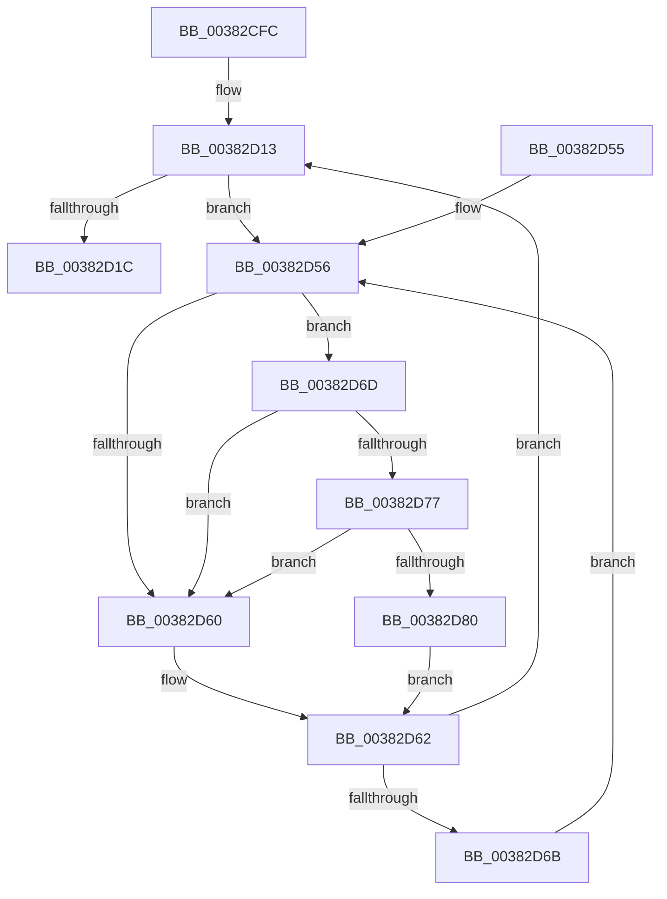

# MiWriteUselessChildPte

- RVA: `0x00382CFC`–`0x00382D89` (길이 `141` bytes)
- VA: `0x0000000140382CFC`
- 실행 섹션: `.text`
- PDB 이름 있음: `예`; PDB Function 태그: `아니요`
- unwind 정보 RVA: `0x0007BB48`
- 디코드: `40`개 명령, `141/141` bytes 표시
- 미해석 바이트: `0` (있으면 어셈블리에 `.byte`로 보존)

> 이 문서는 커널 이미지의 기계어와 PDB 기호를 분석해 생성했습니다. 4번과 5번은 함수 원형과 자료형을 바이너리 사용 방식에서 추정한 C 해석이며 원본 소스 복구 결과는 아닙니다.

## 1. Dependencies

- 직접 호출 지점: **4**; 고유 호출 대상: **4**
- 직접 호출자로 확인된 함수: **2**
- RIP 상대 이미지 참조: **2**

### Outgoing calls
- `0x00382D21` → [MiMakeDemandZeroPte](../33/MiMakeDemandZeroPte_function_00337A00.md) (function, `0x00337A00`)
- `0x00382D31` → [MiIncreaseUsedPtesInPfn](MiIncreaseUsedPtesInPfn_function_00382D90.md) (function, `0x00382D90`)
- `0x00382D77` → [KiCheckVpBackingLongSpinWaitHypercall](../30/KiCheckVpBackingLongSpinWaitHypercall_function_0030F490.md) (function, `0x0030F490`)
- `0x00382D82` → [HvlNotifyLongSpinWait](../30/HvlNotifyLongSpinWait_function_0030F460.md) (function, `0x0030F460`)

### Direct callers
- [MiHandleForkTransitionPte](../22/MiHandleForkTransitionPte_function_0022D34C.md) at `0x0022D43A`
- [MiBuildForkPte](../22/MiBuildForkPte_function_0022E32C.md) at `0x0022EA15`

### Static image references
- `0x00382D58` → RVA `0x00FC52AC` (`ALMOSTRO`; reference)
- `0x00382D6D` → RVA `0x00FC6AB8` (`ALMOSTRO`; read)

## 2. Other-region calls and transfers

- 다른 실행 섹션으로 향하는 call: **0**
- 별도 외부 분기/꼬리 이동을 확인하지 못했습니다.

## 3. Assembly (complete function range)

```asm
00382CFC  48 89 5C 24 10                  mov qword ptr [rsp + 0x10], rbx
00382D01  48 89 74 24 18                  mov qword ptr [rsp + 0x18], rsi
00382D06  57                              push rdi
00382D07  48 83 EC 20                     sub rsp, 0x20
00382D0B  48 8B DA                        mov rbx, rdx
00382D0E  48 8B F1                        mov rsi, rcx
00382D11  33 FF                           xor edi, edi
00382D13  F0 48 0F BA 6B 18 3F            lock bts qword ptr [rbx + 0x18], 0x3f
00382D1A  72 3A                           jb 0x140382d56
00382D1C  B9 04 00 00 00                  mov ecx, 4
00382D21  E8 DA 4C FB FF                  call 0x140337a00
00382D26  48 8B CB                        mov rcx, rbx
00382D29  48 89 06                        mov qword ptr [rsi], rax
00382D2C  BA 01 00 00 00                  mov edx, 1
00382D31  E8 5A 00 00 00                  call 0x140382d90
00382D36  48 B8 FF FF FF FF FF FF FF 7F   movabs rax, 0x7fffffffffffffff
00382D40  F0 48 21 43 18                  lock and qword ptr [rbx + 0x18], rax
00382D45  48 8B 5C 24 38                  mov rbx, qword ptr [rsp + 0x38]
00382D4A  48 8B 74 24 40                  mov rsi, qword ptr [rsp + 0x40]
00382D4F  48 83 C4 20                     add rsp, 0x20
00382D53  5F                              pop rdi
00382D54  C3                              ret
00382D55  CC                              int3
00382D56  FF C7                           inc edi
00382D58  85 3D 4E 25 C4 00               test dword ptr [rip + 0xc4254e], edi
00382D5E  74 0D                           je 0x140382d6d
00382D60  F3 90                           pause
00382D62  48 8B 43 18                     mov rax, qword ptr [rbx + 0x18]
00382D66  48 85 C0                        test rax, rax
00382D69  79 A8                           jns 0x140382d13
00382D6B  EB E9                           jmp 0x140382d56
00382D6D  8B 05 45 3D C4 00               mov eax, dword ptr [rip + 0xc43d45]
00382D73  A8 40                           test al, 0x40
00382D75  74 E9                           je 0x140382d60
00382D77  E8 14 C7 F8 FF                  call 0x14030f490
00382D7C  84 C0                           test al, al
00382D7E  74 E0                           je 0x140382d60
00382D80  8B CF                           mov ecx, edi
00382D82  E8 D9 C6 F8 FF                  call 0x14030f460
00382D87  EB D9                           jmp 0x140382d62
```

## 4. C-style interpretation (structured pseudocode)

```c
__int64 __fastcall MiWriteUselessChildPte(__int64 a1, __int64 a2)
{
    __int64 result;
    __int64 v_rdi;
    __int64 v_rsp;
    unsigned __int64 v_stack_p10;
    unsigned __int64 v_stack_p18;

    v_stack_p10 = v_rbx;
    v_stack_p18 = v_rsi;
    v_rsp = (v_rsp) - (32);
    v_rdi = 0;
loc_00382D13:
    if (condition_is_below) goto loc_00382D56;
    result = MiMakeDemandZeroPte(4, a2, a3, a4);
    *(unsigned __int64 *)(a1) = result;
    result = MiIncreaseUsedPtesInPfn(a2, 1, a3, a4);
    v_rsp = (v_rsp) + (32);
    return result;
loc_00382D56:
    v_rdi = (unsigned int)((v_rdi) + 1);
    if (((*(unsigned int *)(v_rip + 12854606)) & ((unsigned int)(v_rdi))) == 0) goto loc_00382D6D;
loc_00382D60:
loc_00382D62:
    if (!sign_flag) goto loc_00382D13;
    goto loc_00382D56;
loc_00382D6D:
    if ((((unsigned __int8)((unsigned int)(*(unsigned int *)(v_rip + 12860741)))) & (64)) == 0) goto loc_00382D60;
    result = KiCheckVpBackingLongSpinWaitHypercall(a2, 1, a3, a4);
    if ((unsigned __int8)(result) == 0) goto loc_00382D60;
    result = HvlNotifyLongSpinWait((unsigned int)((unsigned int)(v_rdi)), 1, a3, a4);
    goto loc_00382D62;
}
```

## 5. (Beta) C Style

```c
int64_t MiWriteUselessChildPte(void *Arg1, void *Arg2)
{
    uint8_t *arg1 = (uint8_t *)Arg1;
    uint8_t *arg2 = (uint8_t *)Arg2;

    int64_t result;
    int64_t local_rdi;
    int64_t local_rsp;
    uint64_t v_stack_p10;
    uint64_t v_stack_p18;

    v_stack_p10 = local_rbx;
    v_stack_p18 = local_rsi;
    local_rsp = (local_rsp) - (32);
    local_rdi = 0;
loc_00382D13:
    if (condition_is_below) goto loc_00382D56;
    result = MiMakeDemandZeroPte(4, Arg2, a3, a4);
    *(uint64_t *)(arg1) = result;
    result = MiIncreaseUsedPtesInPfn(Arg2, 1, a3, a4);
    local_rsp = (local_rsp) + (32);
    return result;
loc_00382D56:
    local_rdi = (uint32_t)((local_rdi) + 1);
    if (((*(uint32_t *)(v_rip + 0xC4254E)) & ((uint32_t)(local_rdi))) == 0) goto loc_00382D6D;
loc_00382D60:
loc_00382D62:
    if (!sign_flag) goto loc_00382D13;
    goto loc_00382D56;
loc_00382D6D:
    if ((((uint8_t)((uint32_t)(*(uint32_t *)(v_rip + 0xC43D45)))) & (64)) == 0) goto loc_00382D60;
    result = KiCheckVpBackingLongSpinWaitHypercall(Arg2, 1, a3, a4);
    if ((uint8_t)(result) == 0) goto loc_00382D60;
    result = HvlNotifyLongSpinWait((uint32_t)((uint32_t)(local_rdi)), 1, a3, a4);
    goto loc_00382D62;
}
```

### 관측된 메모리 오프셋

구조체 형식이 확인되지 않은 접근은 인자 기준의 오프셋으로만 기록했습니다.

| 기준 인자 | 오프셋 표현 | 폭 (bit) | 접근 |
|---|---:|---:|---|
| `Arg1` | `+ 0x0` | `64` | `W` |
| `Arg2` | `+ 0x18` | `64` | `R` |
| `Arg2` | `+ 0x18` | `64` | `R/W` |

## 6. Execution-region graph

[열기: 2D/3D 그래프와 함수 탐색 컨트롤 패널](../../../control-panel.html?section=text&rva=0x00382CFC&view=graph)

- 2D 그래프는 위에서 아래로 흐르고, 3D 그래프는 빈 공간을 드래그해 회전합니다. Shift+드래그는 이동, 휠은 확대·축소, 함수 노드 선택은 대상 보고서 이동입니다.

### Static fallback


