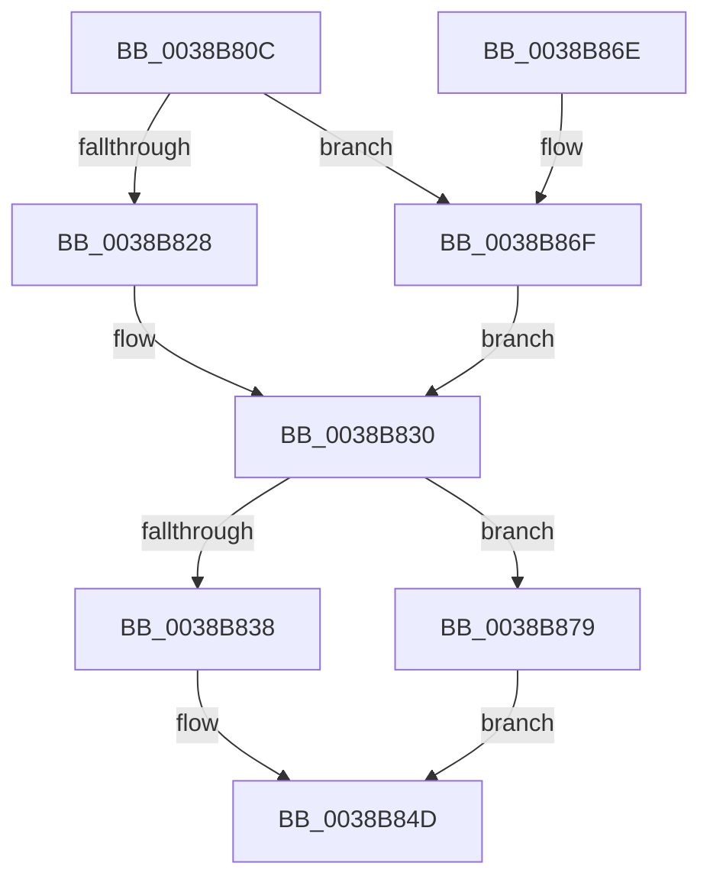

# MmGetControlAreaPartition

- RVA: `0x0038B80C`–`0x0038B882` (길이 `118` bytes)
- VA: `0x000000014038B80C`
- 실행 섹션: `.text`
- PDB 이름 있음: `예`; PDB Function 태그: `아니요`
- unwind 정보 RVA: `0x00065624`
- 디코드: `31`개 명령, `118/118` bytes 표시
- 미해석 바이트: `0` (있으면 어셈블리에 `.byte`로 보존)

> 이 문서는 커널 이미지의 기계어와 PDB 기호를 분석해 생성했습니다. 4번과 5번은 함수 원형과 자료형을 바이너리 사용 방식에서 추정한 C 해석이며 원본 소스 복구 결과는 아닙니다.

## 1. Dependencies

- 직접 호출 지점: **3**; 고유 호출 대상: **3**
- 직접 호출자로 확인된 함수: **2**
- RIP 상대 이미지 참조: **3**

### Outgoing calls
- `0x0038B828` → [ExAcquireSpinLockExclusive](../24/ExAcquireSpinLockExclusive_function_00248690.md) (function, `0x00248690`)
- `0x0038B857` → [MiReleaseSpinLockExclusive](../24/MiReleaseSpinLockExclusive_function_002482C0.md) (function, `0x002482C0`)
- `0x0038B872` → [ExAcquireSpinLockExclusiveAtDpcLevel](../24/ExAcquireSpinLockExclusiveAtDpcLevel_function_00248E80.md) (function, `0x00248E80`)

### Direct callers
- [CcGetPartitionForSectionObject](CcGetPartitionForSectionObject_function_0038B740.md) at `0x0038B744`
- [CcDeleteSectionsForPartition](../57/CcDeleteSectionsForPartition_function_0057E0F8.md) at `0x0057E1B2`

### Static image references
- `0x0038B81D` → RVA `0x00E2CD00` (`.data`; read)
- `0x0038B83C` → RVA `0x00E30088` (`.data`; read)
- `0x0038B879` → RVA `0x00E38D00` (`.data`; read)

## 2. Other-region calls and transfers

- 다른 실행 섹션으로 향하는 call: **0**
- 별도 외부 분기/꼬리 이동을 확인하지 못했습니다.

## 3. Assembly (complete function range)

```asm
0038B80C  48 89 5C 24 08                  mov qword ptr [rsp + 8], rbx
0038B811  57                              push rdi
0038B812  48 83 EC 20                     sub rsp, 0x20
0038B816  48 8B D9                        mov rbx, rcx
0038B819  44 0F 20 C0                     mov rax, cr8
0038B81D  48 8D 0D DC 14 AA 00            lea rcx, [rip + 0xaa14dc]
0038B824  3C 02                           cmp al, 2
0038B826  74 47                           je 0x14038b86f
0038B828  E8 63 CE EB FF                  call 0x140248690
0038B82D  40 8A F8                        mov dil, al
0038B830  48 8B 0B                        mov rcx, qword ptr [rbx]
0038B833  48 85 C9                        test rcx, rcx
0038B836  74 41                           je 0x14038b879
0038B838  0F B7 51 3C                     movzx edx, word ptr [rcx + 0x3c]
0038B83C  48 8B 05 45 48 AA 00            mov rax, qword ptr [rip + 0xaa4845]
0038B843  81 E2 FF 03 00 00               and edx, 0x3ff
0038B849  48 8B 1C D0                     mov rbx, qword ptr [rax + rdx*8]
0038B84D  40 8A D7                        mov dl, dil
0038B850  48 8D 0D A9 14 AA 00            lea rcx, [rip + 0xaa14a9]
0038B857  E8 64 CA EB FF                  call 0x1402482c0
0038B85C  48 8B 83 B8 00 00 00            mov rax, qword ptr [rbx + 0xb8]
0038B863  48 8B 5C 24 30                  mov rbx, qword ptr [rsp + 0x30]
0038B868  48 83 C4 20                     add rsp, 0x20
0038B86C  5F                              pop rdi
0038B86D  C3                              ret
0038B86E  CC                              int3
0038B86F  40 B7 11                        mov dil, 0x11
0038B872  E8 09 D6 EB FF                  call 0x140248e80
0038B877  EB B7                           jmp 0x14038b830
0038B879  48 8D 1D 80 D4 AA 00            lea rbx, [rip + 0xaad480]
0038B880  EB CB                           jmp 0x14038b84d
```

## 4. C-style interpretation (structured pseudocode)

```c
__int64 __fastcall MmGetControlAreaPartition(__int64 a1)
{
    __int64 result;
    __int64 v_rsp;
    unsigned __int64 v_stack_p8;

    v_stack_p8 = v_rbx;
    v_rsp = (v_rsp) - (32);
    if (((unsigned __int8)(v_cr8)) == 2) goto loc_0038B86F;
    result = ExAcquireSpinLockExclusive(v_rip + 11146460, a2, a3, a4);
loc_0038B830:
    if (*(unsigned __int64 *)(a1) == 0) goto loc_0038B879;
    a2 = (unsigned int)((*(unsigned __int16 *)(*(unsigned __int64 *)(a1) + 60)) & (0x3FFULL));
loc_0038B84D:
    result = MiReleaseSpinLockExclusive(v_rip + 11146409, (unsigned __int8)((unsigned __int8)(result)), a3, a4);
    v_rsp = (v_rsp) + (32);
    return *(unsigned __int64 *)(*(unsigned __int64 *)(*(unsigned __int64 *)(v_rip + 11159621) + a2 * 8) + 184);
loc_0038B86F:
    result = ExAcquireSpinLockExclusiveAtDpcLevel(v_rip + 11146409, (unsigned __int8)((unsigned __int8)(result)), a3, a4);
    goto loc_0038B830;
loc_0038B879:
    goto loc_0038B84D;
}
```

## 5. (Beta) C Style

```c
int64_t MmGetControlAreaPartition(void *Arg1)
{
    uint8_t *arg1 = (uint8_t *)Arg1;

    int64_t result;
    int64_t local_rsp;
    uint64_t v_stack_p8;

    v_stack_p8 = local_rbx;
    local_rsp = (local_rsp) - (32);
    if (((uint8_t)(v_cr8)) == 2) goto loc_0038B86F;
    result = ExAcquireSpinLockExclusive(v_rip + 11146460, a2, a3, a4);
loc_0038B830:
    if (*(uint64_t *)(arg1) == 0) goto loc_0038B879;
    a2 = (uint32_t)((*(uint16_t *)(*(uint64_t *)(arg1) + 0x3C)) & (0x3FFULL));
loc_0038B84D:
    result = MiReleaseSpinLockExclusive(v_rip + 11146409, (uint8_t)((uint8_t)(result)), a3, a4);
    local_rsp = (local_rsp) + (32);
    return *(uint64_t *)(*(uint64_t *)(*(uint64_t *)(v_rip + 0xAA4845) + a2 * 8) + 0xB8);
loc_0038B86F:
    result = ExAcquireSpinLockExclusiveAtDpcLevel(v_rip + 11146409, (uint8_t)((uint8_t)(result)), a3, a4);
    goto loc_0038B830;
loc_0038B879:
    goto loc_0038B84D;
}
```

### 관측된 메모리 오프셋

구조체 형식이 확인되지 않은 접근은 인자 기준의 오프셋으로만 기록했습니다.

| 기준 인자 | 오프셋 표현 | 폭 (bit) | 접근 |
|---|---:|---:|---|
| `Arg1` | `+ 0x0` | `64` | `R` |

## 6. Execution-region graph

[열기: 2D/3D 그래프와 함수 탐색 컨트롤 패널](../../../control-panel.html?section=text&rva=0x0038B80C&view=graph)

- 2D 그래프는 위에서 아래로 흐르고, 3D 그래프는 빈 공간을 드래그해 회전합니다. Shift+드래그는 이동, 휠은 확대·축소, 함수 노드 선택은 대상 보고서 이동입니다.

### Static fallback


