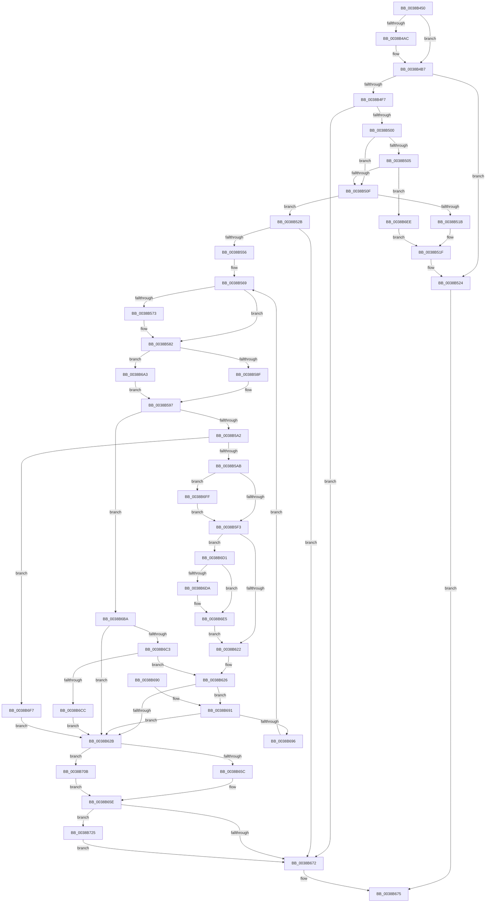

# MmPurgeSection

- RVA: `0x0038B450`–`0x0038B73A` (길이 `746` bytes)
- VA: `0x000000014038B450`
- 실행 섹션: `.text`
- PDB 이름 있음: `예`; PDB Function 태그: `아니요`
- unwind 정보 RVA: `0x000800D4`
- 디코드: `203`개 명령, `746/746` bytes 표시
- 미해석 바이트: `0` (있으면 어셈블리에 `.byte`로 보존)

> 이 문서는 커널 이미지의 기계어와 PDB 기호를 분석해 생성했습니다. 4번과 5번은 함수 원형과 자료형을 바이너리 사용 방식에서 추정한 C 해석이며 원본 소스 복구 결과는 아닙니다.

## 1. Dependencies

- 직접 호출 지점: **14**; 고유 호출 대상: **11**
- 직접 호출자로 확인된 함수: **1**
- RIP 상대 이미지 참조: **1**

### Outgoing calls
- `0x0038B4E7` → [MiCanFileBeTruncatedInternal](../2A/MiCanFileBeTruncatedInternal_function_002ACCB4.md) (function, `0x002ACCB4`)
- `0x0038B51F` → [MiReleaseSpinLockExclusive](../24/MiReleaseSpinLockExclusive_function_002482C0.md) (function, `0x002482C0`)
- `0x0038B549` → [MiComputeDataFlushRange](../2B/MiComputeDataFlushRange_function_002BBA10.md) (function, `0x002BBA10`)
- `0x0038B577` → [ExAcquireSpinLockExclusive](../24/ExAcquireSpinLockExclusive_function_00248690.md) (function, `0x00248690`)
- `0x0038B5B0` → [MiIncrementSubsectionViewCount](../24/MiIncrementSubsectionViewCount_function_00249440.md) (function, `0x00249440`)
- `0x0038B5C5` → [MiReleaseSpinLockExclusive](../24/MiReleaseSpinLockExclusive_function_002482C0.md) (function, `0x002482C0`)
- `0x0038B5E1` → [MiPurgeSubsection](../37/MiPurgeSubsection_function_003712F0.md) (function, `0x003712F0`)
- `0x0038B603` → [ExAcquireSpinLockExclusive](../24/ExAcquireSpinLockExclusive_function_00248690.md) (function, `0x00248690`)
- `0x0038B613` → [MiDecrementSubsectionViewCount](../29/MiDecrementSubsectionViewCount_function_00298E90.md) (function, `0x00298E90`)
- `0x0038B635` → [MiDecrementSubsections](../29/MiDecrementSubsections_function_00298B50.md) (function, `0x00298B50`)
- `0x0038B646` → [MiDecrementSubsections](../29/MiDecrementSubsections_function_00298B50.md) (function, `0x00298B50`)
- `0x0038B664` → [MiCheckControlArea](../28/MiCheckControlArea_function_002861B0.md) (function, `0x002861B0`)
- `0x0038B6DD` → [MiInsertUnusedSubsection](../29/MiInsertUnusedSubsection_function_00298D50.md) (function, `0x00298D50`)
- `0x0038B730` → [MiReturnCrossPartitionSectionCharges](../4B/MiReturnCrossPartitionSectionCharges_function_004BA61C.md) (function, `0x004BA61C`)

### Direct callers
- [CcPurgeCacheSection](CcPurgeCacheSection_function_0038B130.md) at `0x0038B25C`

### Static image references
- `0x0038B70F` → RVA `0x00E30088` (`.data`; read)

## 2. Other-region calls and transfers

- 다른 실행 섹션으로 향하는 call: **0**
- 별도 외부 분기/꼬리 이동을 확인하지 못했습니다.

## 3. Assembly (complete function range)

```asm
0038B450  48 89 5C 24 18                  mov qword ptr [rsp + 0x18], rbx
0038B455  55                              push rbp
0038B456  56                              push rsi
0038B457  57                              push rdi
0038B458  41 54                           push r12
0038B45A  41 55                           push r13
0038B45C  41 56                           push r14
0038B45E  41 57                           push r15
0038B460  48 8D 6C 24 E1                  lea rbp, [rsp - 0x1f]
0038B465  48 81 EC 90 00 00 00            sub rsp, 0x90
0038B46C  45 33 ED                        xor r13d, r13d
0038B46F  33 C0                           xor eax, eax
0038B471  48 89 45 E7                     mov qword ptr [rbp - 0x19], rax
0038B475  0F 57 C0                        xorps xmm0, xmm0
0038B478  48 8B 45 7F                     mov rax, qword ptr [rbp + 0x7f]
0038B47C  0F 57 C9                        xorps xmm1, xmm1
0038B47F  44 88 6D 77                     mov byte ptr [rbp + 0x77], r13b
0038B483  41 8B F1                        mov esi, r9d
0038B486  4C 89 6D 67                     mov qword ptr [rbp + 0x67], r13
0038B48A  4D 8B F0                        mov r14, r8
0038B48D  48 8B DA                        mov rbx, rdx
0038B490  44 88 28                        mov byte ptr [rax], r13b
0038B493  0F 11 45 EF                     movups xmmword ptr [rbp - 0x11], xmm0
0038B497  0F 11 45 FF                     movups xmmword ptr [rbp - 1], xmm0
0038B49B  0F 11 45 0F                     movups xmmword ptr [rbp + 0xf], xmm0
0038B49F  0F 11 4D C7                     movups xmmword ptr [rbp - 0x39], xmm1
0038B4A3  0F 11 4D D7                     movups xmmword ptr [rbp - 0x29], xmm1
0038B4A7  48 85 D2                        test rdx, rdx
0038B4AA  74 0B                           je 0x14038b4b7
0038B4AC  48 8B 02                        mov rax, qword ptr [rdx]
0038B4AF  48 8D 5D 67                     lea rbx, [rbp + 0x67]
0038B4B3  48 89 45 67                     mov qword ptr [rbp + 0x67], rax
0038B4B7  41 8B D5                        mov edx, r13d
0038B4BA  48 8D 45 77                     lea rax, [rbp + 0x77]
0038B4BE  0F BA E6 01                     bt esi, 1
0038B4C2  48 89 44 24 20                  mov qword ptr [rsp + 0x20], rax
0038B4C7  45 8B CD                        mov r9d, r13d
0038B4CA  41 BF 01 00 00 00               mov r15d, 1
0038B4D0  0F 93 C2                        setae dl
0038B4D3  45 8B C7                        mov r8d, r15d
0038B4D6  89 55 5F                        mov dword ptr [rbp + 0x5f], edx
0038B4D9  0F BA E6 01                     bt esi, 1
0038B4DD  48 8B D3                        mov rdx, rbx
0038B4E0  4D 8B E5                        mov r12, r13
0038B4E3  41 0F 92 C1                     setb r9b
0038B4E7  E8 C8 17 F2 FF                  call 0x1402accb4
0038B4EC  8A 55 77                        mov dl, byte ptr [rbp + 0x77]
0038B4EF  48 8B F8                        mov rdi, rax
0038B4F2  80 FA 11                        cmp dl, 0x11
0038B4F5  74 2D                           je 0x14038b524
0038B4F7  48 85 C0                        test rax, rax
0038B4FA  0F 84 72 01 00 00               je 0x14038b672
0038B500  41 84 F7                        test r15b, sil
0038B503  75 0A                           jne 0x14038b50f
0038B505  44 39 68 58                     cmp dword ptr [rax + 0x58], r13d
0038B509  0F 85 DF 01 00 00               jne 0x14038b6ee
0038B50F  8B 40 38                        mov eax, dword ptr [rax + 0x38]
0038B512  8A 55 77                        mov dl, byte ptr [rbp + 0x77]
0038B515  4C 39 6F 40                     cmp qword ptr [rdi + 0x40], r13
0038B519  75 10                           jne 0x14038b52b
0038B51B  48 8D 4F 48                     lea rcx, [rdi + 0x48]
0038B51F  E8 9C CD EB FF                  call 0x1402482c0
0038B524  32 C0                           xor al, al
0038B526  E9 4A 01 00 00                  jmp 0x14038b675
0038B52B  0F BA E8 0F                     bts eax, 0xf
0038B52F  4D 8B CE                        mov r9, r14
0038B532  89 47 38                        mov dword ptr [rdi + 0x38], eax
0038B535  4C 8B C3                        mov r8, rbx
0038B538  48 8D 45 EF                     lea rax, [rbp - 0x11]
0038B53C  48 8B CF                        mov rcx, rdi
0038B53F  48 89 44 24 28                  mov qword ptr [rsp + 0x28], rax
0038B544  44 89 7C 24 20                  mov dword ptr [rsp + 0x20], r15d
0038B549  E8 C2 04 F3 FF                  call 0x1402bba10
0038B54E  85 C0                           test eax, eax
0038B550  0F 84 1C 01 00 00               je 0x14038b672
0038B556  48 8B 45 F7                     mov rax, qword ptr [rbp - 9]
0038B55A  40 B6 11                        mov sil, 0x11
0038B55D  48 8B 5D 07                     mov rbx, qword ptr [rbp + 7]
0038B561  4C 8B 75 0F                     mov r14, qword ptr [rbp + 0xf]
0038B565  40 88 75 77                     mov byte ptr [rbp + 0x77], sil
0038B569  48 89 45 BF                     mov qword ptr [rbp - 0x41], rax
0038B56D  40 80 FE 11                     cmp sil, 0x11
0038B571  75 0F                           jne 0x14038b582
0038B573  48 8D 4F 48                     lea rcx, [rdi + 0x48]
0038B577  E8 14 D1 EB FF                  call 0x140248690
0038B57C  40 8A F0                        mov sil, al
0038B57F  88 45 77                        mov byte ptr [rbp + 0x77], al
0038B582  48 8B 43 08                     mov rax, qword ptr [rbx + 8]
0038B586  4C 3B F3                        cmp r14, rbx
0038B589  0F 85 14 01 00 00               jne 0x14038b6a3
0038B58F  4C 8B 6D FF                     mov r13, qword ptr [rbp - 1]
0038B593  49 83 C5 08                     add r13, 8
0038B597  33 C9                           xor ecx, ecx
0038B599  48 85 C0                        test rax, rax
0038B59C  0F 84 18 01 00 00               je 0x14038b6ba
0038B5A2  39 4B 6C                        cmp dword ptr [rbx + 0x6c], ecx
0038B5A5  0F 85 4C 01 00 00               jne 0x14038b6f7
0038B5AB  33 D2                           xor edx, edx
0038B5AD  48 8B CB                        mov rcx, rbx
0038B5B0  E8 8B DE EB FF                  call 0x140249440
0038B5B5  8B 43 20                        mov eax, dword ptr [rbx + 0x20]
0038B5B8  48 8D 4F 48                     lea rcx, [rdi + 0x48]
0038B5BC  8A 55 77                        mov dl, byte ptr [rbp + 0x77]
0038B5BF  83 C8 01                        or eax, 1
0038B5C2  89 43 20                        mov dword ptr [rbx + 0x20], eax
0038B5C5  E8 F6 CC EB FF                  call 0x1402482c0
0038B5CA  44 8B 4D 5F                     mov r9d, dword ptr [rbp + 0x5f]
0038B5CE  48 8D 45 C7                     lea rax, [rbp - 0x39]
0038B5D2  48 8B 55 BF                     mov rdx, qword ptr [rbp - 0x41]
0038B5D6  4D 8B C5                        mov r8, r13
0038B5D9  48 8B CB                        mov rcx, rbx
0038B5DC  48 89 44 24 20                  mov qword ptr [rsp + 0x20], rax
0038B5E1  E8 0A 5D FE FF                  call 0x1403712f0
0038B5E6  45 33 ED                        xor r13d, r13d
0038B5E9  44 38 6D D0                     cmp byte ptr [rbp - 0x30], r13b
0038B5ED  0F 85 0C 01 00 00               jne 0x14038b6ff
0038B5F3  44 38 6D CF                     cmp byte ptr [rbp - 0x31], r13b
0038B5F7  48 8D 4F 48                     lea rcx, [rdi + 0x48]
0038B5FB  45 0F B6 FF                     movzx r15d, r15b
0038B5FF  45 0F 45 FD                     cmovne r15d, r13d
0038B603  E8 88 D0 EB FF                  call 0x140248690
0038B608  33 D2                           xor edx, edx
0038B60A  88 45 77                        mov byte ptr [rbp + 0x77], al
0038B60D  48 8B CB                        mov rcx, rbx
0038B610  40 8A F0                        mov sil, al
0038B613  E8 78 D8 F0 FF                  call 0x140298e90
0038B618  4C 39 6B 50                     cmp qword ptr [rbx + 0x50], r13
0038B61C  0F 84 AF 00 00 00               je 0x14038b6d1
0038B622  4C 8B 75 0F                     mov r14, qword ptr [rbp + 0xf]
0038B626  49 3B DE                        cmp rbx, r14
0038B629  75 66                           jne 0x14038b691
0038B62B  48 8B 4D 07                     mov rcx, qword ptr [rbp + 7]
0038B62F  45 33 C0                        xor r8d, r8d
0038B632  48 8B D1                        mov rdx, rcx
0038B635  E8 16 D5 F0 FF                  call 0x140298b50
0038B63A  45 33 C0                        xor r8d, r8d
0038B63D  49 8B D6                        mov rdx, r14
0038B640  49 8B CE                        mov rcx, r14
0038B643  4C 03 E0                        add r12, rax
0038B646  E8 05 D5 F0 FF                  call 0x140298b50
0038B64B  48 FF 4F 28                     dec qword ptr [rdi + 0x28]
0038B64F  83 67 38 FB                     and dword ptr [rdi + 0x38], 0xfffffffb
0038B653  4C 03 E0                        add r12, rax
0038B656  0F 85 AF 00 00 00               jne 0x14038b70b
0038B65C  33 DB                           xor ebx, ebx
0038B65E  40 8A D6                        mov dl, sil
0038B661  48 8B CF                        mov rcx, rdi
0038B664  E8 47 AB EF FF                  call 0x1402861b0
0038B669  4D 85 E4                        test r12, r12
0038B66C  0F 85 B3 00 00 00               jne 0x14038b725
0038B672  41 8A C7                        mov al, r15b
0038B675  48 8B 9C 24 E0 00 00 00         mov rbx, qword ptr [rsp + 0xe0]
0038B67D  48 81 C4 90 00 00 00            add rsp, 0x90
0038B684  41 5F                           pop r15
0038B686  41 5E                           pop r14
0038B688  41 5D                           pop r13
0038B68A  41 5C                           pop r12
0038B68C  5F                              pop rdi
0038B68D  5E                              pop rsi
0038B68E  5D                              pop rbp
0038B68F  C3                              ret
0038B690  CC                              int3
0038B691  45 84 FF                        test r15b, r15b
0038B694  74 95                           je 0x14038b62b
0038B696  48 8B 5B 10                     mov rbx, qword ptr [rbx + 0x10]
0038B69A  48 8B 43 08                     mov rax, qword ptr [rbx + 8]
0038B69E  E9 C6 FE FF FF                  jmp 0x14038b569
0038B6A3  8B 4B 2C                        mov ecx, dword ptr [rbx + 0x2c]
0038B6A6  8B 53 34                        mov edx, dword ptr [rbx + 0x34]
0038B6A9  81 E2 FF FF FF 3F               and edx, 0x3fffffff
0038B6AF  2B CA                           sub ecx, edx
0038B6B1  4C 8D 2C C8                     lea r13, [rax + rcx*8]
0038B6B5  E9 DD FE FF FF                  jmp 0x14038b597
0038B6BA  49 3B DE                        cmp rbx, r14
0038B6BD  0F 84 68 FF FF FF               je 0x14038b62b
0038B6C3  45 84 FF                        test r15b, r15b
0038B6C6  0F 85 5A FF FF FF               jne 0x14038b626
0038B6CC  E9 5A FF FF FF                  jmp 0x14038b62b
0038B6D1  8B 43 20                        mov eax, dword ptr [rbx + 0x20]
0038B6D4  0F BA E0 10                     bt eax, 0x10
0038B6D8  72 0B                           jb 0x14038b6e5
0038B6DA  48 8B CB                        mov rcx, rbx
0038B6DD  E8 6E D6 F0 FF                  call 0x140298d50
0038B6E2  4C 03 E0                        add r12, rax
0038B6E5  40 8A 75 77                     mov sil, byte ptr [rbp + 0x77]
0038B6E9  E9 34 FF FF FF                  jmp 0x14038b622
0038B6EE  48 8D 48 48                     lea rcx, [rax + 0x48]
0038B6F2  E9 28 FE FF FF                  jmp 0x14038b51f
0038B6F7  44 8A F9                        mov r15b, cl
0038B6FA  E9 2C FF FF FF                  jmp 0x14038b62b
0038B6FF  48 8B 45 7F                     mov rax, qword ptr [rbp + 0x7f]
0038B703  C6 00 01                        mov byte ptr [rax], 1
0038B706  E9 E8 FE FF FF                  jmp 0x14038b5f3
0038B70B  0F B7 4F 3C                     movzx ecx, word ptr [rdi + 0x3c]
0038B70F  48 8B 05 72 49 AA 00            mov rax, qword ptr [rip + 0xaa4972]
0038B716  81 E1 FF 03 00 00               and ecx, 0x3ff
0038B71C  48 8B 1C C8                     mov rbx, qword ptr [rax + rcx*8]
0038B720  E9 39 FF FF FF                  jmp 0x14038b65e
0038B725  4D 8B C4                        mov r8, r12
0038B728  BA 01 00 00 00                  mov edx, 1
0038B72D  48 8B CB                        mov rcx, rbx
0038B730  E8 E7 EE 12 00                  call 0x1404ba61c
0038B735  E9 38 FF FF FF                  jmp 0x14038b672
```

## 4. C-style interpretation (structured pseudocode)

```c
__int64 __fastcall MmPurgeSection(__int64 a1, __int64 a2, __int64 a3, int a4, __int64 a5)
{
    __int64 result;
    __int64 v_r12;
    __int64 v_r13;
    __int64 v_r15;
    __int64 v_rbx;
    __int64 v_rsi;
    __int64 v_rsp;
    unsigned __int64 v_stack_m48;
    unsigned __int64 v_stack_m50;
    unsigned __int64 v_stack_m57;
    unsigned __int64 v_stack_m58;
    unsigned __int64 v_stack_m60;
    unsigned __int64 v_stack_m68;
    unsigned __int64 v_stack_m70;
    unsigned __int64 v_stack_m80;
    unsigned __int8 v_stack_m87;
    unsigned __int8 v_stack_m88;
    unsigned __int64 v_stack_m90;
    unsigned __int64 v_stack_m98;
    unsigned __int64 v_stack_mA0;
    unsigned __int64 v_stack_mA8;
    unsigned __int64 v_stack_p10;
    unsigned __int64 v_stack_p18;
    unsigned __int8 v_stack_p20;
    unsigned int v_stack_p8;

    v_stack_p18 = v_rbx;
    v_rsp = (v_rsp) - (144);
    v_r13 = 0;
    result = 0;
    v_stack_m70 = 0;
    v_stack_p20 = 0;
    v_stack_p10 = 0;
    *(unsigned __int8 *)(a5) = 0;
    v_stack_m68 = v_xmm0;
    v_stack_m58 = v_xmm0;
    v_stack_m48 = v_xmm0;
    v_stack_m90 = v_xmm1;
    v_stack_m80 = v_xmm1;
    result = a5;
    v_rbx = a2;
    if (a2 != 0) {
        result = *(unsigned __int64 *)(a2);
        v_rbx = v_stack_p10;
        v_stack_p10 = result;
    }
    v_stack_mA8 = v_stack_p20;
    a2 = (condition_is_above_or_equal) ? 1 : 0;
    v_stack_p8 = (unsigned int)(a2);
    a4 = (condition_is_below) ? 1 : 0;
    result = MiCanFileBeTruncatedInternal(a1, v_rbx, 1, a4);
    if (((unsigned __int8)(v_stack_p20)) == 17) goto loc_0038B524;
    if (result == 0) goto loc_0038B672;
    if (((1) & ((unsigned __int8)((unsigned int)(a4)))) != 0) goto loc_0038B50F;
    if ((*(unsigned int *)(result + 88)) != 0) goto loc_0038B6EE;
loc_0038B50F:
    if ((*(unsigned __int64 *)(result + 64)) != 0) goto loc_0038B52B;
loc_0038B51F:
    result = MiReleaseSpinLockExclusive(result + 72, v_stack_p20, 1, a4);
loc_0038B524:
    result = 0;
    goto loc_0038B675;
loc_0038B52B:
    *(unsigned int *)(result + 56) = 0;
    v_stack_mA0 = v_stack_m68;
    v_stack_mA8 = 1;
    result = MiComputeDataFlushRange(0, v_stack_p20, v_rbx, a3);
    if ((unsigned int)(result) == 0) goto loc_0038B672;
    v_stack_p20 = 17;
loc_0038B569:
    v_stack_m98 = v_stack_m60;
    result = v_stack_m60;
    v_rsi = 17;
    if (17 == 17) {
        a1 = result + 72;
        result = ExAcquireSpinLockExclusive(a1, v_stack_p20, v_rbx, a3);
        v_rsi = (unsigned __int8)(result);
        v_stack_p20 = (unsigned __int8)(result);
    }
    if (v_stack_m48 != v_stack_m50) goto loc_0038B6A3;
    v_r13 = (v_stack_m58) + (8);
loc_0038B597:
    a1 = 0;
    if (*(unsigned __int64 *)(v_stack_m50 + 8) == 0) goto loc_0038B6BA;
    if ((*(unsigned int *)(v_stack_m50 + 108)) != 0) goto loc_0038B6F7;
    a2 = 0;
    result = MiIncrementSubsectionViewCount(v_stack_m50, a2, v_rbx, a3);
    result = (unsigned int)(((unsigned int)(*(unsigned int *)(v_stack_m50 + 32))) | (1));
    *(unsigned int *)(v_stack_m50 + 32) = (unsigned int)(result);
    result = MiReleaseSpinLockExclusive(result + 72, v_stack_p20, v_rbx, a3);
    v_stack_mA8 = v_stack_m90;
    result = MiPurgeSubsection(v_stack_m50, v_stack_m98, v_r13, (unsigned int)(v_stack_p8));
    v_r13 = 0;
    if (v_stack_m87 != 0) goto loc_0038B6FF;
loc_0038B5F3:
    v_r15 = 1;
    if (v_stack_m88 != 0) { v_r15 = 0; }
    result = ExAcquireSpinLockExclusive(result + 72, v_stack_m98, v_r13, (unsigned int)(v_stack_p8));
    a2 = 0;
    v_stack_p20 = (unsigned __int8)(result);
    result = MiDecrementSubsectionViewCount(v_stack_m50, a2, v_r13, (unsigned int)(v_stack_p8));
    if ((*(unsigned __int64 *)(v_stack_m50 + 80)) == 0) goto loc_0038B6D1;
loc_0038B622:
loc_0038B626:
    if (v_stack_m50 != v_stack_m48) goto loc_0038B691;
loc_0038B62B:
    a3 = 0;
    result = MiDecrementSubsections(v_stack_m50, v_stack_m50, a3, (unsigned int)(v_stack_p8));
    a3 = 0;
    v_r12 = (0) + (result);
    result = MiDecrementSubsections(v_stack_m48, v_stack_m48, a3, (unsigned int)(v_stack_p8));
    v_r12 = (v_r12) + (result);
    if (condition_is_not_equal) goto loc_0038B70B;
    v_rbx = 0;
loc_0038B65E:
    result = MiCheckControlArea(result, (unsigned __int8)((unsigned __int8)(result)), a3, (unsigned int)(v_stack_p8));
    if (v_r12 != 0) goto loc_0038B725;
loc_0038B672:
loc_0038B675:
    v_rsp = (v_rsp) + (144);
    return (unsigned __int8)(v_r15);
loc_0038B691:
    if ((unsigned __int8)(v_r15) == 0) goto loc_0038B62B;
    goto loc_0038B569;
loc_0038B6A3:
    a2 = (unsigned int)(((unsigned int)(*(unsigned int *)(*(unsigned __int64 *)(v_stack_p18 + 16) + 52))) & (0x3FFFFFFFULL));
    a1 = (unsigned int)(((unsigned int)(*(unsigned int *)(*(unsigned __int64 *)(v_stack_p18 + 16) + 44))) - ((unsigned int)(a2)));
    goto loc_0038B597;
loc_0038B6BA:
    if ((*(unsigned __int64 *)(v_stack_p18 + 16)) == v_stack_m48) goto loc_0038B62B;
    if ((unsigned __int8)(v_r15) != 0) goto loc_0038B626;
    goto loc_0038B62B;
loc_0038B6D1:
    result = (unsigned int)(*(unsigned int *)(*(unsigned __int64 *)(v_stack_p18 + 16) + 32));
    if (!(condition_is_below)) {
        a1 = *(unsigned __int64 *)(v_stack_p18 + 16);
        result = MiInsertUnusedSubsection(a1, a2, a3, (unsigned int)(v_stack_p8));
        v_r12 = (v_r12) + (result);
    }
    goto loc_0038B622;
loc_0038B6EE:
    goto loc_0038B51F;
loc_0038B6F7:
    goto loc_0038B62B;
loc_0038B6FF:
    *(unsigned __int8 *)(a5) = 1;
    goto loc_0038B5F3;
loc_0038B70B:
    a1 = (unsigned int)((*(unsigned __int16 *)(result + 60)) & (0x3FFULL));
    goto loc_0038B65E;
loc_0038B725:
    result = MiReturnCrossPartitionSectionCharges(*(unsigned __int64 *)(*(unsigned __int64 *)(v_rip + 11159922) + a1 * 8), 1, v_r12, (unsigned int)(v_stack_p8));
    goto loc_0038B672;
}
```

## 5. (Beta) C Style

```c
int64_t MmPurgeSection(int64_t Arg1, int64_t Arg2, int64_t Arg3, int32_t Arg4, void *Arg5)
{
    uint8_t *arg5 = (uint8_t *)Arg5;

    int64_t result;
    int64_t local_r12;
    int64_t local_r13;
    int64_t local_r15;
    int64_t local_rbx;
    int64_t local_rsi;
    int64_t local_rsp;
    uint64_t v_stack_m48;
    uint64_t v_stack_m50;
    uint64_t v_stack_m57;
    uint64_t v_stack_m58;
    uint64_t v_stack_m60;
    uint64_t v_stack_m68;
    uint64_t v_stack_m70;
    uint64_t v_stack_m80;
    uint8_t v_stack_m87;
    uint8_t v_stack_m88;
    uint64_t v_stack_m90;
    uint64_t v_stack_m98;
    uint64_t v_stack_mA0;
    uint64_t v_stack_mA8;
    uint64_t v_stack_p10;
    uint64_t v_stack_p18;
    uint8_t v_stack_p20;
    uint32_t v_stack_p8;

    v_stack_p18 = local_rbx;
    local_rsp = (local_rsp) - (144);
    local_r13 = 0;
    result = 0;
    v_stack_m70 = 0;
    v_stack_p20 = 0;
    v_stack_p10 = 0;
    *(uint8_t *)(arg5) = 0;
    v_stack_m68 = v_xmm0;
    v_stack_m58 = v_xmm0;
    v_stack_m48 = v_xmm0;
    v_stack_m90 = v_xmm1;
    v_stack_m80 = v_xmm1;
    result = Arg5;
    local_rbx = Arg2;
    if (Arg2 != 0) {
        result = *(uint64_t *)(Arg2);
        local_rbx = v_stack_p10;
        v_stack_p10 = result;
    }
    v_stack_mA8 = v_stack_p20;
    Arg2 = (condition_is_above_or_equal) ? 1 : 0;
    v_stack_p8 = (uint32_t)(Arg2);
    Arg4 = (condition_is_below) ? 1 : 0;
    result = MiCanFileBeTruncatedInternal(Arg1, local_rbx, 1, Arg4);
    if (((uint8_t)(v_stack_p20)) == 17) goto loc_0038B524;
    if (result == 0) goto loc_0038B672;
    if (((1) & ((uint8_t)((uint32_t)(Arg4)))) != 0) goto loc_0038B50F;
    if ((*(uint32_t *)(result + 0x58)) != 0) goto loc_0038B6EE;
loc_0038B50F:
    if ((*(uint64_t *)(result + 0x40)) != 0) goto loc_0038B52B;
loc_0038B51F:
    result = MiReleaseSpinLockExclusive(result + 72, v_stack_p20, 1, Arg4);
loc_0038B524:
    result = 0;
    goto loc_0038B675;
loc_0038B52B:
    *(uint32_t *)(result + 0x38) = 0;
    v_stack_mA0 = v_stack_m68;
    v_stack_mA8 = 1;
    result = MiComputeDataFlushRange(0, v_stack_p20, local_rbx, Arg3);
    if ((uint32_t)(result) == 0) goto loc_0038B672;
    v_stack_p20 = 17;
loc_0038B569:
    v_stack_m98 = v_stack_m60;
    result = v_stack_m60;
    local_rsi = 17;
    if (17 == 17) {
        Arg1 = result + 72;
        result = ExAcquireSpinLockExclusive(Arg1, v_stack_p20, local_rbx, Arg3);
        local_rsi = (uint8_t)(result);
        v_stack_p20 = (uint8_t)(result);
    }
    if (v_stack_m48 != v_stack_m50) goto loc_0038B6A3;
    local_r13 = (v_stack_m58) + (8);
loc_0038B597:
    Arg1 = 0;
    if (*(uint64_t *)(v_stack_m50 + 0x8) == 0) goto loc_0038B6BA;
    if ((*(uint32_t *)(v_stack_m50 + 0x6C)) != 0) goto loc_0038B6F7;
    Arg2 = 0;
    result = MiIncrementSubsectionViewCount(v_stack_m50, Arg2, local_rbx, Arg3);
    result = (uint32_t)(((uint32_t)(*(uint32_t *)(v_stack_m50 + 0x20))) | (1));
    *(uint32_t *)(v_stack_m50 + 0x20) = (uint32_t)(result);
    result = MiReleaseSpinLockExclusive(result + 72, v_stack_p20, local_rbx, Arg3);
    v_stack_mA8 = v_stack_m90;
    result = MiPurgeSubsection(v_stack_m50, v_stack_m98, local_r13, (uint32_t)(v_stack_p8));
    local_r13 = 0;
    if (v_stack_m87 != 0) goto loc_0038B6FF;
loc_0038B5F3:
    local_r15 = 1;
    if (v_stack_m88 != 0) { local_r15 = 0; }
    result = ExAcquireSpinLockExclusive(result + 72, v_stack_m98, local_r13, (uint32_t)(v_stack_p8));
    Arg2 = 0;
    v_stack_p20 = (uint8_t)(result);
    result = MiDecrementSubsectionViewCount(v_stack_m50, Arg2, local_r13, (uint32_t)(v_stack_p8));
    if ((*(uint64_t *)(v_stack_m50 + 0x50)) == 0) goto loc_0038B6D1;
loc_0038B622:
loc_0038B626:
    if (v_stack_m50 != v_stack_m48) goto loc_0038B691;
loc_0038B62B:
    Arg3 = 0;
    result = MiDecrementSubsections(v_stack_m50, v_stack_m50, Arg3, (uint32_t)(v_stack_p8));
    Arg3 = 0;
    local_r12 = (0) + (result);
    result = MiDecrementSubsections(v_stack_m48, v_stack_m48, Arg3, (uint32_t)(v_stack_p8));
    local_r12 = (local_r12) + (result);
    if (condition_is_not_equal) goto loc_0038B70B;
    local_rbx = 0;
loc_0038B65E:
    result = MiCheckControlArea(result, (uint8_t)((uint8_t)(result)), Arg3, (uint32_t)(v_stack_p8));
    if (local_r12 != 0) goto loc_0038B725;
loc_0038B672:
loc_0038B675:
    local_rsp = (local_rsp) + (144);
    return (uint8_t)(local_r15);
loc_0038B691:
    if ((uint8_t)(local_r15) == 0) goto loc_0038B62B;
    goto loc_0038B569;
loc_0038B6A3:
    Arg2 = (uint32_t)(((uint32_t)(*(uint32_t *)(*(uint64_t *)(v_stack_p18 + 0x10) + 0x34))) & (0x3FFFFFFFULL));
    Arg1 = (uint32_t)(((uint32_t)(*(uint32_t *)(*(uint64_t *)(v_stack_p18 + 0x10) + 0x2C))) - ((uint32_t)(Arg2)));
    goto loc_0038B597;
loc_0038B6BA:
    if ((*(uint64_t *)(v_stack_p18 + 0x10)) == v_stack_m48) goto loc_0038B62B;
    if ((uint8_t)(local_r15) != 0) goto loc_0038B626;
    goto loc_0038B62B;
loc_0038B6D1:
    result = (uint32_t)(*(uint32_t *)(*(uint64_t *)(v_stack_p18 + 0x10) + 0x20));
    if (!(condition_is_below)) {
        Arg1 = *(uint64_t *)(v_stack_p18 + 0x10);
        result = MiInsertUnusedSubsection(Arg1, Arg2, Arg3, (uint32_t)(v_stack_p8));
        local_r12 = (local_r12) + (result);
    }
    goto loc_0038B622;
loc_0038B6EE:
    goto loc_0038B51F;
loc_0038B6F7:
    goto loc_0038B62B;
loc_0038B6FF:
    *(uint8_t *)(arg5) = 1;
    goto loc_0038B5F3;
loc_0038B70B:
    Arg1 = (uint32_t)((*(uint16_t *)(result + 0x3C)) & (0x3FFULL));
    goto loc_0038B65E;
loc_0038B725:
    result = MiReturnCrossPartitionSectionCharges(*(uint64_t *)(*(uint64_t *)(v_rip + 0xAA4972) + Arg1 * 8), 1, local_r12, (uint32_t)(v_stack_p8));
    goto loc_0038B672;
}
```

### 관측된 메모리 오프셋

구조체 형식이 확인되지 않은 접근은 인자 기준의 오프셋으로만 기록했습니다.

| 기준 인자 | 오프셋 표현 | 폭 (bit) | 접근 |
|---|---:|---:|---|
| `Arg5` | `+ 0x0` | `8` | `W` |

## 6. Execution-region graph

[열기: 2D/3D 그래프와 함수 탐색 컨트롤 패널](../../../control-panel.html?section=text&rva=0x0038B450&view=graph)

- 2D 그래프는 위에서 아래로 흐르고, 3D 그래프는 빈 공간을 드래그해 회전합니다. Shift+드래그는 이동, 휠은 확대·축소, 함수 노드 선택은 대상 보고서 이동입니다.

### Static fallback


