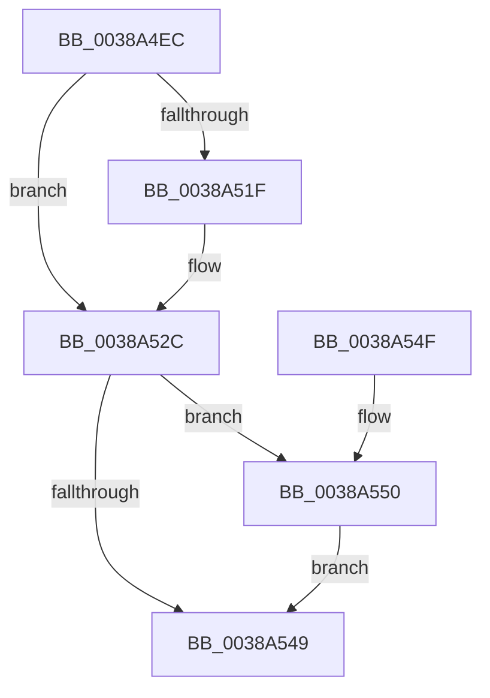

# MmTrimSection

- RVA: `0x0038A4EC`–`0x0038A57C` (길이 `144` bytes)
- VA: `0x000000014038A4EC`
- 실행 섹션: `.text`
- PDB 이름 있음: `예`; PDB Function 태그: `아니요`
- unwind 정보 RVA: `0x0007FFF4`
- 디코드: `43`개 명령, `144/144` bytes 표시
- 미해석 바이트: `0` (있으면 어셈블리에 `.byte`로 보존)

> 이 문서는 커널 이미지의 기계어와 PDB 기호를 분석해 생성했습니다. 4번과 5번은 함수 원형과 자료형을 바이너리 사용 방식에서 추정한 C 해석이며 원본 소스 복구 결과는 아닙니다.

## 1. Dependencies

- 직접 호출 지점: **3**; 고유 호출 대상: **3**
- 직접 호출자로 확인된 함수: **2**
- RIP 상대 이미지 참조: **0**

### Outgoing calls
- `0x0038A540` → [MiComputeFlushRange](../2B/MiComputeFlushRange_function_002BB8D0.md) (function, `0x002BB8D0`)
- `0x0038A55D` → [MiTrimSection](../2E/MiTrimSection_function_002E0810.md) (function, `0x002E0810`)
- `0x0038A573` → [MiFlushRelease](../29/MiFlushRelease_function_002982C0.md) (function, `0x002982C0`)

### Direct callers
- [CcPurgeCacheSection](CcPurgeCacheSection_function_0038B130.md) at `0x0038B395`
- [CcCoherencyFlushAndPurgeCache](../48/CcCoherencyFlushAndPurgeCache_function_0048E3D0.md) at `0x0048E488`

### Static image references
- 디코드된 RIP-relative 메모리 참조가 없습니다.

## 2. Other-region calls and transfers

- 다른 실행 섹션으로 향하는 call: **0**
- 별도 외부 분기/꼬리 이동을 확인하지 못했습니다.

## 3. Assembly (complete function range)

```asm
0038A4EC  48 8B C4                        mov rax, rsp
0038A4EF  53                              push rbx
0038A4F0  48 83 EC 60                     sub rsp, 0x60
0038A4F4  48 83 60 10 00                  and qword ptr [rax + 0x10], 0
0038A4F9  0F 57 C0                        xorps xmm0, xmm0
0038A4FC  0F 11 40 C8                     movups xmmword ptr [rax - 0x38], xmm0
0038A500  0F 11 40 D8                     movups xmmword ptr [rax - 0x28], xmm0
0038A504  0F 11 40 E8                     movups xmmword ptr [rax - 0x18], xmm0
0038A508  41 8B C1                        mov eax, r9d
0038A50B  83 E0 01                        and eax, 1
0038A50E  8B D8                           mov ebx, eax
0038A510  83 CB 20                        or ebx, 0x20
0038A513  41 F6 C1 02                     test r9b, 2
0038A517  0F 44 D8                        cmove ebx, eax
0038A51A  48 85 D2                        test rdx, rdx
0038A51D  74 0D                           je 0x14038a52c
0038A51F  48 8B 02                        mov rax, qword ptr [rdx]
0038A522  48 8D 54 24 78                  lea rdx, [rsp + 0x78]
0038A527  48 89 44 24 78                  mov qword ptr [rsp + 0x78], rax
0038A52C  45 33 C9                        xor r9d, r9d
0038A52F  48 8D 44 24 30                  lea rax, [rsp + 0x30]
0038A534  83 FB 20                        cmp ebx, 0x20
0038A537  48 89 44 24 20                  mov qword ptr [rsp + 0x20], rax
0038A53C  41 0F 93 C1                     setae r9b
0038A540  E8 8B 13 F3 FF                  call 0x1402bb8d0
0038A545  85 C0                           test eax, eax
0038A547  75 07                           jne 0x14038a550
0038A549  48 83 C4 60                     add rsp, 0x60
0038A54D  5B                              pop rbx
0038A54E  C3                              ret
0038A54F  CC                              int3
0038A550  44 8B CB                        mov r9d, ebx
0038A553  48 8D 4C 24 30                  lea rcx, [rsp + 0x30]
0038A558  45 33 C0                        xor r8d, r8d
0038A55B  33 D2                           xor edx, edx
0038A55D  E8 AE 62 F5 FF                  call 0x1402e0810
0038A562  4C 8B 44 24 50                  mov r8, qword ptr [rsp + 0x50]
0038A567  8B D8                           mov ebx, eax
0038A569  48 8B 54 24 48                  mov rdx, qword ptr [rsp + 0x48]
0038A56E  48 8B 4C 24 30                  mov rcx, qword ptr [rsp + 0x30]
0038A573  E8 48 DD F0 FF                  call 0x1402982c0
0038A578  8B C3                           mov eax, ebx
0038A57A  EB CD                           jmp 0x14038a549
```

## 4. C-style interpretation (structured pseudocode)

```c
__int64 __fastcall MmTrimSection(__int64 a1, __int64 a2, int a3, int a4)
{
    __int64 result;
    __int64 v_rbx;
    __int64 v_rsp;
    unsigned __int64 v_stack_m38;
    unsigned __int64 v_stack_m48;
    unsigned __int64 v_stack_p10;
    unsigned __int64 v_stack_p30;
    unsigned __int64 v_stack_p48;
    unsigned __int64 v_stack_p50;

    v_rsp = (v_rsp) - (96);
    *(unsigned __int64 *)(v_rsp - 56) = v_xmm0;
    *(unsigned __int64 *)(v_rsp - 40) = v_xmm0;
    *(unsigned __int64 *)(v_rsp - 24) = v_xmm0;
    result = (unsigned int)(((unsigned int)(a4)) & (1));
    v_rbx = (unsigned int)(((unsigned int)((unsigned int)(result))) | (32));
    if ((((unsigned __int8)(a4)) & (2)) == 0) { v_rbx = (unsigned int)(result); }
    if (a2 != 0) {
        result = *(unsigned __int64 *)(a2);
        a2 = v_stack_p10;
        v_stack_p10 = result;
    }
    a4 = 0;
    v_stack_m48 = v_stack_m38;
    a4 = (((unsigned int)(v_rbx)) >= 32) ? 1 : 0;
    result = MiComputeFlushRange(a1, a2, a3, a4);
    if ((unsigned int)(result) != 0) goto loc_0038A550;
loc_0038A549:
    v_rsp = (v_rsp) + (96);
    return result;
loc_0038A550:
    a3 = 0;
    a2 = 0;
    result = MiTrimSection(v_stack_p30, a2, a3, (unsigned int)((unsigned int)(v_rbx)));
    result = MiFlushRelease(v_stack_p30, v_stack_p48, v_stack_p50, (unsigned int)((unsigned int)(v_rbx)));
    goto loc_0038A549;
}
```

## 5. (Beta) C Style

```c
int64_t MmTrimSection(int64_t Arg1, int64_t Arg2, int32_t Arg3, int32_t Arg4)
{
    int64_t result;
    int64_t local_rbx;
    int64_t local_rsp;
    uint64_t v_stack_m38;
    uint64_t v_stack_m48;
    uint64_t v_stack_p10;
    uint64_t v_stack_p30;
    uint64_t v_stack_p48;
    uint64_t v_stack_p50;

    local_rsp = (local_rsp) - (96);
    *(uint64_t *)(local_rsp - 0x38) = v_xmm0;
    *(uint64_t *)(local_rsp - 0x28) = v_xmm0;
    *(uint64_t *)(local_rsp - 0x18) = v_xmm0;
    result = (uint32_t)(((uint32_t)(Arg4)) & (1));
    local_rbx = (uint32_t)(((uint32_t)((uint32_t)(result))) | (32));
    if ((((uint8_t)(Arg4)) & (2)) == 0) { local_rbx = (uint32_t)(result); }
    if (Arg2 != 0) {
        result = *(uint64_t *)(Arg2);
        Arg2 = v_stack_p10;
        v_stack_p10 = result;
    }
    Arg4 = 0;
    v_stack_m48 = v_stack_m38;
    Arg4 = (((uint32_t)(local_rbx)) >= 32) ? 1 : 0;
    result = MiComputeFlushRange(Arg1, Arg2, Arg3, Arg4);
    if ((uint32_t)(result) != 0) goto loc_0038A550;
loc_0038A549:
    local_rsp = (local_rsp) + (96);
    return result;
loc_0038A550:
    Arg3 = 0;
    Arg2 = 0;
    result = MiTrimSection(v_stack_p30, Arg2, Arg3, (uint32_t)((uint32_t)(local_rbx)));
    result = MiFlushRelease(v_stack_p30, v_stack_p48, v_stack_p50, (uint32_t)((uint32_t)(local_rbx)));
    goto loc_0038A549;
}
```

## 6. Execution-region graph

[열기: 2D/3D 그래프와 함수 탐색 컨트롤 패널](../../../control-panel.html?section=text&rva=0x0038A4EC&view=graph)

- 2D 그래프는 위에서 아래로 흐르고, 3D 그래프는 빈 공간을 드래그해 회전합니다. Shift+드래그는 이동, 휠은 확대·축소, 함수 노드 선택은 대상 보고서 이동입니다.

### Static fallback


