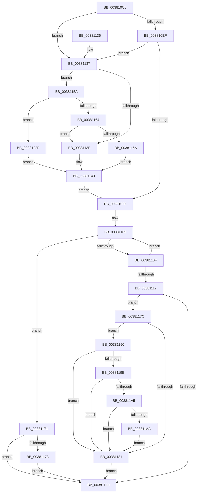

# PfHardFaultLog

- RVA: `0x003810C0`–`0x00381239` (길이 `377` bytes)
- VA: `0x00000001403810C0`
- 실행 섹션: `.text`
- PDB 이름 있음: `예`; PDB Function 태그: `아니요`
- unwind 정보 RVA: `0x0007B934`
- 디코드: `93`개 명령, `377/377` bytes 표시
- 미해석 바이트: `0` (있으면 어셈블리에 `.byte`로 보존)

> 이 문서는 커널 이미지의 기계어와 PDB 기호를 분석해 생성했습니다. 4번과 5번은 함수 원형과 자료형을 바이너리 사용 방식에서 추정한 C 해석이며 원본 소스 복구 결과는 아닙니다.

## 1. Dependencies

- 직접 호출 지점: **3**; 고유 호출 대상: **3**
- 직접 호출자로 확인된 함수: **1**
- RIP 상대 이미지 참조: **1**

### Outgoing calls
- `0x00381153` → [EtwTraceSiloTimedEvent](../48/EtwTraceSiloTimedEvent_function_00485260.md) (function, `0x00485260`)
- `0x00381189` → [PsDereferencePartition](../34/PsDereferencePartition_function_00342E70.md) (function, `0x00342E70`)
- `0x00381225` → [PfLogEvent](../34/PfLogEvent_function_00349BA8.md) (function, `0x00349BA8`)

### Direct callers
- [MiWaitForInPageComplete](MiWaitForInPageComplete_function_00380AB8.md) at `0x00380C97`

### Static image references
- `0x003811E3` → RVA `0x00F0F228` (`.data`; read)

## 2. Other-region calls and transfers

- 다른 실행 섹션으로 향하는 call: **0**
- 별도 외부 분기/꼬리 이동을 확인하지 못했습니다.

## 3. Assembly (complete function range)

```asm
003810C0  48 89 5C 24 08                  mov qword ptr [rsp + 8], rbx
003810C5  48 89 6C 24 10                  mov qword ptr [rsp + 0x10], rbp
003810CA  48 89 74 24 18                  mov qword ptr [rsp + 0x18], rsi
003810CF  57                              push rdi
003810D0  48 83 EC 70                     sub rsp, 0x70
003810D4  65 48 8B 04 25 88 01 00 00      mov rax, qword ptr gs:[0x188]
003810DD  8B F2                           mov esi, edx
003810DF  48 83 39 00                     cmp qword ptr [rcx], 0
003810E3  48 8B D9                        mov rbx, rcx
003810E6  48 8B A8 20 02 00 00            mov rbp, qword ptr [rax + 0x220]
003810ED  75 48                           jne 0x140381137
003810EF  48 83 79 08 00                  cmp qword ptr [rcx + 8], 0
003810F4  75 41                           jne 0x140381137
003810F6  48 8B BD 58 07 00 00            mov rdi, qword ptr [rbp + 0x758]
003810FD  0F 0D 4F 28                     prefetchw byte ptr [rdi + 0x28]
00381101  48 8B 47 28                     mov rax, qword ptr [rdi + 0x28]
00381105  48 8D 48 01                     lea rcx, [rax + 1]
00381109  48 83 F9 01                     cmp rcx, 1
0038110D  76 62                           jbe 0x140381171
0038110F  F0 48 0F B1 4F 28               lock cmpxchg qword ptr [rdi + 0x28], rcx
00381115  75 EE                           jne 0x140381105
00381117  48 8B 4F 20                     mov rcx, qword ptr [rdi + 0x20]
0038111B  48 85 FF                        test rdi, rdi
0038111E  75 5C                           jne 0x14038117c
00381120  4C 8D 5C 24 70                  lea r11, [rsp + 0x70]
00381125  49 8B 5B 10                     mov rbx, qword ptr [r11 + 0x10]
00381129  49 8B 6B 18                     mov rbp, qword ptr [r11 + 0x18]
0038112D  49 8B 73 20                     mov rsi, qword ptr [r11 + 0x20]
00381131  49 8B E3                        mov rsp, r11
00381134  5F                              pop rdi
00381135  C3                              ret
00381136  CC                              int3
00381137  44 8B C6                        mov r8d, esi
0038113A  85 F6                           test esi, esi
0038113C  75 1C                           jne 0x14038115a
0038113E  BA 20 02 00 00                  mov edx, 0x220
00381143  4C 8D 49 20                     lea r9, [rcx + 0x20]
00381147  48 89 5C 24 30                  mov qword ptr [rsp + 0x30], rbx
0038114C  48 8B 8D F0 05 00 00            mov rcx, qword ptr [rbp + 0x5f0]
00381153  E8 08 41 10 00                  call 0x140485260
00381158  EB 9C                           jmp 0x1403810f6
0038115A  41 83 E8 01                     sub r8d, 1
0038115E  0F 84 CB 00 00 00               je 0x14038122f
00381164  41 83 F8 01                     cmp r8d, 1
00381168  75 D4                           jne 0x14038113e
0038116A  BA 73 02 00 00                  mov edx, 0x273
0038116F  EB D2                           jmp 0x140381143
00381171  74 AD                           je 0x140381120
00381173  B9 0E 00 00 00                  mov ecx, 0xe
00381178  CD 29                           int 0x29
0038117A  EB A4                           jmp 0x140381120
0038117C  48 85 C9                        test rcx, rcx
0038117F  75 0F                           jne 0x140381190
00381181  BA 50 66 50 74                  mov edx, 0x74506650
00381186  48 8B CF                        mov rcx, rdi
00381189  E8 E2 1C FC FF                  call 0x140342e70
0038118E  EB 90                           jmp 0x140381120
00381190  8B 81 64 02 00 00               mov eax, dword ptr [rcx + 0x264]
00381196  39 81 60 02 00 00               cmp dword ptr [rcx + 0x260], eax
0038119C  73 E3                           jae 0x140381181
0038119E  48 83 7B 40 00                  cmp qword ptr [rbx + 0x40], 0
003811A3  74 DC                           je 0x140381181
003811A5  83 FE 02                        cmp esi, 2
003811A8  74 D7                           je 0x140381181
003811AA  49 B8 20 03 00 00 80 F7 FF FF   movabs r8, 0xfffff78000000320
003811B4  C7 44 24 20 28 00 00 00         mov dword ptr [rsp + 0x20], 0x28
003811BC  4C 8D 4C 24 40                  lea r9, [rsp + 0x40]
003811C1  4D 8B 00                        mov r8, qword ptr [r8]
003811C4  49 8B C0                        mov rax, r8
003811C7  48 2B 43 40                     sub rax, qword ptr [rbx + 0x40]
003811CB  48 89 43 40                     mov qword ptr [rbx + 0x40], rax
003811CF  03 C0                           add eax, eax
003811D1  48 8B 95 F8 01 00 00            mov rdx, qword ptr [rbp + 0x1f8]
003811D8  48 33 95 D0 01 00 00            xor rdx, qword ptr [rbp + 0x1d0]
003811DF  89 44 24 40                     mov dword ptr [rsp + 0x40], eax
003811E3  8B 05 3F E0 B8 00               mov eax, dword ptr [rip + 0xb8e03f]
003811E9  89 44 24 44                     mov dword ptr [rsp + 0x44], eax
003811ED  48 8B 43 30                     mov rax, qword ptr [rbx + 0x30]
003811F1  48 89 44 24 58                  mov qword ptr [rsp + 0x58], rax
003811F6  48 8B 43 20                     mov rax, qword ptr [rbx + 0x20]
003811FA  48 C1 E8 09                     shr rax, 9
003811FE  8B C0                           mov eax, eax
00381200  48 89 44 24 48                  mov qword ptr [rsp + 0x48], rax
00381205  48 B8 FF FF FF FF FF FF FF 1F   movabs rax, 0x1fffffffffffffff
0038120F  48 23 D0                        and rdx, rax
00381212  48 8B 43 28                     mov rax, qword ptr [rbx + 0x28]
00381216  48 89 54 24 60                  mov qword ptr [rsp + 0x60], rdx
0038121B  BA 1D 00 00 00                  mov edx, 0x1d
00381220  48 89 44 24 50                  mov qword ptr [rsp + 0x50], rax
00381225  E8 7E 89 FC FF                  call 0x140349ba8
0038122A  E9 52 FF FF FF                  jmp 0x140381181
0038122F  BA 72 02 00 00                  mov edx, 0x272
00381234  E9 0A FF FF FF                  jmp 0x140381143
```

## 4. C-style interpretation (structured pseudocode)

```c
__int64 __fastcall PfHardFaultLog(__int64 a1, int a2)
{
    __int64 result;
    __int64 v_rsp;
    unsigned __int64 v_stack_m10;
    unsigned __int64 v_stack_m18;
    unsigned __int64 v_stack_m20;
    unsigned __int64 v_stack_m28;
    unsigned int v_stack_m2C;
    unsigned __int64 v_stack_m30;
    unsigned __int64 v_stack_m40;
    unsigned int v_stack_m50;
    unsigned __int64 v_stack_m8;
    unsigned __int64 v_stack_p10;
    unsigned __int64 v_stack_p18;
    unsigned __int64 v_stack_p8;

    v_stack_p8 = v_rbx;
    v_stack_p10 = v_rbp;
    v_stack_p18 = v_rsi;
    v_rsp = (v_rsp) - (112);
    if ((*(unsigned __int64 *)(a1)) != 0) goto loc_00381137;
    if ((*(unsigned __int64 *)(a1 + 8)) != 0) goto loc_00381137;
loc_003810F6:
loc_00381105:
    if ((*(unsigned __int64 *)(*(unsigned __int64 *)(*(unsigned __int64 *)(*(unsigned __int64 *)(gs_base + (0 + 392)) + 544) + 1880) + 40) + 1) <= 1) goto loc_00381171;
    if ((*(unsigned __int64 *)(*(unsigned __int64 *)(*(unsigned __int64 *)(*(unsigned __int64 *)(gs_base + (0 + 392)) + 544) + 1880) + 40) + 1) != 1) goto loc_00381105;
    if (*(unsigned __int64 *)(*(unsigned __int64 *)(*(unsigned __int64 *)(gs_base + (0 + 392)) + 544) + 1880) != 0) goto loc_0038117C;
loc_00381120:
    return *(unsigned __int64 *)(*(unsigned __int64 *)(*(unsigned __int64 *)(*(unsigned __int64 *)(gs_base + (0 + 392)) + 544) + 1880) + 40);
loc_00381137:
    if ((unsigned int)(*(unsigned __int64 *)(v_stack_m8 + 32)) != 0) goto loc_0038115A;
loc_0038113E:
loc_00381143:
    v_stack_m40 = *(unsigned __int64 *)(v_stack_m8 + 16);
    result = EtwTraceSiloTimedEvent(*(unsigned __int64 *)(*(unsigned __int64 *)(v_stack_m8 + 24) + 1520), 544, (unsigned int)((unsigned int)(*(unsigned __int64 *)(v_stack_m8 + 32))), *(unsigned __int64 *)(*(unsigned __int64 *)(*(unsigned __int64 *)(*(unsigned __int64 *)(gs_base + (0 + 392)) + 544) + 1880) + 32) + 32);
    goto loc_003810F6;
loc_0038115A:
    a3 = (unsigned int)(((unsigned int)((unsigned int)(*(unsigned __int64 *)(v_stack_m8 + 32)))) - (1));
    if (condition_is_equal) goto loc_0038122F;
    if (((unsigned int)(a3)) != 1) goto loc_0038113E;
    goto loc_00381143;
loc_00381171:
    if (((unsigned int)(a3)) == 1) goto loc_00381120;
    goto loc_00381120;
loc_0038117C:
    if (14 != 0) goto loc_00381190;
loc_00381181:
    result = PsDereferencePartition(*(unsigned __int64 *)(*(unsigned __int64 *)(*(unsigned __int64 *)(gs_base + (0 + 392)) + 544) + 1880), (unsigned int)(0x74506650ULL), a3, *(unsigned __int64 *)(*(unsigned __int64 *)(*(unsigned __int64 *)(*(unsigned __int64 *)(gs_base + (0 + 392)) + 544) + 1880) + 32) + 32);
    goto loc_00381120;
loc_00381190:
    if ((*(unsigned int *)(*(unsigned __int64 *)(*(unsigned __int64 *)(*(unsigned __int64 *)(gs_base + (0 + 392)) + 544) + 1880) + 608)) >= ((unsigned int)((unsigned int)(*(unsigned int *)(*(unsigned __int64 *)(*(unsigned __int64 *)(*(unsigned __int64 *)(gs_base + (0 + 392)) + 544) + 1880) + 612))))) goto loc_00381181;
    if ((*(unsigned __int64 *)(*(unsigned __int64 *)(v_stack_m8 + 16) + 64)) == 0) goto loc_00381181;
    if (((unsigned int)(*(unsigned __int64 *)(v_stack_m8 + 32))) == 2) goto loc_00381181;
    v_stack_m50 = 40;
    result = (*(unsigned __int64 *)(a3)) - (*(unsigned __int64 *)(*(unsigned __int64 *)(v_stack_m8 + 16) + 64));
    *(unsigned __int64 *)(*(unsigned __int64 *)(v_stack_m8 + 16) + 64) = result;
    result = (unsigned int)((result) + ((unsigned int)(result)));
    a2 = (*(unsigned __int64 *)(*(unsigned __int64 *)(v_stack_m8 + 24) + 504)) ^ (*(unsigned __int64 *)(*(unsigned __int64 *)(v_stack_m8 + 24) + 464));
    v_stack_m30 = (unsigned int)(result);
    v_stack_m2C = (unsigned int)((unsigned int)(*(unsigned int *)(v_rip + 12116031)));
    v_stack_m18 = *(unsigned __int64 *)(*(unsigned __int64 *)(v_stack_m8 + 16) + 48);
    result = (*(unsigned __int64 *)(*(unsigned __int64 *)(v_stack_m8 + 16) + 32)) >> (9);
    v_stack_m28 = (unsigned int)((unsigned int)(result));
    a2 = (a2) & ((unsigned int)((unsigned int)(result)));
    v_stack_m10 = a2;
    v_stack_m20 = *(unsigned __int64 *)(*(unsigned __int64 *)(v_stack_m8 + 16) + 40);
    result = PfLogEvent(*(unsigned __int64 *)(*(unsigned __int64 *)(*(unsigned __int64 *)(gs_base + (0 + 392)) + 544) + 1880), 29, *(unsigned __int64 *)(a3), v_stack_m30);
    goto loc_00381181;
loc_0038122F:
    goto loc_00381143;
}
```

## 5. (Beta) C Style

```c
int64_t PfHardFaultLog(void *Arg1, int32_t Arg2)
{
    uint8_t *arg1 = (uint8_t *)Arg1;

    int64_t result;
    int64_t local_rsp;
    uint64_t v_stack_m10;
    uint64_t v_stack_m18;
    uint64_t v_stack_m20;
    uint64_t v_stack_m28;
    uint32_t v_stack_m2C;
    uint64_t v_stack_m30;
    uint64_t v_stack_m40;
    uint32_t v_stack_m50;
    uint64_t v_stack_m8;
    uint64_t v_stack_p10;
    uint64_t v_stack_p18;
    uint64_t v_stack_p8;

    v_stack_p8 = local_rbx;
    v_stack_p10 = local_rbp;
    v_stack_p18 = local_rsi;
    local_rsp = (local_rsp) - (112);
    if ((*(uint64_t *)(arg1)) != 0) goto loc_00381137;
    if ((*(uint64_t *)(arg1 + 0x8)) != 0) goto loc_00381137;
loc_003810F6:
loc_00381105:
    if ((*(uint64_t *)(*(uint64_t *)(*(uint64_t *)(*(uint64_t *)(gs_base + (0 + 0x188)) + 0x220) + 0x758) + 0x28) + 1) <= 1) goto loc_00381171;
    if ((*(uint64_t *)(*(uint64_t *)(*(uint64_t *)(*(uint64_t *)(gs_base + (0 + 0x188)) + 0x220) + 0x758) + 0x28) + 1) != 1) goto loc_00381105;
    if (*(uint64_t *)(*(uint64_t *)(*(uint64_t *)(gs_base + (0 + 0x188)) + 0x220) + 0x758) != 0) goto loc_0038117C;
loc_00381120:
    return *(uint64_t *)(*(uint64_t *)(*(uint64_t *)(*(uint64_t *)(gs_base + (0 + 0x188)) + 0x220) + 0x758) + 0x28);
loc_00381137:
    if ((uint32_t)(*(uint64_t *)(v_stack_m8 + 0x20)) != 0) goto loc_0038115A;
loc_0038113E:
loc_00381143:
    v_stack_m40 = *(uint64_t *)(v_stack_m8 + 0x10);
    result = EtwTraceSiloTimedEvent(*(uint64_t *)(*(uint64_t *)(v_stack_m8 + 0x18) + 0x5F0), 544, (uint32_t)((uint32_t)(*(uint64_t *)(v_stack_m8 + 0x20))), *(uint64_t *)(*(uint64_t *)(*(uint64_t *)(*(uint64_t *)(gs_base + (0 + 0x188)) + 0x220) + 0x758) + 0x20) + 32);
    goto loc_003810F6;
loc_0038115A:
    a3 = (uint32_t)(((uint32_t)((uint32_t)(*(uint64_t *)(v_stack_m8 + 0x20)))) - (1));
    if (condition_is_equal) goto loc_0038122F;
    if (((uint32_t)(a3)) != 1) goto loc_0038113E;
    goto loc_00381143;
loc_00381171:
    if (((uint32_t)(a3)) == 1) goto loc_00381120;
    goto loc_00381120;
loc_0038117C:
    if (14 != 0) goto loc_00381190;
loc_00381181:
    result = PsDereferencePartition(*(uint64_t *)(*(uint64_t *)(*(uint64_t *)(gs_base + (0 + 0x188)) + 0x220) + 0x758), (uint32_t)(0x74506650ULL), a3, *(uint64_t *)(*(uint64_t *)(*(uint64_t *)(*(uint64_t *)(gs_base + (0 + 0x188)) + 0x220) + 0x758) + 0x20) + 32);
    goto loc_00381120;
loc_00381190:
    if ((*(uint32_t *)(*(uint64_t *)(*(uint64_t *)(*(uint64_t *)(gs_base + (0 + 0x188)) + 0x220) + 0x758) + 0x260)) >= ((uint32_t)((uint32_t)(*(uint32_t *)(*(uint64_t *)(*(uint64_t *)(*(uint64_t *)(gs_base + (0 + 0x188)) + 0x220) + 0x758) + 0x264))))) goto loc_00381181;
    if ((*(uint64_t *)(*(uint64_t *)(v_stack_m8 + 0x10) + 0x40)) == 0) goto loc_00381181;
    if (((uint32_t)(*(uint64_t *)(v_stack_m8 + 0x20))) == 2) goto loc_00381181;
    v_stack_m50 = 40;
    result = (*(uint64_t *)(a3)) - (*(uint64_t *)(*(uint64_t *)(v_stack_m8 + 0x10) + 0x40));
    *(uint64_t *)(*(uint64_t *)(v_stack_m8 + 0x10) + 0x40) = result;
    result = (uint32_t)((result) + ((uint32_t)(result)));
    Arg2 = (*(uint64_t *)(*(uint64_t *)(v_stack_m8 + 0x18) + 0x1F8)) ^ (*(uint64_t *)(*(uint64_t *)(v_stack_m8 + 0x18) + 0x1D0));
    v_stack_m30 = (uint32_t)(result);
    v_stack_m2C = (uint32_t)((uint32_t)(*(uint32_t *)(v_rip + 0xB8E03F)));
    v_stack_m18 = *(uint64_t *)(*(uint64_t *)(v_stack_m8 + 0x10) + 0x30);
    result = (*(uint64_t *)(*(uint64_t *)(v_stack_m8 + 0x10) + 0x20)) >> (9);
    v_stack_m28 = (uint32_t)((uint32_t)(result));
    Arg2 = (Arg2) & ((uint32_t)((uint32_t)(result)));
    v_stack_m10 = Arg2;
    v_stack_m20 = *(uint64_t *)(*(uint64_t *)(v_stack_m8 + 0x10) + 0x28);
    result = PfLogEvent(*(uint64_t *)(*(uint64_t *)(*(uint64_t *)(gs_base + (0 + 0x188)) + 0x220) + 0x758), 29, *(uint64_t *)(a3), v_stack_m30);
    goto loc_00381181;
loc_0038122F:
    goto loc_00381143;
}
```

### 관측된 메모리 오프셋

구조체 형식이 확인되지 않은 접근은 인자 기준의 오프셋으로만 기록했습니다.

| 기준 인자 | 오프셋 표현 | 폭 (bit) | 접근 |
|---|---:|---:|---|
| `Arg1` | `+ 0x0` | `64` | `R` |
| `Arg1` | `+ 0x8` | `64` | `R` |
| `Arg1` | `+ 0x20` | `64` | `R` |
| `Arg1` | `+ 0x28` | `64` | `R` |
| `Arg1` | `+ 0x30` | `64` | `R` |
| `Arg1` | `+ 0x40` | `64` | `R` |
| `Arg1` | `+ 0x40` | `64` | `W` |

## 6. Execution-region graph

[열기: 2D/3D 그래프와 함수 탐색 컨트롤 패널](../../../control-panel.html?section=text&rva=0x003810C0&view=graph)

- 2D 그래프는 위에서 아래로 흐르고, 3D 그래프는 빈 공간을 드래그해 회전합니다. Shift+드래그는 이동, 휠은 확대·축소, 함수 노드 선택은 대상 보고서 이동입니다.

### Static fallback


