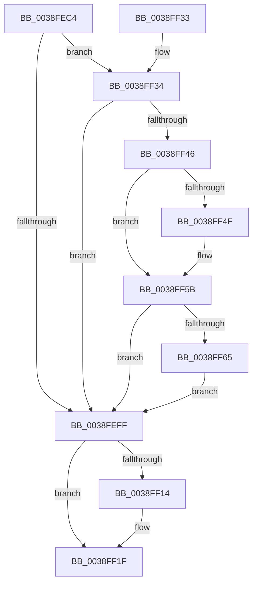

# PopDeepSleepSetDisengageReason

- RVA: `0x0038FEC4`–`0x0038FF7F` (길이 `187` bytes)
- VA: `0x000000014038FEC4`
- 실행 섹션: `.text`
- PDB 이름 있음: `예`; PDB Function 태그: `아니요`
- unwind 정보 RVA: `0x0006D4EC`
- 디코드: `48`개 명령, `187/187` bytes 표시
- 미해석 바이트: `0` (있으면 어셈블리에 `.byte`로 보존)

> 이 문서는 커널 이미지의 기계어와 PDB 기호를 분석해 생성했습니다. 4번과 5번은 함수 원형과 자료형을 바이너리 사용 방식에서 추정한 C 해석이며 원본 소스 복구 결과는 아닙니다.

## 1. Dependencies

- 직접 호출 지점: **7**; 고유 호출 대상: **7**
- 직접 호출자로 확인된 함수: **11**
- RIP 상대 이미지 참조: **9**

### Outgoing calls
- `0x0038FEDC` → [KeAcquireSpinLockRaiseToDpc](../20/KeAcquireSpinLockRaiseToDpc_function_00208470.md) (function, `0x00208470`)
- `0x0038FF06` → [KxReleaseSpinLock](../20/KxReleaseSpinLock_function_00206670.md) (function, `0x00206670`)
- `0x0038FF1A` → [KiLowerIrqlProcessIrqlFlags](../4F/KiLowerIrqlProcessIrqlFlags_function_004F5698.md) (function, `0x004F5698`)
- `0x0038FF34` → [PopDiagTraceSetDeepSleepConstraint](../39/PopDiagTraceSetDeepSleepConstraint_function_003909A4.md) (function, `0x003909A4`)
- `0x0038FF3D` → [PopDeepSleepResiliencyPhaseAccountingUpdate](../39/PopDeepSleepResiliencyPhaseAccountingUpdate_function_003901D0.md) (function, `0x003901D0`)
- `0x0038FF4F` → [KeClearForceIdle](../48/KeClearForceIdle_function_0048D69C.md) (function, `0x0048D69C`)
- `0x0038FF78` → [ExQueueWorkItem](../2F/ExQueueWorkItem_function_002F9520.md) (function, `0x002F9520`)

### Direct callers
- [PopQueueQuerySetIrp](../2B/PopQueueQuerySetIrp_function_002BEF18.md) at `0x002BEFB7`
- [PopFxPlatformStateAvailable](../30/PopFxPlatformStateAvailable_function_00303F6C.md) at `0x00303FFA`
- [PpmUpdatePlatformIdleVeto](../30/PpmUpdatePlatformIdleVeto_function_003047E0.md) at `0x00304910`
- [PopIncrementPowerSettingPendingUpdates](PopIncrementPowerSettingPendingUpdates_function_0038FE38.md) at `0x0038FE86`
- [PopSetPowerActionState](../4B/PopSetPowerActionState_function_004BC8A8.md) at `0x004BC8C3`
- [PopThermalEventTransitionDisableDeepSleep](../4E/PopThermalEventTransitionDisableDeepSleep_function_004E1284.md) at `0x004E12BE`
- [PopIdleAoAcDozeS4TimerCallback](../5D/PopIdleAoAcDozeS4TimerCallback_function_005D9840.md) at `0x005D9888`
- [PopCheckResiliencyScenarios](../../page/A3/PopCheckResiliencyScenarios_function_00A31718.md) at `0x00A317A5`
- [PopDirectedDripsIdleResiliencyCallback](../../page/A3/PopDirectedDripsIdleResiliencyCallback_function_00A31884.md) at `0x00A318C5`
- [PopPowerInformationInternal](../../page/A8/PopPowerInformationInternal_function_00A8B7C0.md) at `0x00A8C3C5`
- [PopEnforceDeepSleep](../../page/AC/PopEnforceDeepSleep_function_00AC3E1C.md) at `0x00AC3EAE`
- [PopEnforceDeepSleep](../../page/AC/PopEnforceDeepSleep_function_00AC3E1C.md) at `0x00AC3EBE`

### Static image references
- `0x0038FED5` → RVA `0x00F09328` (`.data`; read)
- `0x0038FEE1` → RVA `0x00F09330` (`.data`; read)
- `0x0038FEF5` → RVA `0x00F09330` (`.data`; write)
- `0x0038FF0B` → RVA `0x00FC6D20` (`ALMOSTRO`; read)
- `0x0038FF46` → RVA `0x00F0C9C8` (`.data`; read)
- `0x0038FF54` → RVA `0x00F0C9C8` (`.data`; write)
- `0x0038FF5B` → RVA `0x00F09320` (`.data`; read)
- `0x0038FF6A` → RVA `0x00F09320` (`.data`; write)
- `0x0038FF71` → RVA `0x00F09300` (`.data`; read)

## 2. Other-region calls and transfers

- 다른 실행 섹션으로 향하는 call: **0**
- 별도 외부 분기/꼬리 이동을 확인하지 못했습니다.

## 3. Assembly (complete function range)

```asm
0038FEC4  48 89 5C 24 08                  mov qword ptr [rsp + 8], rbx
0038FEC9  48 89 74 24 10                  mov qword ptr [rsp + 0x10], rsi
0038FECE  57                              push rdi
0038FECF  48 83 EC 20                     sub rsp, 0x20
0038FED3  8B F9                           mov edi, ecx
0038FED5  48 8D 0D 4C 94 B7 00            lea rcx, [rip + 0xb7944c]
0038FEDC  E8 8F 85 E7 FF                  call 0x140208470
0038FEE1  8B 35 49 94 B7 00               mov esi, dword ptr [rip + 0xb79449]
0038FEE7  8B CF                           mov ecx, edi
0038FEE9  BA 01 00 00 00                  mov edx, 1
0038FEEE  0F B6 D8                        movzx ebx, al
0038FEF1  D3 E2                           shl edx, cl
0038FEF3  0B D6                           or edx, esi
0038FEF5  89 15 35 94 B7 00               mov dword ptr [rip + 0xb79435], edx
0038FEFB  3B F2                           cmp esi, edx
0038FEFD  75 35                           jne 0x14038ff34
0038FEFF  48 8D 0D 22 94 B7 00            lea rcx, [rip + 0xb79422]
0038FF06  E8 65 67 E7 FF                  call 0x140206670
0038FF0B  83 3D 0E 6E C3 00 00            cmp dword ptr [rip + 0xc36e0e], 0
0038FF12  74 0B                           je 0x14038ff1f
0038FF14  44 0F 20 C1                     mov rcx, cr8
0038FF18  8A D3                           mov dl, bl
0038FF1A  E8 79 57 16 00                  call 0x1404f5698
0038FF1F  44 0F 22 C3                     mov cr8, rbx
0038FF23  48 8B 5C 24 30                  mov rbx, qword ptr [rsp + 0x30]
0038FF28  48 8B 74 24 38                  mov rsi, qword ptr [rsp + 0x38]
0038FF2D  48 83 C4 20                     add rsp, 0x20
0038FF31  5F                              pop rdi
0038FF32  C3                              ret
0038FF33  CC                              int3
0038FF34  E8 6B 0A 00 00                  call 0x1403909a4
0038FF39  B2 01                           mov dl, 1
0038FF3B  8B CF                           mov ecx, edi
0038FF3D  E8 8E 02 00 00                  call 0x1403901d0
0038FF42  85 F6                           test esi, esi
0038FF44  75 B9                           jne 0x14038feff
0038FF46  40 38 35 7B CA B7 00            cmp byte ptr [rip + 0xb7ca7b], sil
0038FF4D  74 0C                           je 0x14038ff5b
0038FF4F  E8 48 D7 0F 00                  call 0x14048d69c
0038FF54  40 88 35 6D CA B7 00            mov byte ptr [rip + 0xb7ca6d], sil
0038FF5B  8A 05 BF 93 B7 00               mov al, byte ptr [rip + 0xb793bf]
0038FF61  84 C0                           test al, al
0038FF63  75 9A                           jne 0x14038feff
0038FF65  BA 01 00 00 00                  mov edx, 1
0038FF6A  C6 05 AF 93 B7 00 01            mov byte ptr [rip + 0xb793af], 1
0038FF71  48 8D 0D 88 93 B7 00            lea rcx, [rip + 0xb79388]
0038FF78  E8 A3 95 F6 FF                  call 0x1402f9520
0038FF7D  EB 80                           jmp 0x14038feff
```

## 4. C-style interpretation (structured pseudocode)

```c
__int64 __fastcall PopDeepSleepSetDisengageReason(int a1)
{
    __int64 result;
    __int64 v_rsp;
    unsigned __int64 v_stack_p10;
    unsigned __int64 v_stack_p8;

    v_stack_p8 = v_rbx;
    v_stack_p10 = v_rsi;
    v_rsp = (v_rsp) - (32);
    result = KeAcquireSpinLockRaiseToDpc(v_rip + 12031052, a2, a3, a4);
    a2 = (unsigned int)((1) << ((unsigned __int8)((unsigned int)((unsigned int)((unsigned int)(a1))))));
    a2 = (unsigned int)((a2) | ((unsigned int)((unsigned int)(*(unsigned int *)(v_rip + 12031049)))));
    *(unsigned int *)(v_rip + 12031029) = (unsigned int)(a2);
    if (((unsigned int)((unsigned int)(*(unsigned int *)(v_rip + 12031049)))) != ((unsigned int)(a2))) goto loc_0038FF34;
loc_0038FEFF:
    result = KxReleaseSpinLock(v_rip + 12031010, a2, a3, a4);
    if ((*(unsigned int *)(v_rip + 12807694)) != 0) {
        a1 = v_cr8;
        a2 = (unsigned __int8)((unsigned __int8)(result));
        result = KiLowerIrqlProcessIrqlFlags(a1, a2, a3, a4);
    }
    v_rsp = (v_rsp) + (32);
    return result;
loc_0038FF34:
    result = PopDiagTraceSetDeepSleepConstraint(a1, a2, a3, a4);
    result = PopDeepSleepResiliencyPhaseAccountingUpdate((unsigned int)((unsigned int)((unsigned int)(a1))), 1, a3, a4);
    if ((unsigned int)(v_stack_p10) != 0) goto loc_0038FEFF;
    if ((*(unsigned __int8 *)(v_rip + 12044923)) != ((unsigned __int8)(v_stack_p10))) {
        result = KeClearForceIdle((unsigned int)((unsigned int)((unsigned int)(a1))), 1, a3, a4);
        *(unsigned __int8 *)(v_rip + 12044909) = (unsigned __int8)(v_stack_p10);
    }
    if ((unsigned __int8)(*(unsigned __int8 *)(v_rip + 12030911)) != 0) goto loc_0038FEFF;
    *(unsigned __int8 *)(v_rip + 12030895) = 1;
    result = ExQueueWorkItem(v_rip + 12030856, 1, a3, a4);
    goto loc_0038FEFF;
}
```

## 5. (Beta) C Style

```c
int64_t PopDeepSleepSetDisengageReason(int32_t Arg1)
{
    int64_t result;
    int64_t local_rsp;
    uint64_t v_stack_p10;
    uint64_t v_stack_p8;

    v_stack_p8 = local_rbx;
    v_stack_p10 = local_rsi;
    local_rsp = (local_rsp) - (32);
    result = KeAcquireSpinLockRaiseToDpc(v_rip + 12031052, a2, a3, a4);
    a2 = (uint32_t)((1) << ((uint8_t)((uint32_t)((uint32_t)((uint32_t)(Arg1))))));
    a2 = (uint32_t)((a2) | ((uint32_t)((uint32_t)(*(uint32_t *)(v_rip + 0xB79449)))));
    *(uint32_t *)(v_rip + 0xB79435) = (uint32_t)(a2);
    if (((uint32_t)((uint32_t)(*(uint32_t *)(v_rip + 0xB79449)))) != ((uint32_t)(a2))) goto loc_0038FF34;
loc_0038FEFF:
    result = KxReleaseSpinLock(v_rip + 12031010, a2, a3, a4);
    if ((*(uint32_t *)(v_rip + 0xC36E0E)) != 0) {
        Arg1 = v_cr8;
        a2 = (uint8_t)((uint8_t)(result));
        result = KiLowerIrqlProcessIrqlFlags(Arg1, a2, a3, a4);
    }
    local_rsp = (local_rsp) + (32);
    return result;
loc_0038FF34:
    result = PopDiagTraceSetDeepSleepConstraint(Arg1, a2, a3, a4);
    result = PopDeepSleepResiliencyPhaseAccountingUpdate((uint32_t)((uint32_t)((uint32_t)(Arg1))), 1, a3, a4);
    if ((uint32_t)(v_stack_p10) != 0) goto loc_0038FEFF;
    if ((*(uint8_t *)(v_rip + 0xB7CA7B)) != ((uint8_t)(v_stack_p10))) {
        result = KeClearForceIdle((uint32_t)((uint32_t)((uint32_t)(Arg1))), 1, a3, a4);
        *(uint8_t *)(v_rip + 0xB7CA6D) = (uint8_t)(v_stack_p10);
    }
    if ((uint8_t)(*(uint8_t *)(v_rip + 0xB793BF)) != 0) goto loc_0038FEFF;
    *(uint8_t *)(v_rip + 0xB793AF) = 1;
    result = ExQueueWorkItem(v_rip + 12030856, 1, a3, a4);
    goto loc_0038FEFF;
}
```

## 6. Execution-region graph

[열기: 2D/3D 그래프와 함수 탐색 컨트롤 패널](../../../control-panel.html?section=text&rva=0x0038FEC4&view=graph)

- 2D 그래프는 위에서 아래로 흐르고, 3D 그래프는 빈 공간을 드래그해 회전합니다. Shift+드래그는 이동, 휠은 확대·축소, 함수 노드 선택은 대상 보고서 이동입니다.

### Static fallback


