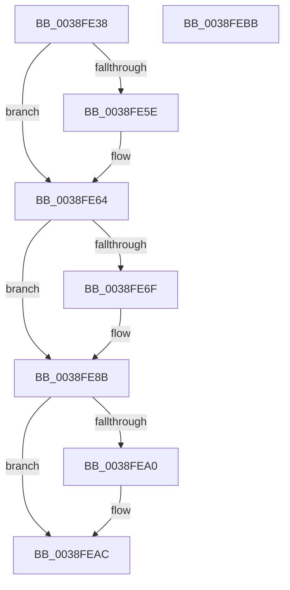

# PopIncrementPowerSettingPendingUpdates

- RVA: `0x0038FE38`–`0x0038FEBC` (길이 `132` bytes)
- VA: `0x000000014038FE38`
- 실행 섹션: `.text`
- PDB 이름 있음: `예`; PDB Function 태그: `아니요`
- unwind 정보 RVA: `0x0005CAAC`
- 디코드: `32`개 명령, `132/132` bytes 표시
- 미해석 바이트: `0` (있으면 어셈블리에 `.byte`로 보존)

> 이 문서는 커널 이미지의 기계어와 PDB 기호를 분석해 생성했습니다. 4번과 5번은 함수 원형과 자료형을 바이너리 사용 방식에서 추정한 C 해석이며 원본 소스 복구 결과는 아닙니다.

## 1. Dependencies

- 직접 호출 지점: **4**; 고유 호출 대상: **4**
- 직접 호출자로 확인된 함수: **2**
- RIP 상대 이미지 참조: **6**

### Outgoing calls
- `0x0038FE4B` → [KeAcquireSpinLockRaiseToDpc](../20/KeAcquireSpinLockRaiseToDpc_function_00208470.md) (function, `0x00208470`)
- `0x0038FE86` → [PopDeepSleepSetDisengageReason](PopDeepSleepSetDisengageReason_function_0038FEC4.md) (function, `0x0038FEC4`)
- `0x0038FE92` → [KxReleaseSpinLock](../20/KxReleaseSpinLock_function_00206670.md) (function, `0x00206670`)
- `0x0038FEA7` → [KiLowerIrqlProcessIrqlFlags](../4F/KiLowerIrqlProcessIrqlFlags_function_004F5698.md) (function, `0x004F5698`)

### Direct callers
- [PopSetPowerSettingValue](../../page/91/PopSetPowerSettingValue_function_00914E54.md) at `0x00914EB4`
- [PopSetPowerSettingValue](../../page/91/PopSetPowerSettingValue_function_00914E54.md) at `0x00914F9D`
- [PopDispatchPowerSettingCallbacks](../../page/91/PopDispatchPowerSettingCallbacks_function_00916190.md) at `0x009161AA`

### Static image references
- `0x0038FE44` → RVA `0x00F0C6B0` (`.data`; read)
- `0x0038FE53` → RVA `0x00F0C694` (`.data`; read/write)
- `0x0038FE5E` → RVA `0x00F0C690` (`.data`; read/write)
- `0x0038FE64` → RVA `0x00F0C694` (`.data`; read)
- `0x0038FE7F` → RVA `0x00F0C698` (`.data`; write)
- `0x0038FE97` → RVA `0x00FC6D20` (`ALMOSTRO`; read)

## 2. Other-region calls and transfers

- 다른 실행 섹션으로 향하는 call: **0**
- 별도 외부 분기/꼬리 이동을 확인하지 못했습니다.

## 3. Assembly (complete function range)

```asm
0038FE38  48 89 5C 24 08                  mov qword ptr [rsp + 8], rbx
0038FE3D  57                              push rdi
0038FE3E  48 83 EC 20                     sub rsp, 0x20
0038FE42  8A D9                           mov bl, cl
0038FE44  48 8D 0D 65 C8 B7 00            lea rcx, [rip + 0xb7c865]
0038FE4B  E8 20 86 E7 FF                  call 0x140208470
0038FE50  0F B6 F8                        movzx edi, al
0038FE53  F0 FF 05 3A C8 B7 00            lock inc dword ptr [rip + 0xb7c83a]
0038FE5A  84 DB                           test bl, bl
0038FE5C  74 06                           je 0x14038fe64
0038FE5E  FF 05 2C C8 B7 00               inc dword ptr [rip + 0xb7c82c]
0038FE64  8B 15 2A C8 B7 00               mov edx, dword ptr [rip + 0xb7c82a]
0038FE6A  83 FA 01                        cmp edx, 1
0038FE6D  75 1C                           jne 0x14038fe8b
0038FE6F  48 B8 08 00 00 00 80 F7 FF FF   movabs rax, 0xfffff78000000008
0038FE79  8D 4A 02                        lea ecx, [rdx + 2]
0038FE7C  48 8B 00                        mov rax, qword ptr [rax]
0038FE7F  48 89 05 12 C8 B7 00            mov qword ptr [rip + 0xb7c812], rax
0038FE86  E8 39 00 00 00                  call 0x14038fec4
0038FE8B  48 8D 0D 1E C8 B7 00            lea rcx, [rip + 0xb7c81e]
0038FE92  E8 D9 67 E7 FF                  call 0x140206670
0038FE97  83 3D 82 6E C3 00 00            cmp dword ptr [rip + 0xc36e82], 0
0038FE9E  74 0C                           je 0x14038feac
0038FEA0  44 0F 20 C1                     mov rcx, cr8
0038FEA4  40 8A D7                        mov dl, dil
0038FEA7  E8 EC 57 16 00                  call 0x1404f5698
0038FEAC  44 0F 22 C7                     mov cr8, rdi
0038FEB0  48 8B 5C 24 30                  mov rbx, qword ptr [rsp + 0x30]
0038FEB5  48 83 C4 20                     add rsp, 0x20
0038FEB9  5F                              pop rdi
0038FEBA  C3                              ret
0038FEBB  CC                              int3
```

## 4. C-style interpretation (structured pseudocode)

```c
__int64 __fastcall PopIncrementPowerSettingPendingUpdates(unsigned __int8 a1)
{
    __int64 result;
    __int64 v_rsp;
    unsigned __int64 v_stack_p8;

    v_stack_p8 = v_rbx;
    v_rsp = (v_rsp) - (32);
    result = KeAcquireSpinLockRaiseToDpc(v_rip + 12044389, a2, a3, a4);
    if (a1 != 0) {
    }
    if (((unsigned int)((unsigned int)(*(unsigned int *)(v_rip + 12044330)))) == 1) {
        a1 = (unsigned int)(*(unsigned int *)(v_rip + 12044330)) + 2;
        result = *(unsigned __int64 *)(result);
        *(unsigned __int64 *)(v_rip + 12044306) = result;
        result = PopDeepSleepSetDisengageReason(a1, (unsigned int)(*(unsigned int *)(v_rip + 12044330)), a3, a4);
    }
    result = KxReleaseSpinLock(v_rip + 12044318, (unsigned int)(*(unsigned int *)(v_rip + 12044330)), a3, a4);
    if ((*(unsigned int *)(v_rip + 12807810)) != 0) {
        a1 = v_cr8;
        a2 = (unsigned __int8)((unsigned __int8)(result));
        result = KiLowerIrqlProcessIrqlFlags(a1, a2, a3, a4);
    }
    v_rsp = (v_rsp) + (32);
    return result;
}
```

## 5. (Beta) C Style

```c
int64_t PopIncrementPowerSettingPendingUpdates(uint8_t Arg1)
{
    int64_t result;
    int64_t local_rsp;
    uint64_t v_stack_p8;

    v_stack_p8 = local_rbx;
    local_rsp = (local_rsp) - (32);
    result = KeAcquireSpinLockRaiseToDpc(v_rip + 12044389, a2, a3, a4);
    if (Arg1 != 0) {
    }
    if (((uint32_t)((uint32_t)(*(uint32_t *)(v_rip + 0xB7C82A)))) == 1) {
        Arg1 = (uint32_t)(*(uint32_t *)(v_rip + 0xB7C82A)) + 2;
        result = *(uint64_t *)(result);
        *(uint64_t *)(v_rip + 0xB7C812) = result;
        result = PopDeepSleepSetDisengageReason(Arg1, (uint32_t)(*(uint32_t *)(v_rip + 0xB7C82A)), a3, a4);
    }
    result = KxReleaseSpinLock(v_rip + 12044318, (uint32_t)(*(uint32_t *)(v_rip + 0xB7C82A)), a3, a4);
    if ((*(uint32_t *)(v_rip + 0xC36E82)) != 0) {
        Arg1 = v_cr8;
        a2 = (uint8_t)((uint8_t)(result));
        result = KiLowerIrqlProcessIrqlFlags(Arg1, a2, a3, a4);
    }
    local_rsp = (local_rsp) + (32);
    return result;
}
```

## 6. Execution-region graph

[열기: 2D/3D 그래프와 함수 탐색 컨트롤 패널](../../../control-panel.html?section=text&rva=0x0038FE38&view=graph)

- 2D 그래프는 위에서 아래로 흐르고, 3D 그래프는 빈 공간을 드래그해 회전합니다. Shift+드래그는 이동, 휠은 확대·축소, 함수 노드 선택은 대상 보고서 이동입니다.

### Static fallback


