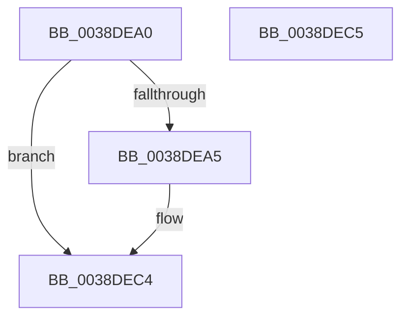

# PsReleaseSiloHardReference

- RVA: `0x0038DEA0`–`0x0038DEC6` (길이 `38` bytes)
- VA: `0x000000014038DEA0`
- 실행 섹션: `.text`
- PDB 이름 있음: `예`; PDB Function 태그: `아니요`
- unwind 정보 RVA: `0x000805BC`
- 디코드: `13`개 명령, `38/38` bytes 표시
- 미해석 바이트: `0` (있으면 어셈블리에 `.byte`로 보존)

> 이 문서는 커널 이미지의 기계어와 PDB 기호를 분석해 생성했습니다. 4번과 5번은 함수 원형과 자료형을 바이너리 사용 방식에서 추정한 C 해석이며 원본 소스 복구 결과는 아닙니다.

## 1. Dependencies

- 직접 호출 지점: **2**; 고유 호출 대상: **2**
- 직접 호출자로 확인된 함수: **3**
- RIP 상대 이미지 참조: **0**

### Outgoing calls
- `0x0038DEAD` → [PspHardDereferenceSiloWorker](PspHardDereferenceSiloWorker_function_0038F740.md) (function, `0x0038F740`)
- `0x0038DEBA` → [ObfDereferenceObjectWithTag](../2F/ObfDereferenceObjectWithTag_function_002F78E0.md) (function, `0x002F78E0`)

### Direct callers
- [sub_0038C58B](Unknown_function_0038C58B.md) at `0x0038C686`
- [IopAllocRealFileObject](../../page/89/IopAllocRealFileObject_function_00899720.md) at `0x00899ECA`
- [IopParseDevice](../../page/89/IopParseDevice_function_0089E510.md) at `0x0089FACB`

### Static image references
- 디코드된 RIP-relative 메모리 참조가 없습니다.

## 2. Other-region calls and transfers

- 다른 실행 섹션으로 향하는 call: **0**
- 별도 외부 분기/꼬리 이동을 확인하지 못했습니다.

## 3. Assembly (complete function range)

```asm
0038DEA0  48 85 C9                        test rcx, rcx
0038DEA3  74 1F                           je 0x14038dec4
0038DEA5  53                              push rbx
0038DEA6  48 83 EC 20                     sub rsp, 0x20
0038DEAA  48 8B D9                        mov rbx, rcx
0038DEAD  E8 8E 18 00 00                  call 0x14038f740
0038DEB2  BA 53 69 6C 48                  mov edx, 0x486c6953
0038DEB7  48 8B CB                        mov rcx, rbx
0038DEBA  E8 21 9A F6 FF                  call 0x1402f78e0
0038DEBF  48 83 C4 20                     add rsp, 0x20
0038DEC3  5B                              pop rbx
0038DEC4  C3                              ret
0038DEC5  CC                              int3
```

## 4. C-style interpretation (structured pseudocode)

```c
__int64 __fastcall PsReleaseSiloHardReference(__int64 a1)
{
    __int64 result;
    __int64 v_rbx;
    __int64 v_rsp;

    if (a1 != 0) {
        v_rsp = (v_rsp) - (32);
        v_rbx = a1;
        result = PspHardDereferenceSiloWorker(a1, a2, a3, a4);
        a2 = 0x486C6953ULL;
        a1 = v_rbx;
        result = ObfDereferenceObjectWithTag(a1, a2, a3, a4);
        v_rsp = (v_rsp) + (32);
    }
    return result;
}
```

## 5. (Beta) C Style

```c
int64_t PsReleaseSiloHardReference(int64_t Arg1)
{
    int64_t result;
    int64_t local_rbx;
    int64_t local_rsp;

    if (Arg1 != 0) {
        local_rsp = (local_rsp) - (32);
        local_rbx = Arg1;
        result = PspHardDereferenceSiloWorker(Arg1, a2, a3, a4);
        a2 = 0x486C6953ULL;
        Arg1 = local_rbx;
        result = ObfDereferenceObjectWithTag(Arg1, a2, a3, a4);
        local_rsp = (local_rsp) + (32);
    }
    return result;
}
```

## 6. Execution-region graph

[열기: 2D/3D 그래프와 함수 탐색 컨트롤 패널](../../../control-panel.html?section=text&rva=0x0038DEA0&view=graph)

- 2D 그래프는 위에서 아래로 흐르고, 3D 그래프는 빈 공간을 드래그해 회전합니다. Shift+드래그는 이동, 휠은 확대·축소, 함수 노드 선택은 대상 보고서 이동입니다.

### Static fallback


