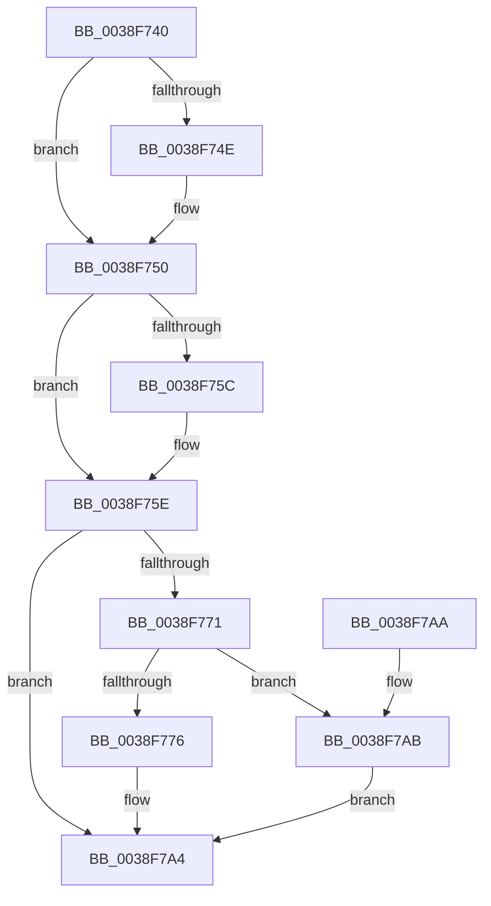

# PspHardDereferenceSiloWorker

- RVA: `0x0038F740`–`0x0038F7B4` (길이 `116` bytes)
- VA: `0x000000014038F740`
- 실행 섹션: `.text`
- PDB 이름 있음: `예`; PDB Function 태그: `아니요`
- unwind 정보 RVA: `0x00060BD8`
- 디코드: `31`개 명령, `116/116` bytes 표시
- 미해석 바이트: `0` (있으면 어셈블리에 `.byte`로 보존)

> 이 문서는 커널 이미지의 기계어와 PDB 기호를 분석해 생성했습니다. 4번과 5번은 함수 원형과 자료형을 바이너리 사용 방식에서 추정한 C 해석이며 원본 소스 복구 결과는 아닙니다.

## 1. Dependencies

- 직접 호출 지점: **2**; 고유 호출 대상: **2**
- 직접 호출자로 확인된 함수: **5**
- RIP 상대 이미지 참조: **1**

### Outgoing calls
- `0x0038F77B` → [ObfReferenceObjectWithTag](../21/ObfReferenceObjectWithTag_function_00210710.md) (function, `0x00210710`)
- `0x0038F79F` → [ExQueueWorkItem](../2F/ExQueueWorkItem_function_002F9520.md) (function, `0x002F9520`)

### Direct callers
- [PsReleaseSiloHardReference](PsReleaseSiloHardReference_function_0038DEA0.md) at `0x0038DEAD`
- [IopCloseFileObjectExtension](IopCloseFileObjectExtension_function_0038F6E0.md) at `0x0038F720`
- [PspJobClose](../../page/91/PspJobClose_function_00916FE0.md) at `0x0091712B`
- [PspEvaluateAndNotifyEmptyJob](../../page/91/PspEvaluateAndNotifyEmptyJob_function_00917D88.md) at `0x00917E5F`
- [NtSetInformationJobObject](../../page/9F/NtSetInformationJobObject_function_009F84C0.md) at `0x009FA21E`

### Static image references
- `0x0038F790` → RVA `0x00ABDB10` (`PspCompleteHardDereferenceSiloDeferred`; read)

## 2. Other-region calls and transfers

- 다른 실행 섹션으로 향하는 call: **0**
- 별도 외부 분기/꼬리 이동을 확인하지 못했습니다.

## 3. Assembly (complete function range)

```asm
0038F740  40 53                           push rbx
0038F742  48 83 EC 20                     sub rsp, 0x20
0038F746  48 8B D9                        mov rbx, rcx
0038F749  48 85 C9                        test rcx, rcx
0038F74C  75 02                           jne 0x14038f750
0038F74E  CD 2C                           int 0x2c
0038F750  F7 81 10 06 00 00 00 00 00 40   test dword ptr [rcx + 0x610], 0x40000000
0038F75A  75 02                           jne 0x14038f75e
0038F75C  CD 2C                           int 0x2c
0038F75E  48 83 C8 FF                     or rax, 0xffffffffffffffff
0038F762  F0 48 0F C1 81 D8 06 00 00      lock xadd qword ptr [rcx + 0x6d8], rax
0038F76B  48 83 E8 01                     sub rax, 1
0038F76F  7F 33                           jg 0x14038f7a4
0038F771  48 85 C0                        test rax, rax
0038F774  75 35                           jne 0x14038f7ab
0038F776  BA 44 66 6C 74                  mov edx, 0x746c6644
0038F77B  E8 90 0F E8 FF                  call 0x140210710
0038F780  48 8D 8B E0 06 00 00            lea rcx, [rbx + 0x6e0]
0038F787  BA 01 00 00 00                  mov edx, 1
0038F78C  48 83 21 00                     and qword ptr [rcx], 0
0038F790  48 8D 05 79 E3 72 00            lea rax, [rip + 0x72e379]
0038F797  48 89 41 10                     mov qword ptr [rcx + 0x10], rax
0038F79B  48 89 59 18                     mov qword ptr [rcx + 0x18], rbx
0038F79F  E8 7C 9D F6 FF                  call 0x1402f9520
0038F7A4  48 83 C4 20                     add rsp, 0x20
0038F7A8  5B                              pop rbx
0038F7A9  C3                              ret
0038F7AA  CC                              int3
0038F7AB  B9 0E 00 00 00                  mov ecx, 0xe
0038F7B0  CD 29                           int 0x29
0038F7B2  EB F0                           jmp 0x14038f7a4
```

## 4. C-style interpretation (structured pseudocode)

```c
__int64 __fastcall PspHardDereferenceSiloWorker(__int64 a1)
{
    __int64 result;
    __int64 v_rsp;

    v_rsp = (v_rsp) - (32);
    if (a1 == 0) {
    }
    if (((*(unsigned int *)(a1 + 1552)) & (0x40000000ULL)) == 0) {
    }
    result = (result) | (-1);
    result = (result) - (1);
    if (condition_is_greater) goto loc_0038F7A4;
    if (result != 0) goto loc_0038F7AB;
    result = ObfReferenceObjectWithTag(a1, (unsigned int)(0x746C6644ULL), a3, a4);
    *(unsigned __int64 *)(a1 + 1760 + 16) = v_rip + 7529337;
    *(unsigned __int64 *)(a1 + 1760 + 24) = a1;
    result = ExQueueWorkItem(a1 + 1760, 1, a3, a4);
loc_0038F7A4:
    v_rsp = (v_rsp) + (32);
    return result;
loc_0038F7AB:
    goto loc_0038F7A4;
}
```

## 5. (Beta) C Style

```c
int64_t PspHardDereferenceSiloWorker(void *Arg1)
{
    uint8_t *arg1 = (uint8_t *)Arg1;

    int64_t result;
    int64_t local_rsp;

    local_rsp = (local_rsp) - (32);
    if (Arg1 == NULL) {
    }
    if (((*(uint32_t *)(arg1 + 0x610)) & (0x40000000ULL)) == 0) {
    }
    result = (result) | (-1);
    result = (result) - (1);
    if (condition_is_greater) goto loc_0038F7A4;
    if (result != 0) goto loc_0038F7AB;
    result = ObfReferenceObjectWithTag(Arg1, (uint32_t)(0x746C6644ULL), a3, a4);
    *(uint64_t *)(arg1 + 0x6E0 + 0x10) = v_rip + 7529337;
    *(void **)(arg1 + 0x6E0 + 0x18) = Arg1;
    result = ExQueueWorkItem(Arg1 + 1760, 1, a3, a4);
loc_0038F7A4:
    local_rsp = (local_rsp) + (32);
    return result;
loc_0038F7AB:
    goto loc_0038F7A4;
}
```

### 관측된 메모리 오프셋

구조체 형식이 확인되지 않은 접근은 인자 기준의 오프셋으로만 기록했습니다.

| 기준 인자 | 오프셋 표현 | 폭 (bit) | 접근 |
|---|---:|---:|---|
| `Arg1` | `+ 0x0` | `64` | `R/W` |
| `Arg1` | `+ 0x10` | `64` | `W` |
| `Arg1` | `+ 0x18` | `64` | `W` |
| `Arg1` | `+ 0x6E0` | `64` | `R` |

## 6. Execution-region graph

[열기: 2D/3D 그래프와 함수 탐색 컨트롤 패널](../../../control-panel.html?section=text&rva=0x0038F740&view=graph)

- 2D 그래프는 위에서 아래로 흐르고, 3D 그래프는 빈 공간을 드래그해 회전합니다. Shift+드래그는 이동, 휠은 확대·축소, 함수 노드 선택은 대상 보고서 이동입니다.

### Static fallback


