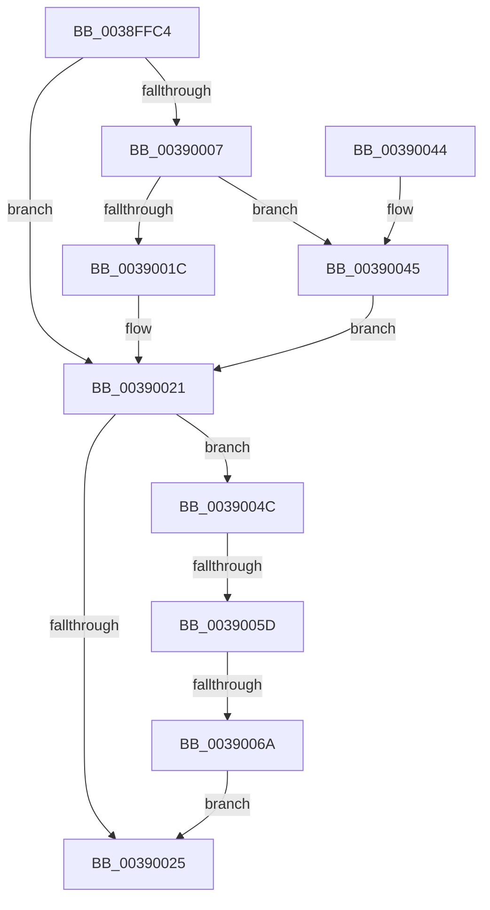

# PspReturnResourceQuota

- RVA: `0x0038FFC4`–`0x00390073` (길이 `175` bytes)
- VA: `0x000000014038FFC4`
- 실행 섹션: `.text`
- PDB 이름 있음: `예`; PDB Function 태그: `예`
- unwind 정보 RVA: `0x000808F0`
- 디코드: `51`개 명령, `175/175` bytes 표시
- 미해석 바이트: `0` (있으면 어셈블리에 `.byte`로 보존)

> 이 문서는 커널 이미지의 기계어와 PDB 기호를 분석해 생성했습니다. 4번과 5번은 함수 원형과 자료형을 바이너리 사용 방식에서 추정한 C 해석이며 원본 소스 복구 결과는 아닙니다.

## 1. Dependencies

- 직접 호출 지점: **4**; 고유 호출 대상: **4**
- 직접 호출자로 확인된 함수: **12**
- RIP 상대 이미지 참조: **2**

### Outgoing calls
- `0x0038FFFD` → [PspLockQuotaExpansion](../39/PspLockQuotaExpansion_function_00390774.md) (function, `0x00390774`)
- `0x0039001C` → [MmReturnPoolQuota](../39/MmReturnPoolQuota_function_00390EE0.md) (function, `0x00390EE0`)
- `0x0039002C` → [PspUnlockQuotaExpansion](../39/PspUnlockQuotaExpansion_function_00390E68.md) (function, `0x00390E68`)
- `0x00390045` → [guard_dispatch_icall](../6B/guard_dispatch_icall_function_006BAAD0.md) (function, `0x006BAAD0`)

### Direct callers
- [sub_0024E38F](../24/Unknown_function_0024E38F.md) at `0x0024E3D9`
- [sub_0024EAB1](../24/Unknown_function_0024EAB1.md) at `0x0024EAFB`
- [sub_002A6937](../2A/Unknown_function_002A6937.md) at `0x002A6986`
- [sub_002F0454](../2F/Unknown_function_002F0454.md) at `0x002F049B`
- [ExAllocateHeapPool](../35/ExAllocateHeapPool_function_0035BA30.md) at `0x0035D629`
- [ExAllocateHeapPool](../35/ExAllocateHeapPool_function_0035BA30.md) at `0x0035DA99`
- [sub_00360968](../36/Unknown_function_00360968.md) at `0x003609B2`
- [sub_00360968](../36/Unknown_function_00360968.md) at `0x00360C11`
- [sub_0038FDAD](Unknown_function_0038FDAD.md) at `0x0038FDF6`
- [sub_0041C2D3](../41/Unknown_function_0041C2D3.md) at `0x0041C320`
- [sub_00864EE6](../../page/86/Unknown_function_00864EE6.md) at `0x0086515B`
- [sub_00864EE6](../../page/86/Unknown_function_00864EE6.md) at `0x0086518C`
- [sub_00864EE6](../../page/86/Unknown_function_00864EE6.md) at `0x008651BD`
- [sub_00864EE6](../../page/86/Unknown_function_00864EE6.md) at `0x008651EE`
- [sub_00864EE6](../../page/86/Unknown_function_00864EE6.md) at `0x0086532E`
- [sub_00864EE6](../../page/86/Unknown_function_00864EE6.md) at `0x00865362`
- [sub_00864EE6](../../page/86/Unknown_function_00864EE6.md) at `0x00865393`
- [sub_00864EE6](../../page/86/Unknown_function_00864EE6.md) at `0x008653C7`
- [PsReturnSharedPoolQuota](../../page/8B/PsReturnSharedPoolQuota_function_008BCC30.md) at `0x008BCDBE`
- [PsReturnSharedPoolQuota](../../page/8B/PsReturnSharedPoolQuota_function_008BCC30.md) at `0x008BCDEF`
- [PsReturnSharedPoolQuota](../../page/8B/PsReturnSharedPoolQuota_function_008BCC30.md) at `0x008BCE20`
- [PsReturnSharedPoolQuota](../../page/8B/PsReturnSharedPoolQuota_function_008BCC30.md) at `0x008BCE4E`
- [sub_009DA93A](../../page/9D/Unknown_function_009DA93A.md) at `0x009DA95E`
- [sub_009DA93A](../../page/9D/Unknown_function_009DA93A.md) at `0x009DA98F`
- [sub_009DA93A](../../page/9D/Unknown_function_009DA93A.md) at `0x009DA9C0`
- [sub_009DA93A](../../page/9D/Unknown_function_009DA93A.md) at `0x009DA9EE`
- [sub_00B8371E](../../poolcode/B8/Unknown_function_00B8371E.md) at `0x00B83768`
- [sub_00B8371E](../../poolcode/B8/Unknown_function_00B8371E.md) at `0x00B839CC`

### Static image references
- `0x0038FFD9` → RVA `0x00F06640` (`.data`; read)
- `0x0039000B` → RVA `0x00390EE0` (`MmReturnPoolQuota`; read)

## 2. Other-region calls and transfers

- 다른 실행 섹션으로 향하는 call: **0**
- call이 아닌 외부 분기/꼬리 이동: **2**
  - `0x00390057` → [sub_006E5780](../6E/Unknown_function_006E5780.md) (`tail-transfer`)
  - `0x00390064` → [sub_006E5780](../6E/Unknown_function_006E5780.md) (`tail-transfer`)

## 3. Assembly (complete function range)

```asm
0038FFC4  48 89 5C 24 10                  mov qword ptr [rsp + 0x10], rbx
0038FFC9  48 89 6C 24 18                  mov qword ptr [rsp + 0x18], rbp
0038FFCE  56                              push rsi
0038FFCF  57                              push rdi
0038FFD0  41 56                           push r14
0038FFD2  48 83 EC 20                     sub rsp, 0x20
0038FFD6  48 63 F1                        movsxd rsi, ecx
0038FFD9  48 8D 05 60 66 B7 00            lea rax, [rip + 0xb76660]
0038FFE0  4C 8B F2                        mov r14, rdx
0038FFE3  C6 44 24 40 00                  mov byte ptr [rsp + 0x40], 0
0038FFE8  48 6B DE 38                     imul rbx, rsi, 0x38
0038FFEC  48 8D 54 24 40                  lea rdx, [rsp + 0x40]
0038FFF1  41 8B E9                        mov ebp, r9d
0038FFF4  48 03 D8                        add rbx, rax
0038FFF7  49 8B F8                        mov rdi, r8
0038FFFA  48 8B CB                        mov rcx, rbx
0038FFFD  E8 72 07 00 00                  call 0x140390774
00390002  48 85 FF                        test rdi, rdi
00390005  74 1A                           je 0x140390021
00390007  48 8B 43 20                     mov rax, qword ptr [rbx + 0x20]
0039000B  48 8D 0D CE 0E 00 00            lea rcx, [rip + 0xece]
00390012  48 3B C1                        cmp rax, rcx
00390015  48 8B D7                        mov rdx, rdi
00390018  8B CE                           mov ecx, esi
0039001A  75 29                           jne 0x140390045
0039001C  E8 BF 0E 00 00                  call 0x140390ee0
00390021  85 ED                           test ebp, ebp
00390023  75 27                           jne 0x14039004c
00390025  8A 54 24 40                     mov dl, byte ptr [rsp + 0x40]
00390029  48 8B CB                        mov rcx, rbx
0039002C  E8 37 0E 00 00                  call 0x140390e68
00390031  48 8B 5C 24 48                  mov rbx, qword ptr [rsp + 0x48]
00390036  48 8B 6C 24 50                  mov rbp, qword ptr [rsp + 0x50]
0039003B  48 83 C4 20                     add rsp, 0x20
0039003F  41 5E                           pop r14
00390041  5F                              pop rdi
00390042  5E                              pop rsi
00390043  C3                              ret
00390044  CC                              int3
00390045  E8 86 AA 32 00                  call 0x1406baad0
0039004A  EB D5                           jmp 0x140390021
0039004C  49 8D 46 50                     lea rax, [r14 + 0x50]
00390050  48 8B 10                        mov rdx, qword ptr [rax]
00390053  48 39 42 08                     cmp qword ptr [rdx + 8], rax
00390057  0F 85 23 57 35 00               jne 0x1406e5780
0039005D  48 8B 48 08                     mov rcx, qword ptr [rax + 8]
00390061  48 39 01                        cmp qword ptr [rcx], rax
00390064  0F 85 16 57 35 00               jne 0x1406e5780
0039006A  48 89 11                        mov qword ptr [rcx], rdx
0039006D  48 89 4A 08                     mov qword ptr [rdx + 8], rcx
00390071  EB B2                           jmp 0x140390025
```

## 4. C-style interpretation (structured pseudocode)

```c
__int64 __fastcall PspReturnResourceQuota(int a1, __int64 a2, __int64 a3, int a4)
{
    __int64 result;
    __int64 v_rbx;
    __int64 v_rsp;
    unsigned __int64 v_stack_p10;
    unsigned __int64 v_stack_p18;
    unsigned __int8 v_stack_p8;

    v_stack_p10 = v_rbx;
    v_stack_p18 = v_rbp;
    v_rsp = (v_rsp) - (32);
    v_stack_p8 = 0;
    v_rbx = (v_rbx) * ((int)(a1));
    v_rbx = (v_rbx) + (v_rip + 12019296);
    result = PspLockQuotaExpansion(v_rbx, v_stack_p8, a3, a4);
    if (a3 == 0) goto loc_00390021;
    if ((*(unsigned __int64 *)(v_rbx + 32)) != (v_rip + 3790)) goto loc_00390045;
    result = MmReturnPoolQuota((unsigned int)((unsigned int)((int)(a1))), a3, a3, a4);
loc_00390021:
    if ((unsigned int)((unsigned int)(a4)) != 0) goto loc_0039004C;
loc_00390025:
    result = PspUnlockQuotaExpansion(v_rbx, v_stack_p8, a3, a4);
    v_rsp = (v_rsp) + (32);
    return result;
loc_00390045:
    result = guard_dispatch_icall(v_rbx, v_stack_p8, a3, a4);
    goto loc_00390021;
loc_0039004C:
    *(unsigned __int64 *)(*(unsigned __int64 *)(a2 + 80 + 8)) = *(unsigned __int64 *)(a2 + 80);
    *(unsigned __int64 *)(*(unsigned __int64 *)(a2 + 80) + 8) = *(unsigned __int64 *)(a2 + 80 + 8);
    goto loc_00390025;
}
```

## 5. (Beta) C Style

```c
int64_t PspReturnResourceQuota(int32_t Arg1, void *Arg2, int64_t Arg3, int32_t Arg4)
{
    uint8_t *arg2 = (uint8_t *)Arg2;

    int64_t result;
    int64_t local_rbx;
    int64_t local_rsp;
    uint64_t v_stack_p10;
    uint64_t v_stack_p18;
    uint8_t v_stack_p8;

    v_stack_p10 = local_rbx;
    v_stack_p18 = local_rbp;
    local_rsp = (local_rsp) - (32);
    v_stack_p8 = 0;
    local_rbx = (local_rbx) * ((int32_t)(Arg1));
    local_rbx = (local_rbx) + (v_rip + 12019296);
    result = PspLockQuotaExpansion(local_rbx, v_stack_p8, Arg3, Arg4);
    if (Arg3 == 0) goto loc_00390021;
    if ((*(uint64_t *)(local_rbx + 0x20)) != (v_rip + 3790)) goto loc_00390045;
    result = MmReturnPoolQuota((uint32_t)((uint32_t)((int32_t)(Arg1))), Arg3, Arg3, Arg4);
loc_00390021:
    if ((uint32_t)((uint32_t)(Arg4)) != 0) goto loc_0039004C;
loc_00390025:
    result = PspUnlockQuotaExpansion(local_rbx, v_stack_p8, Arg3, Arg4);
    local_rsp = (local_rsp) + (32);
    return result;
loc_00390045:
    result = guard_dispatch_icall(local_rbx, v_stack_p8, Arg3, Arg4);
    goto loc_00390021;
loc_0039004C:
    *(uint64_t *)(*(uint64_t *)(arg2 + 0x50 + 0x8)) = *(uint64_t *)(arg2 + 0x50);
    *(uint64_t *)(*(uint64_t *)(arg2 + 0x50) + 0x8) = *(uint64_t *)(arg2 + 0x50 + 0x8);
    goto loc_00390025;
}
```

### 관측된 메모리 오프셋

구조체 형식이 확인되지 않은 접근은 인자 기준의 오프셋으로만 기록했습니다.

| 기준 인자 | 오프셋 표현 | 폭 (bit) | 접근 |
|---|---:|---:|---|
| `Arg2` | `+ 0x0` | `64` | `R` |
| `Arg2` | `+ 0x8` | `64` | `R` |
| `Arg2` | `+ 0x50` | `64` | `R` |

## 6. Execution-region graph

[열기: 2D/3D 그래프와 함수 탐색 컨트롤 패널](../../../control-panel.html?section=text&rva=0x0038FFC4&view=graph)

- 2D 그래프는 위에서 아래로 흐르고, 3D 그래프는 빈 공간을 드래그해 회전합니다. Shift+드래그는 이동, 휠은 확대·축소, 함수 노드 선택은 대상 보고서 이동입니다.

### Static fallback


