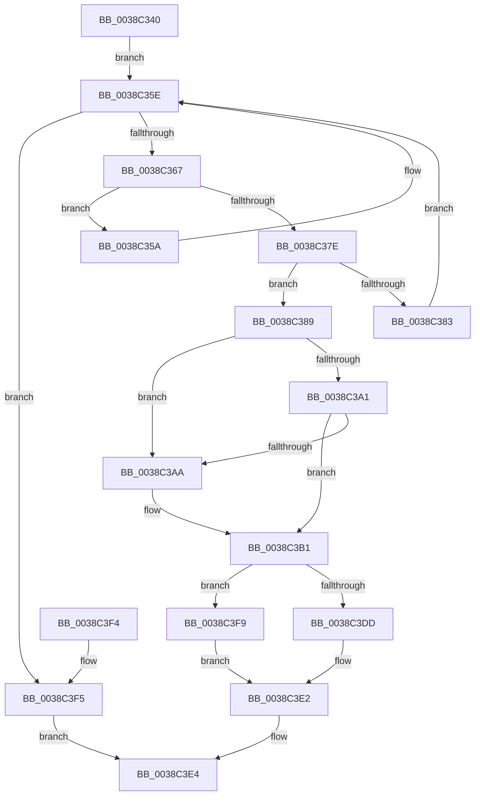

# RtlDeleteElementGenericTable

- RVA: `0x0038C340`–`0x0038C400` (길이 `192` bytes)
- VA: `0x000000014038C340`
- 실행 섹션: `.text`
- PDB 이름 있음: `예`; PDB Function 태그: `아니요`
- unwind 정보 RVA: `0x00070B38`
- 디코드: `58`개 명령, `192/192` bytes 표시
- 미해석 바이트: `0` (있으면 어셈블리에 `.byte`로 보존)

> 이 문서는 커널 이미지의 기계어와 PDB 기호를 분석해 생성했습니다. 4번과 5번은 함수 원형과 자료형을 바이너리 사용 방식에서 추정한 C 해석이며 원본 소스 복구 결과는 아닙니다.

## 1. Dependencies

- 직접 호출 지점: **4**; 고유 호출 대상: **3**
- 직접 호출자로 확인된 함수: **0**
- RIP 상대 이미지 참조: **1**

### Outgoing calls
- `0x0038C375` → [guard_dispatch_icall](../6B/guard_dispatch_icall_function_006BAAD0.md) (function, `0x006BAAD0`)
- `0x0038C38C` → [RtlDelete](RtlDelete_function_0038D8B0.md) (function, `0x0038D8B0`)
- `0x0038C3DD` → [ExFreePoolWithTag](../../poolcode/B8/ExFreePoolWithTag_function_00B82870.md) (function, `0x00B82870`)
- `0x0038C3F9` → [guard_dispatch_icall](../6B/guard_dispatch_icall_function_006BAAD0.md) (function, `0x006BAAD0`)

### Direct callers
- 이 함수 시작 RVA로 연결되는 직접 call은 확인되지 않았습니다. 간접 호출은 완전히 역산할 수 없습니다.

### Static image references
- `0x0038C3BC` → RVA `0x00B82870` (`ExFreePoolWithTag`; read)

## 2. Other-region calls and transfers

- 다른 실행 섹션으로 향하는 call: **1**
  - `0x0038C3DD` → [ExFreePoolWithTag](../../poolcode/B8/ExFreePoolWithTag_function_00B82870.md) (`.text` → `POOLCODE`)
- 별도 외부 분기/꼬리 이동을 확인하지 못했습니다.

## 3. Assembly (complete function range)

```asm
0038C340  48 89 5C 24 08                  mov qword ptr [rsp + 8], rbx
0038C345  48 89 74 24 10                  mov qword ptr [rsp + 0x10], rsi
0038C34A  57                              push rdi
0038C34B  48 83 EC 20                     sub rsp, 0x20
0038C34F  48 8B 19                        mov rbx, qword ptr [rcx]
0038C352  48 8B F2                        mov rsi, rdx
0038C355  48 8B F9                        mov rdi, rcx
0038C358  EB 04                           jmp 0x14038c35e
0038C35A  48 8B 5B 08                     mov rbx, qword ptr [rbx + 8]
0038C35E  48 85 DB                        test rbx, rbx
0038C361  0F 84 8E 00 00 00               je 0x14038c3f5
0038C367  48 8B 47 28                     mov rax, qword ptr [rdi + 0x28]
0038C36B  4C 8D 43 28                     lea r8, [rbx + 0x28]
0038C36F  48 8B D6                        mov rdx, rsi
0038C372  48 8B CF                        mov rcx, rdi
0038C375  E8 56 E7 32 00                  call 0x1406baad0
0038C37A  85 C0                           test eax, eax
0038C37C  74 DC                           je 0x14038c35a
0038C37E  83 F8 01                        cmp eax, 1
0038C381  75 06                           jne 0x14038c389
0038C383  48 8B 5B 10                     mov rbx, qword ptr [rbx + 0x10]
0038C387  EB D5                           jmp 0x14038c35e
0038C389  48 8B CB                        mov rcx, rbx
0038C38C  E8 1F 15 00 00                  call 0x14038d8b0
0038C391  48 89 07                        mov qword ptr [rdi], rax
0038C394  48 8D 43 18                     lea rax, [rbx + 0x18]
0038C398  48 8B 10                        mov rdx, qword ptr [rax]
0038C39B  48 39 42 08                     cmp qword ptr [rdx + 8], rax
0038C39F  75 09                           jne 0x14038c3aa
0038C3A1  48 8B 48 08                     mov rcx, qword ptr [rax + 8]
0038C3A5  48 39 01                        cmp qword ptr [rcx], rax
0038C3A8  74 07                           je 0x14038c3b1
0038C3AA  B9 03 00 00 00                  mov ecx, 3
0038C3AF  CD 29                           int 0x29
0038C3B1  48 89 11                        mov qword ptr [rcx], rdx
0038C3B4  48 8D 47 08                     lea rax, [rdi + 8]
0038C3B8  48 89 4A 08                     mov qword ptr [rdx + 8], rcx
0038C3BC  48 8D 0D AD 64 7F 00            lea rcx, [rip + 0x7f64ad]
0038C3C3  FF 4F 24                        dec dword ptr [rdi + 0x24]
0038C3C6  48 8B D3                        mov rdx, rbx
0038C3C9  83 67 20 00                     and dword ptr [rdi + 0x20], 0
0038C3CD  48 89 47 18                     mov qword ptr [rdi + 0x18], rax
0038C3D1  48 8B 47 38                     mov rax, qword ptr [rdi + 0x38]
0038C3D5  48 3B C1                        cmp rax, rcx
0038C3D8  48 8B CF                        mov rcx, rdi
0038C3DB  75 1C                           jne 0x14038c3f9
0038C3DD  E8 8E 64 7F 00                  call 0x140b82870
0038C3E2  B0 01                           mov al, 1
0038C3E4  48 8B 5C 24 30                  mov rbx, qword ptr [rsp + 0x30]
0038C3E9  48 8B 74 24 38                  mov rsi, qword ptr [rsp + 0x38]
0038C3EE  48 83 C4 20                     add rsp, 0x20
0038C3F2  5F                              pop rdi
0038C3F3  C3                              ret
0038C3F4  CC                              int3
0038C3F5  32 C0                           xor al, al
0038C3F7  EB EB                           jmp 0x14038c3e4
0038C3F9  E8 D2 E6 32 00                  call 0x1406baad0
0038C3FE  EB E2                           jmp 0x14038c3e2
```

## 4. C-style interpretation (structured pseudocode)

```c
__int64 __fastcall RtlDeleteElementGenericTable(__int64 a1, __int64 a2)
{
    __int64 result;
    __int64 v_rsp;
    unsigned __int64 v_stack_p10;
    unsigned __int64 v_stack_p8;

    v_stack_p8 = v_rbx;
    v_stack_p10 = v_rsi;
    v_rsp = (v_rsp) - (32);
    goto loc_0038C35E;
loc_0038C35A:
loc_0038C35E:
    if (*(unsigned __int64 *)(*(unsigned __int64 *)(a1) + 8) == 0) goto loc_0038C3F5;
    result = guard_dispatch_icall(a1, a2, *(unsigned __int64 *)(*(unsigned __int64 *)(a1) + 8) + 40, a4);
    if ((unsigned int)(result) == 0) goto loc_0038C35A;
    if (((unsigned int)(result)) != 1) goto loc_0038C389;
    goto loc_0038C35E;
loc_0038C389:
    result = RtlDelete(*(unsigned __int64 *)(*(unsigned __int64 *)(*(unsigned __int64 *)(a1) + 8) + 16), a2, *(unsigned __int64 *)(*(unsigned __int64 *)(a1) + 8) + 40, a4);
    *(unsigned __int64 *)(a1) = result;
    if ((*(unsigned __int64 *)(*(unsigned __int64 *)(*(unsigned __int64 *)(*(unsigned __int64 *)(*(unsigned __int64 *)(a1) + 8) + 16) + 24) + 8)) != (*(unsigned __int64 *)(*(unsigned __int64 *)(*(unsigned __int64 *)(a1) + 8) + 16) + 24)) goto loc_0038C3AA;
    if ((*(unsigned __int64 *)(*(unsigned __int64 *)(*(unsigned __int64 *)(*(unsigned __int64 *)(*(unsigned __int64 *)(a1) + 8) + 16) + 24 + 8))) != (*(unsigned __int64 *)(*(unsigned __int64 *)(*(unsigned __int64 *)(a1) + 8) + 16) + 24)) {
        a1 = 3;
    }
    *(unsigned __int64 *)(a1) = *(unsigned __int64 *)(*(unsigned __int64 *)(*(unsigned __int64 *)(*(unsigned __int64 *)(a1) + 8) + 16) + 24);
    *(unsigned __int64 *)(*(unsigned __int64 *)(*(unsigned __int64 *)(*(unsigned __int64 *)(*(unsigned __int64 *)(a1) + 8) + 16) + 24) + 8) = a1;
    *(unsigned __int64 *)(a1 + 24) = a1 + 8;
    if ((*(unsigned __int64 *)(a1 + 56)) != (v_rip + 8348845)) goto loc_0038C3F9;
    result = ExFreePoolWithTag(a1, *(unsigned __int64 *)(*(unsigned __int64 *)(*(unsigned __int64 *)(a1) + 8) + 16), *(unsigned __int64 *)(*(unsigned __int64 *)(a1) + 8) + 40, a4);
loc_0038C3E2:
loc_0038C3E4:
    v_rsp = (v_rsp) + (32);
    return 1;
loc_0038C3F5:
    result = 0;
    goto loc_0038C3E4;
loc_0038C3F9:
    result = guard_dispatch_icall(a1, *(unsigned __int64 *)(*(unsigned __int64 *)(*(unsigned __int64 *)(a1) + 8) + 16), *(unsigned __int64 *)(*(unsigned __int64 *)(a1) + 8) + 40, a4);
    goto loc_0038C3E2;
}
```

## 5. (Beta) C Style

```c
int64_t RtlDeleteElementGenericTable(void *Arg1, int64_t Arg2)
{
    uint8_t *arg1 = (uint8_t *)Arg1;

    int64_t result;
    int64_t local_rsp;
    uint64_t v_stack_p10;
    uint64_t v_stack_p8;

    v_stack_p8 = local_rbx;
    v_stack_p10 = local_rsi;
    local_rsp = (local_rsp) - (32);
    goto loc_0038C35E;
loc_0038C35A:
loc_0038C35E:
    if (*(uint64_t *)(*(uint64_t *)(arg1) + 0x8) == 0) goto loc_0038C3F5;
    result = guard_dispatch_icall(Arg1, Arg2, *(uint64_t *)(*(uint64_t *)(arg1) + 0x8) + 40, a4);
    if ((uint32_t)(result) == 0) goto loc_0038C35A;
    if (((uint32_t)(result)) != 1) goto loc_0038C389;
    goto loc_0038C35E;
loc_0038C389:
    result = RtlDelete(*(uint64_t *)(*(uint64_t *)(*(uint64_t *)(arg1) + 0x8) + 0x10), Arg2, *(uint64_t *)(*(uint64_t *)(arg1) + 0x8) + 40, a4);
    *(uint64_t *)(arg1) = result;
    if ((*(uint64_t *)(*(uint64_t *)(*(uint64_t *)(*(uint64_t *)(*(uint64_t *)(arg1) + 0x8) + 0x10) + 0x18) + 0x8)) != (*(uint64_t *)(*(uint64_t *)(*(uint64_t *)(arg1) + 0x8) + 0x10) + 24)) goto loc_0038C3AA;
    if ((*(uint64_t *)(*(uint64_t *)(*(uint64_t *)(*(uint64_t *)(*(uint64_t *)(arg1) + 0x8) + 0x10) + 0x18 + 0x8))) != (*(uint64_t *)(*(uint64_t *)(*(uint64_t *)(arg1) + 0x8) + 0x10) + 24)) {
        Arg1 = 3;
    }
    *(uint64_t *)(arg1) = *(uint64_t *)(*(uint64_t *)(*(uint64_t *)(*(uint64_t *)(arg1) + 0x8) + 0x10) + 0x18);
    *(void **)(*(uint64_t *)(*(uint64_t *)(*(uint64_t *)(*(uint64_t *)(arg1) + 0x8) + 0x10) + 0x18) + 0x8) = Arg1;
    *(void **)(arg1 + 0x18) = Arg1 + 8;
    if ((*(uint64_t *)(arg1 + 0x38)) != (v_rip + 8348845)) goto loc_0038C3F9;
    result = ExFreePoolWithTag(Arg1, *(uint64_t *)(*(uint64_t *)(*(uint64_t *)(arg1) + 0x8) + 0x10), *(uint64_t *)(*(uint64_t *)(arg1) + 0x8) + 40, a4);
loc_0038C3E2:
loc_0038C3E4:
    local_rsp = (local_rsp) + (32);
    return 1;
loc_0038C3F5:
    result = 0;
    goto loc_0038C3E4;
loc_0038C3F9:
    result = guard_dispatch_icall(Arg1, *(uint64_t *)(*(uint64_t *)(*(uint64_t *)(arg1) + 0x8) + 0x10), *(uint64_t *)(*(uint64_t *)(arg1) + 0x8) + 40, a4);
    goto loc_0038C3E2;
}
```

### 관측된 메모리 오프셋

구조체 형식이 확인되지 않은 접근은 인자 기준의 오프셋으로만 기록했습니다.

| 기준 인자 | 오프셋 표현 | 폭 (bit) | 접근 |
|---|---:|---:|---|
| `Arg1` | `+ 0x0` | `64` | `R` |
| `Arg1` | `+ 0x0` | `64` | `W` |
| `Arg1` | `+ 0x8` | `64` | `R` |
| `Arg1` | `+ 0x18` | `64` | `W` |
| `Arg1` | `+ 0x20` | `32` | `R/W` |
| `Arg1` | `+ 0x24` | `32` | `R/W` |
| `Arg1` | `+ 0x28` | `64` | `R` |
| `Arg1` | `+ 0x38` | `64` | `R` |

## 6. Execution-region graph

[열기: 2D/3D 그래프와 함수 탐색 컨트롤 패널](../../../control-panel.html?section=text&rva=0x0038C340&view=graph)

- 2D 그래프는 위에서 아래로 흐르고, 3D 그래프는 빈 공간을 드래그해 회전합니다. Shift+드래그는 이동, 휠은 확대·축소, 함수 노드 선택은 대상 보고서 이동입니다.

### Static fallback


