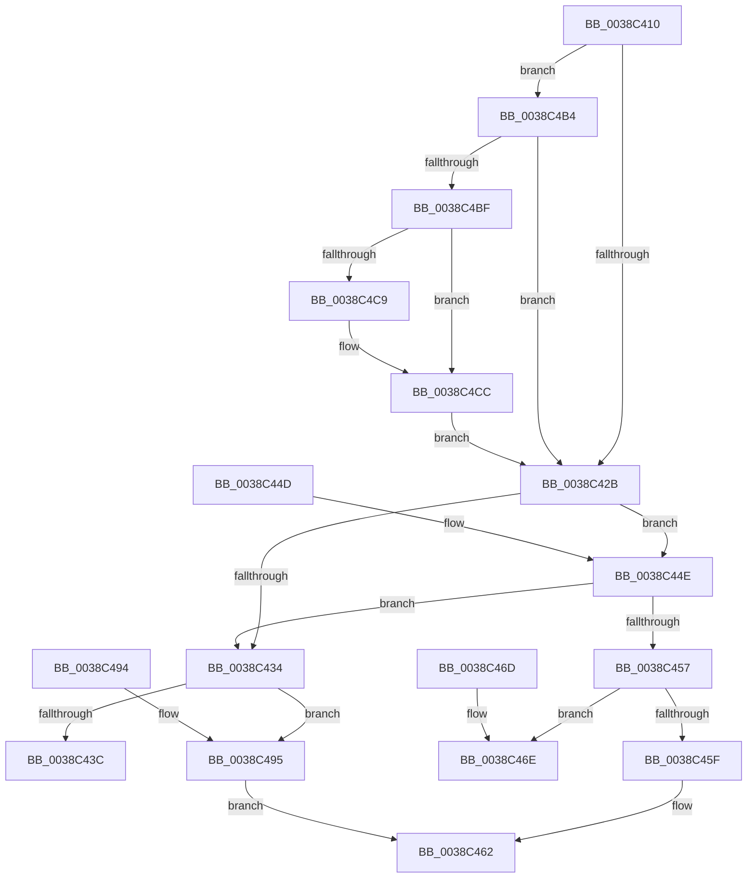

# RtlDeleteNoSplay

- RVA: `0x0038C410`–`0x0038C4DC` (길이 `204` bytes)
- VA: `0x000000014038C410`
- 실행 섹션: `.text`
- PDB 이름 있음: `예`; PDB Function 태그: `아니요`
- unwind 정보 RVA: `0x00080280`
- 디코드: `60`개 명령, `204/204` bytes 표시
- 미해석 바이트: `0` (있으면 어셈블리에 `.byte`로 보존)

> 이 문서는 커널 이미지의 기계어와 PDB 기호를 분석해 생성했습니다. 4번과 5번은 함수 원형과 자료형을 바이너리 사용 방식에서 추정한 C 해석이며 원본 소스 복구 결과는 아닙니다.

## 1. Dependencies

- 직접 호출 지점: **2**; 고유 호출 대상: **2**
- 직접 호출자로 확인된 함수: **5**
- RIP 상대 이미지 참조: **0**

### Outgoing calls
- `0x0038C4BF` → [RtlSubtreePredecessor](RtlSubtreePredecessor_function_0038DB20.md) (function, `0x0038DB20`)
- `0x0038C4D2` → [SwapSplayLinks](SwapSplayLinks_function_0038DB48.md) (function, `0x0038DB48`)

### Direct callers
- [FsRtlUninitializeFileLock](FsRtlUninitializeFileLock_function_00386F50.md) at `0x0038700C`
- [FsRtlUninitializeFileLock](FsRtlUninitializeFileLock_function_00386F50.md) at `0x0038703C`
- [FsRtlRemoveNodeFromTunnel](FsRtlRemoveNodeFromTunnel_function_0038A450.md) at `0x0038A482`
- [sub_006E56AC](../6E/Unknown_function_006E56AC.md) at `0x006E5711`
- [FsRtlPruneTunnelCache](../../page/93/FsRtlPruneTunnelCache_function_009380F0.md) at `0x0093817E`
- [FsRtlDeleteKeyFromTunnelCache](../../page/A5/FsRtlDeleteKeyFromTunnelCache_function_00A51E30.md) at `0x00A51EE5`

### Static image references
- 디코드된 RIP-relative 메모리 참조가 없습니다.

## 2. Other-region calls and transfers

- 다른 실행 섹션으로 향하는 call: **0**
- 별도 외부 분기/꼬리 이동을 확인하지 못했습니다.

## 3. Assembly (complete function range)

```asm
0038C410  48 89 5C 24 08                  mov qword ptr [rsp + 8], rbx
0038C415  57                              push rdi
0038C416  48 83 EC 20                     sub rsp, 0x20
0038C41A  48 83 79 08 00                  cmp qword ptr [rcx + 8], 0
0038C41F  48 8B FA                        mov rdi, rdx
0038C422  48 8B D9                        mov rbx, rcx
0038C425  0F 85 89 00 00 00               jne 0x14038c4b4
0038C42B  48 8B 4B 08                     mov rcx, qword ptr [rbx + 8]
0038C42F  48 85 C9                        test rcx, rcx
0038C432  74 1A                           je 0x14038c44e
0038C434  48 8B 03                        mov rax, qword ptr [rbx]
0038C437  48 3B C3                        cmp rax, rbx
0038C43A  75 59                           jne 0x14038c495
0038C43C  48 89 09                        mov qword ptr [rcx], rcx
0038C43F  48 89 0F                        mov qword ptr [rdi], rcx
0038C442  48 8B 5C 24 30                  mov rbx, qword ptr [rsp + 0x30]
0038C447  48 83 C4 20                     add rsp, 0x20
0038C44B  5F                              pop rdi
0038C44C  C3                              ret
0038C44D  CC                              int3
0038C44E  48 8B 4B 10                     mov rcx, qword ptr [rbx + 0x10]
0038C452  48 85 C9                        test rcx, rcx
0038C455  75 DD                           jne 0x14038c434
0038C457  48 8B 03                        mov rax, qword ptr [rbx]
0038C45A  48 3B C3                        cmp rax, rbx
0038C45D  75 0F                           jne 0x14038c46e
0038C45F  48 89 0F                        mov qword ptr [rdi], rcx
0038C462  48 8B 5C 24 30                  mov rbx, qword ptr [rsp + 0x30]
0038C467  48 83 C4 20                     add rsp, 0x20
0038C46B  5F                              pop rdi
0038C46C  C3                              ret
0038C46D  CC                              int3
0038C46E  48 39 58 08                     cmp qword ptr [rax + 8], rbx
0038C472  BA 08 00 00 00                  mov edx, 8
0038C477  48 8B 5C 24 30                  mov rbx, qword ptr [rsp + 0x30]
0038C47C  41 B8 10 00 00 00               mov r8d, 0x10
0038C482  41 0F 45 D0                     cmovne edx, r8d
0038C486  48 C7 04 02 00 00 00 00         mov qword ptr [rdx + rax], 0
0038C48E  48 83 C4 20                     add rsp, 0x20
0038C492  5F                              pop rdi
0038C493  C3                              ret
0038C494  CC                              int3
0038C495  48 39 58 08                     cmp qword ptr [rax + 8], rbx
0038C499  BA 08 00 00 00                  mov edx, 8
0038C49E  41 B8 10 00 00 00               mov r8d, 0x10
0038C4A4  41 0F 45 D0                     cmovne edx, r8d
0038C4A8  48 89 0C 02                     mov qword ptr [rdx + rax], rcx
0038C4AC  48 8B 03                        mov rax, qword ptr [rbx]
0038C4AF  48 89 01                        mov qword ptr [rcx], rax
0038C4B2  EB AE                           jmp 0x14038c462
0038C4B4  48 83 79 10 00                  cmp qword ptr [rcx + 0x10], 0
0038C4B9  0F 84 6C FF FF FF               je 0x14038c42b
0038C4BF  E8 5C 16 00 00                  call 0x14038db20
0038C4C4  48 39 1B                        cmp qword ptr [rbx], rbx
0038C4C7  75 03                           jne 0x14038c4cc
0038C4C9  48 89 07                        mov qword ptr [rdi], rax
0038C4CC  48 8B D3                        mov rdx, rbx
0038C4CF  48 8B C8                        mov rcx, rax
0038C4D2  E8 71 16 00 00                  call 0x14038db48
0038C4D7  E9 4F FF FF FF                  jmp 0x14038c42b
```

## 4. C-style interpretation (structured pseudocode)

```c
__int64 __fastcall RtlDeleteNoSplay(__int64 a1, __int64 a2)
{
    __int64 result;
    __int64 v_rsp;
    unsigned __int64 v_stack_p30;
    unsigned __int64 v_stack_p58;
    unsigned __int64 v_stack_p8;

    v_stack_p8 = v_rbx;
    v_rsp = (v_rsp) - (32);
    if ((*(unsigned __int64 *)(a1 + 8)) != 0) goto loc_0038C4B4;
loc_0038C42B:
    if (*(unsigned __int64 *)(a1 + 8) == 0) goto loc_0038C44E;
loc_0038C434:
    if ((*(unsigned __int64 *)(a1)) != a1) goto loc_0038C495;
    *(unsigned __int64 *)(*(unsigned __int64 *)(a1 + 8)) = *(unsigned __int64 *)(a1 + 8);
    *(unsigned __int64 *)(a2) = *(unsigned __int64 *)(a1 + 8);
    v_rsp = (v_rsp) + (32);
    return *(unsigned __int64 *)(a1);
loc_0038C44E:
    if (*(unsigned __int64 *)(v_stack_p8 + 16) != 0) goto loc_0038C434;
    if ((*(unsigned __int64 *)(v_stack_p8)) != v_stack_p8) goto loc_0038C46E;
    *(unsigned __int64 *)(a2) = *(unsigned __int64 *)(v_stack_p8 + 16);
loc_0038C462:
    v_rsp = (v_rsp) + (32);
    return *(unsigned __int64 *)(v_stack_p8);
loc_0038C46E:
    a2 = 8;
    if ((*(unsigned __int64 *)(*(unsigned __int64 *)(v_stack_p8) + 8)) != v_stack_p30) { a2 = 16; }
    *(unsigned __int64 *)(a2 + *(unsigned __int64 *)(v_stack_p8) * 1) = 0;
    v_rsp = (v_rsp) + (32);
    return *(unsigned __int64 *)(v_stack_p8);
loc_0038C495:
    a2 = 8;
    if ((*(unsigned __int64 *)(*(unsigned __int64 *)(v_stack_p8) + 8)) != v_stack_p58) { a2 = 16; }
    *(unsigned __int64 *)(a2 + *(unsigned __int64 *)(v_stack_p8) * 1) = *(unsigned __int64 *)(v_stack_p8 + 16);
    *(unsigned __int64 *)(*(unsigned __int64 *)(v_stack_p8 + 16)) = *(unsigned __int64 *)(v_stack_p58);
    goto loc_0038C462;
loc_0038C4B4:
    if ((*(unsigned __int64 *)(*(unsigned __int64 *)(v_stack_p8 + 16) + 16)) == 0) goto loc_0038C42B;
    result = RtlSubtreePredecessor(*(unsigned __int64 *)(v_stack_p8 + 16), a2, 16, a4);
    if ((*(unsigned __int64 *)(v_stack_p58)) == v_stack_p58) {
        *(unsigned __int64 *)(a2) = result;
    }
    result = SwapSplayLinks(result, v_stack_p58, 16, a4);
    goto loc_0038C42B;
}
```

## 5. (Beta) C Style

```c
int64_t RtlDeleteNoSplay(void *Arg1, void *Arg2)
{
    uint8_t *arg1 = (uint8_t *)Arg1;
    uint8_t *arg2 = (uint8_t *)Arg2;

    int64_t result;
    int64_t local_rsp;
    uint64_t v_stack_p30;
    uint64_t v_stack_p58;
    uint64_t v_stack_p8;

    v_stack_p8 = local_rbx;
    local_rsp = (local_rsp) - (32);
    if ((*(uint64_t *)(arg1 + 0x8)) != 0) goto loc_0038C4B4;
loc_0038C42B:
    if (*(uint64_t *)(arg1 + 0x8) == 0) goto loc_0038C44E;
loc_0038C434:
    if ((*(uint64_t *)(arg1)) != Arg1) goto loc_0038C495;
    *(uint64_t *)(*(uint64_t *)(arg1 + 0x8)) = *(uint64_t *)(arg1 + 0x8);
    *(uint64_t *)(arg2) = *(uint64_t *)(arg1 + 0x8);
    local_rsp = (local_rsp) + (32);
    return *(uint64_t *)(arg1);
loc_0038C44E:
    if (*(uint64_t *)(v_stack_p8 + 0x10) != 0) goto loc_0038C434;
    if ((*(uint64_t *)(v_stack_p8)) != v_stack_p8) goto loc_0038C46E;
    *(uint64_t *)(arg2) = *(uint64_t *)(v_stack_p8 + 0x10);
loc_0038C462:
    local_rsp = (local_rsp) + (32);
    return *(uint64_t *)(v_stack_p8);
loc_0038C46E:
    Arg2 = 8;
    if ((*(uint64_t *)(*(uint64_t *)(v_stack_p8) + 0x8)) != v_stack_p30) { Arg2 = 16; }
    *(uint64_t *)(arg2 + *(uint64_t *)(v_stack_p8) * 1) = 0;
    local_rsp = (local_rsp) + (32);
    return *(uint64_t *)(v_stack_p8);
loc_0038C495:
    Arg2 = 8;
    if ((*(uint64_t *)(*(uint64_t *)(v_stack_p8) + 0x8)) != v_stack_p58) { Arg2 = 16; }
    *(uint64_t *)(arg2 + *(uint64_t *)(v_stack_p8) * 1) = *(uint64_t *)(v_stack_p8 + 0x10);
    *(uint64_t *)(*(uint64_t *)(v_stack_p8 + 0x10)) = *(uint64_t *)(v_stack_p58);
    goto loc_0038C462;
loc_0038C4B4:
    if ((*(uint64_t *)(*(uint64_t *)(v_stack_p8 + 0x10) + 0x10)) == 0) goto loc_0038C42B;
    result = RtlSubtreePredecessor(*(uint64_t *)(v_stack_p8 + 0x10), Arg2, 16, a4);
    if ((*(uint64_t *)(v_stack_p58)) == v_stack_p58) {
        *(uint64_t *)(arg2) = result;
    }
    result = SwapSplayLinks(result, v_stack_p58, 16, a4);
    goto loc_0038C42B;
}
```

### 관측된 메모리 오프셋

구조체 형식이 확인되지 않은 접근은 인자 기준의 오프셋으로만 기록했습니다.

| 기준 인자 | 오프셋 표현 | 폭 (bit) | 접근 |
|---|---:|---:|---|
| `Arg1` | `+ 0x0` | `64` | `R` |
| `Arg1` | `+ 0x8` | `64` | `R` |
| `Arg1` | `+ 0x10` | `64` | `R` |
| `Arg2` | `+ 0x0` | `64` | `W` |

## 6. Execution-region graph

[열기: 2D/3D 그래프와 함수 탐색 컨트롤 패널](../../../control-panel.html?section=text&rva=0x0038C410&view=graph)

- 2D 그래프는 위에서 아래로 흐르고, 3D 그래프는 빈 공간을 드래그해 회전합니다. Shift+드래그는 이동, 휠은 확대·축소, 함수 노드 선택은 대상 보고서 이동입니다.

### Static fallback


