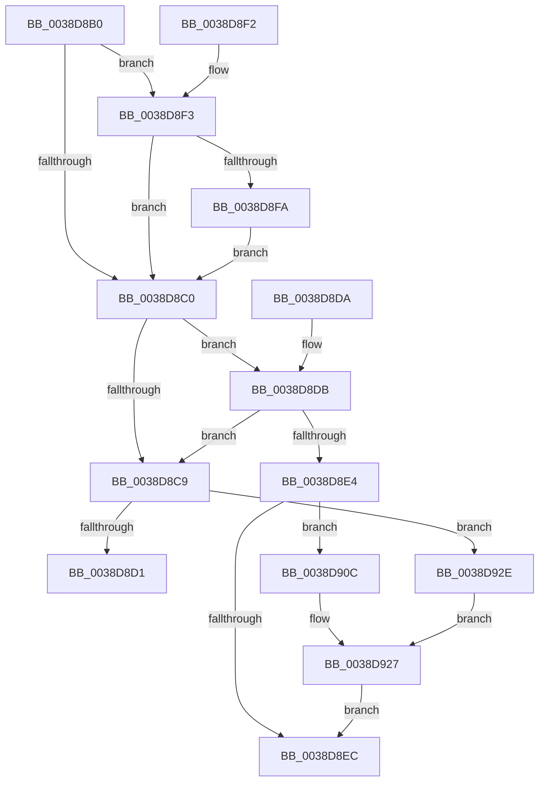

# RtlDelete

- RVA: `0x0038D8B0`–`0x0038D94D` (길이 `157` bytes)
- VA: `0x000000014038D8B0`
- 실행 섹션: `.text`
- PDB 이름 있음: `예`; PDB Function 태그: `아니요`
- unwind 정보 RVA: `0x00080570`
- 디코드: `48`개 명령, `157/157` bytes 표시
- 미해석 바이트: `0` (있으면 어셈블리에 `.byte`로 보존)

> 이 문서는 커널 이미지의 기계어와 PDB 기호를 분석해 생성했습니다. 4번과 5번은 함수 원형과 자료형을 바이너리 사용 방식에서 추정한 C 해석이며 원본 소스 복구 결과는 아닙니다.

## 1. Dependencies

- 직접 호출 지점: **3**; 고유 호출 대상: **3**
- 직접 호출자로 확인된 함수: **11**
- RIP 상대 이미지 참조: **0**

### Outgoing calls
- `0x0038D8FA` → [RtlSubtreePredecessor](RtlSubtreePredecessor_function_0038DB20.md) (function, `0x0038DB20`)
- `0x0038D905` → [SwapSplayLinks](SwapSplayLinks_function_0038DB48.md) (function, `0x0038DB48`)
- `0x0038D927` → [RtlSplay](RtlSplay_function_0038F1E0.md) (function, `0x0038F1E0`)

### Direct callers
- [FsRtlRemoveNodeFromTunnel](FsRtlRemoveNodeFromTunnel_function_0038A450.md) at `0x0038A4A7`
- [RtlDeleteElementGenericTable](RtlDeleteElementGenericTable_function_0038C340.md) at `0x0038C38C`
- [FsRtlFastUnlockSingleExclusive](FsRtlFastUnlockSingleExclusive_function_0038C8E0.md) at `0x0038CA27`
- [sub_0038CBC6](Unknown_function_0038CBC6.md) at `0x0038CD32`
- [sub_0038CE61](Unknown_function_0038CE61.md) at `0x0038CF29`
- [sub_0038D2A1](Unknown_function_0038D2A1.md) at `0x0038D357`
- [FsRtlPrivateFastUnlockAll](../3F/FsRtlPrivateFastUnlockAll_function_003FD554.md) at `0x003FD74A`
- [FsRtlPrivateFastUnlockAll](../3F/FsRtlPrivateFastUnlockAll_function_003FD554.md) at `0x003FD835`
- [PfxRemovePrefix](../../page/78/PfxRemovePrefix_function_0078CEC0.md) at `0x0078CF05`
- [FsRtlPruneTunnelCache](../../page/93/FsRtlPruneTunnelCache_function_009380F0.md) at `0x0093819C`
- [RtlRemoveUnicodePrefix](../../page/A4/RtlRemoveUnicodePrefix_function_00A431B0.md) at `0x00A43202`
- [FsRtlDeleteKeyFromTunnelCache](../../page/A5/FsRtlDeleteKeyFromTunnelCache_function_00A51E30.md) at `0x00A51F07`

### Static image references
- 디코드된 RIP-relative 메모리 참조가 없습니다.

## 2. Other-region calls and transfers

- 다른 실행 섹션으로 향하는 call: **0**
- 별도 외부 분기/꼬리 이동을 확인하지 못했습니다.

## 3. Assembly (complete function range)

```asm
0038D8B0  40 53                           push rbx
0038D8B2  48 83 EC 20                     sub rsp, 0x20
0038D8B6  48 83 79 08 00                  cmp qword ptr [rcx + 8], 0
0038D8BB  48 8B D9                        mov rbx, rcx
0038D8BE  75 33                           jne 0x14038d8f3
0038D8C0  48 8B 43 08                     mov rax, qword ptr [rbx + 8]
0038D8C4  48 85 C0                        test rax, rax
0038D8C7  74 12                           je 0x14038d8db
0038D8C9  48 8B 0B                        mov rcx, qword ptr [rbx]
0038D8CC  48 3B CB                        cmp rcx, rbx
0038D8CF  75 5D                           jne 0x14038d92e
0038D8D1  48 89 00                        mov qword ptr [rax], rax
0038D8D4  48 83 C4 20                     add rsp, 0x20
0038D8D8  5B                              pop rbx
0038D8D9  C3                              ret
0038D8DA  CC                              int3
0038D8DB  48 8B 43 10                     mov rax, qword ptr [rbx + 0x10]
0038D8DF  48 85 C0                        test rax, rax
0038D8E2  75 E5                           jne 0x14038d8c9
0038D8E4  48 8B 0B                        mov rcx, qword ptr [rbx]
0038D8E7  48 3B CB                        cmp rcx, rbx
0038D8EA  75 20                           jne 0x14038d90c
0038D8EC  48 83 C4 20                     add rsp, 0x20
0038D8F0  5B                              pop rbx
0038D8F1  C3                              ret
0038D8F2  CC                              int3
0038D8F3  48 83 79 10 00                  cmp qword ptr [rcx + 0x10], 0
0038D8F8  74 C6                           je 0x14038d8c0
0038D8FA  E8 21 02 00 00                  call 0x14038db20
0038D8FF  48 8B D3                        mov rdx, rbx
0038D902  48 8B C8                        mov rcx, rax
0038D905  E8 3E 02 00 00                  call 0x14038db48
0038D90A  EB B4                           jmp 0x14038d8c0
0038D90C  48 39 59 08                     cmp qword ptr [rcx + 8], rbx
0038D910  BA 08 00 00 00                  mov edx, 8
0038D915  41 B8 10 00 00 00               mov r8d, 0x10
0038D91B  41 0F 45 D0                     cmovne edx, r8d
0038D91F  48 C7 04 0A 00 00 00 00         mov qword ptr [rdx + rcx], 0
0038D927  E8 B4 18 00 00                  call 0x14038f1e0
0038D92C  EB BE                           jmp 0x14038d8ec
0038D92E  48 39 59 08                     cmp qword ptr [rcx + 8], rbx
0038D932  BA 08 00 00 00                  mov edx, 8
0038D937  41 B8 10 00 00 00               mov r8d, 0x10
0038D93D  41 0F 45 D0                     cmovne edx, r8d
0038D941  48 89 04 0A                     mov qword ptr [rdx + rcx], rax
0038D945  48 8B 0B                        mov rcx, qword ptr [rbx]
0038D948  48 89 08                        mov qword ptr [rax], rcx
0038D94B  EB DA                           jmp 0x14038d927
```

## 4. C-style interpretation (structured pseudocode)

```c
__int64 __fastcall RtlDelete(__int64 a1)
{
    __int64 result;
    __int64 v_rsp;

    v_rsp = (v_rsp) - (32);
    if ((*(unsigned __int64 *)(a1 + 8)) != 0) goto loc_0038D8F3;
loc_0038D8C0:
    if (*(unsigned __int64 *)(a1 + 8) == 0) goto loc_0038D8DB;
loc_0038D8C9:
    if ((*(unsigned __int64 *)(a1)) != a1) goto loc_0038D92E;
    *(unsigned __int64 *)(*(unsigned __int64 *)(a1 + 8)) = *(unsigned __int64 *)(a1 + 8);
    v_rsp = (v_rsp) + (32);
    return *(unsigned __int64 *)(a1 + 8);
loc_0038D8DB:
    if (*(unsigned __int64 *)(a1 + 16) != 0) goto loc_0038D8C9;
    if ((*(unsigned __int64 *)(a1)) != a1) goto loc_0038D90C;
loc_0038D8EC:
    v_rsp = (v_rsp) + (32);
    return *(unsigned __int64 *)(a1 + 16);
loc_0038D8F3:
    if ((*(unsigned __int64 *)(*(unsigned __int64 *)(a1) + 16)) == 0) goto loc_0038D8C0;
    result = RtlSubtreePredecessor(*(unsigned __int64 *)(a1), a2, a3, a4);
    result = SwapSplayLinks(result, a1, a3, a4);
    goto loc_0038D8C0;
loc_0038D90C:
    a2 = 8;
    if ((*(unsigned __int64 *)(result + 8)) != a1) { a2 = 16; }
    *(unsigned __int64 *)(a2 + result * 1) = 0;
loc_0038D927:
    result = RtlSplay(result, a2, 16, a4);
    goto loc_0038D8EC;
loc_0038D92E:
    a2 = 8;
    if ((*(unsigned __int64 *)(result + 8)) != a1) { a2 = 16; }
    *(unsigned __int64 *)(a2 + result * 1) = result;
    *(unsigned __int64 *)(result) = *(unsigned __int64 *)(a1);
    goto loc_0038D927;
}
```

## 5. (Beta) C Style

```c
int64_t RtlDelete(void *Arg1)
{
    uint8_t *arg1 = (uint8_t *)Arg1;

    int64_t result;
    int64_t local_rsp;

    local_rsp = (local_rsp) - (32);
    if ((*(uint64_t *)(arg1 + 0x8)) != 0) goto loc_0038D8F3;
loc_0038D8C0:
    if (*(uint64_t *)(arg1 + 0x8) == 0) goto loc_0038D8DB;
loc_0038D8C9:
    if ((*(uint64_t *)(arg1)) != Arg1) goto loc_0038D92E;
    *(uint64_t *)(*(uint64_t *)(arg1 + 0x8)) = *(uint64_t *)(arg1 + 0x8);
    local_rsp = (local_rsp) + (32);
    return *(uint64_t *)(arg1 + 0x8);
loc_0038D8DB:
    if (*(uint64_t *)(arg1 + 0x10) != 0) goto loc_0038D8C9;
    if ((*(uint64_t *)(arg1)) != Arg1) goto loc_0038D90C;
loc_0038D8EC:
    local_rsp = (local_rsp) + (32);
    return *(uint64_t *)(arg1 + 0x10);
loc_0038D8F3:
    if ((*(uint64_t *)(*(uint64_t *)(arg1) + 0x10)) == 0) goto loc_0038D8C0;
    result = RtlSubtreePredecessor(*(uint64_t *)(arg1), a2, a3, a4);
    result = SwapSplayLinks(result, Arg1, a3, a4);
    goto loc_0038D8C0;
loc_0038D90C:
    a2 = 8;
    if ((*(uint64_t *)(result + 0x8)) != Arg1) { a2 = 16; }
    *(uint64_t *)(a2 + result * 1) = 0;
loc_0038D927:
    result = RtlSplay(result, a2, 16, a4);
    goto loc_0038D8EC;
loc_0038D92E:
    a2 = 8;
    if ((*(uint64_t *)(result + 0x8)) != Arg1) { a2 = 16; }
    *(uint64_t *)(a2 + result * 1) = result;
    *(uint64_t *)(result) = *(uint64_t *)(arg1);
    goto loc_0038D927;
}
```

### 관측된 메모리 오프셋

구조체 형식이 확인되지 않은 접근은 인자 기준의 오프셋으로만 기록했습니다.

| 기준 인자 | 오프셋 표현 | 폭 (bit) | 접근 |
|---|---:|---:|---|
| `Arg1` | `+ 0x0` | `64` | `R` |
| `Arg1` | `+ 0x8` | `64` | `R` |
| `Arg1` | `+ 0x10` | `64` | `R` |

## 6. Execution-region graph

[열기: 2D/3D 그래프와 함수 탐색 컨트롤 패널](../../../control-panel.html?section=text&rva=0x0038D8B0&view=graph)

- 2D 그래프는 위에서 아래로 흐르고, 3D 그래프는 빈 공간을 드래그해 회전합니다. Shift+드래그는 이동, 휠은 확대·축소, 함수 노드 선택은 대상 보고서 이동입니다.

### Static fallback


