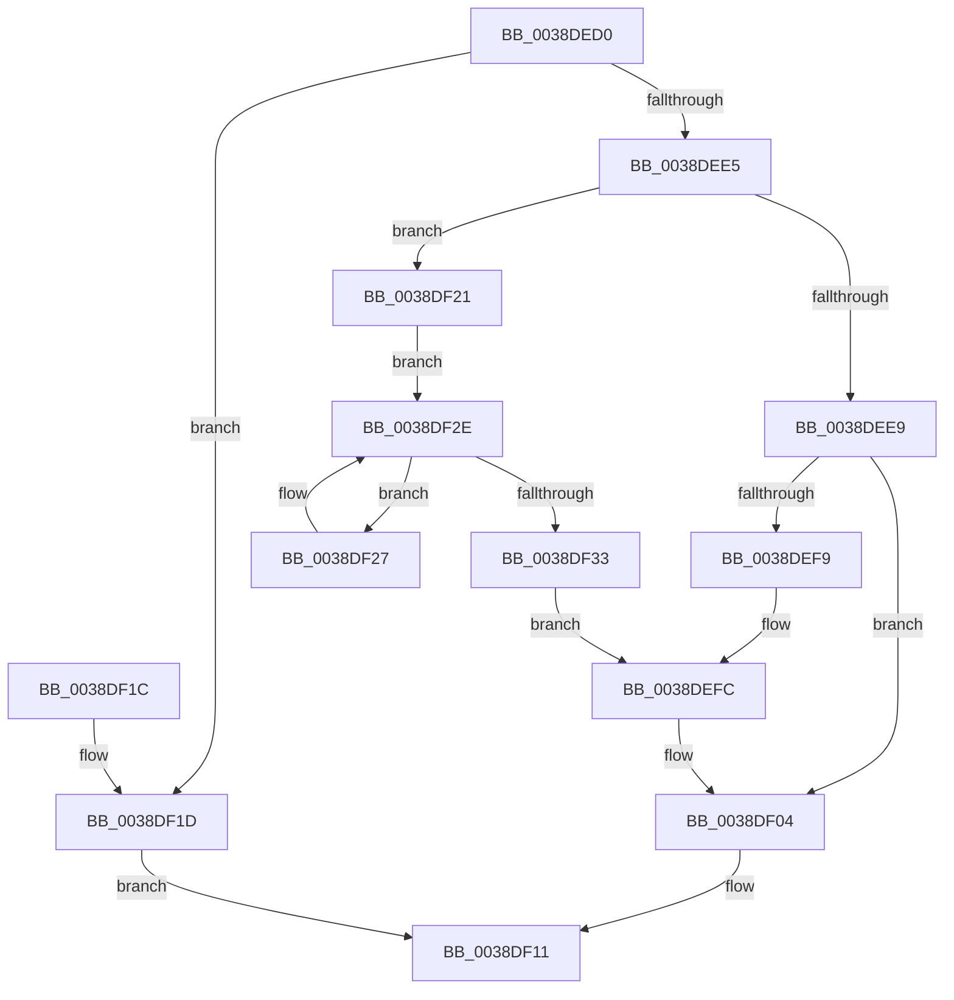

# RtlEnumerateGenericTable

- RVA: `0x0038DED0`–`0x0038DF38` (길이 `104` bytes)
- VA: `0x000000014038DED0`
- 실행 섹션: `.text`
- PDB 이름 있음: `예`; PDB Function 태그: `아니요`
- unwind 정보 RVA: `0x0007CED0`
- 디코드: `36`개 명령, `104/104` bytes 표시
- 미해석 바이트: `0` (있으면 어셈블리에 `.byte`로 보존)

> 이 문서는 커널 이미지의 기계어와 PDB 기호를 분석해 생성했습니다. 4번과 5번은 함수 원형과 자료형을 바이너리 사용 방식에서 추정한 C 해석이며 원본 소스 복구 결과는 아닙니다.

## 1. Dependencies

- 직접 호출 지점: **2**; 고유 호출 대상: **2**
- 직접 호출자로 확인된 함수: **0**
- RIP 상대 이미지 참조: **0**

### Outgoing calls
- `0x0038DEEC` → [RtlRealSuccessor](RtlRealSuccessor_function_0038DF40.md) (function, `0x0038DF40`)
- `0x0038DEFC` → [RtlSplay](RtlSplay_function_0038F1E0.md) (function, `0x0038F1E0`)

### Direct callers
- 이 함수 시작 RVA로 연결되는 직접 call은 확인되지 않았습니다. 간접 호출은 완전히 역산할 수 없습니다.

### Static image references
- 디코드된 RIP-relative 메모리 참조가 없습니다.

## 2. Other-region calls and transfers

- 다른 실행 섹션으로 향하는 call: **0**
- 별도 외부 분기/꼬리 이동을 확인하지 못했습니다.

## 3. Assembly (complete function range)

```asm
0038DED0  48 89 5C 24 08                  mov qword ptr [rsp + 8], rbx
0038DED5  57                              push rdi
0038DED6  48 83 EC 20                     sub rsp, 0x20
0038DEDA  48 8B 19                        mov rbx, qword ptr [rcx]
0038DEDD  48 8B F9                        mov rdi, rcx
0038DEE0  48 85 DB                        test rbx, rbx
0038DEE3  74 38                           je 0x14038df1d
0038DEE5  84 D2                           test dl, dl
0038DEE7  75 38                           jne 0x14038df21
0038DEE9  48 8B CB                        mov rcx, rbx
0038DEEC  E8 4F 00 00 00                  call 0x14038df40
0038DEF1  48 8B D8                        mov rbx, rax
0038DEF4  48 85 C0                        test rax, rax
0038DEF7  74 0B                           je 0x14038df04
0038DEF9  48 8B C8                        mov rcx, rax
0038DEFC  E8 DF 12 00 00                  call 0x14038f1e0
0038DF01  48 89 07                        mov qword ptr [rdi], rax
0038DF04  48 8D 4B 28                     lea rcx, [rbx + 0x28]
0038DF08  48 F7 DB                        neg rbx
0038DF0B  48 1B C0                        sbb rax, rax
0038DF0E  48 23 C1                        and rax, rcx
0038DF11  48 8B 5C 24 30                  mov rbx, qword ptr [rsp + 0x30]
0038DF16  48 83 C4 20                     add rsp, 0x20
0038DF1A  5F                              pop rdi
0038DF1B  C3                              ret
0038DF1C  CC                              int3
0038DF1D  33 C0                           xor eax, eax
0038DF1F  EB F0                           jmp 0x14038df11
0038DF21  48 8B 43 08                     mov rax, qword ptr [rbx + 8]
0038DF25  EB 07                           jmp 0x14038df2e
0038DF27  48 8B D8                        mov rbx, rax
0038DF2A  48 8B 40 08                     mov rax, qword ptr [rax + 8]
0038DF2E  48 85 C0                        test rax, rax
0038DF31  75 F4                           jne 0x14038df27
0038DF33  48 8B CB                        mov rcx, rbx
0038DF36  EB C4                           jmp 0x14038defc
```

## 4. C-style interpretation (structured pseudocode)

```c
__int64 __fastcall RtlEnumerateGenericTable(__int64 a1, unsigned __int8 a2)
{
    __int64 result;
    __int64 v_rbx;
    __int64 v_rsp;
    unsigned __int64 v_stack_p8;

    v_stack_p8 = v_rbx;
    v_rsp = (v_rsp) - (32);
    if (*(unsigned __int64 *)(a1) == 0) goto loc_0038DF1D;
    if (a2 != 0) goto loc_0038DF21;
    result = RtlRealSuccessor(*(unsigned __int64 *)(a1), a2, a3, a4);
    if (result == 0) goto loc_0038DF04;
loc_0038DEFC:
    result = RtlSplay(result, a2, a3, a4);
    *(unsigned __int64 *)(a1) = result;
loc_0038DF04:
    v_rbx = -(result);
    result = (result) & (result + 40);
loc_0038DF11:
    v_rsp = (v_rsp) + (32);
    return result;
loc_0038DF1D:
    result = 0;
    goto loc_0038DF11;
loc_0038DF21:
    goto loc_0038DF2E;
loc_0038DF27:
loc_0038DF2E:
    if (*(unsigned __int64 *)(*(unsigned __int64 *)(v_stack_p8 + 8) + 8) != 0) goto loc_0038DF27;
    goto loc_0038DEFC;
}
```

## 5. (Beta) C Style

```c
int64_t RtlEnumerateGenericTable(void *Arg1, uint8_t Arg2)
{
    uint8_t *arg1 = (uint8_t *)Arg1;

    int64_t result;
    int64_t local_rbx;
    int64_t local_rsp;
    uint64_t v_stack_p8;

    v_stack_p8 = local_rbx;
    local_rsp = (local_rsp) - (32);
    if (*(uint64_t *)(arg1) == 0) goto loc_0038DF1D;
    if (Arg2 != 0) goto loc_0038DF21;
    result = RtlRealSuccessor(*(uint64_t *)(arg1), Arg2, a3, a4);
    if (result == 0) goto loc_0038DF04;
loc_0038DEFC:
    result = RtlSplay(result, Arg2, a3, a4);
    *(uint64_t *)(arg1) = result;
loc_0038DF04:
    local_rbx = -(result);
    result = (result) & (result + 40);
loc_0038DF11:
    local_rsp = (local_rsp) + (32);
    return result;
loc_0038DF1D:
    result = 0;
    goto loc_0038DF11;
loc_0038DF21:
    goto loc_0038DF2E;
loc_0038DF27:
loc_0038DF2E:
    if (*(uint64_t *)(*(uint64_t *)(v_stack_p8 + 0x8) + 0x8) != 0) goto loc_0038DF27;
    goto loc_0038DEFC;
}
```

### 관측된 메모리 오프셋

구조체 형식이 확인되지 않은 접근은 인자 기준의 오프셋으로만 기록했습니다.

| 기준 인자 | 오프셋 표현 | 폭 (bit) | 접근 |
|---|---:|---:|---|
| `Arg1` | `+ 0x0` | `64` | `R` |
| `Arg1` | `+ 0x0` | `64` | `W` |

## 6. Execution-region graph

[열기: 2D/3D 그래프와 함수 탐색 컨트롤 패널](../../../control-panel.html?section=text&rva=0x0038DED0&view=graph)

- 2D 그래프는 위에서 아래로 흐르고, 3D 그래프는 빈 공간을 드래그해 회전합니다. Shift+드래그는 이동, 휠은 확대·축소, 함수 노드 선택은 대상 보고서 이동입니다.

### Static fallback


