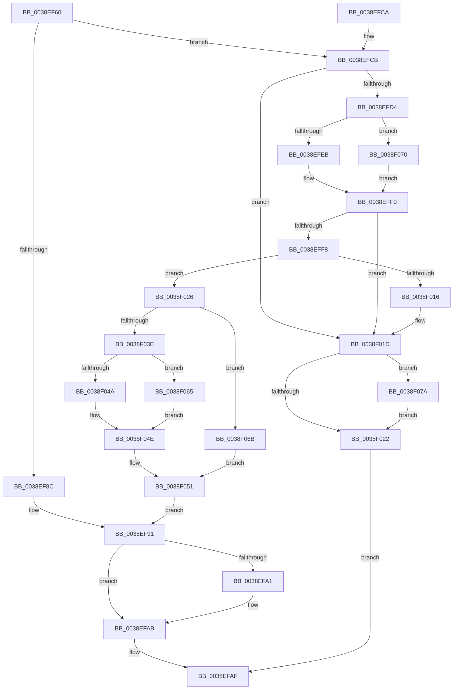

# RtlInsertElementGenericTableFull

- RVA: `0x0038EF60`–`0x0038F07F` (길이 `287` bytes)
- VA: `0x000000014038EF60`
- 실행 섹션: `.text`
- PDB 이름 있음: `예`; PDB Function 태그: `아니요`
- unwind 정보 RVA: `0x0008075C`
- 디코드: `82`개 명령, `287/287` bytes 표시
- 미해석 바이트: `0` (있으면 어셈블리에 `.byte`로 보존)

> 이 문서는 커널 이미지의 기계어와 PDB 기호를 분석해 생성했습니다. 4번과 5번은 함수 원형과 자료형을 바이너리 사용 방식에서 추정한 C 해석이며 원본 소스 복구 결과는 아닙니다.

## 1. Dependencies

- 직접 호출 지점: **4**; 고유 호출 대상: **4**
- 직접 호출자로 확인된 함수: **0**
- RIP 상대 이미지 참조: **1**

### Outgoing calls
- `0x0038EF94` → [RtlSplay](RtlSplay_function_0038F1E0.md) (function, `0x0038F1E0`)
- `0x0038EFEB` → [ExAllocatePool2](../../poolcode/B8/ExAllocatePool2_function_00B820F0.md) (function, `0x00B820F0`)
- `0x0038F05B` → [memcpy](../6C/memcpy_function_006C6840.md) (function, `0x006C6840`)
- `0x0038F070` → [guard_dispatch_icall](../6B/guard_dispatch_icall_function_006BAAD0.md) (function, `0x006BAAD0`)

### Direct callers
- 이 함수 시작 RVA로 연결되는 직접 call은 확인되지 않았습니다. 간접 호출은 완전히 역산할 수 없습니다.

### Static image references
- `0x0038EFD8` → RVA `0x00B820F0` (`ExAllocatePool2`; read)

## 2. Other-region calls and transfers

- 다른 실행 섹션으로 향하는 call: **1**
  - `0x0038EFEB` → [ExAllocatePool2](../../poolcode/B8/ExAllocatePool2_function_00B820F0.md) (`.text` → `POOLCODE`)
- 별도 외부 분기/꼬리 이동을 확인하지 못했습니다.

## 3. Assembly (complete function range)

```asm
0038EF60  48 8B C4                        mov rax, rsp
0038EF63  48 89 58 08                     mov qword ptr [rax + 8], rbx
0038EF67  48 89 70 10                     mov qword ptr [rax + 0x10], rsi
0038EF6B  48 89 78 18                     mov qword ptr [rax + 0x18], rdi
0038EF6F  4C 89 70 20                     mov qword ptr [rax + 0x20], r14
0038EF73  41 57                           push r15
0038EF75  48 83 EC 20                     sub rsp, 0x20
0038EF79  83 7C 24 58 01                  cmp dword ptr [rsp + 0x58], 1
0038EF7E  49 8B F1                        mov rsi, r9
0038EF81  45 8B F0                        mov r14d, r8d
0038EF84  4C 8B FA                        mov r15, rdx
0038EF87  48 8B F9                        mov rdi, rcx
0038EF8A  75 3F                           jne 0x14038efcb
0038EF8C  48 8B 5C 24 50                  mov rbx, qword ptr [rsp + 0x50]
0038EF91  48 8B CB                        mov rcx, rbx
0038EF94  E8 47 02 00 00                  call 0x14038f1e0
0038EF99  48 89 07                        mov qword ptr [rdi], rax
0038EF9C  48 85 F6                        test rsi, rsi
0038EF9F  74 0A                           je 0x14038efab
0038EFA1  83 7C 24 58 01                  cmp dword ptr [rsp + 0x58], 1
0038EFA6  0F 95 C0                        setne al
0038EFA9  88 06                           mov byte ptr [rsi], al
0038EFAB  48 8D 43 28                     lea rax, [rbx + 0x28]
0038EFAF  48 8B 5C 24 30                  mov rbx, qword ptr [rsp + 0x30]
0038EFB4  48 8B 74 24 38                  mov rsi, qword ptr [rsp + 0x38]
0038EFB9  48 8B 7C 24 40                  mov rdi, qword ptr [rsp + 0x40]
0038EFBE  4C 8B 74 24 48                  mov r14, qword ptr [rsp + 0x48]
0038EFC3  48 83 C4 20                     add rsp, 0x20
0038EFC7  41 5F                           pop r15
0038EFC9  C3                              ret
0038EFCA  CC                              int3
0038EFCB  41 8D 56 28                     lea edx, [r14 + 0x28]
0038EFCF  41 3B D6                        cmp edx, r14d
0038EFD2  72 49                           jb 0x14038f01d
0038EFD4  48 8B 41 30                     mov rax, qword ptr [rcx + 0x30]
0038EFD8  48 8D 0D 11 31 7F 00            lea rcx, [rip + 0x7f3111]
0038EFDF  48 3B C1                        cmp rax, rcx
0038EFE2  48 8B CF                        mov rcx, rdi
0038EFE5  0F 85 85 00 00 00               jne 0x14038f070
0038EFEB  E8 00 31 7F 00                  call 0x140b820f0
0038EFF0  48 8B D8                        mov rbx, rax
0038EFF3  48 85 C0                        test rax, rax
0038EFF6  74 25                           je 0x14038f01d
0038EFF8  48 83 60 08 00                  and qword ptr [rax + 8], 0
0038EFFD  48 8D 4F 08                     lea rcx, [rdi + 8]
0038F001  48 83 60 10 00                  and qword ptr [rax + 0x10], 0
0038F006  48 89 00                        mov qword ptr [rax], rax
0038F009  48 8D 40 18                     lea rax, [rax + 0x18]
0038F00D  48 8B 51 08                     mov rdx, qword ptr [rcx + 8]
0038F011  48 39 0A                        cmp qword ptr [rdx], rcx
0038F014  74 10                           je 0x14038f026
0038F016  B9 03 00 00 00                  mov ecx, 3
0038F01B  CD 29                           int 0x29
0038F01D  48 85 F6                        test rsi, rsi
0038F020  75 58                           jne 0x14038f07a
0038F022  33 C0                           xor eax, eax
0038F024  EB 89                           jmp 0x14038efaf
0038F026  48 89 08                        mov qword ptr [rax], rcx
0038F029  48 89 50 08                     mov qword ptr [rax + 8], rdx
0038F02D  48 89 02                        mov qword ptr [rdx], rax
0038F030  48 89 41 08                     mov qword ptr [rcx + 8], rax
0038F034  FF 47 24                        inc dword ptr [rdi + 0x24]
0038F037  83 7C 24 58 00                  cmp dword ptr [rsp + 0x58], 0
0038F03C  74 2D                           je 0x14038f06b
0038F03E  83 7C 24 58 02                  cmp dword ptr [rsp + 0x58], 2
0038F043  48 8B 44 24 50                  mov rax, qword ptr [rsp + 0x50]
0038F048  74 1B                           je 0x14038f065
0038F04A  48 89 58 10                     mov qword ptr [rax + 0x10], rbx
0038F04E  48 89 03                        mov qword ptr [rbx], rax
0038F051  4D 8B C6                        mov r8, r14
0038F054  48 8D 4B 28                     lea rcx, [rbx + 0x28]
0038F058  49 8B D7                        mov rdx, r15
0038F05B  E8 E0 77 33 00                  call 0x1406c6840
0038F060  E9 2C FF FF FF                  jmp 0x14038ef91
0038F065  48 89 58 08                     mov qword ptr [rax + 8], rbx
0038F069  EB E3                           jmp 0x14038f04e
0038F06B  48 89 1F                        mov qword ptr [rdi], rbx
0038F06E  EB E1                           jmp 0x14038f051
0038F070  E8 5B BA 32 00                  call 0x1406baad0
0038F075  E9 76 FF FF FF                  jmp 0x14038eff0
0038F07A  C6 06 00                        mov byte ptr [rsi], 0
0038F07D  EB A3                           jmp 0x14038f022
```

## 4. C-style interpretation (structured pseudocode)

```c
__int64 __fastcall RtlInsertElementGenericTableFull(__int64 a1, __int64 a2, int a3, __int64 a4, __int64 a5, unsigned int a6)
{
    __int64 result;
    __int64 v_rsp;
    unsigned __int64 v_stack_p10;
    unsigned __int64 v_stack_p18;
    unsigned __int64 v_stack_p20;
    unsigned __int64 v_stack_p8;

    *(unsigned __int64 *)(v_rsp + 8) = v_rbx;
    *(unsigned __int64 *)(v_rsp + 16) = v_rsi;
    *(unsigned __int64 *)(v_rsp + 24) = v_rdi;
    *(unsigned __int64 *)(v_rsp + 32) = v_r14;
    v_rsp = (v_rsp) - (32);
    if (a6 != 1) goto loc_0038EFCB;
loc_0038EF91:
    result = RtlSplay(a5, a2, a3, a4);
    *(unsigned __int64 *)(a1) = result;
    if (a4 != 0) {
        result = (a6 != 1) ? 1 : 0;
        *(unsigned __int8 *)(a4) = (unsigned __int8)(result);
    }
loc_0038EFAF:
    v_rsp = (v_rsp) + (32);
    return a5 + 40;
loc_0038EFCB:
    if (((unsigned int)(v_stack_p20 + 40)) < ((unsigned int)(v_stack_p20))) goto loc_0038F01D;
    if ((*(unsigned __int64 *)(a5 + 48)) != (v_rip + 8335633)) goto loc_0038F070;
    result = ExAllocatePool2(v_stack_p18, v_stack_p20 + 40, a3, a4);
loc_0038EFF0:
    if (result == 0) goto loc_0038F01D;
    *(unsigned __int64 *)(result) = result;
    if ((*(unsigned __int64 *)(*(unsigned __int64 *)(v_stack_p18 + 8 + 8))) == (v_stack_p18 + 8)) goto loc_0038F026;
loc_0038F01D:
    if (v_stack_p10 != 0) goto loc_0038F07A;
loc_0038F022:
    result = 0;
    goto loc_0038EFAF;
loc_0038F026:
    *(unsigned __int64 *)(result) = 3;
    *(unsigned __int64 *)(result + 8) = *(unsigned __int64 *)(v_stack_p18 + 8 + 8);
    *(unsigned __int64 *)(*(unsigned __int64 *)(v_stack_p18 + 8 + 8)) = 0;
    *(unsigned __int64 *)(3 + 8) = 0;
    if (a6 == 0) goto loc_0038F06B;
    if (a6 == 2) goto loc_0038F065;
    *(unsigned __int64 *)(a5 + 16) = 0;
loc_0038F04E:
    *(unsigned __int64 *)(result) = a5;
loc_0038F051:
    result = memcpy(result + 40, a2, v_stack_p20, a4);
    goto loc_0038EF91;
loc_0038F065:
    *(unsigned __int64 *)(result + 8) = result;
    goto loc_0038F04E;
loc_0038F06B:
    *(unsigned __int64 *)(v_stack_p18) = result;
    goto loc_0038F051;
loc_0038F070:
    result = guard_dispatch_icall(result + 40, a2, v_stack_p20, a4);
    goto loc_0038EFF0;
loc_0038F07A:
    *(unsigned __int8 *)(v_stack_p10) = 0;
    goto loc_0038F022;
}
```

## 5. (Beta) C Style

```c
void *RtlInsertElementGenericTableFull(void *Arg1, int64_t Arg2, void *Arg3, int64_t Arg4, void *Arg5, uint32_t Arg6)
{
    uint8_t *arg1 = (uint8_t *)Arg1;
    uint8_t *arg3 = (uint8_t *)Arg3;
    uint8_t *arg5 = (uint8_t *)Arg5;

    int64_t result;
    int64_t local_rsp;
    uint64_t v_stack_p10;
    uint64_t v_stack_p18;
    uint64_t v_stack_p20;
    uint64_t v_stack_p8;

    *(uint64_t *)(local_rsp + 0x8) = local_rbx;
    *(uint64_t *)(local_rsp + 0x10) = local_rsi;
    *(uint64_t *)(local_rsp + 0x18) = local_rdi;
    *(uint64_t *)(local_rsp + 0x20) = local_r14;
    local_rsp = (local_rsp) - (32);
    if (Arg6 != 1) goto loc_0038EFCB;
loc_0038EF91:
    result = RtlSplay(Arg5, Arg2, Arg3, Arg4);
    *(uint64_t *)(arg1) = result;
    if (Arg4 != 0) {
        result = (Arg6 != 1) ? 1 : 0;
        *(uint8_t *)(Arg4) = (uint8_t)(result);
    }
loc_0038EFAF:
    local_rsp = (local_rsp) + (32);
    return Arg5 + 40;
loc_0038EFCB:
    if (((uint32_t)(v_stack_p20 + 40)) < ((uint32_t)(v_stack_p20))) goto loc_0038F01D;
    if ((*(uint64_t *)(arg5 + 0x30)) != (v_rip + 8335633)) goto loc_0038F070;
    result = ExAllocatePool2(v_stack_p18, v_stack_p20 + 40, Arg3, Arg4);
loc_0038EFF0:
    if (result == 0) goto loc_0038F01D;
    *(uint64_t *)(result) = result;
    if ((*(uint64_t *)(*(uint64_t *)(v_stack_p18 + 0x8 + 0x8))) == (v_stack_p18 + 8)) goto loc_0038F026;
loc_0038F01D:
    if (v_stack_p10 != 0) goto loc_0038F07A;
loc_0038F022:
    result = 0;
    goto loc_0038EFAF;
loc_0038F026:
    *(uint64_t *)(result) = 3;
    *(uint64_t *)(result + 0x8) = *(uint64_t *)(v_stack_p18 + 0x8 + 0x8);
    *(uint64_t *)(*(uint64_t *)(v_stack_p18 + 0x8 + 0x8)) = 0;
    *(uint64_t *)(3 + 0x8) = 0;
    if (Arg6 == 0) goto loc_0038F06B;
    if (Arg6 == 2) goto loc_0038F065;
    *(uint64_t *)(arg5 + 0x10) = 0;
loc_0038F04E:
    *(void **)(result) = Arg5;
loc_0038F051:
    result = memcpy(result + 40, Arg2, v_stack_p20, Arg4);
    goto loc_0038EF91;
loc_0038F065:
    *(uint64_t *)(result + 0x8) = result;
    goto loc_0038F04E;
loc_0038F06B:
    *(uint64_t *)(v_stack_p18) = result;
    goto loc_0038F051;
loc_0038F070:
    result = guard_dispatch_icall(result + 40, Arg2, v_stack_p20, Arg4);
    goto loc_0038EFF0;
loc_0038F07A:
    *(uint8_t *)(v_stack_p10) = 0;
    goto loc_0038F022;
}
```

### 관측된 메모리 오프셋

구조체 형식이 확인되지 않은 접근은 인자 기준의 오프셋으로만 기록했습니다.

| 기준 인자 | 오프셋 표현 | 폭 (bit) | 접근 |
|---|---:|---:|---|
| `Arg1` | `+ 0x0` | `64` | `W` |
| `Arg1` | `+ 0x8` | `64` | `R` |
| `Arg1` | `+ 0x8` | `64` | `W` |
| `Arg1` | `+ 0x24` | `32` | `R/W` |
| `Arg1` | `+ 0x30` | `64` | `R` |
| `Arg3` | `+ 0x28` | `32` | `R` |
| `Arg5` | `+ 0x8` | `64` | `W` |
| `Arg5` | `+ 0x10` | `64` | `W` |

## 6. Execution-region graph

[열기: 2D/3D 그래프와 함수 탐색 컨트롤 패널](../../../control-panel.html?section=text&rva=0x0038EF60&view=graph)

- 2D 그래프는 위에서 아래로 흐르고, 3D 그래프는 빈 공간을 드래그해 회전합니다. Shift+드래그는 이동, 휠은 확대·축소, 함수 노드 선택은 대상 보고서 이동입니다.

### Static fallback


