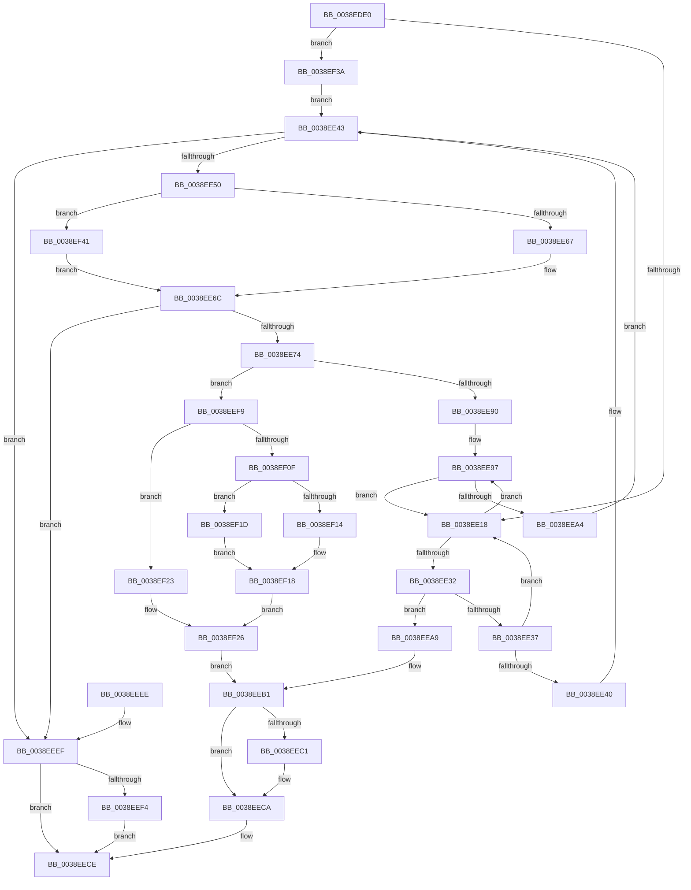

# RtlInsertElementGenericTable

- RVA: `0x0038EDE0`–`0x0038EF4B` (길이 `363` bytes)
- VA: `0x000000014038EDE0`
- 실행 섹션: `.text`
- PDB 이름 있음: `예`; PDB Function 태그: `아니요`
- unwind 정보 RVA: `0x0008073C`
- 디코드: `110`개 명령, `363/363` bytes 표시
- 미해석 바이트: `0` (있으면 어셈블리에 `.byte`로 보존)

> 이 문서는 커널 이미지의 기계어와 PDB 기호를 분석해 생성했습니다. 4번과 5번은 함수 원형과 자료형을 바이너리 사용 방식에서 추정한 C 해석이며 원본 소스 복구 결과는 아닙니다.

## 1. Dependencies

- 직접 호출 지점: **5**; 고유 호출 대상: **4**
- 직접 호출자로 확인된 함수: **0**
- RIP 상대 이미지 참조: **1**

### Outgoing calls
- `0x0038EE29` → [guard_dispatch_icall](../6B/guard_dispatch_icall_function_006BAAD0.md) (function, `0x006BAAD0`)
- `0x0038EE67` → [ExAllocatePool2](../../poolcode/B8/ExAllocatePool2_function_00B820F0.md) (function, `0x00B820F0`)
- `0x0038EEB4` → [RtlSplay](RtlSplay_function_0038F1E0.md) (function, `0x0038F1E0`)
- `0x0038EF30` → [memcpy](../6C/memcpy_function_006C6840.md) (function, `0x006C6840`)
- `0x0038EF41` → [guard_dispatch_icall](../6B/guard_dispatch_icall_function_006BAAD0.md) (function, `0x006BAAD0`)

### Direct callers
- 이 함수 시작 RVA로 연결되는 직접 call은 확인되지 않았습니다. 간접 호출은 완전히 역산할 수 없습니다.

### Static image references
- `0x0038EE54` → RVA `0x00B820F0` (`ExAllocatePool2`; read)

## 2. Other-region calls and transfers

- 다른 실행 섹션으로 향하는 call: **1**
  - `0x0038EE67` → [ExAllocatePool2](../../poolcode/B8/ExAllocatePool2_function_00B820F0.md) (`.text` → `POOLCODE`)
- 별도 외부 분기/꼬리 이동을 확인하지 못했습니다.

## 3. Assembly (complete function range)

```asm
0038EDE0  48 89 5C 24 08                  mov qword ptr [rsp + 8], rbx
0038EDE5  48 89 6C 24 10                  mov qword ptr [rsp + 0x10], rbp
0038EDEA  48 89 74 24 18                  mov qword ptr [rsp + 0x18], rsi
0038EDEF  57                              push rdi
0038EDF0  41 54                           push r12
0038EDF2  41 55                           push r13
0038EDF4  41 56                           push r14
0038EDF6  41 57                           push r15
0038EDF8  48 83 EC 20                     sub rsp, 0x20
0038EDFC  48 8B 01                        mov rax, qword ptr [rcx]
0038EDFF  33 FF                           xor edi, edi
0038EE01  45 8B E8                        mov r13d, r8d
0038EE04  4D 8B F9                        mov r15, r9
0038EE07  4C 8B E2                        mov r12, rdx
0038EE0A  4C 8B F1                        mov r14, rcx
0038EE0D  8B F7                           mov esi, edi
0038EE0F  48 85 C0                        test rax, rax
0038EE12  0F 84 22 01 00 00               je 0x14038ef3a
0038EE18  48 8B F0                        mov rsi, rax
0038EE1B  4C 8D 40 28                     lea r8, [rax + 0x28]
0038EE1F  49 8B 46 28                     mov rax, qword ptr [r14 + 0x28]
0038EE23  49 8B D4                        mov rdx, r12
0038EE26  49 8B CE                        mov rcx, r14
0038EE29  E8 A2 BC 32 00                  call 0x1406baad0
0038EE2E  85 C0                           test eax, eax
0038EE30  74 65                           je 0x14038ee97
0038EE32  83 F8 01                        cmp eax, 1
0038EE35  75 72                           jne 0x14038eea9
0038EE37  48 8B 46 10                     mov rax, qword ptr [rsi + 0x10]
0038EE3B  48 85 C0                        test rax, rax
0038EE3E  75 D8                           jne 0x14038ee18
0038EE40  8D 68 03                        lea ebp, [rax + 3]
0038EE43  41 8D 55 28                     lea edx, [r13 + 0x28]
0038EE47  41 3B D5                        cmp edx, r13d
0038EE4A  0F 82 9F 00 00 00               jb 0x14038eeef
0038EE50  49 8B 46 30                     mov rax, qword ptr [r14 + 0x30]
0038EE54  48 8D 0D 95 32 7F 00            lea rcx, [rip + 0x7f3295]
0038EE5B  48 3B C1                        cmp rax, rcx
0038EE5E  49 8B CE                        mov rcx, r14
0038EE61  0F 85 DA 00 00 00               jne 0x14038ef41
0038EE67  E8 84 32 7F 00                  call 0x140b820f0
0038EE6C  48 8B D8                        mov rbx, rax
0038EE6F  48 85 C0                        test rax, rax
0038EE72  74 7B                           je 0x14038eeef
0038EE74  48 89 00                        mov qword ptr [rax], rax
0038EE77  49 8D 56 08                     lea rdx, [r14 + 8]
0038EE7B  48 89 78 08                     mov qword ptr [rax + 8], rdi
0038EE7F  48 89 78 10                     mov qword ptr [rax + 0x10], rdi
0038EE83  48 8D 40 18                     lea rax, [rax + 0x18]
0038EE87  4C 8B 42 08                     mov r8, qword ptr [rdx + 8]
0038EE8B  49 39 10                        cmp qword ptr [r8], rdx
0038EE8E  74 69                           je 0x14038eef9
0038EE90  B9 03 00 00 00                  mov ecx, 3
0038EE95  CD 29                           int 0x29
0038EE97  48 8B 46 08                     mov rax, qword ptr [rsi + 8]
0038EE9B  48 85 C0                        test rax, rax
0038EE9E  0F 85 74 FF FF FF               jne 0x14038ee18
0038EEA4  8D 68 02                        lea ebp, [rax + 2]
0038EEA7  EB 9A                           jmp 0x14038ee43
0038EEA9  48 8B DE                        mov rbx, rsi
0038EEAC  BD 01 00 00 00                  mov ebp, 1
0038EEB1  48 8B CB                        mov rcx, rbx
0038EEB4  E8 27 03 00 00                  call 0x14038f1e0
0038EEB9  49 89 06                        mov qword ptr [r14], rax
0038EEBC  4D 85 FF                        test r15, r15
0038EEBF  74 09                           je 0x14038eeca
0038EEC1  83 FD 01                        cmp ebp, 1
0038EEC4  0F 95 C0                        setne al
0038EEC7  41 88 07                        mov byte ptr [r15], al
0038EECA  48 8D 7B 28                     lea rdi, [rbx + 0x28]
0038EECE  48 8B 5C 24 50                  mov rbx, qword ptr [rsp + 0x50]
0038EED3  48 8B C7                        mov rax, rdi
0038EED6  48 8B 6C 24 58                  mov rbp, qword ptr [rsp + 0x58]
0038EEDB  48 8B 74 24 60                  mov rsi, qword ptr [rsp + 0x60]
0038EEE0  48 83 C4 20                     add rsp, 0x20
0038EEE4  41 5F                           pop r15
0038EEE6  41 5E                           pop r14
0038EEE8  41 5D                           pop r13
0038EEEA  41 5C                           pop r12
0038EEEC  5F                              pop rdi
0038EEED  C3                              ret
0038EEEE  CC                              int3
0038EEEF  4D 85 FF                        test r15, r15
0038EEF2  74 DA                           je 0x14038eece
0038EEF4  41 88 3F                        mov byte ptr [r15], dil
0038EEF7  EB D5                           jmp 0x14038eece
0038EEF9  48 89 10                        mov qword ptr [rax], rdx
0038EEFC  4C 89 40 08                     mov qword ptr [rax + 8], r8
0038EF00  49 89 00                        mov qword ptr [r8], rax
0038EF03  48 89 42 08                     mov qword ptr [rdx + 8], rax
0038EF07  41 FF 46 24                     inc dword ptr [r14 + 0x24]
0038EF0B  85 ED                           test ebp, ebp
0038EF0D  74 14                           je 0x14038ef23
0038EF0F  83 FD 02                        cmp ebp, 2
0038EF12  74 09                           je 0x14038ef1d
0038EF14  48 89 5E 10                     mov qword ptr [rsi + 0x10], rbx
0038EF18  48 89 33                        mov qword ptr [rbx], rsi
0038EF1B  EB 09                           jmp 0x14038ef26
0038EF1D  48 89 5E 08                     mov qword ptr [rsi + 8], rbx
0038EF21  EB F5                           jmp 0x14038ef18
0038EF23  49 89 1E                        mov qword ptr [r14], rbx
0038EF26  4D 8B C5                        mov r8, r13
0038EF29  48 8D 4B 28                     lea rcx, [rbx + 0x28]
0038EF2D  49 8B D4                        mov rdx, r12
0038EF30  E8 0B 79 33 00                  call 0x1406c6840
0038EF35  E9 77 FF FF FF                  jmp 0x14038eeb1
0038EF3A  8B EF                           mov ebp, edi
0038EF3C  E9 02 FF FF FF                  jmp 0x14038ee43
0038EF41  E8 8A BB 32 00                  call 0x1406baad0
0038EF46  E9 21 FF FF FF                  jmp 0x14038ee6c
```

## 4. C-style interpretation (structured pseudocode)

```c
__int64 __fastcall RtlInsertElementGenericTable(__int64 a1, __int64 a2, int a3, __int64 a4)
{
    __int64 result;
    __int64 v_rdi;
    __int64 v_rsp;
    unsigned __int64 v_stack_p10;
    unsigned __int64 v_stack_p18;
    unsigned __int64 v_stack_p8;

    v_stack_p8 = v_rbx;
    v_stack_p10 = v_rbp;
    v_stack_p18 = v_rsi;
    v_rsp = (v_rsp) - (32);
    v_rdi = 0;
    if (*(unsigned __int64 *)(a1) == 0) goto loc_0038EF3A;
loc_0038EE18:
    result = guard_dispatch_icall(a1, a2, *(unsigned __int64 *)(a1) + 40, a4);
    if ((unsigned int)(result) == 0) goto loc_0038EE97;
    if (((unsigned int)(result)) != 1) goto loc_0038EEA9;
    if (*(unsigned __int64 *)(*(unsigned __int64 *)(a1) + 16) != 0) goto loc_0038EE18;
loc_0038EE43:
    if (((unsigned int)((unsigned int)(a3) + 40)) < ((unsigned int)((unsigned int)(a3)))) goto loc_0038EEEF;
    if ((*(unsigned __int64 *)(a1 + 48)) != (v_rip + 8336021)) goto loc_0038EF41;
    result = ExAllocatePool2(a1, (unsigned int)(a3) + 40, *(unsigned __int64 *)(a1) + 40, a4);
loc_0038EE6C:
    if (result == 0) goto loc_0038EEEF;
    *(unsigned __int64 *)(result) = result;
    *(unsigned __int64 *)(result + 8) = 0;
    *(unsigned __int64 *)(result + 16) = 0;
    if ((*(unsigned __int64 *)(*(unsigned __int64 *)(a1 + 8 + 8))) == (a1 + 8)) goto loc_0038EEF9;
loc_0038EE97:
    if (*(unsigned __int64 *)(*(unsigned __int64 *)(a1) + 8) != 0) goto loc_0038EE18;
    goto loc_0038EE43;
loc_0038EEA9:
loc_0038EEB1:
    result = RtlSplay(*(unsigned __int64 *)(a1), a1 + 8, *(unsigned __int64 *)(a1 + 8 + 8), a4);
    *(unsigned __int64 *)(a1) = result;
    if (a4 != 0) {
        result = (1 != 1) ? 1 : 0;
        *(unsigned __int8 *)(a4) = (unsigned __int8)(result);
    }
loc_0038EECE:
    v_rsp = (v_rsp) + (32);
    return *(unsigned __int64 *)(a1) + 40;
loc_0038EEEF:
    if (a4 == 0) goto loc_0038EECE;
    *(unsigned __int8 *)(a4) = (unsigned __int8)(*(unsigned __int64 *)(a1) + 40);
    goto loc_0038EECE;
loc_0038EEF9:
    *(unsigned __int64 *)(*(unsigned __int64 *)(a1) + 40) = a1 + 8;
    *(unsigned __int64 *)(*(unsigned __int64 *)(a1) + 40 + 8) = *(unsigned __int64 *)(a1 + 8 + 8);
    *(unsigned __int64 *)(*(unsigned __int64 *)(a1 + 8 + 8)) = *(unsigned __int64 *)(a1) + 40;
    *(unsigned __int64 *)(a1 + 8 + 8) = *(unsigned __int64 *)(a1) + 40;
    if ((unsigned int)(v_stack_p10) == 0) goto loc_0038EF23;
    if (((unsigned int)(v_stack_p10)) == 2) goto loc_0038EF1D;
    *(unsigned __int64 *)(v_stack_p18 + 16) = v_stack_p8;
loc_0038EF18:
    *(unsigned __int64 *)(v_stack_p8) = v_stack_p18;
    goto loc_0038EF26;
loc_0038EF1D:
    *(unsigned __int64 *)(v_stack_p18 + 8) = v_stack_p8;
    goto loc_0038EF18;
loc_0038EF23:
    *(unsigned __int64 *)(a1) = v_stack_p8;
loc_0038EF26:
    result = memcpy(v_stack_p8 + 40, a2, (unsigned int)(a3), a4);
    goto loc_0038EEB1;
loc_0038EF3A:
    goto loc_0038EE43;
loc_0038EF41:
    result = guard_dispatch_icall(v_stack_p8 + 40, a2, (unsigned int)(a3), a4);
    goto loc_0038EE6C;
}
```

## 5. (Beta) C Style

```c
int64_t RtlInsertElementGenericTable(void *Arg1, int64_t Arg2, void *Arg3, int64_t Arg4)
{
    uint8_t *arg1 = (uint8_t *)Arg1;
    uint8_t *arg3 = (uint8_t *)Arg3;

    int64_t result;
    int64_t local_rdi;
    int64_t local_rsp;
    uint64_t v_stack_p10;
    uint64_t v_stack_p18;
    uint64_t v_stack_p8;

    v_stack_p8 = local_rbx;
    v_stack_p10 = local_rbp;
    v_stack_p18 = local_rsi;
    local_rsp = (local_rsp) - (32);
    local_rdi = 0;
    if (*(uint64_t *)(arg1) == 0) goto loc_0038EF3A;
loc_0038EE18:
    result = guard_dispatch_icall(Arg1, Arg2, *(uint64_t *)(arg1) + 40, Arg4);
    if ((uint32_t)(result) == 0) goto loc_0038EE97;
    if (((uint32_t)(result)) != 1) goto loc_0038EEA9;
    if (*(uint64_t *)(*(uint64_t *)(arg1) + 0x10) != 0) goto loc_0038EE18;
loc_0038EE43:
    if (((uint32_t)((uint32_t)(Arg3) + 40)) < ((uint32_t)((uint32_t)(Arg3)))) goto loc_0038EEEF;
    if ((*(uint64_t *)(arg1 + 0x30)) != (v_rip + 8336021)) goto loc_0038EF41;
    result = ExAllocatePool2(Arg1, (uint32_t)(Arg3) + 40, *(uint64_t *)(arg1) + 40, Arg4);
loc_0038EE6C:
    if (result == 0) goto loc_0038EEEF;
    *(uint64_t *)(result) = result;
    *(uint64_t *)(result + 0x8) = 0;
    *(uint64_t *)(result + 0x10) = 0;
    if ((*(uint64_t *)(*(uint64_t *)(arg1 + 0x8 + 0x8))) == (Arg1 + 8)) goto loc_0038EEF9;
loc_0038EE97:
    if (*(uint64_t *)(*(uint64_t *)(arg1) + 0x8) != 0) goto loc_0038EE18;
    goto loc_0038EE43;
loc_0038EEA9:
loc_0038EEB1:
    result = RtlSplay(*(uint64_t *)(arg1), Arg1 + 8, *(uint64_t *)(arg1 + 0x8 + 0x8), Arg4);
    *(uint64_t *)(arg1) = result;
    if (Arg4 != 0) {
        result = (1 != 1) ? 1 : 0;
        *(uint8_t *)(Arg4) = (uint8_t)(result);
    }
loc_0038EECE:
    local_rsp = (local_rsp) + (32);
    return *(uint64_t *)(arg1) + 40;
loc_0038EEEF:
    if (Arg4 == 0) goto loc_0038EECE;
    *(uint8_t *)(Arg4) = (uint8_t)(*(uint64_t *)(arg1) + 40);
    goto loc_0038EECE;
loc_0038EEF9:
    *(void **)(*(uint64_t *)(arg1) + 0x28) = Arg1 + 8;
    *(uint64_t *)(*(uint64_t *)(arg1) + 0x28 + 0x8) = *(uint64_t *)(arg1 + 0x8 + 0x8);
    *(uint64_t *)(*(uint64_t *)(arg1 + 0x8 + 0x8)) = *(uint64_t *)(arg1) + 40;
    *(uint64_t *)(arg1 + 0x8 + 0x8) = *(uint64_t *)(arg1) + 40;
    if ((uint32_t)(v_stack_p10) == 0) goto loc_0038EF23;
    if (((uint32_t)(v_stack_p10)) == 2) goto loc_0038EF1D;
    *(uint64_t *)(v_stack_p18 + 0x10) = v_stack_p8;
loc_0038EF18:
    *(uint64_t *)(v_stack_p8) = v_stack_p18;
    goto loc_0038EF26;
loc_0038EF1D:
    *(uint64_t *)(v_stack_p18 + 0x8) = v_stack_p8;
    goto loc_0038EF18;
loc_0038EF23:
    *(uint64_t *)(arg1) = v_stack_p8;
loc_0038EF26:
    result = memcpy(v_stack_p8 + 40, Arg2, (uint32_t)(Arg3), Arg4);
    goto loc_0038EEB1;
loc_0038EF3A:
    goto loc_0038EE43;
loc_0038EF41:
    result = guard_dispatch_icall(v_stack_p8 + 40, Arg2, (uint32_t)(Arg3), Arg4);
    goto loc_0038EE6C;
}
```

### 관측된 메모리 오프셋

구조체 형식이 확인되지 않은 접근은 인자 기준의 오프셋으로만 기록했습니다.

| 기준 인자 | 오프셋 표현 | 폭 (bit) | 접근 |
|---|---:|---:|---|
| `Arg1` | `+ 0x0` | `64` | `R` |
| `Arg1` | `+ 0x0` | `64` | `W` |
| `Arg1` | `+ 0x8` | `64` | `R` |
| `Arg1` | `+ 0x8` | `64` | `W` |
| `Arg1` | `+ 0x24` | `32` | `R/W` |
| `Arg1` | `+ 0x28` | `64` | `R` |
| `Arg1` | `+ 0x30` | `64` | `R` |
| `Arg3` | `+ 0x28` | `32` | `R` |

## 6. Execution-region graph

[열기: 2D/3D 그래프와 함수 탐색 컨트롤 패널](../../../control-panel.html?section=text&rva=0x0038EDE0&view=graph)

- 2D 그래프는 위에서 아래로 흐르고, 3D 그래프는 빈 공간을 드래그해 회전합니다. Shift+드래그는 이동, 휠은 확대·축소, 함수 노드 선택은 대상 보고서 이동입니다.

### Static fallback


