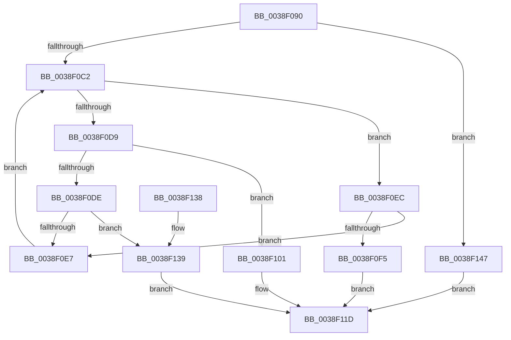

# RtlLookupElementGenericTableFull

- RVA: `0x0038F090`–`0x0038F152` (길이 `194` bytes)
- VA: `0x000000014038F090`
- 실행 섹션: `.text`
- PDB 이름 있음: `예`; PDB Function 태그: `아니요`
- unwind 정보 RVA: `0x00080778`
- 디코드: `55`개 명령, `194/194` bytes 표시
- 미해석 바이트: `0` (있으면 어셈블리에 `.byte`로 보존)

> 이 문서는 커널 이미지의 기계어와 PDB 기호를 분석해 생성했습니다. 4번과 5번은 함수 원형과 자료형을 바이너리 사용 방식에서 추정한 C 해석이며 원본 소스 복구 결과는 아닙니다.

## 1. Dependencies

- 직접 호출 지점: **2**; 고유 호출 대상: **2**
- 직접 호출자로 확인된 함수: **0**
- RIP 상대 이미지 참조: **0**

### Outgoing calls
- `0x0038F0D0` → [guard_dispatch_icall](../6B/guard_dispatch_icall_function_006BAAD0.md) (function, `0x006BAAD0`)
- `0x0038F10E` → [RtlSplay](RtlSplay_function_0038F1E0.md) (function, `0x0038F1E0`)

### Direct callers
- 이 함수 시작 RVA로 연결되는 직접 call은 확인되지 않았습니다. 간접 호출은 완전히 역산할 수 없습니다.

### Static image references
- 디코드된 RIP-relative 메모리 참조가 없습니다.

## 2. Other-region calls and transfers

- 다른 실행 섹션으로 향하는 call: **0**
- 별도 외부 분기/꼬리 이동을 확인하지 못했습니다.

## 3. Assembly (complete function range)

```asm
0038F090  48 89 5C 24 08                  mov qword ptr [rsp + 8], rbx
0038F095  48 89 74 24 10                  mov qword ptr [rsp + 0x10], rsi
0038F09A  48 89 7C 24 18                  mov qword ptr [rsp + 0x18], rdi
0038F09F  4C 89 74 24 20                  mov qword ptr [rsp + 0x20], r14
0038F0A4  41 57                           push r15
0038F0A6  48 83 EC 20                     sub rsp, 0x20
0038F0AA  48 8B 19                        mov rbx, qword ptr [rcx]
0038F0AD  4D 8B F9                        mov r15, r9
0038F0B0  4D 8B F0                        mov r14, r8
0038F0B3  48 8B F2                        mov rsi, rdx
0038F0B6  48 8B F9                        mov rdi, rcx
0038F0B9  48 85 DB                        test rbx, rbx
0038F0BC  0F 84 85 00 00 00               je 0x14038f147
0038F0C2  48 8B 47 28                     mov rax, qword ptr [rdi + 0x28]
0038F0C6  4C 8D 43 28                     lea r8, [rbx + 0x28]
0038F0CA  48 8B D6                        mov rdx, rsi
0038F0CD  48 8B CF                        mov rcx, rdi
0038F0D0  E8 FB B9 32 00                  call 0x1406baad0
0038F0D5  85 C0                           test eax, eax
0038F0D7  74 13                           je 0x14038f0ec
0038F0D9  83 F8 01                        cmp eax, 1
0038F0DC  75 23                           jne 0x14038f101
0038F0DE  48 8B 43 10                     mov rax, qword ptr [rbx + 0x10]
0038F0E2  48 85 C0                        test rax, rax
0038F0E5  74 52                           je 0x14038f139
0038F0E7  48 8B D8                        mov rbx, rax
0038F0EA  EB D6                           jmp 0x14038f0c2
0038F0EC  48 8B 43 08                     mov rax, qword ptr [rbx + 8]
0038F0F0  48 85 C0                        test rax, rax
0038F0F3  75 F2                           jne 0x14038f0e7
0038F0F5  49 89 1E                        mov qword ptr [r14], rbx
0038F0F8  41 C7 07 02 00 00 00            mov dword ptr [r15], 2
0038F0FF  EB 1C                           jmp 0x14038f11d
0038F101  49 89 1E                        mov qword ptr [r14], rbx
0038F104  41 C7 07 01 00 00 00            mov dword ptr [r15], 1
0038F10B  49 8B 0E                        mov rcx, qword ptr [r14]
0038F10E  E8 CD 00 00 00                  call 0x14038f1e0
0038F113  48 89 07                        mov qword ptr [rdi], rax
0038F116  49 8B 06                        mov rax, qword ptr [r14]
0038F119  48 83 C0 28                     add rax, 0x28
0038F11D  48 8B 5C 24 30                  mov rbx, qword ptr [rsp + 0x30]
0038F122  48 8B 74 24 38                  mov rsi, qword ptr [rsp + 0x38]
0038F127  48 8B 7C 24 40                  mov rdi, qword ptr [rsp + 0x40]
0038F12C  4C 8B 74 24 48                  mov r14, qword ptr [rsp + 0x48]
0038F131  48 83 C4 20                     add rsp, 0x20
0038F135  41 5F                           pop r15
0038F137  C3                              ret
0038F138  CC                              int3
0038F139  49 89 1E                        mov qword ptr [r14], rbx
0038F13C  33 C0                           xor eax, eax
0038F13E  41 C7 07 03 00 00 00            mov dword ptr [r15], 3
0038F145  EB D6                           jmp 0x14038f11d
0038F147  41 C7 01 00 00 00 00            mov dword ptr [r9], 0
0038F14E  33 C0                           xor eax, eax
0038F150  EB CB                           jmp 0x14038f11d
```

## 4. C-style interpretation (structured pseudocode)

```c
__int64 __fastcall RtlLookupElementGenericTableFull(__int64 a1, __int64 a2, __int64 a3, __int64 a4)
{
    __int64 result;
    __int64 v_rsp;
    unsigned __int64 v_stack_p10;
    unsigned __int64 v_stack_p18;
    unsigned __int64 v_stack_p20;
    unsigned __int64 v_stack_p8;

    v_stack_p8 = v_rbx;
    v_stack_p10 = v_rsi;
    v_stack_p18 = v_rdi;
    v_stack_p20 = v_r14;
    v_rsp = (v_rsp) - (32);
    if (*(unsigned __int64 *)(a1) == 0) goto loc_0038F147;
loc_0038F0C2:
    result = guard_dispatch_icall(a1, a2, *(unsigned __int64 *)(a1) + 40, a4);
    if ((unsigned int)(result) == 0) goto loc_0038F0EC;
    if (((unsigned int)(result)) != 1) goto loc_0038F101;
    if (*(unsigned __int64 *)(*(unsigned __int64 *)(a1) + 16) == 0) goto loc_0038F139;
loc_0038F0E7:
    goto loc_0038F0C2;
loc_0038F0EC:
    if (*(unsigned __int64 *)(*(unsigned __int64 *)(*(unsigned __int64 *)(a1) + 16) + 8) != 0) goto loc_0038F0E7;
    *(unsigned __int64 *)(a3) = *(unsigned __int64 *)(*(unsigned __int64 *)(a1) + 16);
    *(unsigned int *)(a4) = 2;
    goto loc_0038F11D;
loc_0038F101:
    *(unsigned __int64 *)(a3) = *(unsigned __int64 *)(*(unsigned __int64 *)(a1) + 16);
    *(unsigned int *)(a4) = 1;
    result = RtlSplay(*(unsigned __int64 *)(a3), a2, *(unsigned __int64 *)(a1) + 40, a4);
    *(unsigned __int64 *)(a1) = result;
    result = (*(unsigned __int64 *)(a3)) + (40);
loc_0038F11D:
    v_rsp = (v_rsp) + (32);
    return result;
loc_0038F139:
    *(unsigned __int64 *)(v_stack_p20) = v_stack_p8;
    result = 0;
    *(unsigned int *)(a4) = 3;
    goto loc_0038F11D;
loc_0038F147:
    *(unsigned int *)(a4) = 0;
    result = 0;
    goto loc_0038F11D;
}
```

## 5. (Beta) C Style

```c
int64_t RtlLookupElementGenericTableFull(void *Arg1, int64_t Arg2, void *Arg3, void *Arg4)
{
    uint8_t *arg1 = (uint8_t *)Arg1;
    uint8_t *arg3 = (uint8_t *)Arg3;
    uint8_t *arg4 = (uint8_t *)Arg4;

    int64_t result;
    int64_t local_rsp;
    uint64_t v_stack_p10;
    uint64_t v_stack_p18;
    uint64_t v_stack_p20;
    uint64_t v_stack_p8;

    v_stack_p8 = local_rbx;
    v_stack_p10 = local_rsi;
    v_stack_p18 = local_rdi;
    v_stack_p20 = local_r14;
    local_rsp = (local_rsp) - (32);
    if (*(uint64_t *)(arg1) == 0) goto loc_0038F147;
loc_0038F0C2:
    result = guard_dispatch_icall(Arg1, Arg2, *(uint64_t *)(arg1) + 40, Arg4);
    if ((uint32_t)(result) == 0) goto loc_0038F0EC;
    if (((uint32_t)(result)) != 1) goto loc_0038F101;
    if (*(uint64_t *)(*(uint64_t *)(arg1) + 0x10) == 0) goto loc_0038F139;
loc_0038F0E7:
    goto loc_0038F0C2;
loc_0038F0EC:
    if (*(uint64_t *)(*(uint64_t *)(*(uint64_t *)(arg1) + 0x10) + 0x8) != 0) goto loc_0038F0E7;
    *(uint64_t *)(arg3) = *(uint64_t *)(*(uint64_t *)(arg1) + 0x10);
    *(uint32_t *)(arg4) = 2;
    goto loc_0038F11D;
loc_0038F101:
    *(uint64_t *)(arg3) = *(uint64_t *)(*(uint64_t *)(arg1) + 0x10);
    *(uint32_t *)(arg4) = 1;
    result = RtlSplay(*(uint64_t *)(arg3), Arg2, *(uint64_t *)(arg1) + 40, Arg4);
    *(uint64_t *)(arg1) = result;
    result = (*(uint64_t *)(arg3)) + (40);
loc_0038F11D:
    local_rsp = (local_rsp) + (32);
    return result;
loc_0038F139:
    *(uint64_t *)(v_stack_p20) = v_stack_p8;
    result = 0;
    *(uint32_t *)(arg4) = 3;
    goto loc_0038F11D;
loc_0038F147:
    *(uint32_t *)(arg4) = 0;
    result = 0;
    goto loc_0038F11D;
}
```

### 관측된 메모리 오프셋

구조체 형식이 확인되지 않은 접근은 인자 기준의 오프셋으로만 기록했습니다.

| 기준 인자 | 오프셋 표현 | 폭 (bit) | 접근 |
|---|---:|---:|---|
| `Arg1` | `+ 0x0` | `64` | `R` |
| `Arg1` | `+ 0x0` | `64` | `W` |
| `Arg1` | `+ 0x28` | `64` | `R` |
| `Arg3` | `+ 0x0` | `64` | `R` |
| `Arg3` | `+ 0x0` | `64` | `W` |
| `Arg4` | `+ 0x0` | `32` | `W` |

## 6. Execution-region graph

[열기: 2D/3D 그래프와 함수 탐색 컨트롤 패널](../../../control-panel.html?section=text&rva=0x0038F090&view=graph)

- 2D 그래프는 위에서 아래로 흐르고, 3D 그래프는 빈 공간을 드래그해 회전합니다. Shift+드래그는 이동, 휠은 확대·축소, 함수 노드 선택은 대상 보고서 이동입니다.

### Static fallback


