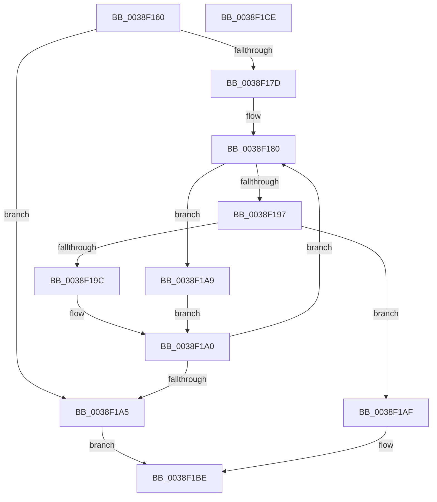

# RtlLookupElementGenericTable

- RVA: `0x0038F160`–`0x0038F1CF` (길이 `111` bytes)
- VA: `0x000000014038F160`
- 실행 섹션: `.text`
- PDB 이름 있음: `예`; PDB Function 태그: `아니요`
- unwind 정보 RVA: `0x00060BC4`
- 디코드: `36`개 명령, `111/111` bytes 표시
- 미해석 바이트: `0` (있으면 어셈블리에 `.byte`로 보존)

> 이 문서는 커널 이미지의 기계어와 PDB 기호를 분석해 생성했습니다. 4번과 5번은 함수 원형과 자료형을 바이너리 사용 방식에서 추정한 C 해석이며 원본 소스 복구 결과는 아닙니다.

## 1. Dependencies

- 직접 호출 지점: **2**; 고유 호출 대상: **2**
- 직접 호출자로 확인된 함수: **0**
- RIP 상대 이미지 참조: **0**

### Outgoing calls
- `0x0038F18E` → [guard_dispatch_icall](../6B/guard_dispatch_icall_function_006BAAD0.md) (function, `0x006BAAD0`)
- `0x0038F1B2` → [RtlSplay](RtlSplay_function_0038F1E0.md) (function, `0x0038F1E0`)

### Direct callers
- 이 함수 시작 RVA로 연결되는 직접 call은 확인되지 않았습니다. 간접 호출은 완전히 역산할 수 없습니다.

### Static image references
- 디코드된 RIP-relative 메모리 참조가 없습니다.

## 2. Other-region calls and transfers

- 다른 실행 섹션으로 향하는 call: **0**
- 별도 외부 분기/꼬리 이동을 확인하지 못했습니다.

## 3. Assembly (complete function range)

```asm
0038F160  48 89 5C 24 08                  mov qword ptr [rsp + 8], rbx
0038F165  48 89 74 24 10                  mov qword ptr [rsp + 0x10], rsi
0038F16A  57                              push rdi
0038F16B  48 83 EC 20                     sub rsp, 0x20
0038F16F  48 8B 19                        mov rbx, qword ptr [rcx]
0038F172  48 8B F2                        mov rsi, rdx
0038F175  48 8B F9                        mov rdi, rcx
0038F178  48 85 DB                        test rbx, rbx
0038F17B  74 28                           je 0x14038f1a5
0038F17D  0F 1F 00                        nop dword ptr [rax]
0038F180  48 8B 47 28                     mov rax, qword ptr [rdi + 0x28]
0038F184  4C 8D 43 28                     lea r8, [rbx + 0x28]
0038F188  48 8B D6                        mov rdx, rsi
0038F18B  48 8B CF                        mov rcx, rdi
0038F18E  E8 3D B9 32 00                  call 0x1406baad0
0038F193  85 C0                           test eax, eax
0038F195  74 12                           je 0x14038f1a9
0038F197  83 F8 01                        cmp eax, 1
0038F19A  75 13                           jne 0x14038f1af
0038F19C  48 8B 5B 10                     mov rbx, qword ptr [rbx + 0x10]
0038F1A0  48 85 DB                        test rbx, rbx
0038F1A3  75 DB                           jne 0x14038f180
0038F1A5  33 C0                           xor eax, eax
0038F1A7  EB 15                           jmp 0x14038f1be
0038F1A9  48 8B 5B 08                     mov rbx, qword ptr [rbx + 8]
0038F1AD  EB F1                           jmp 0x14038f1a0
0038F1AF  48 8B CB                        mov rcx, rbx
0038F1B2  E8 29 00 00 00                  call 0x14038f1e0
0038F1B7  48 89 07                        mov qword ptr [rdi], rax
0038F1BA  48 8D 43 28                     lea rax, [rbx + 0x28]
0038F1BE  48 8B 5C 24 30                  mov rbx, qword ptr [rsp + 0x30]
0038F1C3  48 8B 74 24 38                  mov rsi, qword ptr [rsp + 0x38]
0038F1C8  48 83 C4 20                     add rsp, 0x20
0038F1CC  5F                              pop rdi
0038F1CD  C3                              ret
0038F1CE  CC                              int3
```

## 4. C-style interpretation (structured pseudocode)

```c
__int64 __fastcall RtlLookupElementGenericTable(__int64 a1, __int64 a2)
{
    __int64 result;
    __int64 v_rsp;
    unsigned __int64 v_stack_p10;
    unsigned __int64 v_stack_p8;

    v_stack_p8 = v_rbx;
    v_stack_p10 = v_rsi;
    v_rsp = (v_rsp) - (32);
    if (*(unsigned __int64 *)(a1) == 0) goto loc_0038F1A5;
loc_0038F180:
    result = guard_dispatch_icall(a1, a2, *(unsigned __int64 *)(a1) + 40, a4);
    if ((unsigned int)(result) == 0) goto loc_0038F1A9;
    if (((unsigned int)(result)) != 1) goto loc_0038F1AF;
loc_0038F1A0:
    if (*(unsigned __int64 *)(*(unsigned __int64 *)(a1) + 16) != 0) goto loc_0038F180;
loc_0038F1A5:
    result = 0;
    goto loc_0038F1BE;
loc_0038F1A9:
    goto loc_0038F1A0;
loc_0038F1AF:
    result = RtlSplay(*(unsigned __int64 *)(*(unsigned __int64 *)(*(unsigned __int64 *)(a1) + 16) + 8), a2, *(unsigned __int64 *)(a1) + 40, a4);
    *(unsigned __int64 *)(a1) = result;
loc_0038F1BE:
    v_rsp = (v_rsp) + (32);
    return *(unsigned __int64 *)(*(unsigned __int64 *)(*(unsigned __int64 *)(a1) + 16) + 8) + 40;
}
```

## 5. (Beta) C Style

```c
int64_t RtlLookupElementGenericTable(void *Arg1, int64_t Arg2)
{
    uint8_t *arg1 = (uint8_t *)Arg1;

    int64_t result;
    int64_t local_rsp;
    uint64_t v_stack_p10;
    uint64_t v_stack_p8;

    v_stack_p8 = local_rbx;
    v_stack_p10 = local_rsi;
    local_rsp = (local_rsp) - (32);
    if (*(uint64_t *)(arg1) == 0) goto loc_0038F1A5;
loc_0038F180:
    result = guard_dispatch_icall(Arg1, Arg2, *(uint64_t *)(arg1) + 40, a4);
    if ((uint32_t)(result) == 0) goto loc_0038F1A9;
    if (((uint32_t)(result)) != 1) goto loc_0038F1AF;
loc_0038F1A0:
    if (*(uint64_t *)(*(uint64_t *)(arg1) + 0x10) != 0) goto loc_0038F180;
loc_0038F1A5:
    result = 0;
    goto loc_0038F1BE;
loc_0038F1A9:
    goto loc_0038F1A0;
loc_0038F1AF:
    result = RtlSplay(*(uint64_t *)(*(uint64_t *)(*(uint64_t *)(arg1) + 0x10) + 0x8), Arg2, *(uint64_t *)(arg1) + 40, a4);
    *(uint64_t *)(arg1) = result;
loc_0038F1BE:
    local_rsp = (local_rsp) + (32);
    return *(uint64_t *)(*(uint64_t *)(*(uint64_t *)(arg1) + 0x10) + 0x8) + 40;
}
```

### 관측된 메모리 오프셋

구조체 형식이 확인되지 않은 접근은 인자 기준의 오프셋으로만 기록했습니다.

| 기준 인자 | 오프셋 표현 | 폭 (bit) | 접근 |
|---|---:|---:|---|
| `Arg1` | `+ 0x0` | `64` | `R` |
| `Arg1` | `+ 0x0` | `64` | `W` |
| `Arg1` | `+ 0x28` | `64` | `R` |

## 6. Execution-region graph

[열기: 2D/3D 그래프와 함수 탐색 컨트롤 패널](../../../control-panel.html?section=text&rva=0x0038F160&view=graph)

- 2D 그래프는 위에서 아래로 흐르고, 3D 그래프는 빈 공간을 드래그해 회전합니다. Shift+드래그는 이동, 휠은 확대·축소, 함수 노드 선택은 대상 보고서 이동입니다.

### Static fallback


