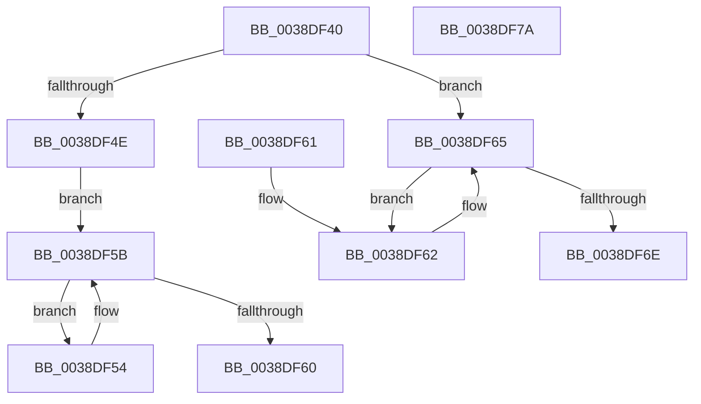

# RtlRealSuccessor

- RVA: `0x0038DF40`–`0x0038DF7B` (길이 `59` bytes)
- VA: `0x000000014038DF40`
- 실행 섹션: `.text`
- PDB 이름 있음: `예`; PDB Function 태그: `아니요`
- unwind 정보 RVA: `0x000DB714`
- 디코드: `22`개 명령, `59/59` bytes 표시
- 미해석 바이트: `0` (있으면 어셈블리에 `.byte`로 보존)

> 이 문서는 커널 이미지의 기계어와 PDB 기호를 분석해 생성했습니다. 4번과 5번은 함수 원형과 자료형을 바이너리 사용 방식에서 추정한 C 해석이며 원본 소스 복구 결과는 아닙니다.

## 1. Dependencies

- 직접 호출 지점: **0**; 고유 호출 대상: **0**
- 직접 호출자로 확인된 함수: **17**
- RIP 상대 이미지 참조: **0**

### Outgoing calls
- 직접 디코드된 call 명령이 없습니다.

### Direct callers
- [FsRtlFastUnlockSingleExclusive](FsRtlFastUnlockSingleExclusive_function_0038C8E0.md) at `0x0038CAE2`
- [sub_0038D025](Unknown_function_0038D025.md) at `0x0038D04A`
- [RtlEnumerateGenericTable](RtlEnumerateGenericTable_function_0038DED0.md) at `0x0038DEEC`
- [FsRtlPrivateLock](FsRtlPrivateLock_function_0038DF90.md) at `0x0038E43F`
- [FsRtlPrivateInsertSharedLock](FsRtlPrivateInsertSharedLock_function_0038E810.md) at `0x0038EA10`
- [FsRtlPrivateInsertExclusiveLock](FsRtlPrivateInsertExclusiveLock_function_0038EBFC.md) at `0x0038ED22`
- [FsRtlCheckNoExclusiveConflict](FsRtlCheckNoExclusiveConflict_function_0038FA54.md) at `0x0038FB64`
- [FsRtlPrivateFastUnlockAll](../3F/FsRtlPrivateFastUnlockAll_function_003FD554.md) at `0x003FD5FF`
- [FsRtlPrivateFastUnlockAll](../3F/FsRtlPrivateFastUnlockAll_function_003FD554.md) at `0x003FD7FF`
- [RtlEnumerateGenericTableWithoutSplaying](../49/RtlEnumerateGenericTableWithoutSplaying_function_0049C670.md) at `0x0049C690`
- [FsRtlGetNextFileLock](../58/FsRtlGetNextFileLock_function_00581850.md) at `0x005819AC`
- [FsRtlGetNextFileLock](../58/FsRtlGetNextFileLock_function_00581850.md) at `0x005819BD`
- [FsRtlGetNextFileLock](../58/FsRtlGetNextFileLock_function_00581850.md) at `0x00581A74`
- [FsRtlGetNextFileLock](../58/FsRtlGetNextFileLock_function_00581850.md) at `0x00581B01`
- [sub_006E54BE](../6E/Unknown_function_006E54BE.md) at `0x006E551F`
- [sub_006E5574](../6E/Unknown_function_006E5574.md) at `0x006E55DE`
- [sub_006E56AC](../6E/Unknown_function_006E56AC.md) at `0x006E5729`
- [sub_006E576A](../6E/Unknown_function_006E576A.md) at `0x006E576A`
- [sub_006EBE5A](../6E/Unknown_function_006EBE5A.md) at `0x006EBEAE`
- [FsRtlDeleteKeyFromTunnelCache](../../page/A5/FsRtlDeleteKeyFromTunnelCache_function_00A51E30.md) at `0x00A51ECC`
- [RtlNextUnicodePrefix](../../page/A5/RtlNextUnicodePrefix_function_00A5ECC0.md) at `0x00A5ECF3`

### Static image references
- 디코드된 RIP-relative 메모리 참조가 없습니다.

## 2. Other-region calls and transfers

- 다른 실행 섹션으로 향하는 call: **0**
- 별도 외부 분기/꼬리 이동을 확인하지 못했습니다.

## 3. Assembly (complete function range)

```asm
0038DF40  48 8B 41 10                     mov rax, qword ptr [rcx + 0x10]
0038DF44  33 D2                           xor edx, edx
0038DF46  4C 8B C1                        mov r8, rcx
0038DF49  48 85 C0                        test rax, rax
0038DF4C  74 17                           je 0x14038df65
0038DF4E  48 8B 48 08                     mov rcx, qword ptr [rax + 8]
0038DF52  EB 07                           jmp 0x14038df5b
0038DF54  48 8B C1                        mov rax, rcx
0038DF57  48 8B 49 08                     mov rcx, qword ptr [rcx + 8]
0038DF5B  48 85 C9                        test rcx, rcx
0038DF5E  75 F4                           jne 0x14038df54
0038DF60  C3                              ret
0038DF61  CC                              int3
0038DF62  4C 8B C1                        mov r8, rcx
0038DF65  48 8B 09                        mov rcx, qword ptr [rcx]
0038DF68  4C 39 41 10                     cmp qword ptr [rcx + 0x10], r8
0038DF6C  74 F4                           je 0x14038df62
0038DF6E  4C 39 41 08                     cmp qword ptr [rcx + 8], r8
0038DF72  48 0F 44 D1                     cmove rdx, rcx
0038DF76  48 8B C2                        mov rax, rdx
0038DF79  C3                              ret
0038DF7A  CC                              int3
```

## 4. C-style interpretation (structured pseudocode)

```c
__int64 __fastcall RtlRealSuccessor(__int64 a1, int a2)
{
    a2 = 0;
    if (*(unsigned __int64 *)(a1 + 16) == 0) goto loc_0038DF65;
    goto loc_0038DF5B;
loc_0038DF54:
loc_0038DF5B:
    if (*(unsigned __int64 *)(*(unsigned __int64 *)(*(unsigned __int64 *)(a1 + 16) + 8) + 8) != 0) goto loc_0038DF54;
    return *(unsigned __int64 *)(*(unsigned __int64 *)(a1 + 16) + 8);
loc_0038DF62:
loc_0038DF65:
    if ((*(unsigned __int64 *)(*(unsigned __int64 *)(*(unsigned __int64 *)(*(unsigned __int64 *)(*(unsigned __int64 *)(a1 + 16) + 8) + 8)) + 16)) == (*(unsigned __int64 *)(*(unsigned __int64 *)(*(unsigned __int64 *)(a1 + 16) + 8) + 8))) goto loc_0038DF62;
    if ((*(unsigned __int64 *)(*(unsigned __int64 *)(*(unsigned __int64 *)(*(unsigned __int64 *)(*(unsigned __int64 *)(a1 + 16) + 8) + 8)) + 8)) == (*(unsigned __int64 *)(*(unsigned __int64 *)(*(unsigned __int64 *)(a1 + 16) + 8) + 8))) { a2 = *(unsigned __int64 *)(*(unsigned __int64 *)(*(unsigned __int64 *)(*(unsigned __int64 *)(a1 + 16) + 8) + 8)); }
    return a2;
}
```

## 5. (Beta) C Style

```c
int64_t RtlRealSuccessor(void *Arg1, int32_t Arg2)
{
    uint8_t *arg1 = (uint8_t *)Arg1;

    Arg2 = 0;
    if (*(uint64_t *)(arg1 + 0x10) == 0) goto loc_0038DF65;
    goto loc_0038DF5B;
loc_0038DF54:
loc_0038DF5B:
    if (*(uint64_t *)(*(uint64_t *)(*(uint64_t *)(arg1 + 0x10) + 0x8) + 0x8) != 0) goto loc_0038DF54;
    return *(uint64_t *)(*(uint64_t *)(arg1 + 0x10) + 0x8);
loc_0038DF62:
loc_0038DF65:
    if ((*(uint64_t *)(*(uint64_t *)(*(uint64_t *)(*(uint64_t *)(*(uint64_t *)(arg1 + 0x10) + 0x8) + 0x8)) + 0x10)) == (*(uint64_t *)(*(uint64_t *)(*(uint64_t *)(arg1 + 0x10) + 0x8) + 0x8))) goto loc_0038DF62;
    if ((*(uint64_t *)(*(uint64_t *)(*(uint64_t *)(*(uint64_t *)(*(uint64_t *)(arg1 + 0x10) + 0x8) + 0x8)) + 0x8)) == (*(uint64_t *)(*(uint64_t *)(*(uint64_t *)(arg1 + 0x10) + 0x8) + 0x8))) { Arg2 = *(uint64_t *)(*(uint64_t *)(*(uint64_t *)(*(uint64_t *)(arg1 + 0x10) + 0x8) + 0x8)); }
    return Arg2;
}
```

### 관측된 메모리 오프셋

구조체 형식이 확인되지 않은 접근은 인자 기준의 오프셋으로만 기록했습니다.

| 기준 인자 | 오프셋 표현 | 폭 (bit) | 접근 |
|---|---:|---:|---|
| `Arg1` | `+ 0x10` | `64` | `R` |

## 6. Execution-region graph

[열기: 2D/3D 그래프와 함수 탐색 컨트롤 패널](../../../control-panel.html?section=text&rva=0x0038DF40&view=graph)

- 2D 그래프는 위에서 아래로 흐르고, 3D 그래프는 빈 공간을 드래그해 회전합니다. Shift+드래그는 이동, 휠은 확대·축소, 함수 노드 선택은 대상 보고서 이동입니다.

### Static fallback


