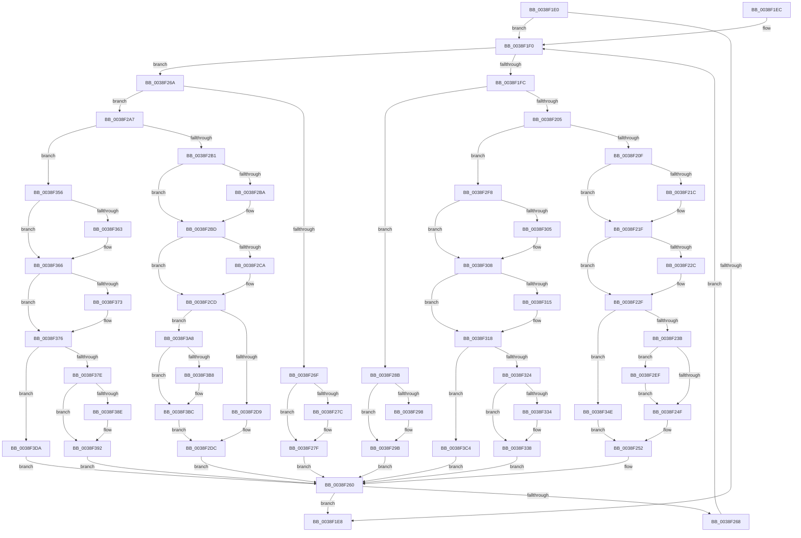

# RtlSplay

- RVA: `0x0038F1E0`–`0x0038F3F0` (길이 `528` bytes)
- VA: `0x000000014038F1E0`
- 실행 섹션: `.text`
- PDB 이름 있음: `예`; PDB Function 태그: `아니요`
- unwind 정보 RVA: `0x000DB714`
- 디코드: `156`개 명령, `528/528` bytes 표시
- 미해석 바이트: `0` (있으면 어셈블리에 `.byte`로 보존)

> 이 문서는 커널 이미지의 기계어와 PDB 기호를 분석해 생성했습니다. 4번과 5번은 함수 원형과 자료형을 바이너리 사용 방식에서 추정한 C 해석이며 원본 소스 복구 결과는 아닙니다.

## 1. Dependencies

- 직접 호출 지점: **0**; 고유 호출 대상: **0**
- 직접 호출자로 확인된 함수: **16**
- RIP 상대 이미지 참조: **0**

### Outgoing calls
- 직접 디코드된 call 명령이 없습니다.

### Direct callers
- [RtlDelete](RtlDelete_function_0038D8B0.md) at `0x0038D927`
- [RtlEnumerateGenericTable](RtlEnumerateGenericTable_function_0038DED0.md) at `0x0038DEFC`
- [FsRtlPrivateLock](FsRtlPrivateLock_function_0038DF90.md) at `0x0038E239`
- [FsRtlPrivateInsertSharedLock](FsRtlPrivateInsertSharedLock_function_0038E810.md) at `0x0038E8FA`
- [FsRtlPrivateInsertSharedLock](FsRtlPrivateInsertSharedLock_function_0038E810.md) at `0x0038E999`
- [FsRtlPrivateCheckForExclusiveLockAccess](FsRtlPrivateCheckForExclusiveLockAccess_function_0038EA28.md) at `0x0038EA62`
- [FsRtlPrivateCheckForExclusiveLockAccess](FsRtlPrivateCheckForExclusiveLockAccess_function_0038EA28.md) at `0x0038EB51`
- [RtlInsertElementGenericTable](RtlInsertElementGenericTable_function_0038EDE0.md) at `0x0038EEB4`
- [RtlInsertElementGenericTableFull](RtlInsertElementGenericTableFull_function_0038EF60.md) at `0x0038EF94`
- [RtlLookupElementGenericTableFull](RtlLookupElementGenericTableFull_function_0038F090.md) at `0x0038F10E`
- [RtlLookupElementGenericTable](RtlLookupElementGenericTable_function_0038F160.md) at `0x0038F1B2`
- [FsRtlPrivateCheckForSharedLockAccess](FsRtlPrivateCheckForSharedLockAccess_function_0038F944.md) at `0x0038F9C7`
- [FsRtlCheckNoExclusiveConflict](FsRtlCheckNoExclusiveConflict_function_0038FA54.md) at `0x0038FAE0`
- [FsRtlCheckNoSharedConflict](FsRtlCheckNoSharedConflict_function_0038FB8C.md) at `0x0038FC07`
- [PfxFindPrefix](../../page/78/PfxFindPrefix_function_0078CCA0.md) at `0x0078CD33`
- [PfxInsertPrefix](../../page/78/PfxInsertPrefix_function_0078CDA0.md) at `0x0078CE77`
- [RtlInsertUnicodePrefix](../../page/99/RtlInsertUnicodePrefix_function_0099D590.md) at `0x0099D650`
- [RtlFindUnicodePrefix](../../page/99/RtlFindUnicodePrefix_function_0099D710.md) at `0x0099D839`

### Static image references
- 디코드된 RIP-relative 메모리 참조가 없습니다.

## 2. Other-region calls and transfers

- 다른 실행 섹션으로 향하는 call: **0**
- 별도 외부 분기/꼬리 이동을 확인하지 못했습니다.

## 3. Assembly (complete function range)

```asm
0038F1E0  48 8B 01                        mov rax, qword ptr [rcx]
0038F1E3  48 3B C1                        cmp rax, rcx
0038F1E6  75 08                           jne 0x14038f1f0
0038F1E8  48 8B C1                        mov rax, rcx
0038F1EB  C3                              ret
0038F1EC  CC                              int3
0038F1ED  0F 1F 00                        nop dword ptr [rax]
0038F1F0  4C 8B 40 08                     mov r8, qword ptr [rax + 8]
0038F1F4  48 8B 10                        mov rdx, qword ptr [rax]
0038F1F7  4C 3B C1                        cmp r8, rcx
0038F1FA  75 6E                           jne 0x14038f26a
0038F1FC  48 3B D0                        cmp rdx, rax
0038F1FF  0F 84 86 00 00 00               je 0x14038f28b
0038F205  48 39 42 08                     cmp qword ptr [rdx + 8], rax
0038F209  0F 85 E9 00 00 00               jne 0x14038f2f8
0038F20F  4C 8B 41 10                     mov r8, qword ptr [rcx + 0x10]
0038F213  4C 89 40 08                     mov qword ptr [rax + 8], r8
0038F217  4D 85 C0                        test r8, r8
0038F21A  74 03                           je 0x14038f21f
0038F21C  49 89 00                        mov qword ptr [r8], rax
0038F21F  4C 8B 40 10                     mov r8, qword ptr [rax + 0x10]
0038F223  4C 89 42 08                     mov qword ptr [rdx + 8], r8
0038F227  4D 85 C0                        test r8, r8
0038F22A  74 03                           je 0x14038f22f
0038F22C  49 89 10                        mov qword ptr [r8], rdx
0038F22F  4C 8B 02                        mov r8, qword ptr [rdx]
0038F232  4C 3B C2                        cmp r8, rdx
0038F235  0F 84 13 01 00 00               je 0x14038f34e
0038F23B  4C 89 01                        mov qword ptr [rcx], r8
0038F23E  4C 8B 0A                        mov r9, qword ptr [rdx]
0038F241  49 39 51 08                     cmp qword ptr [r9 + 8], rdx
0038F245  4D 8D 41 08                     lea r8, [r9 + 8]
0038F249  0F 85 A0 00 00 00               jne 0x14038f2ef
0038F24F  49 89 08                        mov qword ptr [r8], rcx
0038F252  48 89 41 10                     mov qword ptr [rcx + 0x10], rax
0038F256  48 89 08                        mov qword ptr [rax], rcx
0038F259  48 89 50 10                     mov qword ptr [rax + 0x10], rdx
0038F25D  48 89 02                        mov qword ptr [rdx], rax
0038F260  48 8B 01                        mov rax, qword ptr [rcx]
0038F263  48 3B C1                        cmp rax, rcx
0038F266  74 80                           je 0x14038f1e8
0038F268  EB 86                           jmp 0x14038f1f0
0038F26A  48 3B D0                        cmp rdx, rax
0038F26D  75 38                           jne 0x14038f2a7
0038F26F  48 8B 51 08                     mov rdx, qword ptr [rcx + 8]
0038F273  48 89 50 10                     mov qword ptr [rax + 0x10], rdx
0038F277  48 85 D2                        test rdx, rdx
0038F27A  74 03                           je 0x14038f27f
0038F27C  48 89 02                        mov qword ptr [rdx], rax
0038F27F  48 89 41 08                     mov qword ptr [rcx + 8], rax
0038F283  48 89 08                        mov qword ptr [rax], rcx
0038F286  48 89 09                        mov qword ptr [rcx], rcx
0038F289  EB D5                           jmp 0x14038f260
0038F28B  48 8B 51 10                     mov rdx, qword ptr [rcx + 0x10]
0038F28F  48 89 50 08                     mov qword ptr [rax + 8], rdx
0038F293  48 85 D2                        test rdx, rdx
0038F296  74 03                           je 0x14038f29b
0038F298  48 89 02                        mov qword ptr [rdx], rax
0038F29B  48 89 41 10                     mov qword ptr [rcx + 0x10], rax
0038F29F  48 89 08                        mov qword ptr [rax], rcx
0038F2A2  48 89 09                        mov qword ptr [rcx], rcx
0038F2A5  EB B9                           jmp 0x14038f260
0038F2A7  48 39 42 10                     cmp qword ptr [rdx + 0x10], rax
0038F2AB  0F 85 A5 00 00 00               jne 0x14038f356
0038F2B1  4C 89 42 10                     mov qword ptr [rdx + 0x10], r8
0038F2B5  4D 85 C0                        test r8, r8
0038F2B8  74 03                           je 0x14038f2bd
0038F2BA  49 89 10                        mov qword ptr [r8], rdx
0038F2BD  4C 8B 41 08                     mov r8, qword ptr [rcx + 8]
0038F2C1  4C 89 40 10                     mov qword ptr [rax + 0x10], r8
0038F2C5  4D 85 C0                        test r8, r8
0038F2C8  74 03                           je 0x14038f2cd
0038F2CA  49 89 00                        mov qword ptr [r8], rax
0038F2CD  4C 8B 02                        mov r8, qword ptr [rdx]
0038F2D0  4C 3B C2                        cmp r8, rdx
0038F2D3  0F 85 CF 00 00 00               jne 0x14038f3a8
0038F2D9  48 89 09                        mov qword ptr [rcx], rcx
0038F2DC  48 89 41 08                     mov qword ptr [rcx + 8], rax
0038F2E0  48 89 08                        mov qword ptr [rax], rcx
0038F2E3  48 89 50 08                     mov qword ptr [rax + 8], rdx
0038F2E7  48 89 02                        mov qword ptr [rdx], rax
0038F2EA  E9 71 FF FF FF                  jmp 0x14038f260
0038F2EF  4D 8D 41 10                     lea r8, [r9 + 0x10]
0038F2F3  E9 57 FF FF FF                  jmp 0x14038f24f
0038F2F8  4C 8B 41 08                     mov r8, qword ptr [rcx + 8]
0038F2FC  4C 89 42 10                     mov qword ptr [rdx + 0x10], r8
0038F300  4D 85 C0                        test r8, r8
0038F303  74 03                           je 0x14038f308
0038F305  49 89 10                        mov qword ptr [r8], rdx
0038F308  4C 8B 41 10                     mov r8, qword ptr [rcx + 0x10]
0038F30C  4C 89 40 08                     mov qword ptr [rax + 8], r8
0038F310  4D 85 C0                        test r8, r8
0038F313  74 03                           je 0x14038f318
0038F315  49 89 00                        mov qword ptr [r8], rax
0038F318  4C 8B 02                        mov r8, qword ptr [rdx]
0038F31B  4C 3B C2                        cmp r8, rdx
0038F31E  0F 84 A0 00 00 00               je 0x14038f3c4
0038F324  4C 89 01                        mov qword ptr [rcx], r8
0038F327  4C 8B 0A                        mov r9, qword ptr [rdx]
0038F32A  49 39 51 08                     cmp qword ptr [r9 + 8], rdx
0038F32E  4D 8D 41 08                     lea r8, [r9 + 8]
0038F332  74 04                           je 0x14038f338
0038F334  4D 8D 41 10                     lea r8, [r9 + 0x10]
0038F338  49 89 08                        mov qword ptr [r8], rcx
0038F33B  48 89 51 08                     mov qword ptr [rcx + 8], rdx
0038F33F  48 89 0A                        mov qword ptr [rdx], rcx
0038F342  48 89 41 10                     mov qword ptr [rcx + 0x10], rax
0038F346  48 89 08                        mov qword ptr [rax], rcx
0038F349  E9 12 FF FF FF                  jmp 0x14038f260
0038F34E  48 89 09                        mov qword ptr [rcx], rcx
0038F351  E9 FC FE FF FF                  jmp 0x14038f252
0038F356  4C 8B 41 08                     mov r8, qword ptr [rcx + 8]
0038F35A  4C 89 40 10                     mov qword ptr [rax + 0x10], r8
0038F35E  4D 85 C0                        test r8, r8
0038F361  74 03                           je 0x14038f366
0038F363  49 89 00                        mov qword ptr [r8], rax
0038F366  4C 8B 41 10                     mov r8, qword ptr [rcx + 0x10]
0038F36A  4C 89 42 08                     mov qword ptr [rdx + 8], r8
0038F36E  4D 85 C0                        test r8, r8
0038F371  74 03                           je 0x14038f376
0038F373  49 89 10                        mov qword ptr [r8], rdx
0038F376  4C 8B 02                        mov r8, qword ptr [rdx]
0038F379  4C 3B C2                        cmp r8, rdx
0038F37C  74 5C                           je 0x14038f3da
0038F37E  4C 89 01                        mov qword ptr [rcx], r8
0038F381  4C 8B 0A                        mov r9, qword ptr [rdx]
0038F384  49 39 51 08                     cmp qword ptr [r9 + 8], rdx
0038F388  4D 8D 41 08                     lea r8, [r9 + 8]
0038F38C  74 04                           je 0x14038f392
0038F38E  4D 8D 41 10                     lea r8, [r9 + 0x10]
0038F392  49 89 08                        mov qword ptr [r8], rcx
0038F395  48 89 41 08                     mov qword ptr [rcx + 8], rax
0038F399  48 89 08                        mov qword ptr [rax], rcx
0038F39C  48 89 51 10                     mov qword ptr [rcx + 0x10], rdx
0038F3A0  48 89 0A                        mov qword ptr [rdx], rcx
0038F3A3  E9 B8 FE FF FF                  jmp 0x14038f260
0038F3A8  4C 89 01                        mov qword ptr [rcx], r8
0038F3AB  4C 8B 0A                        mov r9, qword ptr [rdx]
0038F3AE  49 39 51 08                     cmp qword ptr [r9 + 8], rdx
0038F3B2  4D 8D 41 08                     lea r8, [r9 + 8]
0038F3B6  74 04                           je 0x14038f3bc
0038F3B8  4D 8D 41 10                     lea r8, [r9 + 0x10]
0038F3BC  49 89 08                        mov qword ptr [r8], rcx
0038F3BF  E9 18 FF FF FF                  jmp 0x14038f2dc
0038F3C4  48 89 09                        mov qword ptr [rcx], rcx
0038F3C7  48 89 51 08                     mov qword ptr [rcx + 8], rdx
0038F3CB  48 89 0A                        mov qword ptr [rdx], rcx
0038F3CE  48 89 41 10                     mov qword ptr [rcx + 0x10], rax
0038F3D2  48 89 08                        mov qword ptr [rax], rcx
0038F3D5  E9 86 FE FF FF                  jmp 0x14038f260
0038F3DA  48 89 09                        mov qword ptr [rcx], rcx
0038F3DD  48 89 41 08                     mov qword ptr [rcx + 8], rax
0038F3E1  48 89 08                        mov qword ptr [rax], rcx
0038F3E4  48 89 51 10                     mov qword ptr [rcx + 0x10], rdx
0038F3E8  48 89 0A                        mov qword ptr [rdx], rcx
0038F3EB  E9 70 FE FF FF                  jmp 0x14038f260
```

## 4. C-style interpretation (structured pseudocode)

```c
__int64 __fastcall RtlSplay(__int64 a1)
{
    if ((*(unsigned __int64 *)(a1)) != a1) goto loc_0038F1F0;
loc_0038F1E8:
    return a1;
loc_0038F1F0:
    if ((*(unsigned __int64 *)(a1 + 8)) != a1) goto loc_0038F26A;
    if ((*(unsigned __int64 *)(a1)) == a1) goto loc_0038F28B;
    if ((*(unsigned __int64 *)(*(unsigned __int64 *)(a1) + 8)) != a1) goto loc_0038F2F8;
    *(unsigned __int64 *)(a1 + 8) = *(unsigned __int64 *)(a1 + 16);
    if (*(unsigned __int64 *)(a1 + 16) != 0) {
        *(unsigned __int64 *)(*(unsigned __int64 *)(a1 + 16)) = a1;
    }
    *(unsigned __int64 *)(*(unsigned __int64 *)(a1) + 8) = *(unsigned __int64 *)(a1 + 16);
    if (*(unsigned __int64 *)(a1 + 16) != 0) {
        *(unsigned __int64 *)(*(unsigned __int64 *)(a1 + 16)) = *(unsigned __int64 *)(a1);
    }
    if ((*(unsigned __int64 *)(*(unsigned __int64 *)(a1))) == (*(unsigned __int64 *)(a1))) goto loc_0038F34E;
    *(unsigned __int64 *)(a1) = *(unsigned __int64 *)(*(unsigned __int64 *)(a1));
    if ((*(unsigned __int64 *)(*(unsigned __int64 *)(*(unsigned __int64 *)(a1)) + 8)) != (*(unsigned __int64 *)(a1))) goto loc_0038F2EF;
loc_0038F24F:
    *(unsigned __int64 *)(*(unsigned __int64 *)(*(unsigned __int64 *)(a1)) + 8) = a1;
loc_0038F252:
    *(unsigned __int64 *)(a1 + 16) = a1;
    *(unsigned __int64 *)(a1) = a1;
    *(unsigned __int64 *)(a1 + 16) = *(unsigned __int64 *)(a1);
    *(unsigned __int64 *)(*(unsigned __int64 *)(a1)) = a1;
loc_0038F260:
    if ((*(unsigned __int64 *)(a1)) == a1) goto loc_0038F1E8;
    goto loc_0038F1F0;
loc_0038F26A:
    if ((*(unsigned __int64 *)(a1)) != (*(unsigned __int64 *)(a1))) goto loc_0038F2A7;
    *(unsigned __int64 *)(*(unsigned __int64 *)(a1) + 16) = *(unsigned __int64 *)(a1 + 8);
    if (*(unsigned __int64 *)(a1 + 8) != 0) {
        *(unsigned __int64 *)(*(unsigned __int64 *)(a1 + 8)) = *(unsigned __int64 *)(a1);
    }
    *(unsigned __int64 *)(a1 + 8) = *(unsigned __int64 *)(a1);
    *(unsigned __int64 *)(*(unsigned __int64 *)(a1)) = a1;
    *(unsigned __int64 *)(a1) = a1;
    goto loc_0038F260;
loc_0038F28B:
    *(unsigned __int64 *)(*(unsigned __int64 *)(a1) + 8) = *(unsigned __int64 *)(a1 + 16);
    if (*(unsigned __int64 *)(a1 + 16) != 0) {
        *(unsigned __int64 *)(*(unsigned __int64 *)(a1 + 16)) = *(unsigned __int64 *)(a1);
    }
    *(unsigned __int64 *)(a1 + 16) = *(unsigned __int64 *)(a1);
    *(unsigned __int64 *)(*(unsigned __int64 *)(a1)) = a1;
    *(unsigned __int64 *)(a1) = a1;
    goto loc_0038F260;
loc_0038F2A7:
    if ((*(unsigned __int64 *)(*(unsigned __int64 *)(a1 + 16) + 16)) != (*(unsigned __int64 *)(a1))) goto loc_0038F356;
    *(unsigned __int64 *)(*(unsigned __int64 *)(a1 + 16) + 16) = *(unsigned __int64 *)(*(unsigned __int64 *)(a1)) + 8;
    if (*(unsigned __int64 *)(*(unsigned __int64 *)(a1)) + 8 != 0) {
        *(unsigned __int64 *)(*(unsigned __int64 *)(*(unsigned __int64 *)(a1)) + 8) = *(unsigned __int64 *)(a1 + 16);
    }
    *(unsigned __int64 *)(*(unsigned __int64 *)(a1) + 16) = *(unsigned __int64 *)(a1 + 8);
    if (*(unsigned __int64 *)(a1 + 8) != 0) {
        *(unsigned __int64 *)(*(unsigned __int64 *)(a1 + 8)) = *(unsigned __int64 *)(a1);
    }
    if ((*(unsigned __int64 *)(*(unsigned __int64 *)(a1 + 16))) != (*(unsigned __int64 *)(a1 + 16))) goto loc_0038F3A8;
    *(unsigned __int64 *)(a1) = a1;
loc_0038F2DC:
    *(unsigned __int64 *)(a1 + 8) = *(unsigned __int64 *)(a1);
    *(unsigned __int64 *)(*(unsigned __int64 *)(a1)) = a1;
    *(unsigned __int64 *)(*(unsigned __int64 *)(a1) + 8) = *(unsigned __int64 *)(a1 + 16);
    *(unsigned __int64 *)(*(unsigned __int64 *)(a1 + 16)) = *(unsigned __int64 *)(a1);
    goto loc_0038F260;
loc_0038F2EF:
    goto loc_0038F24F;
loc_0038F2F8:
    *(unsigned __int64 *)(*(unsigned __int64 *)(a1 + 16) + 16) = *(unsigned __int64 *)(a1 + 8);
    if (*(unsigned __int64 *)(a1 + 8) != 0) {
        *(unsigned __int64 *)(*(unsigned __int64 *)(a1 + 8)) = *(unsigned __int64 *)(a1 + 16);
    }
    *(unsigned __int64 *)(*(unsigned __int64 *)(a1) + 8) = *(unsigned __int64 *)(a1 + 16);
    if (*(unsigned __int64 *)(a1 + 16) != 0) {
        *(unsigned __int64 *)(*(unsigned __int64 *)(a1 + 16)) = *(unsigned __int64 *)(a1);
    }
    if ((*(unsigned __int64 *)(*(unsigned __int64 *)(a1 + 16))) == (*(unsigned __int64 *)(a1 + 16))) goto loc_0038F3C4;
    *(unsigned __int64 *)(a1) = *(unsigned __int64 *)(*(unsigned __int64 *)(a1 + 16));
    if ((*(unsigned __int64 *)(*(unsigned __int64 *)(*(unsigned __int64 *)(a1 + 16)) + 8)) != (*(unsigned __int64 *)(a1 + 16))) {
        a3 = *(unsigned __int64 *)(*(unsigned __int64 *)(a1 + 16)) + 16;
    }
    *(unsigned __int64 *)(a3) = a1;
    *(unsigned __int64 *)(a1 + 8) = *(unsigned __int64 *)(a1 + 16);
    *(unsigned __int64 *)(*(unsigned __int64 *)(a1 + 16)) = a1;
    *(unsigned __int64 *)(a1 + 16) = *(unsigned __int64 *)(a1);
    *(unsigned __int64 *)(*(unsigned __int64 *)(a1)) = a1;
    goto loc_0038F260;
loc_0038F34E:
    *(unsigned __int64 *)(a1) = a1;
    goto loc_0038F252;
loc_0038F356:
    *(unsigned __int64 *)(*(unsigned __int64 *)(a1) + 16) = *(unsigned __int64 *)(a1 + 8);
    if (*(unsigned __int64 *)(a1 + 8) != 0) {
        *(unsigned __int64 *)(*(unsigned __int64 *)(a1 + 8)) = *(unsigned __int64 *)(a1);
    }
    *(unsigned __int64 *)(*(unsigned __int64 *)(a1 + 16) + 8) = *(unsigned __int64 *)(a1 + 16);
    if (*(unsigned __int64 *)(a1 + 16) != 0) {
        *(unsigned __int64 *)(*(unsigned __int64 *)(a1 + 16)) = *(unsigned __int64 *)(a1 + 16);
    }
    if ((*(unsigned __int64 *)(*(unsigned __int64 *)(a1 + 16))) == (*(unsigned __int64 *)(a1 + 16))) goto loc_0038F3DA;
    *(unsigned __int64 *)(a1) = *(unsigned __int64 *)(*(unsigned __int64 *)(a1 + 16));
    if ((*(unsigned __int64 *)(*(unsigned __int64 *)(*(unsigned __int64 *)(a1 + 16)) + 8)) != (*(unsigned __int64 *)(a1 + 16))) {
        a3 = *(unsigned __int64 *)(*(unsigned __int64 *)(a1 + 16)) + 16;
    }
    *(unsigned __int64 *)(a3) = a1;
    *(unsigned __int64 *)(a1 + 8) = *(unsigned __int64 *)(a1);
    *(unsigned __int64 *)(*(unsigned __int64 *)(a1)) = a1;
    *(unsigned __int64 *)(a1 + 16) = *(unsigned __int64 *)(a1 + 16);
    *(unsigned __int64 *)(*(unsigned __int64 *)(a1 + 16)) = a1;
    goto loc_0038F260;
loc_0038F3A8:
    *(unsigned __int64 *)(a1) = a3;
    if ((*(unsigned __int64 *)(*(unsigned __int64 *)(*(unsigned __int64 *)(a1 + 16)) + 8)) != (*(unsigned __int64 *)(a1 + 16))) {
        a3 = *(unsigned __int64 *)(*(unsigned __int64 *)(a1 + 16)) + 16;
    }
    *(unsigned __int64 *)(a3) = a1;
    goto loc_0038F2DC;
loc_0038F3C4:
    *(unsigned __int64 *)(a1) = a1;
    *(unsigned __int64 *)(a1 + 8) = *(unsigned __int64 *)(a1 + 16);
    *(unsigned __int64 *)(*(unsigned __int64 *)(a1 + 16)) = a1;
    *(unsigned __int64 *)(a1 + 16) = *(unsigned __int64 *)(a1);
    *(unsigned __int64 *)(*(unsigned __int64 *)(a1)) = a1;
    goto loc_0038F260;
loc_0038F3DA:
    *(unsigned __int64 *)(a1) = a1;
    *(unsigned __int64 *)(a1 + 8) = *(unsigned __int64 *)(a1);
    *(unsigned __int64 *)(*(unsigned __int64 *)(a1)) = a1;
    *(unsigned __int64 *)(a1 + 16) = *(unsigned __int64 *)(a1 + 16);
    *(unsigned __int64 *)(*(unsigned __int64 *)(a1 + 16)) = a1;
    goto loc_0038F260;
}
```

## 5. (Beta) C Style

```c
void *RtlSplay(void *Arg1)
{
    uint8_t *arg1 = (uint8_t *)Arg1;

    if ((*(uint64_t *)(arg1)) != Arg1) goto loc_0038F1F0;
loc_0038F1E8:
    return Arg1;
loc_0038F1F0:
    if ((*(uint64_t *)(arg1 + 0x8)) != Arg1) goto loc_0038F26A;
    if ((*(uint64_t *)(arg1)) == Arg1) goto loc_0038F28B;
    if ((*(uint64_t *)(*(uint64_t *)(arg1) + 0x8)) != Arg1) goto loc_0038F2F8;
    *(uint64_t *)(arg1 + 0x8) = *(uint64_t *)(arg1 + 0x10);
    if (*(uint64_t *)(arg1 + 0x10) != 0) {
        *(void **)(*(uint64_t *)(arg1 + 0x10)) = Arg1;
    }
    *(uint64_t *)(*(uint64_t *)(arg1) + 0x8) = *(uint64_t *)(arg1 + 0x10);
    if (*(uint64_t *)(arg1 + 0x10) != 0) {
        *(uint64_t *)(*(uint64_t *)(arg1 + 0x10)) = *(uint64_t *)(arg1);
    }
    if ((*(uint64_t *)(*(uint64_t *)(arg1))) == (*(uint64_t *)(arg1))) goto loc_0038F34E;
    *(uint64_t *)(arg1) = *(uint64_t *)(*(uint64_t *)(arg1));
    if ((*(uint64_t *)(*(uint64_t *)(*(uint64_t *)(arg1)) + 0x8)) != (*(uint64_t *)(arg1))) goto loc_0038F2EF;
loc_0038F24F:
    *(void **)(*(uint64_t *)(*(uint64_t *)(arg1)) + 0x8) = Arg1;
loc_0038F252:
    *(void **)(arg1 + 0x10) = Arg1;
    *(void **)(arg1) = Arg1;
    *(uint64_t *)(arg1 + 0x10) = *(uint64_t *)(arg1);
    *(void **)(*(uint64_t *)(arg1)) = Arg1;
loc_0038F260:
    if ((*(uint64_t *)(arg1)) == Arg1) goto loc_0038F1E8;
    goto loc_0038F1F0;
loc_0038F26A:
    if ((*(uint64_t *)(arg1)) != (*(uint64_t *)(arg1))) goto loc_0038F2A7;
    *(uint64_t *)(*(uint64_t *)(arg1) + 0x10) = *(uint64_t *)(arg1 + 0x8);
    if (*(uint64_t *)(arg1 + 0x8) != 0) {
        *(uint64_t *)(*(uint64_t *)(arg1 + 0x8)) = *(uint64_t *)(arg1);
    }
    *(uint64_t *)(arg1 + 0x8) = *(uint64_t *)(arg1);
    *(void **)(*(uint64_t *)(arg1)) = Arg1;
    *(void **)(arg1) = Arg1;
    goto loc_0038F260;
loc_0038F28B:
    *(uint64_t *)(*(uint64_t *)(arg1) + 0x8) = *(uint64_t *)(arg1 + 0x10);
    if (*(uint64_t *)(arg1 + 0x10) != 0) {
        *(uint64_t *)(*(uint64_t *)(arg1 + 0x10)) = *(uint64_t *)(arg1);
    }
    *(uint64_t *)(arg1 + 0x10) = *(uint64_t *)(arg1);
    *(void **)(*(uint64_t *)(arg1)) = Arg1;
    *(void **)(arg1) = Arg1;
    goto loc_0038F260;
loc_0038F2A7:
    if ((*(uint64_t *)(*(uint64_t *)(arg1 + 0x10) + 0x10)) != (*(uint64_t *)(arg1))) goto loc_0038F356;
    *(uint64_t *)(*(uint64_t *)(arg1 + 0x10) + 0x10) = *(uint64_t *)(*(uint64_t *)(arg1)) + 8;
    if (*(uint64_t *)(*(uint64_t *)(arg1)) + 8 != 0) {
        *(uint64_t *)(*(uint64_t *)(*(uint64_t *)(arg1)) + 0x8) = *(uint64_t *)(arg1 + 0x10);
    }
    *(uint64_t *)(*(uint64_t *)(arg1) + 0x10) = *(uint64_t *)(arg1 + 0x8);
    if (*(uint64_t *)(arg1 + 0x8) != 0) {
        *(uint64_t *)(*(uint64_t *)(arg1 + 0x8)) = *(uint64_t *)(arg1);
    }
    if ((*(uint64_t *)(*(uint64_t *)(arg1 + 0x10))) != (*(uint64_t *)(arg1 + 0x10))) goto loc_0038F3A8;
    *(void **)(arg1) = Arg1;
loc_0038F2DC:
    *(uint64_t *)(arg1 + 0x8) = *(uint64_t *)(arg1);
    *(void **)(*(uint64_t *)(arg1)) = Arg1;
    *(uint64_t *)(*(uint64_t *)(arg1) + 0x8) = *(uint64_t *)(arg1 + 0x10);
    *(uint64_t *)(*(uint64_t *)(arg1 + 0x10)) = *(uint64_t *)(arg1);
    goto loc_0038F260;
loc_0038F2EF:
    goto loc_0038F24F;
loc_0038F2F8:
    *(uint64_t *)(*(uint64_t *)(arg1 + 0x10) + 0x10) = *(uint64_t *)(arg1 + 0x8);
    if (*(uint64_t *)(arg1 + 0x8) != 0) {
        *(uint64_t *)(*(uint64_t *)(arg1 + 0x8)) = *(uint64_t *)(arg1 + 0x10);
    }
    *(uint64_t *)(*(uint64_t *)(arg1) + 0x8) = *(uint64_t *)(arg1 + 0x10);
    if (*(uint64_t *)(arg1 + 0x10) != 0) {
        *(uint64_t *)(*(uint64_t *)(arg1 + 0x10)) = *(uint64_t *)(arg1);
    }
    if ((*(uint64_t *)(*(uint64_t *)(arg1 + 0x10))) == (*(uint64_t *)(arg1 + 0x10))) goto loc_0038F3C4;
    *(uint64_t *)(arg1) = *(uint64_t *)(*(uint64_t *)(arg1 + 0x10));
    if ((*(uint64_t *)(*(uint64_t *)(*(uint64_t *)(arg1 + 0x10)) + 0x8)) != (*(uint64_t *)(arg1 + 0x10))) {
        a3 = *(uint64_t *)(*(uint64_t *)(arg1 + 0x10)) + 16;
    }
    *(void **)(a3) = Arg1;
    *(uint64_t *)(arg1 + 0x8) = *(uint64_t *)(arg1 + 0x10);
    *(void **)(*(uint64_t *)(arg1 + 0x10)) = Arg1;
    *(uint64_t *)(arg1 + 0x10) = *(uint64_t *)(arg1);
    *(void **)(*(uint64_t *)(arg1)) = Arg1;
    goto loc_0038F260;
loc_0038F34E:
    *(void **)(arg1) = Arg1;
    goto loc_0038F252;
loc_0038F356:
    *(uint64_t *)(*(uint64_t *)(arg1) + 0x10) = *(uint64_t *)(arg1 + 0x8);
    if (*(uint64_t *)(arg1 + 0x8) != 0) {
        *(uint64_t *)(*(uint64_t *)(arg1 + 0x8)) = *(uint64_t *)(arg1);
    }
    *(uint64_t *)(*(uint64_t *)(arg1 + 0x10) + 0x8) = *(uint64_t *)(arg1 + 0x10);
    if (*(uint64_t *)(arg1 + 0x10) != 0) {
        *(uint64_t *)(*(uint64_t *)(arg1 + 0x10)) = *(uint64_t *)(arg1 + 0x10);
    }
    if ((*(uint64_t *)(*(uint64_t *)(arg1 + 0x10))) == (*(uint64_t *)(arg1 + 0x10))) goto loc_0038F3DA;
    *(uint64_t *)(arg1) = *(uint64_t *)(*(uint64_t *)(arg1 + 0x10));
    if ((*(uint64_t *)(*(uint64_t *)(*(uint64_t *)(arg1 + 0x10)) + 0x8)) != (*(uint64_t *)(arg1 + 0x10))) {
        a3 = *(uint64_t *)(*(uint64_t *)(arg1 + 0x10)) + 16;
    }
    *(void **)(a3) = Arg1;
    *(uint64_t *)(arg1 + 0x8) = *(uint64_t *)(arg1);
    *(void **)(*(uint64_t *)(arg1)) = Arg1;
    *(uint64_t *)(arg1 + 0x10) = *(uint64_t *)(arg1 + 0x10);
    *(void **)(*(uint64_t *)(arg1 + 0x10)) = Arg1;
    goto loc_0038F260;
loc_0038F3A8:
    *(uint64_t *)(arg1) = a3;
    if ((*(uint64_t *)(*(uint64_t *)(*(uint64_t *)(arg1 + 0x10)) + 0x8)) != (*(uint64_t *)(arg1 + 0x10))) {
        a3 = *(uint64_t *)(*(uint64_t *)(arg1 + 0x10)) + 16;
    }
    *(void **)(a3) = Arg1;
    goto loc_0038F2DC;
loc_0038F3C4:
    *(void **)(arg1) = Arg1;
    *(uint64_t *)(arg1 + 0x8) = *(uint64_t *)(arg1 + 0x10);
    *(void **)(*(uint64_t *)(arg1 + 0x10)) = Arg1;
    *(uint64_t *)(arg1 + 0x10) = *(uint64_t *)(arg1);
    *(void **)(*(uint64_t *)(arg1)) = Arg1;
    goto loc_0038F260;
loc_0038F3DA:
    *(void **)(arg1) = Arg1;
    *(uint64_t *)(arg1 + 0x8) = *(uint64_t *)(arg1);
    *(void **)(*(uint64_t *)(arg1)) = Arg1;
    *(uint64_t *)(arg1 + 0x10) = *(uint64_t *)(arg1 + 0x10);
    *(void **)(*(uint64_t *)(arg1 + 0x10)) = Arg1;
    goto loc_0038F260;
}
```

### 관측된 메모리 오프셋

구조체 형식이 확인되지 않은 접근은 인자 기준의 오프셋으로만 기록했습니다.

| 기준 인자 | 오프셋 표현 | 폭 (bit) | 접근 |
|---|---:|---:|---|
| `Arg1` | `+ 0x0` | `64` | `R` |
| `Arg1` | `+ 0x0` | `64` | `W` |
| `Arg1` | `+ 0x8` | `64` | `R` |
| `Arg1` | `+ 0x8` | `64` | `W` |
| `Arg1` | `+ 0x10` | `64` | `R` |
| `Arg1` | `+ 0x10` | `64` | `W` |

## 6. Execution-region graph

[열기: 2D/3D 그래프와 함수 탐색 컨트롤 패널](../../../control-panel.html?section=text&rva=0x0038F1E0&view=graph)

- 2D 그래프는 위에서 아래로 흐르고, 3D 그래프는 빈 공간을 드래그해 회전합니다. Shift+드래그는 이동, 휠은 확대·축소, 함수 노드 선택은 대상 보고서 이동입니다.

### Static fallback


