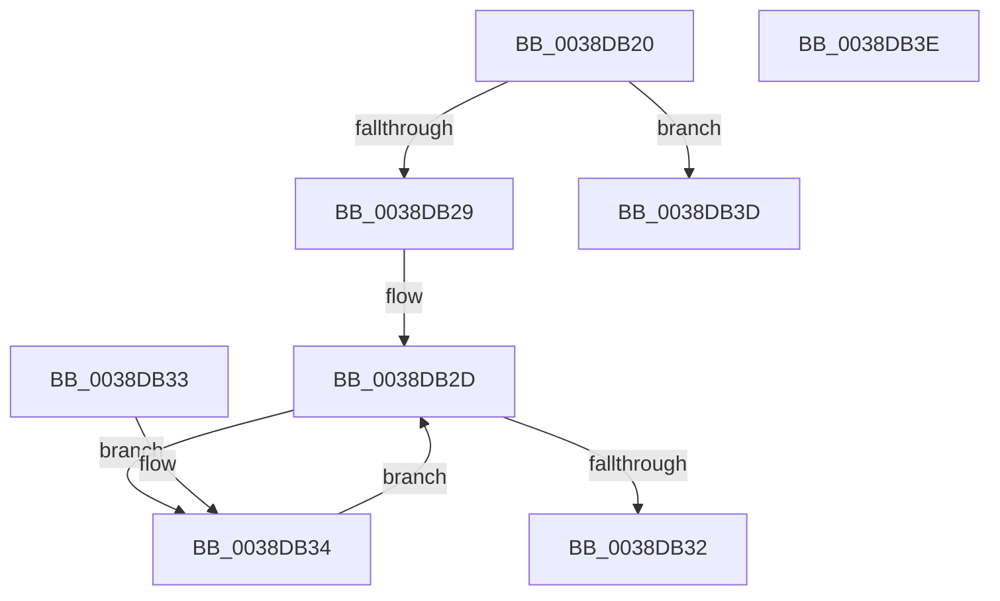

# RtlSubtreePredecessor

- RVA: `0x0038DB20`–`0x0038DB3F` (길이 `31` bytes)
- VA: `0x000000014038DB20`
- 실행 섹션: `.text`
- PDB 이름 있음: `예`; PDB Function 태그: `아니요`
- unwind 정보 RVA: `0x000DB714`
- 디코드: `13`개 명령, `31/31` bytes 표시
- 미해석 바이트: `0` (있으면 어셈블리에 `.byte`로 보존)

> 이 문서는 커널 이미지의 기계어와 PDB 기호를 분석해 생성했습니다. 4번과 5번은 함수 원형과 자료형을 바이너리 사용 방식에서 추정한 C 해석이며 원본 소스 복구 결과는 아닙니다.

## 1. Dependencies

- 직접 호출 지점: **0**; 고유 호출 대상: **0**
- 직접 호출자로 확인된 함수: **2**
- RIP 상대 이미지 참조: **0**

### Outgoing calls
- 직접 디코드된 call 명령이 없습니다.

### Direct callers
- [RtlDeleteNoSplay](RtlDeleteNoSplay_function_0038C410.md) at `0x0038C4BF`
- [RtlDelete](RtlDelete_function_0038D8B0.md) at `0x0038D8FA`

### Static image references
- 디코드된 RIP-relative 메모리 참조가 없습니다.

## 2. Other-region calls and transfers

- 다른 실행 섹션으로 향하는 call: **0**
- 별도 외부 분기/꼬리 이동을 확인하지 못했습니다.

## 3. Assembly (complete function range)

```asm
0038DB20  48 8B 41 08                     mov rax, qword ptr [rcx + 8]
0038DB24  48 85 C0                        test rax, rax
0038DB27  74 14                           je 0x14038db3d
0038DB29  48 8B 48 10                     mov rcx, qword ptr [rax + 0x10]
0038DB2D  48 85 C9                        test rcx, rcx
0038DB30  75 02                           jne 0x14038db34
0038DB32  C3                              ret
0038DB33  CC                              int3
0038DB34  48 8B C1                        mov rax, rcx
0038DB37  48 8B 49 10                     mov rcx, qword ptr [rcx + 0x10]
0038DB3B  EB F0                           jmp 0x14038db2d
0038DB3D  C3                              ret
0038DB3E  CC                              int3
```

## 4. C-style interpretation (structured pseudocode)

```c
__int64 __fastcall RtlSubtreePredecessor(__int64 a1)
{
    if (*(unsigned __int64 *)(a1 + 8) == 0) goto loc_0038DB3D;
loc_0038DB2D:
    if (*(unsigned __int64 *)(*(unsigned __int64 *)(a1 + 8) + 16) != 0) goto loc_0038DB34;
    return *(unsigned __int64 *)(a1 + 8);
loc_0038DB34:
    goto loc_0038DB2D;
loc_0038DB3D:
    return *(unsigned __int64 *)(*(unsigned __int64 *)(a1 + 8) + 16);
}
```

## 5. (Beta) C Style

```c
int64_t RtlSubtreePredecessor(void *Arg1)
{
    uint8_t *arg1 = (uint8_t *)Arg1;

    if (*(uint64_t *)(arg1 + 0x8) == 0) goto loc_0038DB3D;
loc_0038DB2D:
    if (*(uint64_t *)(*(uint64_t *)(arg1 + 0x8) + 0x10) != 0) goto loc_0038DB34;
    return *(uint64_t *)(arg1 + 0x8);
loc_0038DB34:
    goto loc_0038DB2D;
loc_0038DB3D:
    return *(uint64_t *)(*(uint64_t *)(arg1 + 0x8) + 0x10);
}
```

### 관측된 메모리 오프셋

구조체 형식이 확인되지 않은 접근은 인자 기준의 오프셋으로만 기록했습니다.

| 기준 인자 | 오프셋 표현 | 폭 (bit) | 접근 |
|---|---:|---:|---|
| `Arg1` | `+ 0x8` | `64` | `R` |

## 6. Execution-region graph

[열기: 2D/3D 그래프와 함수 탐색 컨트롤 패널](../../../control-panel.html?section=text&rva=0x0038DB20&view=graph)

- 2D 그래프는 위에서 아래로 흐르고, 3D 그래프는 빈 공간을 드래그해 회전합니다. Shift+드래그는 이동, 휠은 확대·축소, 함수 노드 선택은 대상 보고서 이동입니다.

### Static fallback


