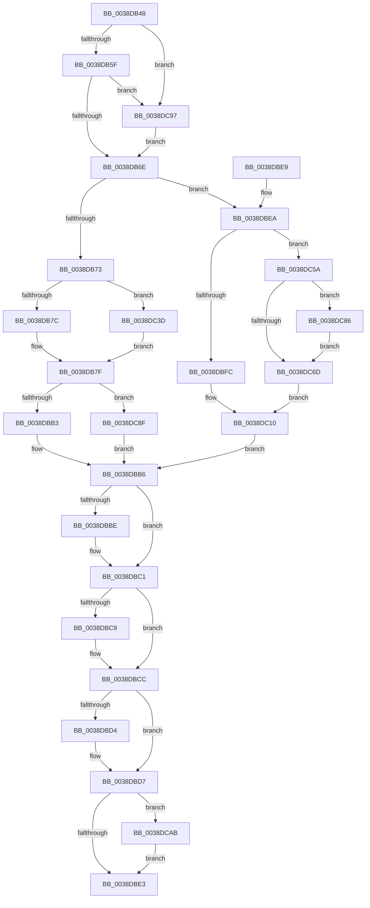

# SwapSplayLinks

- RVA: `0x0038DB48`–`0x0038DCB3` (길이 `363` bytes)
- VA: `0x000000014038DB48`
- 실행 섹션: `.text`
- PDB 이름 있음: `예`; PDB Function 태그: `아니요`
- unwind 정보 RVA: `0x00080594`
- 디코드: `107`개 명령, `363/363` bytes 표시
- 미해석 바이트: `0` (있으면 어셈블리에 `.byte`로 보존)

> 이 문서는 커널 이미지의 기계어와 PDB 기호를 분석해 생성했습니다. 4번과 5번은 함수 원형과 자료형을 바이너리 사용 방식에서 추정한 C 해석이며 원본 소스 복구 결과는 아닙니다.

## 1. Dependencies

- 직접 호출 지점: **0**; 고유 호출 대상: **0**
- 직접 호출자로 확인된 함수: **2**
- RIP 상대 이미지 참조: **0**

### Outgoing calls
- 직접 디코드된 call 명령이 없습니다.

### Direct callers
- [RtlDeleteNoSplay](RtlDeleteNoSplay_function_0038C410.md) at `0x0038C4D2`
- [RtlDelete](RtlDelete_function_0038D8B0.md) at `0x0038D905`

### Static image references
- 디코드된 RIP-relative 메모리 참조가 없습니다.

## 2. Other-region calls and transfers

- 다른 실행 섹션으로 향하는 call: **0**
- 별도 외부 분기/꼬리 이동을 확인하지 못했습니다.

## 3. Assembly (complete function range)

```asm
0038DB48  48 89 5C 24 08                  mov qword ptr [rsp + 8], rbx
0038DB4D  4C 8B C1                        mov r8, rcx
0038DB50  4C 8B D2                        mov r10, rdx
0038DB53  48 8B 09                        mov rcx, qword ptr [rcx]
0038DB56  49 3B C8                        cmp rcx, r8
0038DB59  0F 84 38 01 00 00               je 0x14038dc97
0038DB5F  48 8B 02                        mov rax, qword ptr [rdx]
0038DB62  4C 8B C9                        mov r9, rcx
0038DB65  49 3B C0                        cmp rax, r8
0038DB68  0F 84 29 01 00 00               je 0x14038dc97
0038DB6E  4C 3B CA                        cmp r9, rdx
0038DB71  75 77                           jne 0x14038dbea
0038DB73  48 3B C2                        cmp rax, rdx
0038DB76  0F 85 C1 00 00 00               jne 0x14038dc3d
0038DB7C  49 8B C0                        mov rax, r8
0038DB7F  49 89 00                        mov qword ptr [r8], rax
0038DB82  4D 8D 48 08                     lea r9, [r8 + 8]
0038DB86  49 8B 09                        mov rcx, qword ptr [r9]
0038DB89  4C 8D 5A 08                     lea r11, [rdx + 8]
0038DB8D  49 8B 03                        mov rax, qword ptr [r11]
0038DB90  48 8D 5A 10                     lea rbx, [rdx + 0x10]
0038DB94  49 89 01                        mov qword ptr [r9], rax
0038DB97  4D 8D 50 10                     lea r10, [r8 + 0x10]
0038DB9B  48 8B 03                        mov rax, qword ptr [rbx]
0038DB9E  49 89 0B                        mov qword ptr [r11], rcx
0038DBA1  49 8B 0A                        mov rcx, qword ptr [r10]
0038DBA4  49 89 02                        mov qword ptr [r10], rax
0038DBA7  48 89 0B                        mov qword ptr [rbx], rcx
0038DBAA  4D 39 01                        cmp qword ptr [r9], r8
0038DBAD  0F 85 DC 00 00 00               jne 0x14038dc8f
0038DBB3  49 89 11                        mov qword ptr [r9], rdx
0038DBB6  49 8B 01                        mov rax, qword ptr [r9]
0038DBB9  48 85 C0                        test rax, rax
0038DBBC  74 03                           je 0x14038dbc1
0038DBBE  4C 89 00                        mov qword ptr [rax], r8
0038DBC1  49 8B 02                        mov rax, qword ptr [r10]
0038DBC4  48 85 C0                        test rax, rax
0038DBC7  74 03                           je 0x14038dbcc
0038DBC9  4C 89 00                        mov qword ptr [rax], r8
0038DBCC  49 8B 03                        mov rax, qword ptr [r11]
0038DBCF  48 85 C0                        test rax, rax
0038DBD2  74 03                           je 0x14038dbd7
0038DBD4  48 89 10                        mov qword ptr [rax], rdx
0038DBD7  48 8B 03                        mov rax, qword ptr [rbx]
0038DBDA  48 85 C0                        test rax, rax
0038DBDD  0F 85 C8 00 00 00               jne 0x14038dcab
0038DBE3  48 8B 5C 24 08                  mov rbx, qword ptr [rsp + 8]
0038DBE8  C3                              ret
0038DBE9  CC                              int3
0038DBEA  4D 8B 59 08                     mov r11, qword ptr [r9 + 8]
0038DBEE  B9 08 00 00 00                  mov ecx, 8
0038DBF3  44 8D 51 08                     lea r10d, [rcx + 8]
0038DBF7  48 3B C2                        cmp rax, rdx
0038DBFA  75 5E                           jne 0x14038dc5a
0038DBFC  4D 3B D8                        cmp r11, r8
0038DBFF  41 0F 45 CA                     cmovne ecx, r10d
0038DC03  4A 89 14 09                     mov qword ptr [rcx + r9], rdx
0038DC07  49 8B 00                        mov rax, qword ptr [r8]
0038DC0A  48 89 02                        mov qword ptr [rdx], rax
0038DC0D  4D 89 00                        mov qword ptr [r8], r8
0038DC10  4C 8D 5A 08                     lea r11, [rdx + 8]
0038DC14  49 8B 03                        mov rax, qword ptr [r11]
0038DC17  4D 8D 48 08                     lea r9, [r8 + 8]
0038DC1B  49 8B 09                        mov rcx, qword ptr [r9]
0038DC1E  48 8D 5A 10                     lea rbx, [rdx + 0x10]
0038DC22  49 89 01                        mov qword ptr [r9], rax
0038DC25  4D 8D 50 10                     lea r10, [r8 + 0x10]
0038DC29  48 8B 03                        mov rax, qword ptr [rbx]
0038DC2C  49 89 0B                        mov qword ptr [r11], rcx
0038DC2F  49 8B 0A                        mov rcx, qword ptr [r10]
0038DC32  49 89 02                        mov qword ptr [r10], rax
0038DC35  48 89 0B                        mov qword ptr [rbx], rcx
0038DC38  E9 79 FF FF FF                  jmp 0x14038dbb6
0038DC3D  48 39 50 08                     cmp qword ptr [rax + 8], rdx
0038DC41  B9 08 00 00 00                  mov ecx, 8
0038DC46  44 8D 51 08                     lea r10d, [rcx + 8]
0038DC4A  41 0F 45 CA                     cmovne ecx, r10d
0038DC4E  4C 89 04 01                     mov qword ptr [rcx + rax], r8
0038DC52  48 8B 02                        mov rax, qword ptr [rdx]
0038DC55  E9 25 FF FF FF                  jmp 0x14038db7f
0038DC5A  4D 3B D8                        cmp r11, r8
0038DC5D  49 0F 45 CA                     cmovne rcx, r10
0038DC61  4C 8D 50 08                     lea r10, [rax + 8]
0038DC65  4D 8B 1A                        mov r11, qword ptr [r10]
0038DC68  4C 3B DA                        cmp r11, rdx
0038DC6B  75 19                           jne 0x14038dc86
0038DC6D  4A 8B 04 09                     mov rax, qword ptr [rcx + r9]
0038DC71  4E 89 1C 09                     mov qword ptr [rcx + r9], r11
0038DC75  49 89 02                        mov qword ptr [r10], rax
0038DC78  48 8B 02                        mov rax, qword ptr [rdx]
0038DC7B  49 8B 08                        mov rcx, qword ptr [r8]
0038DC7E  49 89 00                        mov qword ptr [r8], rax
0038DC81  48 89 0A                        mov qword ptr [rdx], rcx
0038DC84  EB 8A                           jmp 0x14038dc10
0038DC86  4C 8D 50 10                     lea r10, [rax + 0x10]
0038DC8A  4D 8B 1A                        mov r11, qword ptr [r10]
0038DC8D  EB DE                           jmp 0x14038dc6d
0038DC8F  49 89 12                        mov qword ptr [r10], rdx
0038DC92  E9 1F FF FF FF                  jmp 0x14038dbb6
0038DC97  4D 8B 0A                        mov r9, qword ptr [r10]
0038DC9A  49 8B C0                        mov rax, r8
0038DC9D  4C 8B C2                        mov r8, rdx
0038DCA0  48 8B D0                        mov rdx, rax
0038DCA3  48 8B C1                        mov rax, rcx
0038DCA6  E9 C3 FE FF FF                  jmp 0x14038db6e
0038DCAB  48 89 10                        mov qword ptr [rax], rdx
0038DCAE  E9 30 FF FF FF                  jmp 0x14038dbe3
```

## 4. C-style interpretation (structured pseudocode)

```c
__int64 __fastcall SwapSplayLinks(__int64 a1, __int64 a2)
{
    unsigned __int64 v_stack_p8;

    v_stack_p8 = v_rbx;
    if ((*(unsigned __int64 *)(a1)) == a1) goto loc_0038DC97;
    if ((*(unsigned __int64 *)(a2)) == a1) goto loc_0038DC97;
loc_0038DB6E:
    if ((*(unsigned __int64 *)(a1)) != a2) goto loc_0038DBEA;
    if ((*(unsigned __int64 *)(a2)) != a2) goto loc_0038DC3D;
loc_0038DB7F:
    *(unsigned __int64 *)(a1) = a1;
    *(unsigned __int64 *)(a1 + 8) = *(unsigned __int64 *)(a2 + 8);
    *(unsigned __int64 *)(a2 + 8) = *(unsigned __int64 *)(a1 + 8);
    *(unsigned __int64 *)(a1 + 16) = *(unsigned __int64 *)(a2 + 16);
    *(unsigned __int64 *)(a2 + 16) = *(unsigned __int64 *)(a1 + 16);
    if ((*(unsigned __int64 *)(a1 + 8)) != a1) goto loc_0038DC8F;
    *(unsigned __int64 *)(a1 + 8) = a2;
loc_0038DBB6:
    if (*(unsigned __int64 *)(a1 + 8) != 0) {
        *(unsigned __int64 *)(*(unsigned __int64 *)(a1 + 8)) = a1;
    }
    if (*(unsigned __int64 *)(a1 + 16) != 0) {
        *(unsigned __int64 *)(*(unsigned __int64 *)(a1 + 16)) = a1;
    }
    if (*(unsigned __int64 *)(a2 + 8) != 0) {
        *(unsigned __int64 *)(*(unsigned __int64 *)(a2 + 8)) = a2;
    }
    if (*(unsigned __int64 *)(a2 + 16) != 0) goto loc_0038DCAB;
loc_0038DBE3:
    return *(unsigned __int64 *)(a2 + 16);
loc_0038DBEA:
    if ((*(unsigned __int64 *)(a2 + 16)) != a2) goto loc_0038DC5A;
    a1 = 8;
    if ((*(unsigned __int64 *)(a1 + 8 + 8)) != a1) { a1 = (unsigned int)(8 + 8); }
    *(unsigned __int64 *)(a1 + a1 + 8 * 1) = a2;
    *(unsigned __int64 *)(a2) = *(unsigned __int64 *)(a1);
    *(unsigned __int64 *)(a1) = a1;
loc_0038DC10:
    *(unsigned __int64 *)(a1 + 8) = *(unsigned __int64 *)(a2 + 8);
    *(unsigned __int64 *)(a2 + 8) = *(unsigned __int64 *)(a1 + 8);
    *(unsigned __int64 *)(a1 + 16) = *(unsigned __int64 *)(a2 + 16);
    *(unsigned __int64 *)(a2 + 16) = *(unsigned __int64 *)(a1 + 16);
    goto loc_0038DBB6;
loc_0038DC3D:
    a1 = 8;
    if ((*(unsigned __int64 *)(*(unsigned __int64 *)(a2 + 16) + 8)) != a2) { a1 = (unsigned int)(8 + 8); }
    *(unsigned __int64 *)(a1 + *(unsigned __int64 *)(a2 + 16) * 1) = a1;
    goto loc_0038DB7F;
loc_0038DC5A:
    if ((a2 + 8) != a1) { a1 = 8 + 8; }
    if ((*(unsigned __int64 *)(*(unsigned __int64 *)(a2) + 8)) != a2) goto loc_0038DC86;
loc_0038DC6D:
    *(unsigned __int64 *)(a1 + a1 + 8 * 1) = *(unsigned __int64 *)(*(unsigned __int64 *)(a2) + 8);
    *(unsigned __int64 *)(*(unsigned __int64 *)(a2) + 8) = *(unsigned __int64 *)(a1 + a1 + 8 * 1);
    *(unsigned __int64 *)(a1) = *(unsigned __int64 *)(a2);
    *(unsigned __int64 *)(a2) = *(unsigned __int64 *)(a1);
    goto loc_0038DC10;
loc_0038DC86:
    goto loc_0038DC6D;
loc_0038DC8F:
    *(unsigned __int64 *)(*(unsigned __int64 *)(a2) + 16) = a2;
    goto loc_0038DBB6;
loc_0038DC97:
    goto loc_0038DB6E;
loc_0038DCAB:
    *(unsigned __int64 *)(*(unsigned __int64 *)(a1)) = a1;
    goto loc_0038DBE3;
}
```

## 5. (Beta) C Style

```c
int64_t SwapSplayLinks(void *Arg1, void *Arg2)
{
    uint8_t *arg1 = (uint8_t *)Arg1;
    uint8_t *arg2 = (uint8_t *)Arg2;

    uint64_t v_stack_p8;

    v_stack_p8 = local_rbx;
    if ((*(uint64_t *)(arg1)) == Arg1) goto loc_0038DC97;
    if ((*(uint64_t *)(arg2)) == Arg1) goto loc_0038DC97;
loc_0038DB6E:
    if ((*(uint64_t *)(arg1)) != Arg2) goto loc_0038DBEA;
    if ((*(uint64_t *)(arg2)) != Arg2) goto loc_0038DC3D;
loc_0038DB7F:
    *(void **)(arg1) = Arg1;
    *(uint64_t *)(arg1 + 0x8) = *(uint64_t *)(arg2 + 0x8);
    *(uint64_t *)(arg2 + 0x8) = *(uint64_t *)(arg1 + 0x8);
    *(uint64_t *)(arg1 + 0x10) = *(uint64_t *)(arg2 + 0x10);
    *(uint64_t *)(arg2 + 0x10) = *(uint64_t *)(arg1 + 0x10);
    if ((*(uint64_t *)(arg1 + 0x8)) != Arg1) goto loc_0038DC8F;
    *(void **)(arg1 + 0x8) = Arg2;
loc_0038DBB6:
    if (*(uint64_t *)(arg1 + 0x8) != 0) {
        *(void **)(*(uint64_t *)(arg1 + 0x8)) = Arg1;
    }
    if (*(uint64_t *)(arg1 + 0x10) != 0) {
        *(void **)(*(uint64_t *)(arg1 + 0x10)) = Arg1;
    }
    if (*(uint64_t *)(arg2 + 0x8) != 0) {
        *(void **)(*(uint64_t *)(arg2 + 0x8)) = Arg2;
    }
    if (*(uint64_t *)(arg2 + 0x10) != 0) goto loc_0038DCAB;
loc_0038DBE3:
    return *(uint64_t *)(arg2 + 0x10);
loc_0038DBEA:
    if ((*(uint64_t *)(arg2 + 0x10)) != Arg2) goto loc_0038DC5A;
    Arg1 = 8;
    if ((*(uint64_t *)(arg1 + 0x8 + 0x8)) != Arg1) { Arg1 = (uint32_t)(8 + 8); }
    *(void **)(arg1 + arg1 + 0x8 * 1) = Arg2;
    *(uint64_t *)(arg2) = *(uint64_t *)(arg1);
    *(void **)(arg1) = Arg1;
loc_0038DC10:
    *(uint64_t *)(arg1 + 0x8) = *(uint64_t *)(arg2 + 0x8);
    *(uint64_t *)(arg2 + 0x8) = *(uint64_t *)(arg1 + 0x8);
    *(uint64_t *)(arg1 + 0x10) = *(uint64_t *)(arg2 + 0x10);
    *(uint64_t *)(arg2 + 0x10) = *(uint64_t *)(arg1 + 0x10);
    goto loc_0038DBB6;
loc_0038DC3D:
    Arg1 = 8;
    if ((*(uint64_t *)(*(uint64_t *)(arg2 + 0x10) + 0x8)) != Arg2) { Arg1 = (uint32_t)(8 + 8); }
    *(void **)(arg1 + *(uint64_t *)(arg2 + 0x10) * 1) = Arg1;
    goto loc_0038DB7F;
loc_0038DC5A:
    if ((Arg2 + 8) != Arg1) { Arg1 = 8 + 8; }
    if ((*(uint64_t *)(*(uint64_t *)(arg2) + 0x8)) != Arg2) goto loc_0038DC86;
loc_0038DC6D:
    *(uint64_t *)(arg1 + arg1 + 0x8 * 1) = *(uint64_t *)(*(uint64_t *)(arg2) + 0x8);
    *(uint64_t *)(*(uint64_t *)(arg2) + 0x8) = *(uint64_t *)(arg1 + arg1 + 0x8 * 1);
    *(uint64_t *)(arg1) = *(uint64_t *)(arg2);
    *(uint64_t *)(arg2) = *(uint64_t *)(arg1);
    goto loc_0038DC10;
loc_0038DC86:
    goto loc_0038DC6D;
loc_0038DC8F:
    *(void **)(*(uint64_t *)(arg2) + 0x10) = Arg2;
    goto loc_0038DBB6;
loc_0038DC97:
    goto loc_0038DB6E;
loc_0038DCAB:
    *(void **)(*(uint64_t *)(arg1)) = Arg1;
    goto loc_0038DBE3;
}
```

### 관측된 메모리 오프셋

구조체 형식이 확인되지 않은 접근은 인자 기준의 오프셋으로만 기록했습니다.

| 기준 인자 | 오프셋 표현 | 폭 (bit) | 접근 |
|---|---:|---:|---|
| `Arg1` | `+ 0x0` | `64` | `R` |
| `Arg2` | `+ 0x0` | `64` | `R` |

## 6. Execution-region graph

[열기: 2D/3D 그래프와 함수 탐색 컨트롤 패널](../../../control-panel.html?section=text&rva=0x0038DB48&view=graph)

- 2D 그래프는 위에서 아래로 흐르고, 3D 그래프는 빈 공간을 드래그해 회전합니다. Shift+드래그는 이동, 휠은 확대·축소, 함수 노드 선택은 대상 보고서 이동입니다.

### Static fallback


