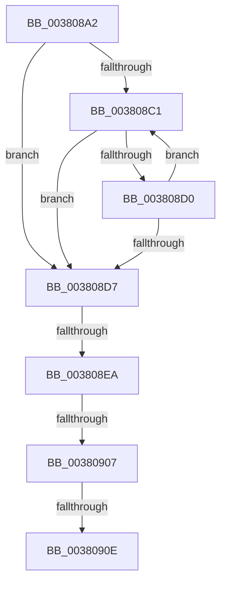

# sub_003808A2

- RVA: `0x003808A2`–`0x00380934` (길이 `146` bytes)
- VA: `0x00000001403808A2`
- 실행 섹션: `.text`
- PDB 이름 있음: `아니요`; PDB Function 태그: `아니요`
- unwind 정보 RVA: `0x0007B880`
- 디코드: `39`개 명령, `146/146` bytes 표시
- 미해석 바이트: `0` (있으면 어셈블리에 `.byte`로 보존)

> 이 문서는 커널 이미지의 기계어와 PDB 기호를 분석해 생성했습니다. 4번과 5번은 함수 원형과 자료형을 바이너리 사용 방식에서 추정한 C 해석이며 원본 소스 복구 결과는 아닙니다.

## 1. Dependencies

- 직접 호출 지점: **1**; 고유 호출 대상: **1**
- 직접 호출자로 확인된 함수: **0**
- RIP 상대 이미지 참조: **0**

### Outgoing calls
- `0x003808F9` → [ObpTraceObjectReferenceIfActive](../21/ObpTraceObjectReferenceIfActive_function_00210780.md) (function, `0x00210780`)

### Direct callers
- 이 함수 시작 RVA로 연결되는 직접 call은 확인되지 않았습니다. 간접 호출은 완전히 역산할 수 없습니다.

### Static image references
- 디코드된 RIP-relative 메모리 참조가 없습니다.

## 2. Other-region calls and transfers

- 다른 실행 섹션으로 향하는 call: **0**
- call이 아닌 외부 분기/꼬리 이동: **3**
  - `0x003808E4` → [sub_0038093F + 0x81](Unknown_function_0038093F.md) (`tail-transfer`)
  - `0x00380901` → [sub_00380A2B](Unknown_function_00380A2B.md) (`tail-transfer`)
  - `0x0038090C` → [sub_0038093F](Unknown_function_0038093F.md) (`tail-transfer`)

## 3. Assembly (complete function range)

```asm
003808A2  48 89 74 24 50                  mov qword ptr [rsp + 0x50], rsi
003808A7  48 89 7C 24 58                  mov qword ptr [rsp + 0x58], rdi
003808AC  48 8B 38                        mov rdi, qword ptr [rax]
003808AF  4C 89 74 24 68                  mov qword ptr [rsp + 0x68], r14
003808B4  0F 0D 4F 40                     prefetchw byte ptr [rdi + 0x40]
003808B8  48 8B 57 40                     mov rdx, qword ptr [rdi + 0x40]
003808BC  F6 C2 0F                        test dl, 0xf
003808BF  74 16                           je 0x1403808d7
003808C1  48 8D 4A FF                     lea rcx, [rdx - 1]
003808C5  48 8B C2                        mov rax, rdx
003808C8  F0 48 0F B1 4F 40               lock cmpxchg qword ptr [rdi + 0x40], rcx
003808CE  74 07                           je 0x1403808d7
003808D0  48 8B D0                        mov rdx, rax
003808D3  A8 0F                           test al, 0xf
003808D5  75 EA                           jne 0x1403808c1
003808D7  48 8B F2                        mov rsi, rdx
003808DA  83 E2 0F                        and edx, 0xf
003808DD  48 83 E6 F0                     and rsi, 0xfffffffffffffff0
003808E1  83 FA 01                        cmp edx, 1
003808E4  0F 86 D6 00 00 00               jbe 0x1403809c0
003808EA  48 8D 4E D0                     lea rcx, [rsi - 0x30]
003808EE  BA 01 00 00 00                  mov edx, 1
003808F3  41 B8 4D 6D 53 63               mov r8d, 0x63536d4d
003808F9  E8 82 FE E8 FF                  call 0x140210780
003808FE  48 85 F6                        test rsi, rsi
00380901  0F 84 24 01 00 00               je 0x140380a2b
00380907  8B 47 38                        mov eax, dword ptr [rdi + 0x38]
0038090A  A8 20                           test al, 0x20
0038090C  75 31                           jne 0x14038093f
0038090E  48 C7 83 D0 00 00 00 00 00 00 00  mov qword ptr [rbx + 0xd0], 0
00380919  48 8B 7C 24 58                  mov rdi, qword ptr [rsp + 0x58]
0038091E  48 8B C6                        mov rax, rsi
00380921  48 8B 74 24 50                  mov rsi, qword ptr [rsp + 0x50]
00380926  4C 8B 74 24 68                  mov r14, qword ptr [rsp + 0x68]
0038092B  48 83 C4 30                     add rsp, 0x30
0038092F  41 5F                           pop r15
00380931  5D                              pop rbp
00380932  5B                              pop rbx
00380933  C3                              ret
```

## 4. C-style interpretation (structured pseudocode)

```c
__int64 __fastcall sub_003808A2(__int64 a1, __int64 a2, __int64 a3, __int64 a4, __int64 a5, __int64 a6, __int64 a7, __int64 a8, __int64 a9, __int64 a10, __int64 a11, __int64 a12, __int64 a13)
{
    __int64 result;
    __int64 v_rsi;
    __int64 v_rsp;
    unsigned __int64 v_stack_p50;
    unsigned __int64 v_stack_p58;
    unsigned __int64 v_stack_p68;

    v_stack_p50 = v_rsi;
    v_stack_p58 = v_rdi;
    v_stack_p68 = v_r14;
    if ((((unsigned __int8)(*(unsigned __int64 *)(*(unsigned __int64 *)(result) + 64))) & (15)) == 0) goto loc_003808D7;
loc_003808C1:
    if ((((unsigned __int8)(*(unsigned __int64 *)(*(unsigned __int64 *)(result) + 64))) & (15)) == 0) goto loc_003808D7;
    if ((((unsigned __int8)(*(unsigned __int64 *)(*(unsigned __int64 *)(result) + 64))) & (15)) != 0) goto loc_003808C1;
loc_003808D7:
    a2 = (unsigned int)((*(unsigned __int64 *)(*(unsigned __int64 *)(result) + 64)) & (15));
    v_rsi = (*(unsigned __int64 *)(*(unsigned __int64 *)(result) + 64)) & (-16);
    result = ObpTraceObjectReferenceIfActive(v_rsi - 48, 1, (unsigned int)(0x63536D4DULL), a4);
    *(unsigned __int64 *)(v_rbx + 208) = 0;
    v_rsp = (v_rsp) + (48);
    return v_rsi;
}
```

## 5. (Beta) C Style

```c
int64_t sub_003808A2(int64_t Arg1, int64_t Arg2, int64_t Arg3, int64_t Arg4, uint64_t Arg5, uint64_t Arg6, uint64_t Arg7, uint64_t Arg8, uint64_t Arg9, int64_t Arg10, int64_t Arg11, uint64_t Arg12, int64_t Arg13)
{
    int64_t result;
    int64_t local_rsi;
    int64_t local_rsp;
    uint64_t v_stack_p50;
    uint64_t v_stack_p58;
    uint64_t v_stack_p68;

    v_stack_p50 = local_rsi;
    v_stack_p58 = local_rdi;
    v_stack_p68 = local_r14;
    if ((((uint8_t)(*(uint64_t *)(*(uint64_t *)(result) + 0x40))) & (15)) == 0) goto loc_003808D7;
loc_003808C1:
    if ((((uint8_t)(*(uint64_t *)(*(uint64_t *)(result) + 0x40))) & (15)) == 0) goto loc_003808D7;
    if ((((uint8_t)(*(uint64_t *)(*(uint64_t *)(result) + 0x40))) & (15)) != 0) goto loc_003808C1;
loc_003808D7:
    Arg2 = (uint32_t)((*(uint64_t *)(*(uint64_t *)(result) + 0x40)) & (15));
    local_rsi = (*(uint64_t *)(*(uint64_t *)(result) + 0x40)) & (-16);
    result = ObpTraceObjectReferenceIfActive(local_rsi - 48, 1, (uint32_t)(0x63536D4DULL), Arg4);
    *(uint64_t *)(local_rbx + 0xD0) = 0;
    local_rsp = (local_rsp) + (48);
    return local_rsi;
}
```

## 6. Execution-region graph

[열기: 2D/3D 그래프와 함수 탐색 컨트롤 패널](../../../control-panel.html?section=text&rva=0x003808A2&view=graph)

- 2D 그래프는 위에서 아래로 흐르고, 3D 그래프는 빈 공간을 드래그해 회전합니다. Shift+드래그는 이동, 휠은 확대·축소, 함수 노드 선택은 대상 보고서 이동입니다.

### Static fallback


