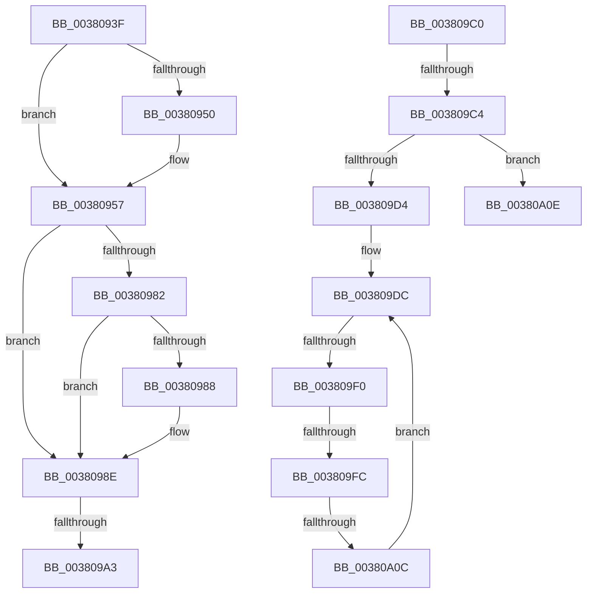

# sub_0038093F

- RVA: `0x0038093F`–`0x00380A2B` (길이 `236` bytes)
- VA: `0x000000014038093F`
- 실행 섹션: `.text`
- PDB 이름 있음: `아니요`; PDB Function 태그: `아니요`
- unwind 정보 RVA: `0x0007B8B4`
- 디코드: `59`개 명령, `236/236` bytes 표시
- 미해석 바이트: `0` (있으면 어셈블리에 `.byte`로 보존)

> 이 문서는 커널 이미지의 기계어와 PDB 기호를 분석해 생성했습니다. 4번과 5번은 함수 원형과 자료형을 바이너리 사용 방식에서 추정한 C 해석이며 원본 소스 복구 결과는 아닙니다.

## 1. Dependencies

- 직접 호출 지점: **1**; 고유 호출 대상: **1**
- 직접 호출자로 확인된 함수: **0**
- RIP 상대 이미지 참조: **1**

### Outgoing calls
- `0x00380A25` → [KeBugCheckEx](../4F/KeBugCheckEx_function_004FD660.md) (function, `0x004FD660`)

### Direct callers
- 이 함수 시작 RVA로 연결되는 직접 call은 확인되지 않았습니다. 간접 호출은 완전히 역산할 수 없습니다.

### Static image references
- `0x00380976` → RVA `0x00E2DC80` (`.data`; read)

## 2. Other-region calls and transfers

- 다른 실행 섹션으로 향하는 call: **0**
- call이 아닌 외부 분기/꼬리 이동: **6**
  - `0x0038099D` → [sub_00380A72 + 0xB](Unknown_function_00380A72.md) (`tail-transfer`)
  - `0x003809BB` → [sub_003808A2 + 0x77](Unknown_function_003808A2.md) (`tail-transfer`)
  - `0x003809C2` → [sub_00380A2B](Unknown_function_00380A2B.md) (`tail-transfer`)
  - `0x003809EA` → [sub_00380A72](Unknown_function_00380A72.md) (`tail-transfer`)
  - `0x003809FA` → [sub_00380A72](Unknown_function_00380A72.md) (`tail-transfer`)
  - `0x00380A06` → [sub_003808A2 + 0x48](Unknown_function_003808A2.md) (`tail-transfer`)

## 3. Assembly (complete function range)

```asm
0038093F  F0 48 FF 47 70                  lock inc qword ptr [rdi + 0x70]
00380944  48 8B 83 00 01 00 00            mov rax, qword ptr [rbx + 0x100]
0038094B  48 85 C0                        test rax, rax
0038094E  75 07                           jne 0x140380957
00380950  48 8D 83 10 01 00 00            lea rax, [rbx + 0x110]
00380957  48 8B 40 30                     mov rax, qword ptr [rax + 0x30]
0038095B  48 8D 0C 40                     lea rcx, [rax + rax*2]
0038095F  48 03 C9                        add rcx, rcx
00380962  48 B8 00 00 00 00 00 DE FF FF   movabs rax, 0xffffde0000000000
0038096C  48 8B 7C C8 08                  mov rdi, qword ptr [rax + rcx*8 + 8]
00380971  4C 8B 74 C8 10                  mov r14, qword ptr [rax + rcx*8 + 0x10]
00380976  48 8B 05 03 D3 AA 00            mov rax, qword ptr [rip + 0xaad303]
0038097D  48 85 C0                        test rax, rax
00380980  74 0C                           je 0x14038098e
00380982  41 F6 C6 10                     test r14b, 0x10
00380986  75 06                           jne 0x14038098e
00380988  48 F7 D0                        not rax
0038098B  4C 23 F0                        and r14, rax
0038098E  49 C1 FE 10                     sar r14, 0x10
00380992  41 8B 46 20                     mov eax, dword ptr [r14 + 0x20]
00380996  49 8B 2E                        mov rbp, qword ptr [r14]
00380999  0F BA E0 11                     bt eax, 0x11
0038099D  0F 82 DA 00 00 00               jb 0x140380a7d
003809A3  48 8B 95 88 00 00 00            mov rdx, qword ptr [rbp + 0x88]
003809AA  33 C9                           xor ecx, ecx
003809AC  48 2B FA                        sub rdi, rdx
003809AF  48 C1 FF 03                     sar rdi, 3
003809B3  03 F9                           add edi, ecx
003809B5  89 BB BC 00 00 00               mov dword ptr [rbx + 0xbc], edi
003809BB  E9 59 FF FF FF                  jmp 0x140380919
003809C0  85 D2                           test edx, edx
003809C2  74 67                           je 0x140380a2b
003809C4  B8 0F 00 00 00                  mov eax, 0xf
003809C9  F0 48 0F C1 46 D0               lock xadd qword ptr [rsi - 0x30], rax
003809CF  48 85 C0                        test rax, rax
003809D2  7E 3A                           jle 0x140380a0e
003809D4  0F 0D 4F 40                     prefetchw byte ptr [rdi + 0x40]
003809D8  48 8B 47 40                     mov rax, qword ptr [rdi + 0x40]
003809DC  48 8B C8                        mov rcx, rax
003809DF  83 E1 0F                        and ecx, 0xf
003809E2  48 83 C1 0F                     add rcx, 0xf
003809E6  48 83 F9 0F                     cmp rcx, 0xf
003809EA  0F 87 82 00 00 00               ja 0x140380a72
003809F0  48 8B C8                        mov rcx, rax
003809F3  48 83 E1 F0                     and rcx, 0xfffffffffffffff0
003809F7  48 3B F1                        cmp rsi, rcx
003809FA  75 76                           jne 0x140380a72
003809FC  48 8D 48 0F                     lea rcx, [rax + 0xf]
00380A00  F0 48 0F B1 4F 40               lock cmpxchg qword ptr [rdi + 0x40], rcx
00380A06  0F 84 DE FE FF FF               je 0x1403808ea
00380A0C  EB CE                           jmp 0x1403809dc
00380A0E  33 D2                           xor edx, edx
00380A10  48 83 C0 0F                     add rax, 0xf
00380A14  41 B9 10 00 00 00               mov r9d, 0x10
00380A1A  48 89 44 24 20                  mov qword ptr [rsp + 0x20], rax
00380A1F  4C 8B C6                        mov r8, rsi
00380A22  8D 4A 18                        lea ecx, [rdx + 0x18]
00380A25  E8 36 CC 17 00                  call 0x1404fd660
00380A2A  CC                              int3
```

## 4. C-style interpretation (structured pseudocode)

```c
__int64 __fastcall sub_0038093F(void)
{
    __int64 result;
    __int64 v_r14;
    __int64 v_rdi;
    unsigned __int64 v_stack_p20;

    result = *(unsigned __int64 *)(v_rbx + 256);
    if (*(unsigned __int64 *)(v_rbx + 256) == 0) {
        result = v_rbx + 272;
    }
    a1 = (*(unsigned __int64 *)(result + 48) + *(unsigned __int64 *)(result + 48) * 2) + (*(unsigned __int64 *)(result + 48) + *(unsigned __int64 *)(result + 48) * 2);
    if (*(unsigned __int64 *)(v_rip + 11195139) == 0) goto loc_0038098E;
    result = *(unsigned __int64 *)(v_rip + 11195139);
    v_r14 = *(unsigned __int64 *)(*(unsigned __int64 *)(result + 48) + a1 * 8 + 16);
    if ((((unsigned __int8)(*(unsigned __int64 *)(*(unsigned __int64 *)(result + 48) + a1 * 8 + 16))) & (16)) == 0) {
        result = ~(*(unsigned __int64 *)(v_rip + 11195139));
        v_r14 = (*(unsigned __int64 *)(*(unsigned __int64 *)(result + 48) + a1 * 8 + 16)) & (result);
    }
    v_r14 = (v_r14) >> (16);
    a1 = 0;
    v_rdi = (*(unsigned __int64 *)(*(unsigned __int64 *)(result + 48) + a1 * 8 + 8)) - (*(unsigned __int64 *)(*(unsigned __int64 *)(v_r14) + 136));
    v_rdi = (v_rdi) >> (3);
    v_rdi = (unsigned int)((v_rdi) + (0));
    *(unsigned int *)(v_rbx + 188) = (unsigned int)(v_rdi);
}
```

## 5. (Beta) C Style

```c
void sub_0038093F(void)
{
    int64_t result;
    int64_t local_r14;
    int64_t local_rdi;
    uint64_t v_stack_p20;

    result = *(uint64_t *)(local_rbx + 0x100);
    if (*(uint64_t *)(local_rbx + 0x100) == 0) {
        result = local_rbx + 272;
    }
    a1 = (*(uint64_t *)(result + 0x30) + *(uint64_t *)(result + 0x30) * 2) + (*(uint64_t *)(result + 0x30) + *(uint64_t *)(result + 0x30) * 2);
    if (*(uint64_t *)(v_rip + 0xAAD303) == 0) goto loc_0038098E;
    result = *(uint64_t *)(v_rip + 0xAAD303);
    local_r14 = *(uint64_t *)(*(uint64_t *)(result + 0x30) + a1 * 8 + 0x10);
    if ((((uint8_t)(*(uint64_t *)(*(uint64_t *)(result + 0x30) + a1 * 8 + 0x10))) & (16)) == 0) {
        result = ~(*(uint64_t *)(v_rip + 0xAAD303));
        local_r14 = (*(uint64_t *)(*(uint64_t *)(result + 0x30) + a1 * 8 + 0x10)) & (result);
    }
    local_r14 = (local_r14) >> (16);
    a1 = 0;
    local_rdi = (*(uint64_t *)(*(uint64_t *)(result + 0x30) + a1 * 8 + 0x8)) - (*(uint64_t *)(*(uint64_t *)(local_r14) + 0x88));
    local_rdi = (local_rdi) >> (3);
    local_rdi = (uint32_t)((local_rdi) + (0));
    *(uint32_t *)(local_rbx + 0xBC) = (uint32_t)(local_rdi);
}
```

## 6. Execution-region graph

[열기: 2D/3D 그래프와 함수 탐색 컨트롤 패널](../../../control-panel.html?section=text&rva=0x0038093F&view=graph)

- 2D 그래프는 위에서 아래로 흐르고, 3D 그래프는 빈 공간을 드래그해 회전합니다. Shift+드래그는 이동, 휠은 확대·축소, 함수 노드 선택은 대상 보고서 이동입니다.

### Static fallback


