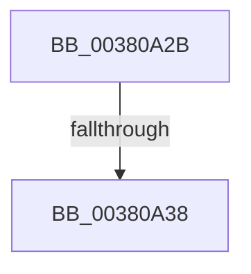

# sub_00380A2B

- RVA: `0x00380A2B`–`0x00380A68` (길이 `61` bytes)
- VA: `0x0000000140380A2B`
- 실행 섹션: `.text`
- PDB 이름 있음: `아니요`; PDB Function 태그: `아니요`
- unwind 정보 RVA: `0x0007B8D0`
- 디코드: `15`개 명령, `61/61` bytes 표시
- 미해석 바이트: `0` (있으면 어셈블리에 `.byte`로 보존)

> 이 문서는 커널 이미지의 기계어와 PDB 기호를 분석해 생성했습니다. 4번과 5번은 함수 원형과 자료형을 바이너리 사용 방식에서 추정한 C 해석이며 원본 소스 복구 결과는 아닙니다.

## 1. Dependencies

- 직접 호출 지점: **3**; 고유 호출 대상: **3**
- 직접 호출자로 확인된 함수: **0**
- RIP 상대 이미지 참조: **0**

### Outgoing calls
- `0x00380A38` → [ExAcquireSpinLockShared](../24/ExAcquireSpinLockShared_function_0024DCE0.md) (function, `0x0024DCE0`)
- `0x00380A49` → [ObFastReferenceObjectLocked](ObFastReferenceObjectLocked_function_00381DA0.md) (function, `0x00381DA0`)
- `0x00380A59` → [MiReleaseSpinLockShared](../34/MiReleaseSpinLockShared_function_00348BF0.md) (function, `0x00348BF0`)

### Direct callers
- 이 함수 시작 RVA로 연결되는 직접 call은 확인되지 않았습니다. 간접 호출은 완전히 역산할 수 없습니다.

### Static image references
- 디코드된 RIP-relative 메모리 참조가 없습니다.

## 2. Other-region calls and transfers

- 다른 실행 섹션으로 향하는 call: **0**
- call이 아닌 외부 분기/꼬리 이동: **2**
  - `0x00380A36` → [sub_00380A68](Unknown_function_00380A68.md) (`tail-transfer`)
  - `0x00380A63` → [sub_003808A2 + 0x65](Unknown_function_003808A2.md) (`tail-transfer`)

## 3. Assembly (complete function range)

```asm
00380A2B  4C 89 64 24 60                  mov qword ptr [rsp + 0x60], r12
00380A30  48 8D 4F 48                     lea rcx, [rdi + 0x48]
00380A34  85 ED                           test ebp, ebp
00380A36  75 30                           jne 0x140380a68
00380A38  E8 A3 D2 EC FF                  call 0x14024dce0
00380A3D  0F B6 E8                        movzx ebp, al
00380A40  BA 4D 6D 53 63                  mov edx, 0x63536d4d
00380A45  48 8D 4F 40                     lea rcx, [rdi + 0x40]
00380A49  E8 52 13 00 00                  call 0x140381da0
00380A4E  40 0F B6 D5                     movzx edx, bpl
00380A52  48 8D 4F 48                     lea rcx, [rdi + 0x48]
00380A56  48 8B F0                        mov rsi, rax
00380A59  E8 92 81 FC FF                  call 0x140348bf0
00380A5E  4C 8B 64 24 60                  mov r12, qword ptr [rsp + 0x60]
00380A63  E9 9F FE FF FF                  jmp 0x140380907
```

## 4. C-style interpretation (structured pseudocode)

```c
__int64 __fastcall sub_00380A2B(__int64 a1, __int64 a2, __int64 a3, __int64 a4, __int64 a5, __int64 a6, __int64 a7, __int64 a8, __int64 a9, __int64 a10, __int64 a11, __int64 a12)
{
    __int64 result;
    unsigned __int64 v_stack_p60;

    v_stack_p60 = v_r12;
    result = ExAcquireSpinLockShared(v_rdi + 72, a2, a3, a4);
    result = ObFastReferenceObjectLocked(v_rdi + 64, (unsigned int)(0x63536D4DULL), a3, a4);
    result = MiReleaseSpinLockShared(v_rdi + 72, (unsigned __int8)((unsigned __int8)(result)), a3, a4);
}
```

## 5. (Beta) C Style

```c
int64_t sub_00380A2B(int64_t Arg1, int64_t Arg2, int64_t Arg3, int64_t Arg4, uint64_t Arg5, uint64_t Arg6, uint64_t Arg7, uint64_t Arg8, uint64_t Arg9, uint64_t Arg10, uint64_t Arg11, int64_t Arg12)
{
    int64_t result;
    uint64_t v_stack_p60;

    v_stack_p60 = local_r12;
    result = ExAcquireSpinLockShared(local_rdi + 72, Arg2, Arg3, Arg4);
    result = ObFastReferenceObjectLocked(local_rdi + 64, (uint32_t)(0x63536D4DULL), Arg3, Arg4);
    result = MiReleaseSpinLockShared(local_rdi + 72, (uint8_t)((uint8_t)(result)), Arg3, Arg4);
}
```

## 6. Execution-region graph

[열기: 2D/3D 그래프와 함수 탐색 컨트롤 패널](../../../control-panel.html?section=text&rva=0x00380A2B&view=graph)

- 2D 그래프는 위에서 아래로 흐르고, 3D 그래프는 빈 공간을 드래그해 회전합니다. Shift+드래그는 이동, 휠은 확대·축소, 함수 노드 선택은 대상 보고서 이동입니다.

### Static fallback


