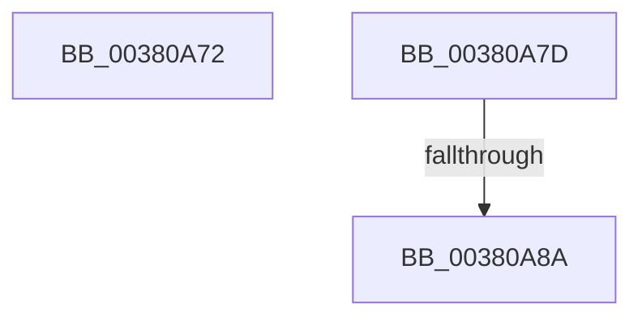

# sub_00380A72

- RVA: `0x00380A72`–`0x00380AB0` (길이 `62` bytes)
- VA: `0x0000000140380A72`
- 실행 섹션: `.text`
- PDB 이름 있음: `아니요`; PDB Function 태그: `아니요`
- unwind 정보 RVA: `0x0007B8F8`
- 디코드: `13`개 명령, `62/62` bytes 표시
- 미해석 바이트: `0` (있으면 어셈블리에 `.byte`로 보존)

> 이 문서는 커널 이미지의 기계어와 PDB 기호를 분석해 생성했습니다. 4번과 5번은 함수 원형과 자료형을 바이너리 사용 방식에서 추정한 C 해석이며 원본 소스 복구 결과는 아닙니다.

## 1. Dependencies

- 직접 호출 지점: **1**; 고유 호출 대상: **1**
- 직접 호출자로 확인된 함수: **0**
- RIP 상대 이미지 참조: **0**

### Outgoing calls
- `0x00380A93` → [MiGetSharedProtos](../34/MiGetSharedProtos_function_00348D58.md) (function, `0x00348D58`)

### Direct callers
- 이 함수 시작 RVA로 연결되는 직접 call은 확인되지 않았습니다. 간접 호출은 완전히 역산할 수 없습니다.

### Static image references
- 디코드된 RIP-relative 메모리 참조가 없습니다.

## 2. Other-region calls and transfers

- 다른 실행 섹션으로 향하는 call: **0**
- call이 아닌 외부 분기/꼬리 이동: **3**
  - `0x00380A78` → [sub_003808A2 + 0x48](Unknown_function_003808A2.md) (`tail-transfer`)
  - `0x00380A84` → [sub_0038093F + 0x64](Unknown_function_0038093F.md) (`tail-transfer`)
  - `0x00380AAB` → [sub_0038093F + 0x6D](Unknown_function_0038093F.md) (`tail-transfer`)

## 3. Assembly (complete function range)

```asm
00380A72  F0 48 83 46 D0 F1               lock add qword ptr [rsi - 0x30], -0xf
00380A78  E9 6D FE FF FF                  jmp 0x1403808ea
00380A7D  F7 45 38 00 00 00 08            test dword ptr [rbp + 0x38], 0x8000000
00380A84  0F 84 19 FF FF FF               je 0x1403809a3
00380A8A  4D 8B C6                        mov r8, r14
00380A8D  41 8B D7                        mov edx, r15d
00380A90  48 8B CD                        mov rcx, rbp
00380A93  E8 C0 82 FC FF                  call 0x140348d58
00380A98  49 8B 4E 08                     mov rcx, qword ptr [r14 + 8]
00380A9C  48 2B 8D 88 00 00 00            sub rcx, qword ptr [rbp + 0x88]
00380AA3  48 C1 F9 03                     sar rcx, 3
00380AA7  48 8B 50 48                     mov rdx, qword ptr [rax + 0x48]
00380AAB  E9 FC FE FF FF                  jmp 0x1403809ac
```

## 4. C-style interpretation (structured pseudocode)

```c
__int64 __fastcall sub_00380A72(void)
{
}
```

## 5. (Beta) C Style

```c
void sub_00380A72(void)
{
}
```

## 6. Execution-region graph

[열기: 2D/3D 그래프와 함수 탐색 컨트롤 패널](../../../control-panel.html?section=text&rva=0x00380A72&view=graph)

- 2D 그래프는 위에서 아래로 흐르고, 3D 그래프는 빈 공간을 드래그해 회전합니다. Shift+드래그는 이동, 휠은 확대·축소, 함수 노드 선택은 대상 보고서 이동입니다.

### Static fallback


