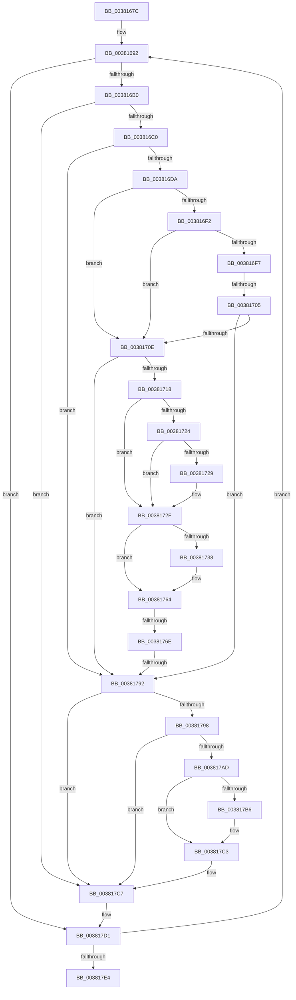

# sub_0038167C

- RVA: `0x0038167C`–`0x00381800` (길이 `388` bytes)
- VA: `0x000000014038167C`
- 실행 섹션: `.text`
- PDB 이름 있음: `아니요`; PDB Function 태그: `아니요`
- unwind 정보 RVA: `0x0007B9A8`
- 디코드: `92`개 명령, `388/388` bytes 표시
- 미해석 바이트: `0` (있으면 어셈블리에 `.byte`로 보존)

> 이 문서는 커널 이미지의 기계어와 PDB 기호를 분석해 생성했습니다. 4번과 5번은 함수 원형과 자료형을 바이너리 사용 방식에서 추정한 C 해석이며 원본 소스 복구 결과는 아닙니다.

## 1. Dependencies

- 직접 호출 지점: **4**; 고유 호출 대상: **4**
- 직접 호출자로 확인된 함수: **0**
- RIP 상대 이미지 참조: **5**

### Outgoing calls
- `0x003816B3` → [MiInPageGapPage](MiInPageGapPage_function_003818A0.md) (function, `0x003818A0`)
- `0x003816C3` → [MiLockPageInline](../31/MiLockPageInline_function_0031A340.md) (function, `0x0031A340`)
- `0x00381785` → [MiArePagefileContentsCorrupted](MiArePagefileContentsCorrupted_function_003818C8.md) (function, `0x003818C8`)
- `0x003817BE` → [KiLowerIrqlProcessIrqlFlags](../4F/KiLowerIrqlProcessIrqlFlags_function_004F5698.md) (function, `0x004F5698`)

### Direct callers
- 이 함수 시작 RVA로 연결되는 직접 call은 확인되지 않았습니다. 간접 호출은 완전히 역산할 수 없습니다.

### Static image references
- `0x003816A3` → RVA `0x00E37430` (`.data`; read)
- `0x003816DE` → RVA `0x00FC5200` (`ALMOSTRO`; read)
- `0x00381718` → RVA `0x00E2DC80` (`.data`; read)
- `0x0038173C` → RVA `0x00E30088` (`.data`; read)
- `0x003817AD` → RVA `0x00FC6D20` (`ALMOSTRO`; read)

## 2. Other-region calls and transfers

- 다른 실행 섹션으로 향하는 call: **0**
- call이 아닌 외부 분기/꼬리 이동: **3**
  - `0x003816FF` → [sub_00381854 + 0x38](Unknown_function_00381854.md) (`tail-transfer`)
  - `0x00381768` → [sub_00381821](Unknown_function_00381821.md) (`tail-transfer`)
  - `0x0038178C` → [sub_00381854](Unknown_function_00381854.md) (`tail-transfer`)

## 3. Assembly (complete function range)

```asm
0038167C  49 89 5B 10                     mov qword ptr [r11 + 0x10], rbx
00381680  4D 89 73 20                     mov qword ptr [r11 + 0x20], r14
00381684  49 89 6B 18                     mov qword ptr [r11 + 0x18], rbp
00381688  48 B9 00 00 00 00 00 DE FF FF   movabs rcx, 0xffffde0000000000
00381692  4C 8B 37                        mov r14, qword ptr [rdi]
00381695  4B 8D 1C 76                     lea rbx, [r14 + r14*2]
00381699  48 C1 E3 04                     shl rbx, 4
0038169D  48 8B C1                        mov rax, rcx
003816A0  48 03 D8                        add rbx, rax
003816A3  48 3B 1D 86 5D AB 00            cmp rbx, qword ptr [rip + 0xab5d86]
003816AA  0F 84 21 01 00 00               je 0x1403817d1
003816B0  48 8B CB                        mov rcx, rbx
003816B3  E8 E8 01 00 00                  call 0x1403818a0
003816B8  85 C0                           test eax, eax
003816BA  0F 85 07 01 00 00               jne 0x1403817c7
003816C0  48 8B CB                        mov rcx, rbx
003816C3  E8 78 8C F9 FF                  call 0x14031a340
003816C8  0F B6 E8                        movzx ebp, al
003816CB  48 8B 43 18                     mov rax, qword ptr [rbx + 0x18]
003816CF  48 0F BA E0 3E                  bt rax, 0x3e
003816D4  0F 82 B8 00 00 00               jb 0x140381792
003816DA  48 8B 53 10                     mov rdx, qword ptr [rbx + 0x10]
003816DE  8B 05 1C 3B C4 00               mov eax, dword ptr [rip + 0xc43b1c]
003816E4  48 8B CA                        mov rcx, rdx
003816E7  48 C1 E9 05                     shr rcx, 5
003816EB  83 E1 1F                        and ecx, 0x1f
003816EE  A8 01                           test al, 1
003816F0  75 1C                           jne 0x14038170e
003816F2  83 F9 1F                        cmp ecx, 0x1f
003816F5  74 17                           je 0x14038170e
003816F7  8B C1                           mov eax, ecx
003816F9  C1 E8 03                        shr eax, 3
003816FC  83 F8 03                        cmp eax, 3
003816FF  0F 84 87 01 00 00               je 0x14038188c
00381705  83 F8 01                        cmp eax, 1
00381708  0F 84 84 00 00 00               je 0x140381792
0038170E  0F B6 C2                        movzx eax, dl
00381711  C0 E8 02                        shr al, 2
00381714  A8 01                           test al, 1
00381716  74 7A                           je 0x140381792
00381718  48 8B 05 61 C5 AA 00            mov rax, qword ptr [rip + 0xaac561]
0038171F  48 85 C0                        test rax, rax
00381722  74 0B                           je 0x14038172f
00381724  F6 C2 10                        test dl, 0x10
00381727  75 06                           jne 0x14038172f
00381729  48 F7 D0                        not rax
0038172C  48 23 D0                        and rdx, rax
0038172F  48 C1 EA 20                     shr rdx, 0x20
00381733  4D 85 E4                        test r12, r12
00381736  75 2C                           jne 0x140381764
00381738  48 8B 43 28                     mov rax, qword ptr [rbx + 0x28]
0038173C  48 8B 0D 45 E9 AA 00            mov rcx, qword ptr [rip + 0xaae945]
00381743  44 8B 4B 10                     mov r9d, dword ptr [rbx + 0x10]
00381747  48 C1 E8 2B                     shr rax, 0x2b
0038174B  25 FF 03 00 00                  and eax, 0x3ff
00381750  49 C1 E9 0C                     shr r9, 0xc
00381754  41 83 E1 0F                     and r9d, 0xf
00381758  4C 8B 04 C1                     mov r8, qword ptr [rcx + rax*8]
0038175C  4F 8B A4 C8 60 48 00 00         mov r12, qword ptr [r8 + r9*8 + 0x4860]
00381764  3B 74 24 28                     cmp esi, dword ptr [rsp + 0x28]
00381768  0F 83 B3 00 00 00               jae 0x140381821
0038176E  8B C6                           mov eax, esi
00381770  48 8D 54 24 40                  lea rdx, [rsp + 0x40]
00381775  48 C1 E0 04                     shl rax, 4
00381779  41 B8 01 00 00 00               mov r8d, 1
0038177F  48 03 D0                        add rdx, rax
00381782  49 8B CE                        mov rcx, r14
00381785  E8 3E 01 00 00                  call 0x1403818c8
0038178A  85 C0                           test eax, eax
0038178C  0F 85 C2 00 00 00               jne 0x140381854
00381792  40 80 FD 11                     cmp bpl, 0x11
00381796  74 2F                           je 0x1403817c7
00381798  48 B8 FF FF FF FF FF FF FF 7F   movabs rax, 0x7fffffffffffffff
003817A2  F0 48 21 43 18                  lock and qword ptr [rbx + 0x18], rax
003817A7  40 80 FD 02                     cmp bpl, 2
003817AB  73 1A                           jae 0x1403817c7
003817AD  83 3D 6C 55 C4 00 00            cmp dword ptr [rip + 0xc4556c], 0
003817B4  74 0D                           je 0x1403817c3
003817B6  44 0F 20 C1                     mov rcx, cr8
003817BA  40 0F B6 D5                     movzx edx, bpl
003817BE  E8 D5 3E 17 00                  call 0x1404f5698
003817C3  44 0F 22 C5                     mov cr8, rbp
003817C7  48 B9 00 00 00 00 00 DE FF FF   movabs rcx, 0xffffde0000000000
003817D1  FF C6                           inc esi
003817D3  48 83 C7 08                     add rdi, 8
003817D7  49 83 EF 08                     sub r15, 8
003817DB  49 3B FD                        cmp rdi, r13
003817DE  0F 82 AE FE FF FF               jb 0x140381692
003817E4  4C 8B B4 24 98 01 00 00         mov r14, qword ptr [rsp + 0x198]
003817EC  48 8B AC 24 90 01 00 00         mov rbp, qword ptr [rsp + 0x190]
003817F4  48 8B 9C 24 88 01 00 00         mov rbx, qword ptr [rsp + 0x188]
003817FC  8B 44 24 20                     mov eax, dword ptr [rsp + 0x20]
```

## 4. C-style interpretation (structured pseudocode)

```c
__int64 __fastcall sub_0038167C(__int64 a1, __int64 a2, __int64 a3, __int64 a4, unsigned int a5, __int64 a6, __int64 a7, __int64 a8, __int64 a9, __int64 a10, __int64 a11, __int64 a12, __int64 a13, __int64 a14, __int64 a15, __int64 a16, __int64 a17, __int64 a18, __int64 a19, __int64 a20, __int64 a21, __int64 a22, __int64 a23, __int64 a24, __int64 a25, __int64 a26, __int64 a27, __int64 a28, __int64 a29, __int64 a30, __int64 a31, __int64 a32, __int64 a33, __int64 a34, __int64 a35, __int64 a36, __int64 a37, __int64 a38, __int64 a39, __int64 a40, __int64 a41, __int64 a42, __int64 a43, __int64 a44, __int64 a45, __int64 a46, __int64 a47, __int64 a48, __int64 a49, __int64 a50, __int64 a51)
{
    __int64 result;
    __int64 v_r12;
    __int64 v_r15;
    __int64 v_rbx;
    __int64 v_rdi;
    __int64 v_rsi;
    unsigned int v_stack_p20;

    *(unsigned __int64 *)(v_r11 + 16) = v_rbx;
    *(unsigned __int64 *)(v_r11 + 32) = v_r14;
    *(unsigned __int64 *)(v_r11 + 24) = v_rbp;
loc_00381692:
    v_rbx = (*(unsigned __int64 *)(v_rdi) + *(unsigned __int64 *)(v_rdi) * 2) << (4);
    v_rbx = (v_rbx) + (a1);
    if (v_rbx == (*(unsigned __int64 *)(v_rip + 11230598))) goto loc_003817D1;
    result = MiInPageGapPage(v_rbx, a2, a3, a4);
    if ((unsigned int)(result) != 0) goto loc_003817C7;
    result = MiLockPageInline(v_rbx, a2, a3, a4);
    if (condition_is_below) goto loc_00381792;
    a1 = (*(unsigned __int64 *)(v_rbx + 16)) >> (5);
    a1 = (unsigned int)((a1) & (31));
    if ((((unsigned __int8)((unsigned int)(*(unsigned int *)(v_rip + 12860188)))) & (1)) != 0) goto loc_0038170E;
    if (((unsigned int)(a1)) == 31) goto loc_0038170E;
    result = (unsigned int)(((unsigned int)((unsigned int)(a1))) >> (3));
    if (((unsigned int)(result)) == 1) goto loc_00381792;
loc_0038170E:
    result = (unsigned __int8)(((unsigned __int8)(*(unsigned __int64 *)(v_rbx + 16))) >> (2));
    if ((((unsigned __int8)(result)) & (1)) == 0) goto loc_00381792;
    if (*(unsigned __int64 *)(v_rip + 11191649) == 0) goto loc_0038172F;
    result = *(unsigned __int64 *)(v_rip + 11191649);
    if ((((unsigned __int8)(*(unsigned __int64 *)(v_rbx + 16))) & (16)) == 0) {
        result = ~(*(unsigned __int64 *)(v_rip + 11191649));
        a2 = (*(unsigned __int64 *)(v_rbx + 16)) & (result);
    }
    a2 = (a2) >> (32);
    if (v_r12 == 0) {
        result = *(unsigned __int64 *)(v_rbx + 40);
        a1 = *(unsigned __int64 *)(v_rip + 11200837);
        a4 = *(unsigned int *)(v_rbx + 16);
        result = (result) >> (43);
        result = (unsigned int)((result) & (0x3FFULL));
        a4 = (a4) >> (12);
        a4 = (unsigned int)((a4) & (15));
        a3 = *(unsigned __int64 *)(a1 + result * 8);
        v_r12 = *(unsigned __int64 *)(a3 + a4 * 8 + 18528);
    }
    result = ((unsigned int)((unsigned int)(v_rsi))) << (4);
    a2 = (a8) + (result);
    result = MiArePagefileContentsCorrupted(*(unsigned __int64 *)(v_rdi), a2, 1, a4);
loc_00381792:
    if (((unsigned __int8)((unsigned __int8)(result))) == 17) goto loc_003817C7;
    if (((unsigned __int8)((unsigned __int8)(result))) >= 2) goto loc_003817C7;
    if ((*(unsigned int *)(v_rip + 12866924)) != 0) {
        a1 = v_cr8;
        a2 = (unsigned __int8)((unsigned __int8)(result));
        result = KiLowerIrqlProcessIrqlFlags(a1, a2, 1, a4);
    }
loc_003817C7:
loc_003817D1:
    v_rsi = (unsigned int)((v_rsi) + 1);
    v_rdi = (v_rdi) + (8);
    v_r15 = (v_r15) - (8);
    if (v_rdi < v_r13) goto loc_00381692;
    return (unsigned int)(v_stack_p20);
}
```

## 5. (Beta) C Style

```c
int64_t sub_0038167C(int64_t Arg1, int64_t Arg2, int64_t Arg3, int64_t Arg4, uint32_t Arg5, uint64_t Arg6, uint64_t Arg7, int64_t Arg8, uint64_t Arg9, uint64_t Arg10, uint64_t Arg11, uint64_t Arg12, uint64_t Arg13, uint64_t Arg14, uint64_t Arg15, uint64_t Arg16, uint64_t Arg17, uint64_t Arg18, uint64_t Arg19, uint64_t Arg20, uint64_t Arg21, uint64_t Arg22, uint64_t Arg23, uint64_t Arg24, uint64_t Arg25, uint64_t Arg26, uint64_t Arg27, uint64_t Arg28, uint64_t Arg29, uint64_t Arg30, uint64_t Arg31, uint64_t Arg32, uint64_t Arg33, uint64_t Arg34, uint64_t Arg35, uint64_t Arg36, uint64_t Arg37, uint64_t Arg38, uint64_t Arg39, uint64_t Arg40, uint64_t Arg41, uint64_t Arg42, uint64_t Arg43, uint64_t Arg44, uint64_t Arg45, uint64_t Arg46, uint64_t Arg47, uint64_t Arg48, int64_t Arg49, int64_t Arg50, int64_t Arg51)
{
    int64_t result;
    int64_t local_r12;
    int64_t local_r15;
    int64_t local_rbx;
    int64_t local_rdi;
    int64_t local_rsi;
    uint32_t v_stack_p20;

    *(uint64_t *)(local_r11 + 0x10) = local_rbx;
    *(uint64_t *)(local_r11 + 0x20) = local_r14;
    *(uint64_t *)(local_r11 + 0x18) = local_rbp;
loc_00381692:
    local_rbx = (*(uint64_t *)(local_rdi) + *(uint64_t *)(local_rdi) * 2) << (4);
    local_rbx = (local_rbx) + (Arg1);
    if (local_rbx == (*(uint64_t *)(v_rip + 0xAB5D86))) goto loc_003817D1;
    result = MiInPageGapPage(local_rbx, Arg2, Arg3, Arg4);
    if ((uint32_t)(result) != 0) goto loc_003817C7;
    result = MiLockPageInline(local_rbx, Arg2, Arg3, Arg4);
    if (condition_is_below) goto loc_00381792;
    Arg1 = (*(uint64_t *)(local_rbx + 0x10)) >> (5);
    Arg1 = (uint32_t)((Arg1) & (31));
    if ((((uint8_t)((uint32_t)(*(uint32_t *)(v_rip + 0xC43B1C)))) & (1)) != 0) goto loc_0038170E;
    if (((uint32_t)(Arg1)) == 31) goto loc_0038170E;
    result = (uint32_t)(((uint32_t)((uint32_t)(Arg1))) >> (3));
    if (((uint32_t)(result)) == 1) goto loc_00381792;
loc_0038170E:
    result = (uint8_t)(((uint8_t)(*(uint64_t *)(local_rbx + 0x10))) >> (2));
    if ((((uint8_t)(result)) & (1)) == 0) goto loc_00381792;
    if (*(uint64_t *)(v_rip + 0xAAC561) == 0) goto loc_0038172F;
    result = *(uint64_t *)(v_rip + 0xAAC561);
    if ((((uint8_t)(*(uint64_t *)(local_rbx + 0x10))) & (16)) == 0) {
        result = ~(*(uint64_t *)(v_rip + 0xAAC561));
        Arg2 = (*(uint64_t *)(local_rbx + 0x10)) & (result);
    }
    Arg2 = (Arg2) >> (32);
    if (local_r12 == 0) {
        result = *(uint64_t *)(local_rbx + 0x28);
        Arg1 = *(uint64_t *)(v_rip + 0xAAE945);
        Arg4 = *(uint32_t *)(local_rbx + 0x10);
        result = (result) >> (43);
        result = (uint32_t)((result) & (0x3FFULL));
        Arg4 = (Arg4) >> (12);
        Arg4 = (uint32_t)((Arg4) & (15));
        Arg3 = *(uint64_t *)(Arg1 + result * 8);
        local_r12 = *(uint64_t *)(Arg3 + Arg4 * 8 + 0x4860);
    }
    result = ((uint32_t)((uint32_t)(local_rsi))) << (4);
    Arg2 = (Arg8) + (result);
    result = MiArePagefileContentsCorrupted(*(uint64_t *)(local_rdi), Arg2, 1, Arg4);
loc_00381792:
    if (((uint8_t)((uint8_t)(result))) == 17) goto loc_003817C7;
    if (((uint8_t)((uint8_t)(result))) >= 2) goto loc_003817C7;
    if ((*(uint32_t *)(v_rip + 0xC4556C)) != 0) {
        Arg1 = v_cr8;
        Arg2 = (uint8_t)((uint8_t)(result));
        result = KiLowerIrqlProcessIrqlFlags(Arg1, Arg2, 1, Arg4);
    }
loc_003817C7:
loc_003817D1:
    local_rsi = (uint32_t)((local_rsi) + 1);
    local_rdi = (local_rdi) + (8);
    local_r15 = (local_r15) - (8);
    if (local_rdi < local_r13) goto loc_00381692;
    return (uint32_t)(v_stack_p20);
}
```

## 6. Execution-region graph

[열기: 2D/3D 그래프와 함수 탐색 컨트롤 패널](../../../control-panel.html?section=text&rva=0x0038167C&view=graph)

- 2D 그래프는 위에서 아래로 흐르고, 3D 그래프는 빈 공간을 드래그해 회전합니다. Shift+드래그는 이동, 휠은 확대·축소, 함수 노드 선택은 대상 보고서 이동입니다.

### Static fallback


