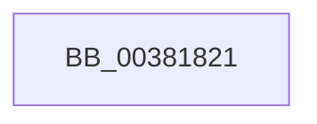

# sub_00381821

- RVA: `0x00381821`–`0x0038184F` (길이 `46` bytes)
- VA: `0x0000000140381821`
- 실행 섹션: `.text`
- PDB 이름 있음: `아니요`; PDB Function 태그: `아니요`
- unwind 정보 RVA: `0x0007B9D8`
- 디코드: `12`개 명령, `46/46` bytes 표시
- 미해석 바이트: `0` (있으면 어셈블리에 `.byte`로 보존)

> 이 문서는 커널 이미지의 기계어와 PDB 기호를 분석해 생성했습니다. 4번과 5번은 함수 원형과 자료형을 바이너리 사용 방식에서 추정한 C 해석이며 원본 소스 복구 결과는 아닙니다.

## 1. Dependencies

- 직접 호출 지점: **1**; 고유 호출 대상: **1**
- 직접 호출자로 확인된 함수: **0**
- RIP 상대 이미지 참조: **0**

### Outgoing calls
- `0x00381843` → [MiObtainPagefileHashes](MiObtainPagefileHashes_function_00381AC8.md) (function, `0x00381AC8`)

### Direct callers
- 이 함수 시작 RVA로 연결되는 직접 call은 확인되지 않았습니다. 간접 호출은 완전히 역산할 수 없습니다.

### Static image references
- 디코드된 RIP-relative 메모리 참조가 없습니다.

## 2. Other-region calls and transfers

- 다른 실행 섹션으로 향하는 call: **0**
- call이 아닌 외부 분기/꼬리 이동: **1**
  - `0x0038184A` → [sub_0038167C + 0xF2](Unknown_function_0038167C.md) (`tail-transfer`)

## 3. Assembly (complete function range)

```asm
00381821  B9 10 00 00 00                  mov ecx, 0x10
00381826  4C 8D 4C 24 40                  lea r9, [rsp + 0x40]
0038182B  49 8B C7                        mov rax, r15
0038182E  48 C1 F8 03                     sar rax, 3
00381832  83 F8 10                        cmp eax, 0x10
00381835  0F 47 C1                        cmova eax, ecx
00381838  49 8B CC                        mov rcx, r12
0038183B  44 8B C0                        mov r8d, eax
0038183E  48 89 44 24 28                  mov qword ptr [rsp + 0x28], rax
00381843  E8 80 02 00 00                  call 0x140381ac8
00381848  33 F6                           xor esi, esi
0038184A  E9 1F FF FF FF                  jmp 0x14038176e
```

## 4. C-style interpretation (structured pseudocode)

```c
__int64 __fastcall sub_00381821(__int64 a1, __int64 a2, __int64 a3, __int64 a4, __int64 a5, __int64 a6, __int64 a7, __int64 a8)
{
    __int64 result;
    __int64 v_rsi;
    unsigned __int64 v_stack_p28;

    result = (v_r15) >> (3);
    if (((unsigned int)(result)) > 16) { result = 16; }
    v_stack_p28 = result;
    result = MiObtainPagefileHashes(v_r12, a2, (unsigned int)((unsigned int)(result)), a8);
    v_rsi = 0;
}
```

## 5. (Beta) C Style

```c
int64_t sub_00381821(int64_t Arg1, int64_t Arg2, int64_t Arg3, int64_t Arg4, uint64_t Arg5, uint64_t Arg6, uint64_t Arg7, int64_t Arg8)
{
    int64_t result;
    int64_t local_rsi;
    uint64_t v_stack_p28;

    result = (local_r15) >> (3);
    if (((uint32_t)(result)) > 16) { result = 16; }
    v_stack_p28 = result;
    result = MiObtainPagefileHashes(local_r12, Arg2, (uint32_t)((uint32_t)(result)), Arg8);
    local_rsi = 0;
}
```

## 6. Execution-region graph

[열기: 2D/3D 그래프와 함수 탐색 컨트롤 패널](../../../control-panel.html?section=text&rva=0x00381821&view=graph)

- 2D 그래프는 위에서 아래로 흐르고, 3D 그래프는 빈 공간을 드래그해 회전합니다. Shift+드래그는 이동, 휠은 확대·축소, 함수 노드 선택은 대상 보고서 이동입니다.

### Static fallback


