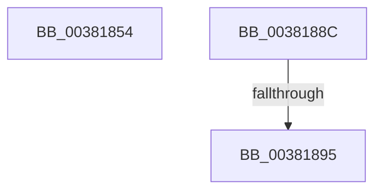

# sub_00381854

- RVA: `0x00381854`–`0x0038189A` (길이 `70` bytes)
- VA: `0x0000000140381854`
- 실행 섹션: `.text`
- PDB 이름 있음: `아니요`; PDB Function 태그: `아니요`
- unwind 정보 RVA: `0x0007BA04`
- 디코드: `17`개 명령, `70/70` bytes 표시
- 미해석 바이트: `0` (있으면 어셈블리에 `.byte`로 보존)

> 이 문서는 커널 이미지의 기계어와 PDB 기호를 분석해 생성했습니다. 4번과 5번은 함수 원형과 자료형을 바이너리 사용 방식에서 추정한 C 해석이며 원본 소스 복구 결과는 아닙니다.

## 1. Dependencies

- 직접 호출 지점: **0**; 고유 호출 대상: **0**
- 직접 호출자로 확인된 함수: **0**
- RIP 상대 이미지 참조: **0**

### Outgoing calls
- 직접 디코드된 call 명령이 없습니다.

### Direct callers
- 이 함수 시작 RVA로 연결되는 직접 call은 확인되지 않았습니다. 간접 호출은 완전히 역산할 수 없습니다.

### Static image references
- 디코드된 RIP-relative 메모리 참조가 없습니다.

## 2. Other-region calls and transfers

- 다른 실행 섹션으로 향하는 call: **0**
- call이 아닌 외부 분기/꼬리 이동: **3**
  - `0x00381887` → [sub_0038167C + 0x116](Unknown_function_0038167C.md) (`tail-transfer`)
  - `0x0038188F` → [sub_0038167C + 0x89](Unknown_function_0038167C.md) (`tail-transfer`)
  - `0x00381895` → [sub_0038167C + 0x116](Unknown_function_0038167C.md) (`tail-transfer`)

## 3. Assembly (complete function range)

```asm
00381854  48 8B 4C 24 30                  mov rcx, qword ptr [rsp + 0x30]
00381859  8B 44 24 20                     mov eax, dword ptr [rsp + 0x20]
0038185D  48 3B 99 F8 00 00 00            cmp rbx, qword ptr [rcx + 0xf8]
00381864  B9 3F 00 00 C0                  mov ecx, 0xc000003f
00381869  0F 44 C1                        cmove eax, ecx
0038186C  89 44 24 20                     mov dword ptr [rsp + 0x20], eax
00381870  8B 43 20                        mov eax, dword ptr [rbx + 0x20]
00381873  89 44 24 24                     mov dword ptr [rsp + 0x24], eax
00381877  C1 E8 18                        shr eax, 0x18
0038187A  0C 10                           or al, 0x10
0038187C  88 44 24 27                     mov byte ptr [rsp + 0x27], al
00381880  8B 44 24 24                     mov eax, dword ptr [rsp + 0x24]
00381884  89 43 20                        mov dword ptr [rbx + 0x20], eax
00381887  E9 06 FF FF FF                  jmp 0x140381792
0038188C  F6 C1 07                        test cl, 7
0038188F  0F 84 70 FE FF FF               je 0x140381705
00381895  E9 F8 FE FF FF                  jmp 0x140381792
```

## 4. C-style interpretation (structured pseudocode)

```c
__int64 __fastcall sub_00381854(__int64 a1, __int64 a2, __int64 a3, __int64 a4, __int64 a5, __int64 a6)
{
    __int64 result;
    unsigned int v_stack_p20;
    unsigned int v_stack_p24;
    unsigned __int8 v_stack_p27;

    result = (unsigned int)(v_stack_p20);
    if (v_rbx == (*(unsigned __int64 *)(a6 + 248))) { result = (unsigned int)((unsigned int)(0xC000003FULL)); }
    v_stack_p20 = (unsigned int)(result);
    v_stack_p24 = (unsigned int)((unsigned int)(*(unsigned int *)(v_rbx + 32)));
    result = (unsigned int)(((unsigned int)(*(unsigned int *)(v_rbx + 32))) >> (24));
    result = (unsigned __int8)((result) | (16));
    v_stack_p27 = (unsigned __int8)(result);
    *(unsigned int *)(v_rbx + 32) = (unsigned int)((unsigned int)(v_stack_p24));
}
```

## 5. (Beta) C Style

```c
int64_t sub_00381854(int64_t Arg1, int64_t Arg2, int64_t Arg3, int64_t Arg4, uint64_t Arg5, void *Arg6)
{
    uint8_t *arg6 = (uint8_t *)Arg6;

    int64_t result;
    uint32_t v_stack_p20;
    uint32_t v_stack_p24;
    uint8_t v_stack_p27;

    result = (uint32_t)(v_stack_p20);
    if (local_rbx == (*(uint64_t *)(arg6 + 0xF8))) { result = (uint32_t)((uint32_t)(0xC000003FULL)); }
    v_stack_p20 = (uint32_t)(result);
    v_stack_p24 = (uint32_t)((uint32_t)(*(uint32_t *)(local_rbx + 0x20)));
    result = (uint32_t)(((uint32_t)(*(uint32_t *)(local_rbx + 0x20))) >> (24));
    result = (uint8_t)((result) | (16));
    v_stack_p27 = (uint8_t)(result);
    *(uint32_t *)(local_rbx + 0x20) = (uint32_t)((uint32_t)(v_stack_p24));
}
```

### 관측된 메모리 오프셋

구조체 형식이 확인되지 않은 접근은 인자 기준의 오프셋으로만 기록했습니다.

| 기준 인자 | 오프셋 표현 | 폭 (bit) | 접근 |
|---|---:|---:|---|
| `Arg6` | `+ 0xF8` | `64` | `R` |

## 6. Execution-region graph

[열기: 2D/3D 그래프와 함수 탐색 컨트롤 패널](../../../control-panel.html?section=text&rva=0x00381854&view=graph)

- 2D 그래프는 위에서 아래로 흐르고, 3D 그래프는 빈 공간을 드래그해 회전합니다. Shift+드래그는 이동, 휠은 확대·축소, 함수 노드 선택은 대상 보고서 이동입니다.

### Static fallback


