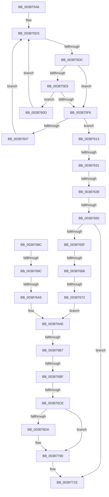

# sub_003875A6

- RVA: `0x003875A6`–`0x00387734` (길이 `398` bytes)
- VA: `0x00000001403875A6`
- 실행 섹션: `.text`
- PDB 이름 있음: `아니요`; PDB Function 태그: `아니요`
- unwind 정보 RVA: `0x0007FD5C`
- 디코드: `111`개 명령, `398/398` bytes 표시
- 미해석 바이트: `0` (있으면 어셈블리에 `.byte`로 보존)

> 이 문서는 커널 이미지의 기계어와 PDB 기호를 분석해 생성했습니다. 4번과 5번은 함수 원형과 자료형을 바이너리 사용 방식에서 추정한 C 해석이며 원본 소스 복구 결과는 아닙니다.

## 1. Dependencies

- 직접 호출 지점: **1**; 고유 호출 대상: **1**
- 직접 호출자로 확인된 함수: **0**
- RIP 상대 이미지 참조: **0**

### Outgoing calls
- `0x003876F7` → [memcpy](../6C/memcpy_function_006C6840.md) (function, `0x006C6840`)

### Direct callers
- 이 함수 시작 RVA로 연결되는 직접 call은 확인되지 않았습니다. 간접 호출은 완전히 역산할 수 없습니다.

### Static image references
- 디코드된 RIP-relative 메모리 참조가 없습니다.

## 2. Other-region calls and transfers

- 다른 실행 섹션으로 향하는 call: **0**
- call이 아닌 외부 분기/꼬리 이동: **11**
  - `0x003875D6` → [sub_00387740 + 0x27C](Unknown_function_00387740.md) (`tail-transfer`)
  - `0x0038762B` → [sub_00387740 + 0x21](Unknown_function_00387740.md) (`tail-transfer`)
  - `0x00387633` → [sub_00387740 + 0xEF](Unknown_function_00387740.md) (`tail-transfer`)
  - `0x0038764A` → [sub_00387740 + 0x1A](Unknown_function_00387740.md) (`tail-transfer`)
  - `0x00387662` → [sub_00387740 + 0x3E5](Unknown_function_00387740.md) (`tail-transfer`)
  - `0x0038766C` → [sub_00387740 + 0x372](Unknown_function_00387740.md) (`tail-transfer`)
  - `0x00387696` → [sub_00387740 + 0x1A](Unknown_function_00387740.md) (`tail-transfer`)
  - `0x0038769F` → [sub_00387740 + 0x273](Unknown_function_00387740.md) (`tail-transfer`)
  - `0x003876B1` → [sub_00387740 + 0xF6](Unknown_function_00387740.md) (`tail-transfer`)
  - `0x003876B9` → [sub_00387740 + 0x8B](Unknown_function_00387740.md) (`tail-transfer`)
  - `0x003876C8` → [sub_00387740 + 0x1E7](Unknown_function_00387740.md) (`tail-transfer`)

## 3. Assembly (complete function range)

```asm
003875A6  48 89 74 24 30                  mov qword ptr [rsp + 0x30], rsi
003875AB  33 F6                           xor esi, esi
003875AD  4C 89 7C 24 20                  mov qword ptr [rsp + 0x20], r15
003875B2  44 8B C6                        mov r8d, esi
003875B5  44 8B 79 04                     mov r15d, dword ptr [rcx + 4]
003875B9  48 89 6C 24 78                  mov qword ptr [rsp + 0x78], rbp
003875BE  44 89 7C 24 68                  mov dword ptr [rsp + 0x68], r15d
003875C3  4C 89 64 24 28                  mov qword ptr [rsp + 0x28], r12
003875C8  41 8D 57 FF                     lea edx, [r15 - 1]
003875CC  89 54 24 60                     mov dword ptr [rsp + 0x60], edx
003875D0  44 8B CA                        mov r9d, edx
003875D3  45 3B C1                        cmp r8d, r9d
003875D6  0F 8F E0 03 00 00               jg 0x1403879bc
003875DC  43 8D 04 01                     lea eax, [r9 + r8]
003875E0  99                              cdq
003875E1  2B C2                           sub eax, edx
003875E3  D1 F8                           sar eax, 1
003875E5  8B C8                           mov ecx, eax
003875E7  74 0D                           je 0x1403875f6
003875E9  48 8B 47 10                     mov rax, qword ptr [rdi + 0x10]
003875ED  48 63 D1                        movsxd rdx, ecx
003875F0  3B 5C D0 F8                     cmp ebx, dword ptr [rax + rdx*8 - 8]
003875F4  72 17                           jb 0x14038760d
003875F6  4C 8B 57 10                     mov r10, qword ptr [rdi + 0x10]
003875FA  48 63 C1                        movsxd rax, ecx
003875FD  41 8B 14 C2                     mov edx, dword ptr [r10 + rax*8]
00387601  FF CA                           dec edx
00387603  3B DA                           cmp ebx, edx
00387605  76 0C                           jbe 0x140387613
00387607  44 8D 41 01                     lea r8d, [rcx + 1]
0038760B  EB C6                           jmp 0x1403875d3
0038760D  44 8D 49 FF                     lea r9d, [rcx - 1]
00387611  EB C0                           jmp 0x1403875d3
00387613  45 8B 44 CA 04                  mov r8d, dword ptr [r10 + rcx*8 + 4]
00387618  8D 6B FF                        lea ebp, [rbx - 1]
0038761B  4D 8D 0C CA                     lea r9, [r10 + rcx*8]
0038761F  41 03 ED                        add ebp, r13d
00387622  41 BC FF FF FF FF               mov r12d, 0xffffffff
00387628  45 3B C4                        cmp r8d, r12d
0038762B  0F 84 30 01 00 00               je 0x140387761
00387631  85 C9                           test ecx, ecx
00387633  0F 84 F6 01 00 00               je 0x14038782f
00387639  8D 41 FF                        lea eax, [rcx - 1]
0038763C  41 8B 14 C2                     mov edx, dword ptr [r10 + rax*8]
00387640  41 8B C0                        mov eax, r8d
00387643  2B C2                           sub eax, edx
00387645  03 C3                           add eax, ebx
00387647  44 3B F0                        cmp r14d, eax
0038764A  0F 85 0A 01 00 00               jne 0x14038775a
00387650  45 8B 19                        mov r11d, dword ptr [r9]
00387653  41 8D 43 FF                     lea eax, [r11 - 1]
00387657  3B E8                           cmp ebp, eax
00387659  0F 86 BF 00 00 00               jbe 0x14038771e
0038765F  41 3B CF                        cmp ecx, r15d
00387662  0F 82 BD 04 00 00               jb 0x140387b25
00387668  8B DE                           mov ebx, esi
0038766A  85 C9                           test ecx, ecx
0038766C  0F 84 40 04 00 00               je 0x140387ab2
00387672  FF C9                           dec ecx
00387674  41 8B 04 CA                     mov eax, dword ptr [r10 + rcx*8]
00387678  44 2B D8                        sub r11d, eax
0038767B  2B EB                           sub ebp, ebx
0038767D  47 8D 34 18                     lea r14d, [r8 + r11]
00387681  4C 89 74 24 70                  mov qword ptr [rsp + 0x70], r14
00387686  44 8D 6D 01                     lea r13d, [rbp + 1]
0038768A  EB 22                           jmp 0x1403876ae
0038768C  2B CB                           sub ecx, ebx
0038768E  41 03 CE                        add ecx, r14d
00387691  43 39 4C CA 04                  cmp dword ptr [r10 + r9*8 + 4], ecx
00387696  0F 85 BE 00 00 00               jne 0x14038775a
0038769C  45 85 C9                        test r9d, r9d
0038769F  0F 85 0E 03 00 00               jne 0x1403879b3
003876A5  8B C5                           mov eax, ebp
003876A7  2B C3                           sub eax, ebx
003876A9  44 8B E8                        mov r13d, eax
003876AC  33 F6                           xor esi, esi
003876AE  45 85 FF                        test r15d, r15d
003876B1  0F 85 7F 01 00 00               jne 0x140387836
003876B7  85 DB                           test ebx, ebx
003876B9  0F 85 0C 01 00 00               jne 0x1403877cb
003876BF  8B 47 04                        mov eax, dword ptr [rdi + 4]
003876C2  8B 17                           mov edx, dword ptr [rdi]
003876C4  FF C0                           inc eax
003876C6  3B C2                           cmp eax, edx
003876C8  0F 87 59 02 00 00               ja 0x140387927
003876CE  48 8B 77 10                     mov rsi, qword ptr [rdi + 0x10]
003876D2  8B 47 04                        mov eax, dword ptr [rdi + 4]
003876D5  44 3B F8                        cmp r15d, eax
003876D8  73 26                           jae 0x140387700
003876DA  4C 8B 4F 10                     mov r9, qword ptr [rdi + 0x10]
003876DE  41 2B C7                        sub eax, r15d
003876E1  44 8B C0                        mov r8d, eax
003876E4  41 8B C7                        mov eax, r15d
003876E7  49 C1 E0 03                     shl r8, 3
003876EB  49 8D 14 C1                     lea rdx, [r9 + rax*8]
003876EF  41 8D 47 01                     lea eax, [r15 + 1]
003876F3  49 8D 0C C1                     lea rcx, [r9 + rax*8]
003876F7  E8 44 F1 33 00                  call 0x1406c6840
003876FC  48 8B 77 10                     mov rsi, qword ptr [rdi + 0x10]
00387700  FF 47 04                        inc dword ptr [rdi + 4]
00387703  41 8B C7                        mov eax, r15d
00387706  48 8D 14 C5 00 00 00 00         lea rdx, [rax*8]
0038770E  44 89 74 32 04                  mov dword ptr [rdx + rsi + 4], r14d
00387713  48 8B 47 10                     mov rax, qword ptr [rdi + 0x10]
00387717  42 8D 0C 2B                     lea ecx, [rbx + r13]
0038771B  89 0C 02                        mov dword ptr [rdx + rax], ecx
0038771E  33 C0                           xor eax, eax
00387720  4C 8B 64 24 28                  mov r12, qword ptr [rsp + 0x28]
00387725  48 8B 6C 24 78                  mov rbp, qword ptr [rsp + 0x78]
0038772A  48 8B 74 24 30                  mov rsi, qword ptr [rsp + 0x30]
0038772F  4C 8B 7C 24 20                  mov r15, qword ptr [rsp + 0x20]
```

## 4. C-style interpretation (structured pseudocode)

```c
__int64 __fastcall sub_003875A6(__int64 a1, __int64 a2, __int64 a3, __int64 a4, __int64 a5, __int64 a6, __int64 a7, __int64 a8, __int64 a9, __int64 a10, __int64 a11, __int64 a12, __int64 a13, __int64 a14, __int64 a15)
{
    __int64 result;
    __int64 v_r11;
    __int64 v_rbp;
    __int64 v_rsi;
    unsigned __int64 v_stack_p20;
    unsigned __int64 v_stack_p28;
    unsigned __int64 v_stack_p30;
    unsigned int v_stack_p60;
    unsigned int v_stack_p68;
    unsigned __int64 v_stack_p70;
    unsigned __int64 v_stack_p78;

    v_stack_p30 = v_rsi;
    v_rsi = 0;
    v_stack_p20 = v_r15;
    v_stack_p78 = v_rbp;
    v_stack_p68 = (unsigned int)((unsigned int)(*(unsigned int *)(a1 + 4)));
    v_stack_p28 = v_r12;
    v_stack_p60 = (unsigned int)((unsigned int)(*(unsigned int *)(a1 + 4)) - 1);
loc_003875D3:
    result = (unsigned int)(((unsigned int)((unsigned int)((unsigned int)(*(unsigned int *)(a1 + 4)) - 1)) + 0 * 1) - ((unsigned int)((unsigned int)(*(unsigned int *)(a1 + 4)) - 1)));
    result = (unsigned int)((result) >> (1));
    if (condition_is_equal) goto loc_003875F6;
    if (((unsigned int)(v_rbx)) < (*(unsigned int *)(*(unsigned __int64 *)(v_rdi + 16) + (int)((unsigned int)((unsigned int)((unsigned int)(result)))) * 8 - 8))) goto loc_0038760D;
loc_003875F6:
    a2 = (unsigned int)(((unsigned int)(*(unsigned int *)(*(unsigned __int64 *)(v_rdi + 16) + (int)((unsigned int)((unsigned int)((unsigned int)(result)))) * 8))) - 1);
    if (((unsigned int)(v_rbx)) <= ((unsigned int)(a2))) goto loc_00387613;
    goto loc_003875D3;
loc_0038760D:
    goto loc_003875D3;
loc_00387613:
    v_rbp = (unsigned int)((v_rbx - 1) + ((unsigned int)(v_r13)));
    result = (unsigned int)(((unsigned int)((unsigned int)((unsigned int)(*(unsigned int *)(*(unsigned __int64 *)(v_rdi + 16) + (unsigned int)((unsigned int)(result)) * 8 + 4))))) - ((unsigned int)((unsigned int)(*(unsigned int *)(*(unsigned __int64 *)(v_rdi + 16) + (unsigned int)((unsigned int)(result)) - 1 * 8)))));
    result = (unsigned int)((result) + ((unsigned int)(v_rbx)));
    if (((unsigned int)(v_rbp)) <= ((unsigned int)((unsigned int)(*(unsigned int *)(*(unsigned __int64 *)(v_rdi + 16) + (unsigned int)((unsigned int)(result)) * 8)) - 1))) goto loc_0038771E;
    a1 = (unsigned int)(((unsigned int)((unsigned int)(result))) - 1);
    v_r11 = (unsigned int)(((unsigned int)(*(unsigned int *)(*(unsigned __int64 *)(v_rdi + 16) + (unsigned int)((unsigned int)(result)) * 8))) - ((unsigned int)((unsigned int)(*(unsigned int *)(*(unsigned __int64 *)(v_rdi + 16) + a1 * 8)))));
    v_rbp = (unsigned int)((v_rbp) - (0));
    v_stack_p70 = (unsigned int)(*(unsigned int *)(*(unsigned __int64 *)(v_rdi + 16) + (unsigned int)((unsigned int)(result)) * 8 + 4)) + v_r11 * 1;
    goto loc_003876AE;
loc_003876AE:
    result = (unsigned int)(((unsigned int)(*(unsigned int *)(v_rdi + 4))) + 1);
    result = (unsigned int)(*(unsigned int *)(v_rdi + 4));
    v_rsi = *(unsigned __int64 *)(v_rdi + 16);
    if (((unsigned int)((unsigned int)(*(unsigned int *)(a1 + 4)))) < ((unsigned int)((unsigned int)(*(unsigned int *)(v_rdi + 4))))) {
        a4 = *(unsigned __int64 *)(v_rdi + 16);
        result = (unsigned int)(((unsigned int)(*(unsigned int *)(v_rdi + 4))) - ((unsigned int)((unsigned int)(*(unsigned int *)(a1 + 4)))));
        a3 = (unsigned int)(result);
        result = (unsigned int)((unsigned int)(*(unsigned int *)(a1 + 4)));
        a3 = (a3) << (3);
        a2 = a4 + result * 8;
        result = (unsigned int)(*(unsigned int *)(a1 + 4)) + 1;
        a1 = a4 + result * 8;
        result = memcpy(a1, a2, a3, a4);
        v_rsi = *(unsigned __int64 *)(v_rdi + 16);
    }
    *(unsigned int *)((unsigned int)((unsigned int)((unsigned int)(*(unsigned int *)(a1 + 4)))) * 8 + v_rsi * 1 + 4) = (unsigned int)((unsigned int)(*(unsigned int *)(*(unsigned __int64 *)(v_rdi + 16) + (unsigned int)((unsigned int)(result)) * 8 + 4)) + v_r11 * 1);
    *(unsigned int *)((unsigned int)((unsigned int)((unsigned int)(*(unsigned int *)(a1 + 4)))) * 8 + *(unsigned __int64 *)(v_rdi + 16) * 1) = (unsigned int)(0 + v_rbp + 1 * 1);
loc_0038771E:
    result = 0;
    return result;
}
```

## 5. (Beta) C Style

```c
int64_t sub_003875A6(void *Arg1, int64_t Arg2, int64_t Arg3, int64_t Arg4, int64_t Arg5, int64_t Arg6, uint64_t Arg7, uint64_t Arg8, uint64_t Arg9, uint64_t Arg10, uint64_t Arg11, uint64_t Arg12, uint64_t Arg13, uint64_t Arg14, int64_t Arg15)
{
    uint8_t *arg1 = (uint8_t *)Arg1;

    int64_t result;
    int64_t local_r11;
    int64_t local_rbp;
    int64_t local_rsi;
    uint64_t v_stack_p20;
    uint64_t v_stack_p28;
    uint64_t v_stack_p30;
    uint32_t v_stack_p60;
    uint32_t v_stack_p68;
    uint64_t v_stack_p70;
    uint64_t v_stack_p78;

    v_stack_p30 = local_rsi;
    local_rsi = 0;
    v_stack_p20 = local_r15;
    v_stack_p78 = local_rbp;
    v_stack_p68 = (uint32_t)((uint32_t)(*(uint32_t *)(arg1 + 0x4)));
    v_stack_p28 = local_r12;
    v_stack_p60 = (uint32_t)((uint32_t)(*(uint32_t *)(arg1 + 0x4)) - 1);
loc_003875D3:
    result = (uint32_t)(((uint32_t)((uint32_t)((uint32_t)(*(uint32_t *)(arg1 + 0x4)) - 1)) + 0 * 1) - ((uint32_t)((uint32_t)(*(uint32_t *)(arg1 + 0x4)) - 1)));
    result = (uint32_t)((result) >> (1));
    if (condition_is_equal) goto loc_003875F6;
    if (((uint32_t)(local_rbx)) < (*(uint32_t *)(*(uint64_t *)(local_rdi + 0x10) + (int32_t)((uint32_t)((uint32_t)((uint32_t)(result)))) * 8 - 0x8))) goto loc_0038760D;
loc_003875F6:
    Arg2 = (uint32_t)(((uint32_t)(*(uint32_t *)(*(uint64_t *)(local_rdi + 0x10) + (int32_t)((uint32_t)((uint32_t)((uint32_t)(result)))) * 8))) - 1);
    if (((uint32_t)(local_rbx)) <= ((uint32_t)(Arg2))) goto loc_00387613;
    goto loc_003875D3;
loc_0038760D:
    goto loc_003875D3;
loc_00387613:
    local_rbp = (uint32_t)((local_rbx - 1) + ((uint32_t)(local_r13)));
    result = (uint32_t)(((uint32_t)((uint32_t)((uint32_t)(*(uint32_t *)(*(uint64_t *)(local_rdi + 0x10) + (uint32_t)((uint32_t)(result)) * 8 + 0x4))))) - ((uint32_t)((uint32_t)(*(uint32_t *)(*(uint64_t *)(local_rdi + 0x10) + (uint32_t)((uint32_t)(result)) - 0x1 * 8)))));
    result = (uint32_t)((result) + ((uint32_t)(local_rbx)));
    if (((uint32_t)(local_rbp)) <= ((uint32_t)((uint32_t)(*(uint32_t *)(*(uint64_t *)(local_rdi + 0x10) + (uint32_t)((uint32_t)(result)) * 8)) - 1))) goto loc_0038771E;
    Arg1 = (uint32_t)(((uint32_t)((uint32_t)(result))) - 1);
    local_r11 = (uint32_t)(((uint32_t)(*(uint32_t *)(*(uint64_t *)(local_rdi + 0x10) + (uint32_t)((uint32_t)(result)) * 8))) - ((uint32_t)((uint32_t)(*(uint32_t *)(*(uint64_t *)(local_rdi + 0x10) + arg1 * 8)))));
    local_rbp = (uint32_t)((local_rbp) - (0));
    v_stack_p70 = (uint32_t)(*(uint32_t *)(*(uint64_t *)(local_rdi + 0x10) + (uint32_t)((uint32_t)(result)) * 8 + 0x4)) + local_r11 * 1;
    goto loc_003876AE;
loc_003876AE:
    result = (uint32_t)(((uint32_t)(*(uint32_t *)(local_rdi + 0x4))) + 1);
    result = (uint32_t)(*(uint32_t *)(local_rdi + 0x4));
    local_rsi = *(uint64_t *)(local_rdi + 0x10);
    if (((uint32_t)((uint32_t)(*(uint32_t *)(arg1 + 0x4)))) < ((uint32_t)((uint32_t)(*(uint32_t *)(local_rdi + 0x4))))) {
        Arg4 = *(uint64_t *)(local_rdi + 0x10);
        result = (uint32_t)(((uint32_t)(*(uint32_t *)(local_rdi + 0x4))) - ((uint32_t)((uint32_t)(*(uint32_t *)(arg1 + 0x4)))));
        Arg3 = (uint32_t)(result);
        result = (uint32_t)((uint32_t)(*(uint32_t *)(arg1 + 0x4)));
        Arg3 = (Arg3) << (3);
        Arg2 = Arg4 + result * 8;
        result = (uint32_t)(*(uint32_t *)(arg1 + 0x4)) + 1;
        Arg1 = Arg4 + result * 8;
        result = memcpy(Arg1, Arg2, Arg3, Arg4);
        local_rsi = *(uint64_t *)(local_rdi + 0x10);
    }
    *(uint32_t *)((uint32_t)((uint32_t)((uint32_t)(*(uint32_t *)(arg1 + 0x4)))) * 8 + local_rsi * 1 + 0x4) = (uint32_t)((uint32_t)(*(uint32_t *)(*(uint64_t *)(local_rdi + 0x10) + (uint32_t)((uint32_t)(result)) * 8 + 0x4)) + local_r11 * 1);
    *(uint32_t *)((uint32_t)((uint32_t)((uint32_t)(*(uint32_t *)(arg1 + 0x4)))) * 8 + *(uint64_t *)(local_rdi + 0x10) * 1) = (uint32_t)(0 + local_rbp + 1 * 1);
loc_0038771E:
    result = 0;
    return result;
}
```

### 관측된 메모리 오프셋

구조체 형식이 확인되지 않은 접근은 인자 기준의 오프셋으로만 기록했습니다.

| 기준 인자 | 오프셋 표현 | 폭 (bit) | 접근 |
|---|---:|---:|---|
| `Arg1` | `+ 0x4` | `32` | `R` |

## 6. Execution-region graph

[열기: 2D/3D 그래프와 함수 탐색 컨트롤 패널](../../../control-panel.html?section=text&rva=0x003875A6&view=graph)

- 2D 그래프는 위에서 아래로 흐르고, 3D 그래프는 빈 공간을 드래그해 회전합니다. Shift+드래그는 이동, 휠은 확대·축소, 함수 노드 선택은 대상 보고서 이동입니다.

### Static fallback


