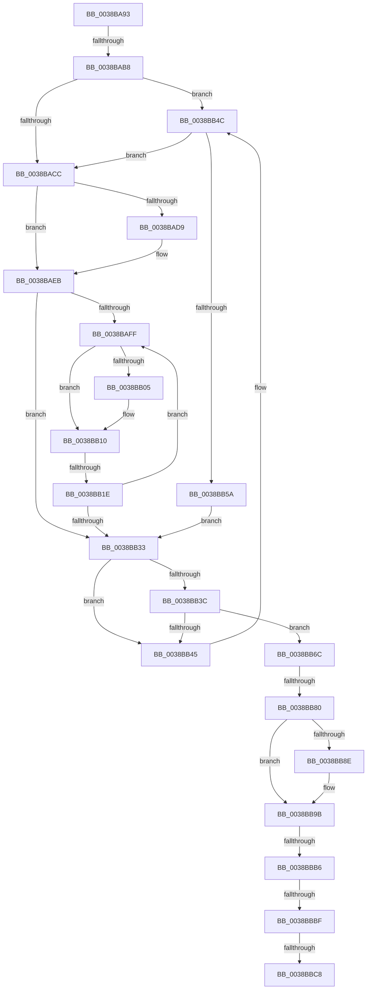

# sub_0038BA93

- RVA: `0x0038BA93`–`0x0038BBE0` (길이 `333` bytes)
- VA: `0x000000014038BA93`
- 실행 섹션: `.text`
- PDB 이름 있음: `아니요`; PDB Function 태그: `아니요`
- unwind 정보 RVA: `0x00080140`
- 디코드: `82`개 명령, `333/333` bytes 표시
- 미해석 바이트: `0` (있으면 어셈블리에 `.byte`로 보존)

> 이 문서는 커널 이미지의 기계어와 PDB 기호를 분석해 생성했습니다. 4번과 5번은 함수 원형과 자료형을 바이너리 사용 방식에서 추정한 C 해석이며 원본 소스 복구 결과는 아닙니다.

## 1. Dependencies

- 직접 호출 지점: **3**; 고유 호출 대상: **3**
- 직접 호출자로 확인된 함수: **0**
- RIP 상대 이미지 참조: **7**

### Outgoing calls
- `0x0038BAE4` → [ExpWaitForSpinLockExclusiveAndAcquire](../32/ExpWaitForSpinLockExclusiveAndAcquire_function_003239A0.md) (function, `0x003239A0`)
- `0x0038BB65` → [ExpAcquireSpinLockExclusiveAtDpcLevelInstrumented](../32/ExpAcquireSpinLockExclusiveAtDpcLevelInstrumented_function_00323A70.md) (function, `0x00323A70`)
- `0x0038BB96` → [KiLowerIrqlProcessIrqlFlags](../4F/KiLowerIrqlProcessIrqlFlags_function_004F5698.md) (function, `0x004F5698`)

### Direct callers
- 이 함수 시작 RVA로 연결되는 직접 call은 확인되지 않았습니다. 간접 호출은 완전히 역산할 수 없습니다.

### Static image references
- `0x0038BAAB` → RVA `0x00FC6D20` (`ALMOSTRO`; read)
- `0x0038BABF` → RVA `0x00FC6B06` (`ALMOSTRO`; read)
- `0x0038BACC` → RVA `0x00FCF0C0` (`CACHEALI`; read/write)
- `0x0038BADD` → RVA `0x00FCF0C0` (`CACHEALI`; read)
- `0x0038BB12` → RVA `0x00FC52AC` (`ALMOSTRO`; reference)
- `0x0038BB4C` → RVA `0x00F0DE58` (`.data`; read)
- `0x0038BB80` → RVA `0x00FCF0C0` (`CACHEALI`; write)

## 2. Other-region calls and transfers

- 다른 실행 섹션으로 향하는 call: **0**
- call이 아닌 외부 분기/꼬리 이동: **6**
  - `0x0038BAB2` → [sub_0038BBE9](Unknown_function_0038BBE9.md) (`tail-transfer`)
  - `0x0038BB18` → [sub_0038BBFB + 0x6F](Unknown_function_0038BBFB.md) (`tail-transfer`)
  - `0x0038BB7A` → [sub_0038BBFB + 0x96](Unknown_function_0038BBFB.md) (`tail-transfer`)
  - `0x0038BBB4` → [sub_0038BBE1](Unknown_function_0038BBE1.md) (`tail-transfer`)
  - `0x0038BBBD` → [sub_0038BBFB](Unknown_function_0038BBFB.md) (`tail-transfer`)
  - `0x0038BBC6` → [sub_0038BBFB + 0x3D](Unknown_function_0038BBFB.md) (`tail-transfer`)

## 3. Assembly (complete function range)

```asm
0038BA93  48 89 6C 24 50                  mov qword ptr [rsp + 0x50], rbp
0038BA98  4C 89 74 24 30                  mov qword ptr [rsp + 0x30], r14
0038BA9D  44 0F 20 C5                     mov rbp, cr8
0038BAA1  41 BE 02 00 00 00               mov r14d, 2
0038BAA7  45 0F 22 C6                     mov cr8, r14
0038BAAB  83 3D 6E B2 C3 00 00            cmp dword ptr [rip + 0xc3b26e], 0
0038BAB2  0F 85 31 01 00 00               jne 0x14038bbe9
0038BAB8  33 F6                           xor esi, esi
0038BABA  48 89 7C 24 60                  mov qword ptr [rsp + 0x60], rdi
0038BABF  F6 05 40 B0 C3 00 21            test byte ptr [rip + 0xc3b040], 0x21
0038BAC6  0F 85 80 00 00 00               jne 0x14038bb4c
0038BACC  F0 0F BA 2D EB 35 C4 00 1F      lock bts dword ptr [rip + 0xc435eb], 0x1f
0038BAD5  8B FE                           mov edi, esi
0038BAD7  73 12                           jae 0x14038baeb
0038BAD9  40 0F B6 D5                     movzx edx, bpl
0038BADD  48 8D 0D DC 35 C4 00            lea rcx, [rip + 0xc435dc]
0038BAE4  E8 B7 7E F9 FF                  call 0x1403239a0
0038BAE9  8B F8                           mov edi, eax
0038BAEB  8B 15 CF 35 C4 00               mov edx, dword ptr [rip + 0xc435cf]
0038BAF1  8B CA                           mov ecx, edx
0038BAF3  0F BA F1 1E                     btr ecx, 0x1e
0038BAF7  81 F9 00 00 00 80               cmp ecx, 0x80000000
0038BAFD  74 34                           je 0x14038bb33
0038BAFF  0F BA E2 1E                     bt edx, 0x1e
0038BB03  72 0B                           jb 0x14038bb10
0038BB05  F0 81 0D B0 35 C4 00 00 00 00 40  lock or dword ptr [rip + 0xc435b0], 0x40000000
0038BB10  FF C7                           inc edi
0038BB12  85 3D 94 97 C3 00               test dword ptr [rip + 0xc39794], edi
0038BB18  0F 84 4C 01 00 00               je 0x14038bc6a
0038BB1E  F3 90                           pause
0038BB20  8B 15 9A 35 C4 00               mov edx, dword ptr [rip + 0xc4359a]
0038BB26  8B C2                           mov eax, edx
0038BB28  0F BA F0 1E                     btr eax, 0x1e
0038BB2C  3D 00 00 00 80                  cmp eax, 0x80000000
0038BB31  75 CC                           jne 0x14038baff
0038BB33  48 8B 03                        mov rax, qword ptr [rbx]
0038BB36  48 39 58 08                     cmp qword ptr [rax + 8], rbx
0038BB3A  75 09                           jne 0x14038bb45
0038BB3C  48 8B 53 08                     mov rdx, qword ptr [rbx + 8]
0038BB40  48 39 1A                        cmp qword ptr [rdx], rbx
0038BB43  74 27                           je 0x14038bb6c
0038BB45  B9 03 00 00 00                  mov ecx, 3
0038BB4A  CD 29                           int 0x29
0038BB4C  8B 05 06 23 B8 00               mov eax, dword ptr [rip + 0xb82306]
0038BB52  85 C0                           test eax, eax
0038BB54  0F 85 72 FF FF FF               jne 0x14038bacc
0038BB5A  40 0F B6 D5                     movzx edx, bpl
0038BB5E  48 8D 0D 5B 35 C4 00            lea rcx, [rip + 0xc4355b]
0038BB65  E8 06 7F F9 FF                  call 0x140323a70
0038BB6A  EB C7                           jmp 0x14038bb33
0038BB6C  48 89 02                        mov qword ptr [rdx], rax
0038BB6F  48 89 50 08                     mov qword ptr [rax + 8], rdx
0038BB73  F6 05 8C AF C3 00 01            test byte ptr [rip + 0xc3af8c], 1
0038BB7A  0F 85 11 01 00 00               jne 0x14038bc91
0038BB80  89 35 3A 35 C4 00               mov dword ptr [rip + 0xc4353a], esi
0038BB86  39 35 94 B1 C3 00               cmp dword ptr [rip + 0xc3b194], esi
0038BB8C  74 0D                           je 0x14038bb9b
0038BB8E  44 0F 20 C1                     mov rcx, cr8
0038BB92  40 0F B6 D5                     movzx edx, bpl
0038BB96  E8 FD 9A 16 00                  call 0x1404f5698
0038BB9B  40 0F B6 C5                     movzx eax, bpl
0038BB9F  44 0F 22 C0                     mov cr8, rax
0038BBA3  48 89 33                        mov qword ptr [rbx], rsi
0038BBA6  48 89 73 08                     mov qword ptr [rbx + 8], rsi
0038BBAA  8B 43 38                        mov eax, dword ptr [rbx + 0x38]
0038BBAD  48 8B 7B 30                     mov rdi, qword ptr [rbx + 0x30]
0038BBB1  41 84 C6                        test r14b, al
0038BBB4  74 2B                           je 0x14038bbe1
0038BBB6  48 83 E7 FC                     and rdi, 0xfffffffffffffffc
0038BBBA  48 85 FF                        test rdi, rdi
0038BBBD  75 3C                           jne 0x14038bbfb
0038BBBF  48 8B 7B 10                     mov rdi, qword ptr [rbx + 0x10]
0038BBC3  48 85 FF                        test rdi, rdi
0038BBC6  75 70                           jne 0x14038bc38
0038BBC8  48 8B 7C 24 60                  mov rdi, qword ptr [rsp + 0x60]
0038BBCD  33 C0                           xor eax, eax
0038BBCF  48 8B 6C 24 50                  mov rbp, qword ptr [rsp + 0x50]
0038BBD4  4C 8B 74 24 30                  mov r14, qword ptr [rsp + 0x30]
0038BBD9  48 83 C4 38                     add rsp, 0x38
0038BBDD  5E                              pop rsi
0038BBDE  5B                              pop rbx
0038BBDF  C3                              ret
```

## 4. C-style interpretation (structured pseudocode)

```c
__int64 __fastcall sub_0038BA93(__int64 a1, __int64 a2, __int64 a3, __int64 a4, __int64 a5, __int64 a6, __int64 a7, __int64 a8, __int64 a9, __int64 a10, __int64 a11, __int64 a12)
{
    __int64 result;
    __int64 v_rdi;
    __int64 v_rsi;
    __int64 v_rsp;
    unsigned __int64 v_stack_p30;
    unsigned __int64 v_stack_p50;
    unsigned __int64 v_stack_p60;

    v_stack_p50 = v_rbp;
    v_stack_p30 = v_r14;
    v_rsi = 0;
    v_stack_p60 = v_rdi;
    if (((*(unsigned __int8 *)(v_rip + 12824640)) & (33)) != 0) goto loc_0038BB4C;
loc_0038BACC:
    v_rdi = 0;
    if (!(condition_is_above_or_equal)) {
        a2 = (unsigned __int8)(v_cr8);
        a1 = v_rip + 12858844;
        result = ExpWaitForSpinLockExclusiveAndAcquire(a1, a2, a3, a4);
        v_rdi = (unsigned int)(result);
    }
    if (((unsigned int)((unsigned int)((unsigned int)((unsigned int)(*(unsigned int *)(v_rip + 12858831)))))) == 0x80000000ULL) goto loc_0038BB33;
loc_0038BAFF:
    if (((unsigned int)((unsigned int)((unsigned int)((unsigned int)(*(unsigned int *)(v_rip + 12858831)))))) >= 0x80000000ULL) {
    }
    v_rdi = (unsigned int)((v_rdi) + 1);
    if (((unsigned int)((unsigned int)((unsigned int)((unsigned int)(*(unsigned int *)(v_rip + 12858778)))))) != 0x80000000ULL) goto loc_0038BAFF;
loc_0038BB33:
    if ((*(unsigned __int64 *)(*(unsigned __int64 *)(v_rbx) + 8)) != v_rbx) goto loc_0038BB45;
    if ((*(unsigned __int64 *)(*(unsigned __int64 *)(v_rbx + 8))) == v_rbx) goto loc_0038BB6C;
loc_0038BB45:
loc_0038BB4C:
    if ((unsigned int)((unsigned int)(*(unsigned int *)(v_rip + 12067590))) != 0) goto loc_0038BACC;
    result = ExpAcquireSpinLockExclusiveAtDpcLevelInstrumented(v_rip + 12858715, (unsigned __int8)(v_cr8), a3, a4);
    goto loc_0038BB33;
loc_0038BB6C:
    *(unsigned __int64 *)((unsigned __int8)(v_cr8)) = result;
    *(unsigned __int64 *)(result + 8) = (unsigned __int8)(v_cr8);
    *(unsigned int *)(v_rip + 12858682) = 0;
    if ((*(unsigned int *)(v_rip + 12824980)) != 0) {
        a1 = 2;
        a2 = (unsigned __int8)(v_cr8);
        result = KiLowerIrqlProcessIrqlFlags(a1, a2, a3, a4);
    }
    *(unsigned __int64 *)(v_rbx) = 0;
    *(unsigned __int64 *)(v_rbx + 8) = 0;
    v_rdi = (*(unsigned __int64 *)(v_rbx + 48)) & (-4);
    result = 0;
    v_rsp = (v_rsp) + (56);
    return result;
}
```

## 5. (Beta) C Style

```c
int64_t sub_0038BA93(int64_t Arg1, int64_t Arg2, int64_t Arg3, int64_t Arg4, uint64_t Arg5, int64_t Arg6, uint64_t Arg7, uint64_t Arg8, uint64_t Arg9, int64_t Arg10, uint64_t Arg11, int64_t Arg12)
{
    int64_t result;
    int64_t local_rdi;
    int64_t local_rsi;
    int64_t local_rsp;
    uint64_t v_stack_p30;
    uint64_t v_stack_p50;
    uint64_t v_stack_p60;

    v_stack_p50 = local_rbp;
    v_stack_p30 = local_r14;
    local_rsi = 0;
    v_stack_p60 = local_rdi;
    if (((*(uint8_t *)(v_rip + 0xC3B040)) & (33)) != 0) goto loc_0038BB4C;
loc_0038BACC:
    local_rdi = 0;
    if (!(condition_is_above_or_equal)) {
        Arg2 = (uint8_t)(v_cr8);
        Arg1 = v_rip + 12858844;
        result = ExpWaitForSpinLockExclusiveAndAcquire(Arg1, Arg2, Arg3, Arg4);
        local_rdi = (uint32_t)(result);
    }
    if (((uint32_t)((uint32_t)((uint32_t)((uint32_t)(*(uint32_t *)(v_rip + 0xC435CF)))))) == 0x80000000ULL) goto loc_0038BB33;
loc_0038BAFF:
    if (((uint32_t)((uint32_t)((uint32_t)((uint32_t)(*(uint32_t *)(v_rip + 0xC435CF)))))) >= 0x80000000ULL) {
    }
    local_rdi = (uint32_t)((local_rdi) + 1);
    if (((uint32_t)((uint32_t)((uint32_t)((uint32_t)(*(uint32_t *)(v_rip + 0xC4359A)))))) != 0x80000000ULL) goto loc_0038BAFF;
loc_0038BB33:
    if ((*(uint64_t *)(*(uint64_t *)(local_rbx) + 0x8)) != local_rbx) goto loc_0038BB45;
    if ((*(uint64_t *)(*(uint64_t *)(local_rbx + 0x8))) == local_rbx) goto loc_0038BB6C;
loc_0038BB45:
loc_0038BB4C:
    if ((uint32_t)((uint32_t)(*(uint32_t *)(v_rip + 0xB82306))) != 0) goto loc_0038BACC;
    result = ExpAcquireSpinLockExclusiveAtDpcLevelInstrumented(v_rip + 12858715, (uint8_t)(v_cr8), Arg3, Arg4);
    goto loc_0038BB33;
loc_0038BB6C:
    *(uint64_t *)((uint8_t)(v_cr8)) = result;
    *(uint64_t *)(result + 0x8) = (uint8_t)(v_cr8);
    *(uint32_t *)(v_rip + 0xC4353A) = 0;
    if ((*(uint32_t *)(v_rip + 0xC3B194)) != 0) {
        Arg1 = 2;
        Arg2 = (uint8_t)(v_cr8);
        result = KiLowerIrqlProcessIrqlFlags(Arg1, Arg2, Arg3, Arg4);
    }
    *(uint64_t *)(local_rbx) = 0;
    *(uint64_t *)(local_rbx + 0x8) = 0;
    local_rdi = (*(uint64_t *)(local_rbx + 0x30)) & (-4);
    result = 0;
    local_rsp = (local_rsp) + (56);
    return result;
}
```

## 6. Execution-region graph

[열기: 2D/3D 그래프와 함수 탐색 컨트롤 패널](../../../control-panel.html?section=text&rva=0x0038BA93&view=graph)

- 2D 그래프는 위에서 아래로 흐르고, 3D 그래프는 빈 공간을 드래그해 회전합니다. Shift+드래그는 이동, 휠은 확대·축소, 함수 노드 선택은 대상 보고서 이동입니다.

### Static fallback


